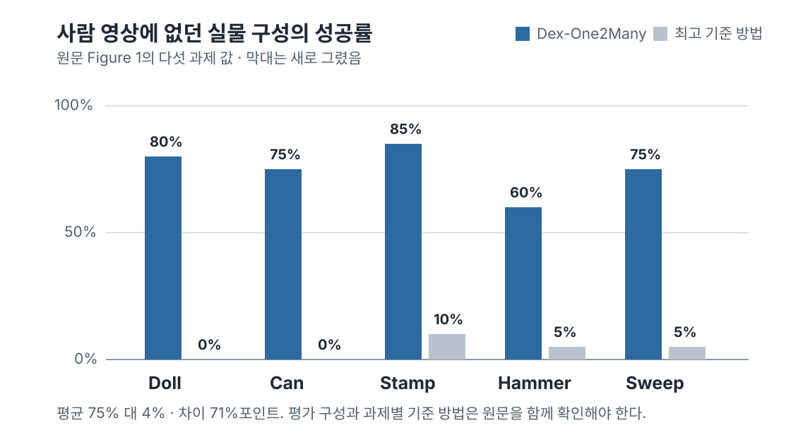
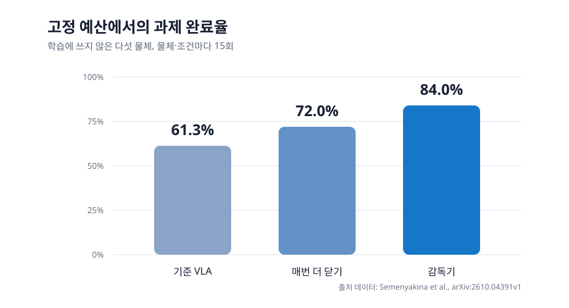

조작 시연을 저장할 때 카메라 영상, 관절 궤적, 촉각값을 빠짐없이 모으면 충분해 보입니다. 하지만 손과 센서가 달라지거나 물체 시작 위치가 바뀌면 같은 숫자와 같은 궤적은 곧바로 답이 아니게 됩니다. 이번 주 세 연구는 시연에서 다시 써야 할 단위를 원시값이 아니라 접촉 사건, 과제 관계, 그리고 보정이 허용되는 조건으로 나눕니다. 이 셋이 남아 있어야 사람 시연을 로봇 학습에 보태고, 한 번의 영상을 여러 시작 상태로 넓히며, 실행 중 보정도 필요한 때에만 걸 수 있습니다.

## 센서값보다 먼저 남길 것은 접촉 사건이에요

사람 손 장갑과 로봇 손의 촉각 센서는 같은 물체를 잡아도 같은 수를 내지 않습니다. 압력을 전기 신호로 바꾸는 방식, 센서가 놓인 자리, 읽는 촘촘함과 반응 시간이 다르기 때문이에요. <abbr title="서로 다른 촉각 센서의 신호를 접촉 사건 단위로 연결해 로봇 조작 학습에 쓰는 방법 이름">TACROSS</abbr>는 채널값을 일대일로 맞추는 대신, 닿기 시작함·하중 변화·안정됨·미끄러짐 의심·놓기처럼 조작에 필요한 사건을 공통 표현으로 만듭니다. [[2026-10-10_TACROSS가_접촉_사건으로_이종_촉각_시연을_연결한_방식|TACROSS가 접촉 사건으로 이종 촉각 시연을 연결한 방식]]은 이 표현이 사람 시연과 로봇 행동 정답을 어떻게 나누는지 다룹니다.

사람 시연은 그 표현을 넓히는 자료이고, 로봇 시연은 행동 정답을 맡습니다. 원문은 로봇 시연 30개와 사람 시연 150개를 쓴 네 과제에서 전체 구성이 평균 91.9% 성공률을 냈다고 보고합니다. 사람 촉각 입력을 뺀 조건은 73.1%, 접촉 사건 정렬을 뺀 조건은 49.4%였어요. 이 세 수치는 센서 하나나 정렬 단계 하나만의 효과가 아니라, 사람 촉각 자료를 로봇 행동에 연결한 전체 경로의 평가입니다.

따라서 시연 파일에는 원시 신호를 버리지 않되, 그 위에 사건 표지를 함께 둬야 합니다. 그리퍼가 닫히기 시작한 시각, 명령한 위치와 실제 위치가 벌어진 구간, 전류나 부하가 변한 구간, 물체를 지지했다고 판단한 근거, 놓기 직전의 상태를 같은 시간축에 묶는 방식입니다. 이렇게 남겨야 센서가 달라져도 "값이 얼마나 컸는가"가 아니라 "어느 손가락이 어떤 접촉 단계에 있었는가"를 비교할 수 있어요.

## 한 번의 손 경로 대신 과제 관계를 보관해요

접촉 사건만으로는 사람이 한 동작에서 무엇을 이루려 했는지 다 담기지 않습니다. <abbr title="사람 영상 한 편에서 과제의 관계를 뽑아 여러 조작 조건으로 넓히는 방법 이름">Dex-One2Many</abbr>는 손가락 궤적을 그대로 정답으로 두지 않고, 손과 물체가 닿기 전·잡은 상태·물체가 목표 영역에 들어간 상태처럼 관계가 바뀌는 지점을 단계로 남깁니다. 그래프에는 잡기·접촉·안에 있음과 그 순서가 들어가지만, 그때의 손 모양과 물체 좌표는 하나로 고정하지 않습니다. [[2026-10-11_Dex-One2Many가_단일_사람_영상의_동작을_관계_제약으로_바꾼_이유|Dex-One2Many가 단일 사람 영상의 동작을 관계 제약으로 바꾼 이유]]는 이 관계를 시뮬레이션의 시작 상태와 보상으로 옮깁니다.

이 관계는 시뮬레이션에서 두 일을 합니다. 각 단계에 맞는 시작 상태만 뽑아 마지막 접촉처럼 어려운 구간을 따로 연습하게 하고, 다음 관계에 가까워지는지를 보상으로 써 탐색이 무작정 퍼지지 않게 합니다. 사람 영상에 없던 초기·목표 자세의 실물 다섯 과제에서 제안 방법은 60~85% 성공률을, 비교 방법은 모두 15% 이하를 보고했습니다. 과제별 최고 기준 방법을 비교한 그림이므로 이 차이를 하나의 공통 기준 방법과의 평균 우열로 읽으면 안 됩니다.

<figure class="fig"><figcaption>한 번의 사람 영상에서 손 경로를 복제하는 대신 단계별 물체 관계를 남긴 조건의 영상 밖 구성 평가예요. 과제마다 비교한 최고 기준 방법이 다르므로 막대는 과제별로 읽어야 합니다. 수치는 원문 그림 1에서 다시 그린 차트입니다.</figcaption></figure>

시연 기록에서도 같은 구분을 적용할 수 있습니다. 물체에 다가감, 접촉, 파지 판정, 목표 영역 도달, 놓음 같은 단계에 각 관계가 충족됐는지 남기고, 최종 성공 여부와 분리해 세는 방식입니다. 좌표와 궤적은 재생과 진단에 필요하지만, 다른 시작 자세까지 같은 동작을 강제하는 정답으로 쓰기 전에 어떤 관계가 반드시 유지돼야 하는지부터 정해야 합니다.

## 보정은 사건이 있어도 항상 실행하지 않아요

관계와 사건을 기록해도, 로봇은 실행 중 어느 순간에 손을 더 닫을지 결정해야 합니다. <abbr title="고정된 로봇 정책 위에서 접촉 상태를 보고 손가락 보정과 재시도를 결정하는 논문의 방법 이름">AgenticTactileVLA</abbr>는 고정된 <abbr title="영상과 언어 지시, 로봇 상태를 받아 다음 행동을 만드는 로봇 정책">VLA</abbr>가 접근과 처음 손가락 목표를 내게 둡니다. 마지막 닫힘 구간에서는 명령한 위치와 실제 위치 차이로 지지 부족을 판정해 개입하고, 보정 중에는 모터 노력값이 계속 기준을 벗어나는지를 보조 근거로 더합니다. [[2026-10-07_AgenticTactileVLA가_고정_VLA의_접촉_보정을_분리한_방식|AgenticTactileVLA가 고정 VLA의 접촉 보정을 분리한 방식]]은 이 접촉 근거가 보정 횟수와 완료율을 어떻게 함께 바꾸는지 다룹니다.

학습에서 제외한 다섯 물체, 총 75개 짝맞춤 블록에서 기준 VLA의 완료율은 61.3%, 매번 끝까지 닫는 조건은 72.0%, 접촉 근거가 부족할 때만 개입한 감독기는 84.0%였습니다. 같은 75개 시험에서 항상 닫는 조건은 연장 동작을 101회 냈고 감독기는 보정 에피소드를 36회 냈습니다. 이 결과는 접촉 신호가 있으면 언제나 더 닫는다는 규칙보다, 사건의 근거와 개입 조건을 분리해 기록하고 실행하는 편이 해당 손과 평가 조건에서는 더 적은 보정으로 높은 완료율을 냈다는 범위의 증거입니다.

<figure class="fig"><figcaption>선택 개입은 늘 더 닫는 동작이 아니라, 지지 근거가 부족한 경우에만 보정을 거는 방식이에요. 세 조건은 같은 75개 짝맞춤 블록에서 비교됐습니다. 수치는 원문 표 2에서 다시 그린 차트입니다.</figcaption></figure>

이 판정은 모든 물체에서 파지가 안정적이라는 보증이 아닙니다. 부드러운 물체는 닿아도 저항 신호가 약할 수 있고, 얇은 컵처럼 눌리기 쉬운 물체에는 다른 순응 제어가 필요할 수 있어요. 그래서 기록에는 "접촉했다"만 남기지 말고, 어떤 관측으로 지지 부족을 판단했는지, 보정은 몇 번 일어났는지, 보정 뒤 유지·해제·재시도 중 무엇을 골랐는지를 함께 남겨야 합니다.

## 시연은 세 층의 판정 기록이어야 해요

세 연구를 한 기준으로 묶으면, 조작 시연은 영상과 수치의 저장소가 아니라 다음 실행이 물을 수 있는 판정 기록이 됩니다. 시간축에는 접촉 사건과 그 근거를, 단계축에는 물체 관계와 완료 판정을, 실행축에는 개입·유지·재시도의 조건과 결과를 둡니다. 원시 센서값과 궤적은 이 세 판정을 다시 확인할 수 있게 보존하되, 그것만으로 다른 손과 다른 초기 상태의 정답을 대신하게 두지는 않습니다.

저가 그리퍼나 로봇팔에서도 첫 단계는 큰 모델을 다시 학습하는 일이 아닐 수 있습니다. 그리퍼 명령·실제 위치·전류 또는 부하·카메라 시각을 같은 식별자로 묶고, 접촉 시작·파지 판단·목표 영역 도달·놓기를 표지한 뒤 단계별 통과와 최종 성공을 나눠 세는 일부터 할 수 있습니다. 그 기록이 있어야 센서를 바꿔도 어떤 사건을 보존해야 하는지, 시작 자세가 달라도 어떤 관계를 지켜야 하는지, 보정을 매번 걸지 않고도 어떤 증거에서 개입해야 하는지를 같은 실험 예산 안에서 비교할 수 있습니다.

---

<!-- src-block -->

출처 — https://arxiv.org/abs/2610.04391

출처 — https://arxiv.org/abs/2610.11945

출처 — https://arxiv.org/abs/2610.12470
