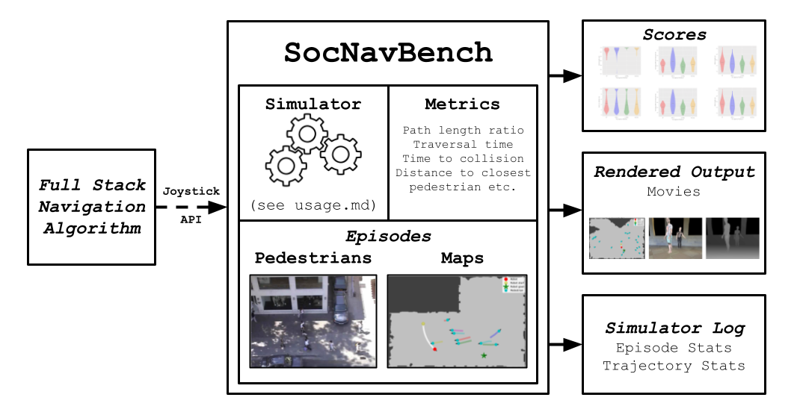
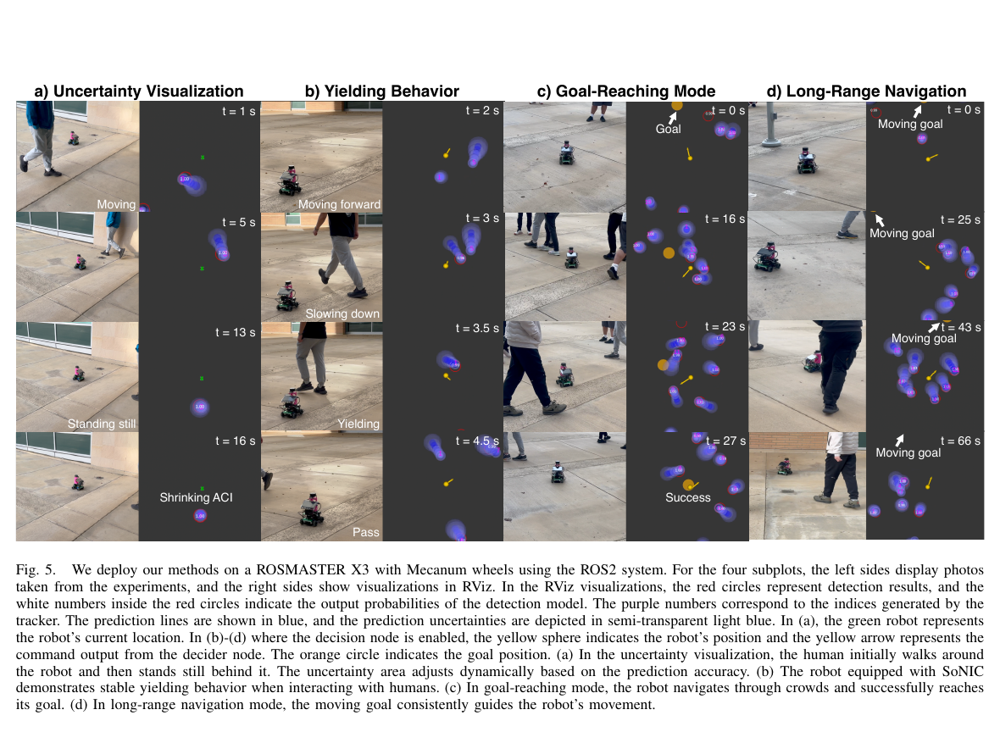

사람을 피하는 로봇은 사람과 얼마나 떨어졌는지로 평가하기 쉽습니다. 하지만 이번 주에 공개한 세 연구를 함께 보면, 거리는 결과의 한 장면일 뿐입니다. 사람을 언제 관측했는지, 그 관측으로 판단이 끝날 때까지 얼마나 걸렸는지, 늦은 명령이 어떤 장면에서 적용됐는지, 성공과 안전 개입을 어떤 분모로 셌는지가 함께 남아야 사회적 주행의 실패를 가를 수 있어요. 비용 함수를 더하기 전에 이 시간 계약을 확인하지 않으면, 같은 성공률도 전혀 다른 주행을 뜻할 수 있습니다.

## 기록된 사람은 로봇을 기다려 주지 않아요

<abbr title="실제 보행자 기록을 재생해 로봇 주행 계획기를 비교하는 평가 도구">SocNavBench</abbr>는 <abbr title="실제 보행자 궤적을 제공하는 두 공개 데이터 모음">UCY·ETH</abbr> 계열의 실제 보행 궤적을 33개 장면으로 재생합니다. 사람의 움직임을 인공 군중 모형으로 만들지 않는다는 장점이 있지만, 재생되는 사람은 로봇을 보고 속도를 늦추거나 길을 비켜 주지 않아요. 로봇 명령을 기다리는 동기 실행과, 시뮬레이터 시간이 계속 흐르는 비동기 실행을 나눈 이유도 여기에 있습니다. 계획기가 늦게 답하면 실제 장면에서는 사람과 로봇이 계속 움직이지만, 동기 실행에서는 그 시간이 멈춘 것처럼 처리될 수 있어요.

<figure class="fig"><figcaption>같은 장면을 실행한 뒤 점수뿐 아니라 영상과 궤적 기록을 함께 남기는 구조입니다. 계획기의 결과를 재현하려면 장면과 지표, 실행 방식도 같이 보존해야 해요. (출처: SocNavBench 공식 설명서 그림 1 · <abbr title="소프트웨어의 사용·수정·배포를 허용하는 공개 사용 허가">MIT 사용 허가</abbr>)</figcaption></figure>

평균값의 분모도 시간 계약 일부입니다. 이 벤치마크는 가장 가까운 사람 거리 10미터 초과와 충돌 예상 시간 10초 초과 값을 해당 평균에서 제외합니다. 멀리 떨어져 상호작용이 없는 장면이 평균을 낮추거나 높이지 않도록 한 선택이지만, 정책마다 평균에 남는 표본 수가 달라질 수 있습니다. 또 목표에 도달했더라도 사람과 충돌했다면 성공이 아니며, 끝까지 실행됐다는 완료와 성공도 다릅니다. 네 후보가 모두 완료한 29개 장면만 공통 비교에 쓴 결과를 33개 장면 전체의 결과처럼 읽으면 분모가 바뀝니다. [[2026-10-17_socialnav_socnavbench|SocNavBench가 실제 보행 궤적으로 플래너를 재는 방식]]에서 실행 방식과 지표 제외 규칙을 더 볼 수 있어요.

이 장면은 사람의 실제 반응을 보장하지 않습니다. 기록된 궤적은 로봇이 멈춰도 계속 흘러가므로, 재생에서 안전했던 정지가 실제 복도에서 사람과 함께 멈추는 교착을 피한다는 뜻은 아니에요. 그래서 재생 평가는 계획기의 시간 한계와 지표 정의를 먼저 고정하는 단계로 쓰고, 사람 반응이 필요한 판단은 별도 통제 시험으로 넘겨야 합니다.

## 예측 영역은 관측이 들어왔을 때만 생겨요

<abbr title="사람 움직임 예측의 오차를 온라인으로 반영해 사회적 주행 정책을 제한하는 방법">SoNIC</abbr>은 사람의 미래 위치를 하나의 점으로 믿지 않고, 최근 예측 오차에 따라 불확실성 영역을 만듭니다. 정책은 그 영역을 피하도록 학습하고, 영역 침범은 비용으로 기록해요. 목표 포함률을 90%로 둔 것은 예측 오차가 어느 정도 영역 안에 들어오게 하는 통계 조건입니다. 사람과 충돌하지 않는다는 물리 안전 보장과는 다릅니다.

이 구분은 입력이 끊길 때 더 중요해집니다. 실물 구성은 초당 약 여섯 번의 2차원 라이다 관측과 외부 노트북을 사용했습니다. 새 관측 사이 간격은 약 167밀리초예요. 사람 검출이 한 프레임이라도 빠지면, 예측기는 다음 위치뿐 아니라 어느 사람의 불확실성을 넓혀야 하는지도 잃을 수 있습니다. 영역이 없다는 상태를 안전하다고 기록하면, 추정기가 조심스러웠는지 관측 자체가 사라졌는지를 가릴 수 없어요.

<figure class="fig"><figcaption>실물 시험은 15×20미터보다 큰 야외 테라스와 외부 노트북 계산 구성을 사용했습니다. 열린 공간에서의 결과를 벽·가림·복도가 많은 환경이나 저전력 온보드 장치의 결과로 넓혀 읽지 않아야 합니다. (출처: SoNIC 원 논문 그림 5; 원 논문 그림 인용, 공개 재배포 라이선스 미확인)</figcaption></figure>

따라서 실행 기록에는 사람 위치와 예측 반경만 넣어서는 부족합니다. 관측 시각, 탐지 여부, 사람 식별자 유지 여부, 예측이 만들어진 시각, 반경이 초기값인지 보정값인지, 명령 적용 시각을 같은 실행 번호에 묶어야 합니다. 사람을 못 본 구간과 예측 오차가 커진 구간은 둘 다 로봇을 보수적으로 만들어야 할 수 있지만, 고칠 곳은 전혀 다릅니다. 전자는 센서·탐지·추적의 문제이고, 후자는 예측·보정·비용의 문제예요. [[2026-10-17_socialnav_sonic|SoNIC이 예측 오차를 주행 제약으로 바꾼 방법]]은 이 경계를 실물 장치 조건과 함께 설명합니다.

## 느린 맥락 판단은 빠른 안전을 대체하지 못해요

<abbr title="카메라 장면의 언어 판단을 행동 후보의 사회 비용으로 바꾸는 사회적 주행 방법">VLM-Social-Nav</abbr>는 카메라에서 사람·손짓·문을 찾으면 언어 모델에 방향과 속도 제안을 묻고, 그 답을 기존 지역 계획기의 사회 비용으로 넣습니다. 목표를 향한 진행과 장애물 회피는 기존 계획기가 계속 평가합니다. 언어 모델이 바퀴를 조종하는 대신, 후보 행동의 선호를 바꾸는 구조예요.

이 역할 분리는 응답 시간이 긴 계층을 안전 계층으로 오해하지 않게 합니다. 연구팀은 평균 응답을 약 3초, 선택지와 호출 시점을 제한한 뒤 2~3초로 보고했습니다. 네 실물 장면에서 제안 방법은 장면별 21회 시험 모두 목표에 도달했지만, 정면 접근의 충돌·안전 개입률은 14.29%였고 교차와 좁은 문도 각각 4.76%, 9.52%였습니다. 목표 도달 100%와 충돌·개입 0% 초과는 모순이 아닙니다. 목표에 도달한 사건과 사람이 개입하거나 충돌한 사건을 따로 센 결과이기 때문이에요.

시간 계약에는 응답 만료도 들어가야 합니다. 카메라 장면을 보고 만든 "감속" 제안이 도착했을 때, 사람 위치와 통로 상태가 이미 달라졌다면 그 답은 버려야 합니다. 지역 계획기와 충돌 감시는 최신 센서로 계속 갱신하고, 맥락 판단에는 생성 시각·만료 시각·파싱 실패·호출 생략을 남겨야 해요. 평균 응답이 짧아 보여도 <abbr title="실행 시간의 긴 쪽 5%가 넘지 않는 기준값">P95</abbr>와 타임아웃, 연속 실패가 길면 특정 장면에서는 오래된 판단이 반복될 수 있습니다. [[2026-10-17_socialnav_vlm-social-nav|언어모델을 저속 행동 점수기로 둔 사회적 로봇 주행]]에서 장면별 사건 수와 응답 시간의 경계를 확인할 수 있어요.

## 먼저 기록할 값이 비용보다 앞서요

세 연구는 서로 다른 도구와 장면을 썼으므로 성공률, 포함률, 충돌률을 평균 내 성능 순위로 만들 수 없습니다. 대신 같은 실행 번호에 아래 다섯 묶음을 남기면 실패를 훨씬 좁게 나눌 수 있어요.

| 묶음 | 남길 값 | 실패를 가르는 질문 |
| --- | --- | --- |
| 관측 | 센서 시각, 탐지 여부, 사람 식별자 | 사람이 없었나, 보지 못했나? |
| 예측 | 생성 시각, 불확실성 영역, 보정 상태 | 예측이 틀렸나, 아직 준비되지 않았나? |
| 판단 | 비용 항, 맥락 제안, 생성·만료 시각 | 어떤 선호가 언제 들어왔나? |
| 명령 | 계획 시작·종료, 적용 시각, 지연 | 장면이 바뀌기 전에 명령이 적용됐나? |
| 결과 | 목표 도달, 충돌, 안전 개입, 최소 거리, 표본 제외 사유 | 성공과 안전을 같은 사건으로 잘못 세지 않았나? |

이 표는 새 안전 보장을 만들지 않습니다. 다만 사람이 많은 공간에서 로봇이 머뭇거리거나 가까이 지나갔을 때, "사회 비용이 부족했다"는 한 문장으로 끝내지 않게 합니다. 재생 장면의 시간이 멈췄는지, 사람 관측이 끊겼는지, 예측이 보정 전이었는지, 느린 맥락 판단이 만료됐는지, 지표의 분모가 달랐는지를 차례로 확인할 수 있어요. 사회적 주행은 사람을 피하는 한 항의 문제가 아니라, 관측에서 명령까지 각 시각이 보존된 시스템으로 검증해야 합니다.

---

<!-- src-block -->

출처 — https://arxiv.org/abs/2103.00047

출처 — https://arxiv.org/abs/2407.17460

출처 — https://arxiv.org/abs/2404.00210
