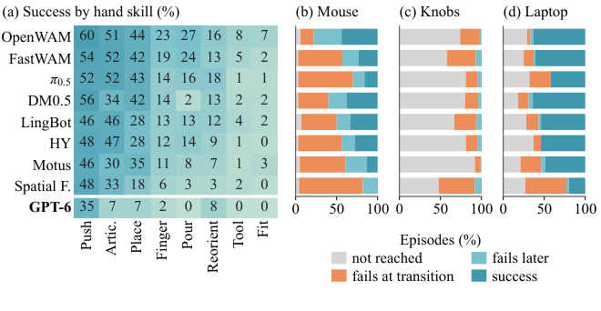
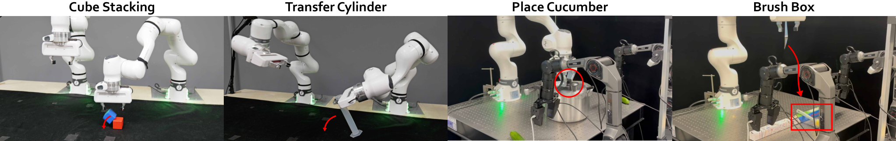

가상 로봇이 물체를 목표 위치까지 옮겼다면 학습 자료로 써도 될까요? 손과 물체의 위치가 맞았다는 검사만으로는, 물체가 마찰로 버텼는지와 손을 놓은 뒤에도 작업이 끝난 상태인지까지 알 수 없어요.

시뮬레이션에서 무엇을 남길지에 따라 검증해야 할 조건이 달라져요. 학습용 영상을 만들려면 영상과 행동의 대응이 필요하고, 접촉 제어를 평가하려면 힘에 따른 운동이 필요해요. 실물에서 다시 실행할 프로그램을 찾는다면 실제 작업대와의 좌표 대응, 실행 전 검사와 자료 수집 조건까지 이어져야 해요. **기하학적으로 가능한 행동, 물리적으로 유지되는 접촉, 과제의 완료는 각각 다른 통과 조건이에요.**

## 같은 가상 실행도 남기는 산출물이 달라요

<abbr title="실제 작업 공간을 복원하고 로봇 좌표에 맞춰 가상 조작 자료를 생성하는 연구 방법">AutoRSR</abbr>은 사람 영상의 물체 운동을 로봇이 실행할 궤적으로 바꾸고, 그 궤적과 외관을 변형해 학습 자료를 늘려요. 반면 <abbr title="실제 여러 로봇팔의 작업 공간을 가상 환경으로 복원해 프로그램 검증과 실물 실행을 연결하는 연구 시스템">CoEnv</abbr>는 가상 공간에서 실행할 프로그램을 찾은 뒤 실물 로봇으로 자료를 모으는 경로를 보여 줘요. 두 방식은 모두 실제 공간을 복원하지만, 학습에 들어가는 영상이 만들어지는 장소가 달라요. 복원 장면의 품질만 비교하면 이 차이를 놓쳐요.

<abbr title="가상 로봇 손의 조작 과제를 단계별 성공 조건으로 평가하는 연구 환경">HandsOn</abbr>은 과제의 성공과 실패를 나누는 기준을 제공해요. 물리 엔진 <abbr title="로봇과 물체의 운동을 계산하고 서로 다른 계산 방법을 연결할 수 있는 공개 도구">Newton</abbr>은 계산 방법 사이에서 접촉 반응을 전달하는 문제를 다뤄요. 이 네 자료를 하나의 성능표에 올리기보다, 어떤 검사가 다음 단계에 무엇을 보장하는지 비교하는 편이 유용해요. 영상 생성 방법이 접촉의 정확성을, 접촉 계산기가 과제의 완료를 자동으로 증명해 주지는 않기 때문이에요.

| 다음에 쓸 산출물 | 먼저 확인할 조건 | 그 검사만으로 남는 공백 |
| --- | --- | --- |
| 학습용 영상과 행동 | 같은 시각의 영상과 행동이 대응하는가 | 힘이 달라졌을 때도 행동이 성립하는가 |
| 접촉을 포함한 운동 기록 | 접촉 반응이 물체 운동에 반영되는가 | 목표 도달 뒤 과제가 유지되는가 |
| 과제 성공 표시 | 놓기와 유지까지 완료 조건에 들어가는가 | 실물에서도 같은 판정이 성립하는가 |
| 실물 수집용 프로그램 | 실제 좌표와 경로, 시작 상태가 맞는가 | 초기화와 실패 복구까지 자동인가 |

이 표는 네 연구의 점수를 합친 결과가 아니라 적용 범위를 가르는 점검 기준이에요. 한 행의 검사를 통과했다고 다음 행까지 승인하면, 실패를 발견했을 때 고칠 위치가 흐려져요. 반대로 모든 목적에 가장 정밀한 물리 계산을 요구할 필요도 없어요. 먼저 산출물이 어떤 판단에 쓰이는지 정하고, 그 판단에 필요한 증거를 선택해야 해요.

## 손에 연결한 물체는 잡기 안정성의 증거가 아니에요

AutoRSR은 실제 장면과 로봇 좌표의 회전·이동·크기 배율을 맞춰요. 외관과 부딪힘을 계산하는 표면이 같은 변환을 따라야 손이 보이는 물체와 계산상의 물체가 일치해요. 여기까지는 어느 위치로 접근해야 하는지를 정하는 조건이에요. 원문은 운반 구간에서 계산된 손끝 자세에 물체를 연결하고, 궤적의 기하학적 가능성을 거르지만 동적인 잡기 안정성까지 보장하지 않는다고 설명해요.

이 구분은 자료를 버릴지 결정하는 기준에도 영향을 줘요. 물체가 손에 연결된 구간을 포함한다고 해서 그 자료가 모든 학습 목적에 무효가 되는 것은 아니에요. 목표 위치에 접근하고 물체를 옮기는 영상과 행동의 대응을 배우는 데 사용할 수 있어요. 다만 그 구간을 근거로 집게의 마찰이나 미끄러짐 억제 성능까지 평가하면, 원래 계산하지 않은 현상을 측정했다고 주장하게 돼요. 같은 자료라도 무엇의 정답으로 쓰는지에 따라 승인 범위가 달라져요.

Newton의 <abbr title="현재 위치와 속도에서 다음 순간 물체 운동을 계산하는 방법">솔버</abbr> 결합은 이 공백을 다른 층에서 드러내요. 로봇팔과 케이블을 서로 다른 계산기가 담당한다면, 케이블이 집게에서 받은 반응을 팔 쪽에도 전달해야 해요. 문서의 <abbr title="다른 계산기가 담당하는 물체를 대리 물체로 두고 계산한 반응을 원래 물체에 돌려주는 연결 방식">프록시 결합</abbr>은 이 교환을 구성하는 방법이에요. 공통 장면에 두 물체가 보인다는 사실과 양쪽 운동에 힘이 반영된다는 사실은 다르며, 반응 전달 방식과 반복 설정도 결과를 바꿀 수 있어요.

여기서 물체를 손에 연결한 궤적과 힘을 교환하며 계산한 궤적을 같은 접촉 기록으로 취급하면 안 돼요. 전자는 정해 둔 상대 위치를 유지하는 표현이고, 후자는 물체와 제어 조건에 따른 운동을 계산하려는 표현이에요. 그렇다고 후자가 실물을 정확히 재현한다는 결론도 나오지 않아요. 잘못된 마찰이나 재료 특성으로도 그럴듯한 운동을 계산할 수 있으므로, 물리 계산의 작동과 실물 일치는 다시 나눠 확인해야 해요.

적용할 때는 운반 중 물체가 어떤 방식으로 유지되는지부터 기록할 수 있어요. 손에 고정했는지, 접촉력으로 버티는지, 놓는 순간 어느 계산으로 전환하는지 적으면 자료의 공백이 보이기 시작해요. 접촉 안정성이 중요한 과제라면 접근 성공 뒤에 미끄러짐과 놓은 뒤의 움직임을 관찰하는 실행을 추가해요. 이는 두 자료의 원리에서 도출한 점검 절차이며, 특정 장비에서 수행한 실험 결과는 아니에요.

## 목표에 닿은 순간과 작업을 마친 순간을 나눠요

힘이 계산돼도 완료 조건이 느슨하면 성공 표시는 부풀 수 있어요. HandsOn의 노트북 각도 과제는 목표에 한 번 닿는 일과 그 각도를 끝까지 유지하는 일을 구분해요. 양손 손잡이 과제에서도 왼쪽과 오른쪽이 각자 목표에 도달하는 사건만으로는 부족해요. 양쪽이 같은 시점에 목표 범위에 있고, 요구된 정지와 놓기 조건까지 충족해야 최종 성공이에요.

<figure class="fig" style="max-width:660px;margin-left:auto;margin-right:auto"><figcaption>HandsOn 원문 그림 5예요. 오른쪽은 회색의 미도달, 주황의 전환 중 실패, 연한 파랑의 이후 실패, 진한 파랑의 성공을 나눠요. 왼쪽 범용 모델은 과제당 10회, 학습한 모델은 원칙적으로 100회이며 무효 시행 하나는 제외돼요. 오른쪽은 학습한 여덟 모델의 결과예요. 색의 비율은 각 과제 안의 실패 위치를 읽는 자료이며 실물 성공률은 아니에요. (출처: Tianwei Luo 외, HandsOn, <a href="https://arxiv.org/html/2610.26765v1#S5.F5">그림 5</a> · <a href="https://creativecommons.org/licenses/by/4.0/">CC BY 4.0</a> · 원본 PNG, 변경 없음)</figcaption></figure>

이 그림을 CoEnv의 실물 실패와 함께 보면 판정 지점을 어디에 둘지 구체화할 수 있어요. 블록을 목표 위로 가져간 뒤 손을 열었을 때 미끄러진다면, 도달 검사는 통과했어도 놓은 뒤 안정성은 통과하지 못한 것이에요. 두 팔이 인계 위치에 도달해도 받는 손이 물체를 지지하기 전에 주는 손이 열리면 인계는 끝나지 않아요. 시뮬레이션의 단계별 진단은 이런 실물 실패를 기록할 질문을 제공하지만, 가상 환경에서의 비율을 실물의 예상 실패율로 옮길 수는 없어요.

<figure class="fig"><figcaption>CoEnv 원문 그림 8의 실물 실패 사례예요. 왼쪽부터 블록을 놓은 뒤 미끄러짐, 원통 인계 실패, 불안정한 뚜껑 잡기, 솔 이동 계획 실패를 보여 줘요. 첫 그림이 가상 과제의 실패 시점을 나눈다면, 이 그림은 실제 실행에서 위치와 접촉 오차가 드러난 장면을 보여 줘요. 붉은 표시는 원문 주석이며 통계적 빈도를 나타내지 않아요. (출처: Li Kang 외, CoEnv v2, <a href="https://arxiv.org/html/2604.05484v2#A5.F8">그림 8</a> · <a href="https://creativecommons.org/licenses/by/4.0/">CC BY 4.0</a> · 원본 PNG, 변경 없음)</figcaption></figure>

두 그림이 공유하는 것은 실패를 나누는 질문이에요. 목표에 못 갔는지, 접촉을 만들지 못했는지, 한동안 유지하다 잃었는지, 놓은 뒤 무너졌는지를 같은 실행 기록에서 추적할 수 있어요. 이 사건들은 서로 이어지므로 각각의 횟수를 더해 전체 시행 수로 만들면 중복될 수 있어요. 최종 종료 원인을 하나씩 분류한 표와 중간 사건이 발생한 표도 구별해야 해요.

새 과제에 이 방식을 옮긴다면 성공 표시를 켜는 순간만 정하지 말고, 그 뒤에 얼마나 상태를 관찰할지도 정해야 해요. 손을 놓자마자 관찰을 멈추는 조건과 놓은 뒤 흔들림을 지켜보는 조건은 실패를 볼 기회가 달라요. 같은 이유로 실행 제한 시간을 늘린 점수와 짧게 제한한 점수를 같은 결과로 취급할 수 없어요. 관찰 길이와 종료 규칙이 고정돼야 도달과 유지 사이의 차이를 정책의 차이로 읽을 수 있어요.

## 합성 자료의 전이 결과가 다르면 생성 위치를 먼저 비교해요

AutoRSR과 CoEnv는 합성 자료를 다르게 해석하게 하는 대조 사례예요. AutoRSR은 합성 실행으로 추가 학습한 정책의 실물 평가를 보고해요. CoEnv의 두 과제 실험에서는 사람 시연에 가상 실행을 더한 조건보다 프로그램으로 모은 실물 자료 조건이 나았어요. 이 관찰을 한쪽은 합성 자료가 유효하고 다른 쪽은 무효라고 일반화하면, 과제와 자료 구성, 수집 방식이 다른 비교를 한 주장으로 합치게 돼요.

| 원문 안의 비교 | 학습 자료 조건 | 실물 평가 범위 | 해석할 수 없는 것 |
| --- | --- | --- | --- |
| AutoRSR 표 1 | 사람 시연 150개와 합성 실행 1,000개를 별도 비교 | 세 과제, 과제별 15회 | 같은 자료 수에서의 효율, 모든 접촉 과제의 동등성 |
| CoEnv 표 2 | 사람 시연 20회, 가상 실행을 추가한 조건, 프로그램으로 모은 실물 자료 조건 | 두 과제, 정책별 과제당 10회 | 합성 자료 전반의 무효성, 서로 다른 수집량의 순수한 출처 효과 |

표의 수와 시행 수는 각 원문의 실험 조건이에요. 두 연구의 성공 횟수를 더하거나 평균 내지 않아요. AutoRSR이 다룬 세 과제와 CoEnv의 협동 과제는 로봇 구성과 관측, 행동 생성 경로가 달라요. 비교에서 가져올 수 있는 판단은 수치의 우열보다, 가상 환경이 무엇을 제공하고 어느 단계에서 실제 영상을 확보하는지 밝혀야 한다는 점이에요.

실제 카메라 자료가 필요하고 작업대를 반복해서 쓸 수 있다면, 가상 환경을 프로그램 탐색에 쓰는 구성이 후보가 돼요. 반대로 실물 실행 기회가 적고 좌표와 동작 관계를 보존하며 외관을 늘려야 한다면, 가상 자료 생성의 조건을 먼저 검토할 수 있어요. 이 선택은 어느 논문의 최고 점수가 높은지로 정하기 어려워요. 접촉 부위가 얼마나 가려지는지, 새 배치에서 행동이 얼마나 달라져야 하는지, 실제 초기화 비용이 얼마인지가 선택을 바꿔요.

## 다음 단계에 넘기는 증거를 작게 고정해요

시뮬레이션 자료를 대량 생성하기 전에는 대표 동작 하나에서 검사가 실제로 무엇을 읽는지 확인할 수 있어요. 좌표 정렬은 손끝과 물체가 같은 길이 기준으로 움직이는지 확인하고, 접촉 검사는 물체가 어떤 힘이나 구속으로 유지되는지 확인해요. 완료 검사는 손을 놓은 뒤에도 요구 상태가 남는지 확인해요. 한 번의 통합 성공 표시로 덮기보다 이 결과를 각각 저장하면, 뒤에서 실패했을 때 앞 단계의 어느 주장을 다시 검사해야 하는지 찾기 쉬워요.

외관을 바꿔 자료를 늘리는 조건도 같은 원리로 나눠요. 조명과 재질만 바꾼 영상은 새 움직임을 추가하지 않아요. 물체 치수나 마찰까지 바뀌었다면 이전 행동의 정답을 그대로 유지해도 되는지 다시 판단해야 해요. 원본 실행과 그 외관 변형을 학습용과 평가용으로 갈라 놓으면 익숙한 행동을 새 행동처럼 평가할 수 있으므로, 분리 기준은 생성 파일보다 원본 실행에 두는 편이 타당해요.

실물 자료 수집에서는 실행 성공과 무인 운영도 나눠야 해요. CoEnv의 해당 수집 실험은 성공한 실행만 자료에 넣었고, 초기 배치 선택과 실행 사이 장면 초기화에는 사람이 참여했어요. 프로그램을 재사용한다는 사실만으로 초기화와 실패 복구의 비용까지 사라지지는 않아요. 수집량을 계획할 때는 유효 자료 수 옆에 실패한 실행과 다시 준비한 횟수도 남겨야, 자동화가 어느 일을 줄였는지 판단할 수 있어요.

실무에서 승인할 대상은 시뮬레이터 전체보다 다음 단계에 건네는 산출물이에요. 기하 검사를 통과한 궤적에는 아직 검증하지 않은 힘 조건을, 물리 실행 기록에는 적용한 접촉과 제어 조건을, 성공 표시에는 놓기와 관찰 시간을 붙여요. 실물 자료에는 실제 촬영 여부와 초기화 방식까지 남겨요. 이 구분이 있어야 자료를 늘릴지, 접촉 계산을 바꿀지, 완료 판정을 고칠지 선택할 근거가 생겨요.

<!-- src-block -->
출처 — https://newton-physics.github.io/newton/latest/concepts/coupling.html
출처 — https://arxiv.org/abs/2610.26765
출처 — https://arxiv.org/abs/2610.20336
출처 — https://arxiv.org/abs/2604.05484v2
