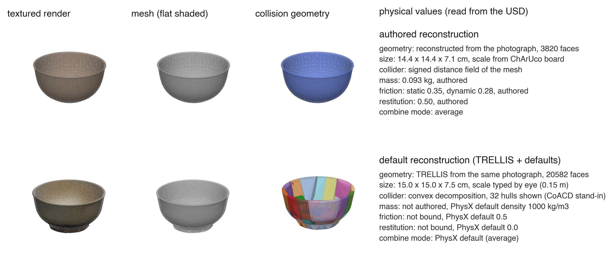
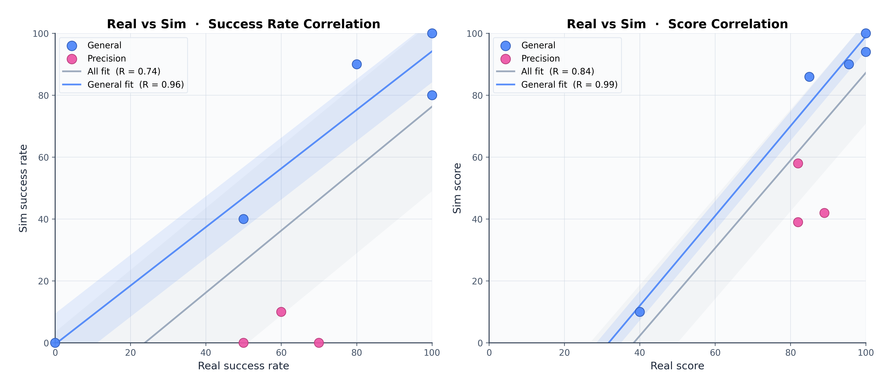

가상 로봇의 점수가 올랐을 때, 로봇이 좋아진 것인지 시험 환경이 쉬워진 것인지 어떻게 구분할까요? 실제 장비와 공간을 가상으로 대응시킨 <abbr title="실제 물체나 작업 공간을 가상 환경에 대응시켜 실험과 예측에 쓰는 모형">디지털 트윈</abbr>은 학습에 쓸 때와 평가에 쓸 때 개선의 방향부터 달라요.

학습용 환경은 실물에서 더 잘 행동하는 모델을 만드는 데 도움이 되어야 해요. 평가용 환경은 같은 모델의 실물 결과를 더 정확히 예측해야 해요. **시뮬레이션을 고친 효과는 가상 점수의 증감보다, 무엇을 고정한 비교에서 어떤 실물 오차가 줄었는지로 판단해야 해요.** 이 기준을 쓰면 자료 생성, 접촉 모델, 긴 작업의 완료 검사도 같은 성공률 표에 섞지 않고 선택할 수 있어요.

## 평가 환경을 고치면 가상 점수가 내려갈 수도 있어요

로봇의 관측에서 다음 행동을 정하는 모델을 <abbr title="카메라 영상이나 상태를 받아 다음 로봇 행동을 정하는 규칙 또는 학습 모델">정책</abbr>이라고 해요. 평가용 트윈을 바꿀 때는 정책을 고정해야 환경 변화의 효과를 읽을 수 있어요. 정책까지 함께 학습하면 높은 점수가 물체 복원 덕분인지, 새 환경에 적응한 행동 덕분인지 나누기 어려워져요. 반대로 정책 학습법을 비교한다면 평가 장면과 채점 규칙을 고정해야 해요.

Sanya Verma 외의 복원 비교는 같은 작업대를 두 방식으로 만들고 두 정책과 다섯 과제를 대조했어요. 과제별 만점에 대한 비율로 환산한 평균 점수 오차는 속성을 지정한 복원에서 6.97퍼센트포인트, 기본 복원에서 17.54퍼센트포인트였어요. 이는 가상 성공률이 오른 수치가 아니에요. 열 개의 정책·과제 조합에서 가상 평균이 같은 실물 평균에 얼마나 가까운지 측정한 값이에요. 형상·크기·물리 속성·배경이 함께 달라졌으므로 특정 속성 하나의 효과로 배분할 수도 없어요.

<figure class="fig"><figcaption>원문 그림 1의 그릇 패널이에요. 위는 속성 지정 복원, 아래는 기본 복원이고 세 번째 열이 부딪힘을 계산하는 형상이에요. 아래쪽은 그릇 안의 빈 공간을 메워, 외관에는 없는 장애물을 만들 수 있어요. 오른쪽 물리 속성은 지정값과 기본값의 비교이며 모두 실측한 값이라는 뜻은 아니에요. (출처: Sanya Verma 외, <a href="https://arxiv.org/html/2610.00731v2#S3.F1">그림 1 그릇 패널</a> · <a href="https://creativecommons.org/licenses/by/4.0/">CC BY 4.0</a> · 원본 PNG, 변경 없음)</figcaption></figure>

이 그림은 환경을 고치는 목적을 구체화해요. 실물에서 들어가지 못하는 위치까지 가상 손이 통과한다면, 그 통과를 막아 가상 점수가 내려가는 수정이 평가에는 도움이 될 수 있어요. 반대로 실제 그릇의 빈 공간을 가상 충돌 형상이 메우고 있다면, 그 공간을 되살려 점수가 올라가는 수정이 필요해요. 어느 방향이 맞는지는 점수의 높낮이로 정할 수 없고, 목적 접촉에서 실물과 같은 제한을 만드는지에 달려 있어요.

## 실물에서 좋아진 정책이 가상 점수로는 구별되지 않아요

학습용 환경에서는 반대 방향의 문제가 나타나요. 영상의 외관을 바꿔 학습한 정책이 실제 카메라 입력에 더 잘 버텨도, 익숙한 가상 장면만으로 시험하면 차이가 작을 수 있어요. 영상 생성 도구 <abbr title="가상 장면의 구조를 조건으로 받아 질감과 조명을 바꾸는 영상 생성 도구">Cosmos</abbr>를 사용한 산업 이동로봇 연구가 이 사례예요. 대상 시설의 가상 자료로 조정한 모델과, 여기에 생성 영상을 더한 모델을 구분해 비교해요.

| 고정 장애물 조건의 비교 | 가상 성공률 | 실물 성공률 |
| --- | ---: | ---: |
| 시설의 원래 가상 자료로 학습 | 72.0% | 54.8% |
| 같은 시설 자료에 생성 영상 추가 | 71.0% | 83.3% |

표는 원문 표 6의 같은 시나리오에 속한 두 모델이에요. 실제 물체 자세와 시작 방향을 가상 장면과 완전히 일치시키지는 못했고, 가상 쪽의 변화 범위도 더 넓어요. 따라서 시행별 정밀 오차나 다른 시설에서의 예상 성공률로 바꿀 수는 없어요. 그래도 가상 점수의 작은 차이만으로 생성 영상의 효과를 기각하면 실물에서 벌어진 차이를 놓친다는 근거는 돼요.

앞의 복원 연구와 나란히 보면 '가상 점수를 높였는가'라는 질문 하나로 두 개선을 평가하기 어렵다는 점이 드러나요. 복원 비교는 같은 정책을 넣어 환경의 예측력을 확인하고, 주행 비교는 학습 자료를 바꿔 정책의 실물 적응을 확인해요. 전자는 환경을 선택하는 시험이고 후자는 정책을 선택하는 시험이에요. 두 결과를 같은 개선율로 평균 내면, 무엇을 채택할지 결정하는 데 필요한 구분이 사라져요.

학습에 유리한 외관 변형과 평가의 실물 대응도 별도로 관리할 필요가 있어요. 학습에서는 한 관측 조건에만 기대지 않도록 외관을 넓히지만, 실물 대응 검사에서는 비교할 카메라와 장면 조건을 명시해야 해요. 원본과 변형본이 같은 행동을 공유한다면 자료 분리도 원래 실행 단위로 유지하는 편이 타당해요. 파일 수가 늘었다는 사실을 독립된 움직임을 더 관찰했다는 증거로 쓰지 않기 위해서예요.

## 전체 점수의 일치는 목적 과제의 일치를 대신하지 못해요

평가 체계 <abbr title="학습 자료와 평가 장면을 분리하고 가상 점수를 실제 로봇 결과와 대조하는 조작 평가 체계">X2Real</abbr>의 실물 대응 실험은 한 정책의 여덟 과제를 비교해요. 성공률의 <abbr title="두 점수가 함께 커지고 작아지는 경향을 나타내며 두 값 자체의 일치를 보장하지 않는 수치">선형 상관계수</abbr>는 일반 조작 다섯 과제에서 0.96이지만 정밀 조작을 포함하면 0.74예요. 진척 점수의 전체 상관은 0.84로, 성공률의 상관과도 달라요. 어느 값을 인용하든 과제 구성과 지표를 함께 남겨야 해요.

<figure class="fig"><figcaption>X2Real 원문 그림 20이에요. 가로축은 실물, 세로축은 가상 결과이고 왼쪽은 성공률, 오른쪽은 진척 점수예요. 파란 점은 일반 조작, 분홍 점은 정밀 조작이에요. 앞의 그릇 그림이 입력 모형의 차이를 보여 준다면, 이 그림은 과제 종류에 따라 남는 평가 오차를 보여 줘요. (출처: Lian Ruan 외, <a href="https://arxiv.org/html/2609.27449v2#S4.F20">그림 20</a> · <a href="https://creativecommons.org/licenses/by/4.0/">CC BY 4.0</a> · 원본 PNG, 변경 없음)</figcaption></figure>

안경을 선반에 놓는 과제는 실물 성공률 70%, 가상 0%였어요. 원문은 가상에서 놓기에 실패한 뒤 안경 다리가 접히면 정책이 익숙하지 않은 상태를 만나 복구하지 못하는 사례를 설명해요. 전체 상관이 높더라도, 이런 상태 변화가 중요한 과제에는 별도의 대조가 필요해요. 한 모델의 과제별 대응을 여러 모델의 순위 보존으로 확장해서도 안 돼요.

복원 비교에도 평균 점수가 가까워졌지만 실물의 초기 실패가 가상에서 나타나지 않는 조합이 남았어요. 이 두 연구가 만나는 질문은 어느 환경의 상관이 더 높은지가 아니에요. 평균 점수로 후보를 선별한 다음, 목적 작업에서 치명적인 실패가 같은 단계에 남는지 확인했는지가 중요해요. 두 연구는 로봇과 과제, 집계 단위가 달라 상관계수를 합쳐 신뢰도 하나를 만들 수 없어요.

평가가 허용하는 오류도 용도에 따라 달라져요. 많은 후보에서 분명히 약한 모델을 거르는 일에는 거친 점수도 쓸 수 있지만, 작은 차이로 최종 모델을 고르려면 점수의 흔들림과 절대 오차를 알아야 해요. 목적 과제가 정밀 삽입이라면 넓은 집기 과제의 평균으로 승인할 수 없어요. 비교 범위를 좁히는 것은 자료를 무시하는 일이 아니라, 실제 결정에 해당하는 표본을 고르는 일이에요.

## 힘을 맞춘 모델도 모든 실패를 예측하지는 않아요

접촉 저항이 중요한 문에서는 외관보다 힘의 모델을 고칠 이유가 생겨요. <abbr title="사람이 물체를 움직이며 측정한 힘과 자세로 가상 물체의 저항을 맞추는 연구 방법">ForceTwin</abbr>은 이런 힘을 측정해 물체의 운동 규칙을 추정해요. 문을 놓은 뒤 닫히는 시간을 실물과 가상에서 비교하면, 힘 모델이 전체 움직임을 얼마나 재현하는지 확인할 수 있어요. 그러나 닫힘 시간이 같다고 내부의 개별 물성이 유일하게 맞는 것은 아니에요.

원문에서 나무 문을 45도로 열어 놓았을 때 닫힘 시간은 실물 3.7초, 식별 모델 5.0초예요. 영상과 언어로 물성을 추정한 비교 모델보다 개선됐어도 이 조건의 오차는 남아요. 또 식별 모델을 쓴 실물 제어의 목표 진행률 87.3%는 손잡이를 이미 잡은 아홉 물체·로봇 조합의 평균이에요. 손잡이를 찾고 잡는 과정까지 포함한 완전 성공률로 읽을 수 없어요.

여기서 복원 연구와 힘 식별 연구는 서로 다른 수정 후보를 제공해요. 그릇 안쪽 공간이 막혔다면 접촉 표면부터, 문이 맞는 축으로 움직이지만 저항이 틀리다면 힘 모델부터 점검할 수 있어요. 다만 가구 모양이 비슷하다는 이유로 측정한 한 문의 저항을 다른 문에 옮길 근거는 없어요. 서랍 속 짐이나 닫힘 장치 설정이 달라졌다면 같은 물체에서도 검증 조건이 달라져요.

재검증 범위는 바꾼 속성의 영향을 따라 정하는 편이 좋아요. 외관 변경 뒤에는 행동과 영상의 대응을, 힘 변경 뒤에는 접촉 이후의 운동을, 성공 규칙 변경 뒤에는 같은 실행에 붙는 채점을 확인할 수 있어요. 모든 수정을 위해 학습 전체를 다시 돌리기 전에 변경 지점에 가까운 작은 대조를 두는 방식이에요. 이 순서는 연구들을 비교해 도출한 실험 설계 판단이며, 특정 장비에서 성능 개선을 측정한 결과는 아니에요.

## 검사기를 고칠 때는 무엇을 볼 수 있는지부터 정해요

검사 점수가 좋아져도 관측하지 않는 현상까지 신뢰 범위에 들어오지는 않아요. 합성 자료 정제 방법 <abbr title="생성 영상에 붙인 행동을 가상 로봇으로 재생해 영상과 움직임이 맞는 자료를 고르는 방법">RoboCurate</abbr>는 물체를 제외한 재생 환경으로 로봇 움직임을 비교해요. 이 환경은 영상에 붙인 행동이 팔을 어떻게 움직이는지 검사할 수 있지만, 병이 손에서 미끄러지는지는 계산할 대상이 없어요. 정교한 판별기를 더해도 이 공백은 남아요.

이 점을 ForceTwin과 연결하면 비싼 물리 모델을 언제 넣을지도 구분할 수 있어요. 관절 명령의 짝이 틀렸는지 검사하는 단계에는 물체의 모든 저항을 복원할 필요가 없어요. 반대로 문을 당길 때 멈추는 이유를 판단하려면 팔의 영상 일치만으로는 부족해요. 검사의 정밀도보다 먼저, 결정에 필요한 현상이 검사 입력에 포함되는지 확인해야 해요.

긴 작업 평가 <abbr title="같은 장면 계열에서 세부 목표를 늘려 긴 조작의 실패를 비교하는 평가 묶음">LADDER</abbr>에서는 완료 검사와 행동 실행을 나눠 볼 수 있어요. 시뮬레이터의 정답 상태를 아는 검증기를 사용해도 같은 행동 정책에 실패가 남아요. 완료 판단을 개선하면 모든 실행 문제가 풀린다는 기대를 제한하는 결과예요. 또한 상위 모델의 계산 중에는 가상 시간을 멈추므로, 성공률의 개선을 실제 경과 시간의 단축으로 바꿀 수 없어요.

두 연구를 함께 적용한다면 검사기가 틀린 경우와 검사 뒤 행동이 실패한 경우를 다른 기록으로 남길 수 있어요. 생성 자료 검사에서는 정상 자료를 얼마나 버렸는지, 긴 작업에서는 이미 완료한 목표를 다시 건드렸는지를 살펴요. 검사 통과율이나 최종 성공률 하나만 저장하면 특정 행동만 자료에 남는 문제와 실행 실패를 구분하기 어려워요. 검증 대상이 자료인지, 현재 상태인지, 앞으로 실행할 행동인지부터 적어 두는 편이 다음 수정을 고르기 쉬워요.

## 변경할 대상과 다시 대조할 증거를 묶어요

가상 환경을 바꾸기 전에 짧은 비교 계약을 둘 수 있어요. 아래 표는 연구별 순위가 아니라 어떤 결정을 내리려는지에 따른 점검 기준이에요. 각 행의 증거는 해당 목적에 필요한 일부이며, 다른 행의 검증을 자동으로 대신하지 않아요.

| 내리려는 결정 | 고정할 조건 | 다시 대조할 증거 |
| --- | --- | --- |
| 평가용 복원을 바꿀지 | 정책·과제·채점 | 실물과의 절대 점수 차이, 실패 단계 |
| 생성 영상을 학습에 더할지 | 기준 모델·시험 조건 | <abbr title="가상 자료로 배운 행동을 실제 로봇에서 실행했을 때 성능이 유지되는지 확인하는 일">실물 전이</abbr>, 관측과 행동의 대응 |
| 접촉 저항 모델을 바꿀지 | 대상 물체·제어기·목표 | 측정 힘, 운동 궤적, 시작 상태 |
| 검사기나 목표 전환을 바꿀지 | 행동 실행·정보·시간 예산 | 오판, 누락 목표, 재시도와 경과 시간 |

실행 기록도 이 계약을 따라 남기면 돼요. 정책 버전만 저장하지 말고 장면의 물리 설정, 자료를 나눈 기준, 채점 규칙과 종료 조건을 함께 남겨요. 새 환경에서 좋아진 점수는 이전 환경의 점수와 나란히 보되, 같은 시험이라는 전제를 자동으로 붙이지 않아요. 실물에서 반복하기 어려운 조건은 그 한계를 결과 옆에 두고 적용 범위를 좁혀요.

처음에는 모든 장면을 정밀하게 만들기보다 목적 과제 하나의 대표 실패를 고르는 편이 판단에 도움이 돼요. 막힌 빈 공간, 접힌 안경, 강한 문 저항처럼 정책의 다음 관측을 바꾸는 사건을 정하고, 수정 전후에 그 사건이 어떻게 달라지는지 비교해요. 평균이 개선됐어도 대표 실패가 사라지지 않으면 채택 범위를 제한할 수 있어요. 반대로 가상 점수가 비슷해도 실물에서 차이가 확인되면 그 효과를 버리지 않을 근거가 생겨요.

시뮬레이션에 요구할 것은 일관된 점수 상승이 아니에요. 학습에서는 실물 행동의 개선을, 평가에서는 실물 결과의 예측을, 진단에서는 실패 위치의 구분을 요구할 수 있어요. 다음 변경을 승인할 때는 이 중 어떤 역할을 개선했으며 어떤 조건에서는 다시 대조해야 하는지 함께 남겨요. 그래야 더 많은 자료와 더 정교한 모형 사이에서 필요한 수정을 고를 수 있어요.

<!-- src-block -->
출처 — https://arxiv.org/abs/2610.00731v2
출처 — https://arxiv.org/abs/2610.28432v3
출처 — https://arxiv.org/abs/2609.27449v2
출처 — https://arxiv.org/abs/2609.21751v1
출처 — https://arxiv.org/abs/2602.18742v2
출처 — https://arxiv.org/abs/2610.18053v1
