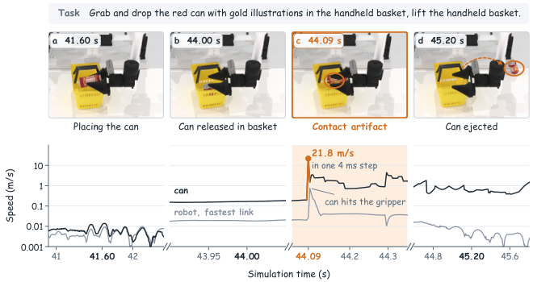
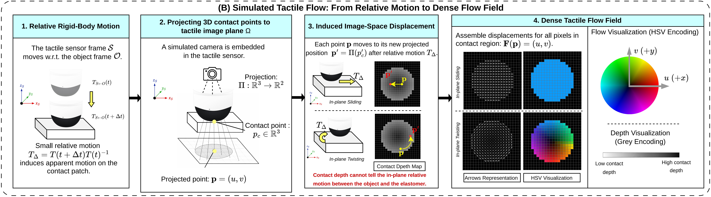
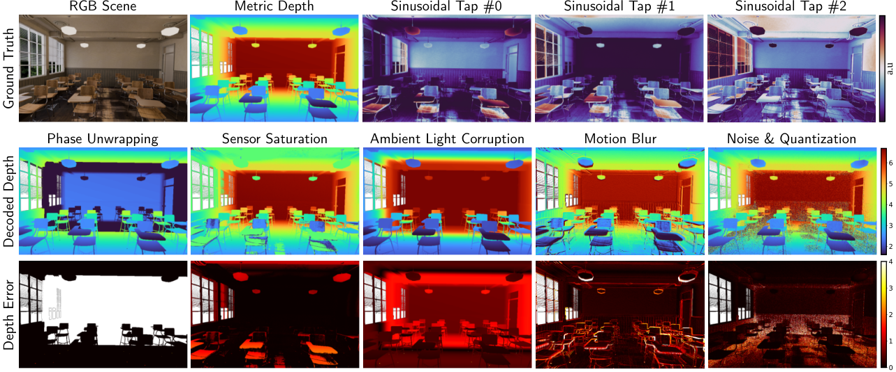

로봇이 놓은 캔이 바구니 밖으로 튀어 나갔다는 사실은 녹화 영상에도 남아요. 하지만 캔을 밀어낸 힘이 생긴 순간은 영상 두 장 사이에 있는 4밀리초짜리 물리 계산 한 번 안에 들어 있을 수 있어요. 시뮬레이터 안에서 물리 계산, 센서 관측, 자료 기록, 성공 판정은 서로 다른 간격으로 돌아가요. 각자 자기 시간 기준과 갱신 간격을 가진 시계를 따르는 셈이에요. 녹화 영상과 상태 기록이 물리 계산보다 성긴 시계로 남으면, 실패의 원인은 기록과 기록 사이에 들어갈 수 있어요.

접촉 계산, 수면 부력, 촉각 센서, 깊이 센서를 다룬 시뮬레이션 연구를 함께 보면 대상은 달라도 같은 문제가 반복돼요. **시뮬레이션 실패를 진단하려면 마지막 상태와 녹화 프레임보다, 이상이 처음 생긴 계산 시각과 그때까지의 최댓값, 그리고 각 기록이 어느 시계에 속하는지를 남겨야 해요.** 이 기준이 없으면 계산 오류로 튄 물체와 행동을 잘못 고른 로봇이 같은 실패 기록을 남기고, 다음 수정이 엉뚱한 쪽으로 향할 수 있어요.

## 한 번의 물리 계산에서 생긴 충격은 영상 사이에 숨어요

<abbr title="관측한 상태를 보고 로봇이 다음에 할 행동을 정하는 학습된 규칙이나 모델">정책</abbr>을 평가하는 시뮬레이터는 물리를 아주 짧은 간격으로 계산하고, 카메라 영상과 상태 기록은 그보다 드물게 남기는 경우가 많아요. 접촉 감사 도구 <abbr title="가상 로봇 평가의 물리 계산을 단계마다 기록하고 같은 행동을 다시 실행해 비정상 접촉의 원인을 찾는 도구">SimuGuard</abbr>가 추적한 사례에서 질량 10g의 캔은 한 번의 4밀리초 계산 동안 초속 약 0.2m에서 22m로 빨라졌어요. 그때 캔과 로봇은 닿아 있지 않았고, 로봇에서 가장 빠른 부위도 초속 0.1m보다 느렸어요. 영상에는 캔이 날아간 결과가 남지만, 무엇이 캔을 밀었는지는 그 계산 한 번의 접촉 보고를 봐야 알 수 있어요.

<figure class="fig"><figcaption>원문 그림 1이에요. 아래 그래프의 세로축은 로그 눈금이라 한 칸 올라갈 때마다 속도가 열 배가 돼요. 주황색 구간(장면 c, 44.09초)이 캔 속도가 초속 21.8m로 솟은 4밀리초 계산 단계예요. 직전 장면 b에서 캔은 이미 바구니 안에 놓여 있었고, 튀어 나간 결과는 장면 d에 보여요. 가로축은 네 구간을 끊어 이어 붙여 구간마다 시간 간격이 달라요. (출처: Alex Zhou 외, SimuGuard, <a href="https://arxiv.org/html/2610.41857v1#S1.F1">그림 1</a> · <a href="https://creativecommons.org/licenses/by/4.0/">CC BY 4.0</a> · 원본 PNG, 변경 없음)</figcaption></figure>

SimuGuard는 그래서 평가 코드의 물리 계산 함수를 감싸, 단계마다 계산 전의 관절 목표와 힘, 계산 후의 물체 위치·속도·접촉 정보를 남겨요. 접촉한 두 물체마다 <abbr title="한 번의 계산 동안 두 물체 사이에 전달된 힘의 양">충격</abbr>과 <abbr title="두 물체의 형상이 서로 파고들었다고 계산된 거리">겹침 깊이</abbr>도 기록해요. 이 기록이 있었기에 속도가 급변하기 직전의 접촉 보고를 거슬러 올라가, 물리 엔진 <abbr title="물체의 충돌과 힘에 따른 움직임을 계산하는 엔비디아의 물리 엔진">PhysX</abbr> 5.3.1의 거리 계산이 21mm 떨어진 두 형상을 27.5mm 겹쳤다고 보고한 사례까지 좁힐 수 있었어요. 영상 프레임 단위의 기록만으로는 '물체가 갑자기 튀었다'는 증상에서 멈추기 쉬워요.

물체를 집어 손이 닿지 않는 바구니에 던져 넣는 평가 환경 <abbr title="가상 로봇이 물체를 집어 던져 바구니에 넣는 과제로 물리적 성질에 맞춰 행동하는 능력을 비교하는 시험 환경">PhyDEX</abbr>의 자료 구성은 두 간격이 얼마나 벌어질 수 있는지 보여 줘요. 물리는 초당 120번 계산하고 자료는 초당 10번 기록해서, 기록 한 칸 사이에 물리 계산이 열두 번 진행돼요. 물체가 손가락 사이에서 미끄러지기 시작한 순간이나 손을 떠난 순간이 그 열두 번 가운데 어디였는지는 기록된 영상과 관절값만으로 정할 수 없어요.

두 연구의 수치를 한 표에 놓고 비교할 수는 없어요. SimuGuard의 4밀리초는 연구진이 분석한 평가 환경의 계산 간격이고, PhyDEX의 초당 120번은 다른 시뮬레이터와 다른 장면의 설정이에요. 그래도 기록 주기가 물리 계산 주기보다 성기면, 접촉 계산의 오류로 튄 물체와 정책이 잘못 던진 물체가 같은 최종 기록을 남길 수 있어요. PhyDEX에서 던지기 단계까지 간 시도 중 목적지에 들어간 비율은 약 5.6%였는데, 이 빗나간 시도들에 계산 오류가 섞였는지는 초당 10번의 기록만으로 답하기 어려운 질문이에요.

PhyDEX 연구진이 장면 설정과 동작을 다시 재생할 수 있는 자료를 함께 보관한 것은 이 점에서 쓸모가 있어요. 재생이 원래 실행을 그대로 다시 만든다면, 의심되는 시도만 골라 물리 단계마다 기록을 붙일 수 있거든요.

## 마지막 상태에는 중간의 이상이 남지 않아요

물리 엔진 <abbr title="로봇과 천·케이블·액체를 한 장면에서 계산하고 병렬 환경마다 계산 이상을 점검하는 시뮬레이션 도구">Alloy</abbr>는 병렬로 돌리는 가상 환경마다 계산 건강 등급을 붙여요. 검사한 이상이 없다는 OK, 실행은 이어지지만 문제가 발견됐다는 DEGRADED, 계산을 신뢰할 수 없어 그 환경을 멈추는 INVALID로 나뉘어요. 공식 문서는 현재 경고와 실행 중 최대 겹침 깊이를 따로 설명해요. 물체가 잠깐 깊게 파고들었다가 떨어지면 마지막 상태의 경고는 사라질 수 있어서, 최대 깊이 기록을 읽어야 중간의 이상을 찾을 수 있어요.

INVALID 환경은 마지막으로 보존한 양호한 상태로 돌아가 멈추고 다른 환경은 계속 진행해요. 그래서 고장 난 환경이 화면에서는 오히려 차분하게 보이기도 해요. 마지막 상태만 보는 기록은 두 방향으로 틀려요. 이상이 지나간 시행을 정상으로 세거나, 멈춘 환경에 명령을 더 보내고 위치 변화가 없다는 이유로 정책이 안정적이라고 채점할 수 있어요.

이 때문에 등급 하나만 저장하지 말고 최초 이상 시각, 실행 중 최대 겹침 깊이, 반복된 경고를 함께 남기는 편이 좋아요. 로봇이 먼저 넘어진 뒤 몸체가 바닥을 깊게 누르며 계산이 무효가 됐다면 첫 사건은 균형 실패일 수 있어요. 처음부터 물체가 겹친 채 놓여 있었다면 행동을 평가하기 전에 장면 구성이 잘못된 거예요. 두 경우를 가르는 근거는 마지막 등급이 아니라 첫 이상이 생긴 시각과 그 직전의 행동이에요.

중간 상태를 저장해 두었다가 거기서 다시 시작하면 원래 실행이 재현될 거라는 기대도 조심해야 해요. SimuGuard 연구진은 접촉 중인 장면을 중간 저장 상태에서 복원하면 물리 계산기의 내부 상태가 달라져 이후 위치가 어긋날 수 있다고 보고, 장면을 처음부터 다시 만든 뒤 첫 물리 단계부터 기록한 명령을 적용했어요. 평가 환경이 단계 사이에 바꾸는 값도 따로 복원했어요. 문 관절을 다시 설정하는 코드나, 성공 검사기가 실제 집게 상태 대신 집게에 내린 목표값을 읽는 경우가 그 예예요. 이렇게 맞춘 뒤 실패 기록 96개를 새 프로세스에서 재생했을 때 추적한 물체의 기록값이 모두 같았어요.

이 결과는 연구진이 재생을 시험한 환경에서 성립한 것이고, 재생 일치는 엔진과 계산 경로마다 따로 확인할 성질이에요. Alloy는 그래픽 처리 장치로 단단한 물체의 접촉을 계산하는 경로에서 여러 접촉이 동시에 생기면, 같은 <abbr title="무작위 배치나 선택을 같은 조건으로 다시 만들 때 쓰는 시작값">시드</abbr>를 써도 계산 결과가 완전히 같지 않을 수 있다고 문서에 밝혀요. 병렬 계산의 작은 차이가 쌓이면 집기처럼 민감한 접촉에서는 최종 위치가 갈라져요. 이런 경로에서는 평소에는 성기게 기록하고 의심 시행만 다시 돌려 촘촘히 기록한다는 전략이 흔들려요. 다시 돌린 실행이 원래 실패를 재현하지 못하면, 촘촘한 기록은 다른 실행에 대한 증거가 돼요.

재생을 진단 도구로 쓰기 전에는 수정하지 않은 재생이 원래 사건과 판정을 다시 만드는지부터 확인해야 해요. 재현이 확인된 조건에서는 의심 시행만 다시 돌려 단계별 기록을 붙일 수 있고, 재현이 보장되지 않는 조건에서는 원래 실행에서 최소한 최초 이상 시각과 최댓값을 남겨야 해요. 기록 비용도 따져야 해요. SimuGuard 연구진이 잰 단계 기록 비용은 시뮬레이터마다 달랐고, 캔과 바구니 사례를 분석한 평가 환경에서는 4밀리초 물리 단계마다 실제 계산 시간이 7.5밀리초에서 11.6밀리초까지 더해졌어요. 모든 학습 실행에 같은 기록을 상시로 켜기 어려운 이유예요.

## 같은 시뮬레이션 시각으로 묶어야 원인과 결과가 이어져요

수상 로봇 시뮬레이터 <abbr title="물 위를 다니는 무인 선박의 파도·부력·센서를 함께 계산하는 Isaac Sim 확장">ASTRA</abbr>는 화면에 그리는 수면 높이를 선체 부력 계산에도 써요. 선체 겉면의 점마다 그 위치의 수면 높이로 잠긴 깊이를 구하고, 이를 잠긴 부피와 힘의 작용점으로 바꿔요. 화면과 부력이 같은 수면을 쓰더라도, 나중에 기록을 비교할 때 기준 시각이 다르면 둘의 관계는 다시 어긋나요. 물리 계산과 화면 갱신의 속도가 다를 때 렌더링한 화면의 번호로 수면과 선체 자세를 짝지으면 서로 다른 순간의 값끼리 묶일 수 있어요. 수면 높이와 선체 자세는 같은 시뮬레이션 시각으로 남겨야 해요.

ASTRA의 측정값도 각자 다른 시계를 가져요. 논문에서 위성 위치와 관성 센서로 배의 위치를 구하는 위치 추정 모듈은 초당 61.8번, 거리 센서와 카메라로 물가를 분류하는 지도 모듈은 초당 2.2번 갱신됐고, 전체 센서와 부력 계산을 켠 장면은 그래픽 처리 장치 한 장에서 초당 약 35프레임으로 재생됐어요. 세 값은 위치 출력, 지도 출력, 화면 재생에 속하는 별개의 측정이에요. 지도에서 물가를 잘못 분류한 순간을 찾으려면 지도 갱신 시각, 그 지도에 들어간 센서 기록의 시각, 그때의 선체 자세를 함께 따라가야 해요. 지도 한 장이 만들어지는 동안 파도 위의 선체 자세는 여러 번 바뀔 수 있어요.

같은 시각으로 묶은 뒤에도 시차는 남아요. ASTRA 연구진은 추진기를 끈 배에서 선체 부근의 수면 높이와 배의 위아래 움직임을 비교했어요. 에너지가 가장 큰 파도 주파수에서 약한 파도는 <abbr title="특정 주기의 파도 높이 변화에 견줘 배가 얼마나 크게 움직였는지 나타내는 비율">진폭비</abbr> 1.02와 <abbr title="같은 주기로 오르내리는 두 신호 중 하나가 한 주기의 얼마만큼 늦는지 나타내는 값">위상 지연</abbr> 14도, 강한 파도는 진폭비 1.00과 위상 지연 20도였어요. 흔들림의 크기는 수면과 비슷해도 배는 수면보다 한 주기의 일부만큼 늦게 움직여요. 한 시각의 수면 높이를 같은 시각의 배 높이로 읽으면 이 지연을 오차로 착각하거나, 반대로 실제 오차를 지연으로 덮을 수 있어요.

학습형 시뮬레이터 <abbr title="로봇 행동에 따른 장면 변화를 삼차원 공간에서 예측하고 여러 시점의 영상과 촉각으로 바꾸는 학습형 시뮬레이터">3D World Simulator</abbr>에서도 세 가지 속도가 따로 나와요. 공식 프로젝트가 제시한 대화형 실행은 초당 50프레임 이상이고, 정책 학습에 쓴 시연 자료는 초당 10번 기록됐으며, 정책이 행동을 결정하는 주기는 또 별도의 설정이에요. 생성 자료로 배운 정책의 움직임이 실물에서 재현되지 않을 때, 실행 속도와 원자료의 시간 간격과 정책 결정 주기를 나눠 두어야 어느 쪽이 어긋났는지 좁힐 수 있어요.

## 두 관측을 묶는 간격도 센서 모사의 일부예요

촉각 시뮬레이터 <abbr title="가상 로봇의 손끝에서 눌림과 접촉면의 움직임을 함께 계산하는 촉각 시뮬레이터">TactileLab</abbr>은 손끝 센서 화면의 접촉 영역에 작은 화살표를 붙여요. 한 관측 시점과 다음 시점 사이에 물체 표면의 점이 센서 화면에서 얼마나 옮겨 갔는지를 나타내는 <abbr title="촉각 센서 화면에서 접촉한 물체 표면이 두 관측 사이에 어느 방향으로 얼마나 움직였는지 나타낸 화살표 지도">촉각 흐름</abbr>이에요. 같은 깊이로 눌린 손끝이라도 물체가 옆으로 미끄러지는지 제자리에서 비틀리는지는 이 흐름에서 드러나요.

<figure class="fig"><figcaption>원문 그림 2의 아래 패널이에요. 첫 칸의 상대 운동은 앞뒤 두 시각의 손끝 자세로 정의돼요. 세 번째 칸 아래 빨간 글씨는 접촉 깊이 지도만으로는 접촉면 안의 움직임을 알 수 없다는 설명이고, 오른쪽은 미끄러짐과 비틀림이 만드는 서로 다른 흐름이에요. 두 시각의 간격이 달라지면 같은 움직임도 다른 길이의 화살표가 돼요. (출처: Yijiong Lin 외, TactileLab, <a href="https://arxiv.org/html/2611.07881v1#S2.F2">그림 2</a> · <a href="https://creativecommons.org/licenses/by/4.0/">CC BY 4.0</a> · 원본 패널 그대로)</figcaption></figure>

흐름 한 장은 시간 간격을 품고 있어요. 같은 속도로 움직여도 두 관측 사이의 시간이 길면 화살표가 길어지고, 한 장을 건너뛰었거나 순서가 뒤집힌 두 장도 모양만 보면 정상 입력이에요. 연구진은 실제 센서 사진을 흐름으로 바꾸는 모델을 학습할 때, 시작 사진과 끝 사진을 센서의 한 관측 간격에 해당하는 변화로 취급해 가상 정답을 만들었어요. 새 장치에 옮길 때 두 장을 묶는 시점이 모델의 입력 크기만큼 중요한 설정이 되는 이유예요.

관측 기록의 길이도 같은 이유로 단계 수만으로 비교할 수 없어요. 손안 회전 학습에서 관절 상태 위주로 보는 제어기는 과거 기록을 대략 10단계에서 15단계까지 늘렸을 때 이득을 봤고, 깊이나 흐름을 받은 제어기는 5단계에서 10단계 사이에서도 높은 보상을 얻었어요. 흐름 한 번이 이미 두 시점 사이의 변화를 담고 있으니, 같은 단계 수라도 시간에 관한 단서의 양이 달라요. 제어 주기가 다른 손과 비교할 때는 단계 수보다 관측 한 번이 담는 시간을 먼저 맞춰야 해요.

센서 모사 도구 <abbr title="가상 장면의 빛과 움직임을 실제 장치가 기록할 법한 신호로 바꾸는 로봇 센서 시뮬레이터">VisionSIM</abbr>은 센서 안쪽의 시계를 다뤄요. 밝기가 주기적으로 바뀌는 빛을 쏘아 거리를 재는 <abbr title="밝기가 주기적으로 바뀌는 빛을 쏘고 되돌아온 빛이 얼마나 밀렸는지로 거리를 계산하는 깊이 센서 방식">iToF</abbr> 센서는 비교 기준을 바꿔 가며 여러 번 기록한 뒤, 그 기록을 묶어 거리 하나를 계산해요. 기록하는 사이에 카메라나 물체가 움직이면 한 픽셀의 기록 일부는 의자를, 일부는 뒤쪽 벽을 본 값이 돼요. 이 오차는 깊이 지도 전체에 고르게 뿌려진 잡음이 아니라 움직이는 물체의 윤곽을 따라 일정한 모양으로 나타나요.

<figure class="fig"><figcaption>원문 그림 2예요. 맨 위 오른쪽 세 칸이 기준을 바꿔 가며 얻은 중간 기록이고, 가운데 줄은 다섯 가지 오류 조건에서 복원한 깊이, 맨 아래 줄은 정답과의 오차예요. 네 번째 열의 움직임 조건에서는 오차가 책상과 의자 윤곽을 따라 밝게 나타나요. 마지막 열의 잡음과 대조하면 기록 순서가 만든 오류의 모양이 보여요. (출처: Jungerman 연구진, VisionSIM, <a href="https://arxiv.org/html/2611.08368v1#S4.F2">그림 2</a> · <a href="https://creativecommons.org/licenses/by/4.0/">CC BY 4.0</a> · 원본 PNG)</figcaption></figure>

정답 깊이 지도에 무작위 잡음을 얹는 방식으로는 이 패턴을 다루기 어려워요. 센서가 중간 기록을 언제 어떤 순서로 모았는지를 모사해야 같은 장면과 같은 움직임에서 같은 모양의 오류가 나와요. 다른 센서도 같은 제약을 받아요. VisionSIM이 공개한 실내 자료는 초당 100장으로 그린 기준 영상을 <abbr title="빛 알갱이 하나하나가 들어온 시각을 감지해 기록하는 카메라">단일 광자 카메라</abbr>용으로 160배, <abbr title="화면 전체를 일정 간격으로 찍지 않고 밝기가 바뀐 픽셀의 위치와 시각만 기록하는 카메라">이벤트 카메라</abbr>용으로 40배 촘촘하게 <abbr title="앞뒤 그림을 이용해 그 사이 시각의 모습을 추정해 채우는 방법">보간</abbr>해 만들었어요. 출력 간격은 촘촘해졌지만, 빠른 물체가 앞뒤 기준 영상에서 모두 가려져 있었다면 그 사이에 드러난 모습을 추정할 근거가 없어요. 보간으로 얻은 시간 간격과 처음 계산한 장면의 시간 간격은 따로 적어야 해요.

SimuGuard와 VisionSIM을 나란히 놓으면 같은 원칙이 물리 쪽과 센서 쪽에 각각 적용돼요. 물리 쪽에서는 계산 한 단계 안의 사건을, 센서 쪽에서는 측정 한 번 안의 기록 순서를 모사하거나 남겨야 해요. 두 연구는 대상과 장면이 달라 오차의 크기를 비교할 수 없지만, 어느 쪽에서 시각을 뭉뚱그려도 원인이 다른 실패가 같은 모양의 최종 기록으로 남는다는 점은 같아요.

## 평가가 끝나는 시각도 결과의 일부예요

PhyDEX 연구진이 전체 시도를 따라가 보니 물체를 잡아 던지기 단계에 이른 비율은 연구진이 보고한 평균으로 21.24%였고, 그중 목적지에 넣은 비율은 약 5.6%였어요. 이 평균이 어떤 모델과 과제를 묶은 값인지는 원문에 따로 밝혀져 있지 않아요. 두 비율을 곱한 최종 성공률 약 1.2%에는 물체를 쥘 기회조차 얻지 못한 시도와 잘 쥐고도 빗나간 시도가 함께 들어 있어요. 잡기, 들기, 놓기, 도착은 시간 순서로 일어나는 사건이라, 각 사건에 도달한 시도 수와 그 시각을 남기면 최종 0점 하나로 합쳐진 실패를 다시 나눌 수 있어요.

TactileLab의 실물 손안 회전 시험은 한 번에 최대 600번 명령, 시간으로 30초에서 끝났어요. 깊이만 쓴 제어기와 깊이와 흐름을 함께 쓴 제어기의 평균 종료 시간은 모두 30초였어요. 종료 시간만 보면 둘은 구분되지 않고, 그 30초 동안의 평균 회전 수 1.70회와 1.95회가 차이를 담아요. 표준편차가 각각 0.78회와 0.81회라 이 차이를 확정적인 우열로 읽기도 어려워요. 30초가 지난 뒤 어느 손이 먼저 물체를 놓칠지는 이 시험으로 알 수 없으니, 평가를 끊은 시각이 결과를 해석할 범위를 정한 셈이에요.

3D World Simulator의 주요 비교도 실제 관측으로 고치지 않고 200프레임 동안 이어 간 예측이에요. 이 구간의 평균 오차가 낮다는 사실은 그보다 긴 예측이나 접촉이 수천 번 반복되는 장면의 안정성을 말하지 않아요. 성공률, 종료 시간, 진척도는 모두 평가가 끝난 시각까지의 기록이라, 평가 길이를 바꾸면 같은 정책의 같은 지표도 다른 값이 될 수 있어요. 결과표의 지표 옆에 종료 조건과 종료 시각을 함께 적어야 하는 이유예요.

## 무엇을 어느 시각으로 남길지 먼저 정해요

아래 표는 연구별 순위가 아니라, 진단하려는 실패에 따라 기준으로 삼을 시각과 함께 남길 값을 정리한 것이에요. 각 행의 근거 연구는 그 행의 필요를 보여 준 사례이고, 다른 행의 검증을 대신하지 않아요.

| 진단하려는 실패 | 기준으로 삼을 시각 | 함께 남길 값 | 근거로 읽은 연구 |
| --- | --- | --- | --- |
| 손을 떠난 물체가 튀거나 빗나감 | 물리 계산 단계 | 접촉 쌍별 충격과 겹침 깊이, 단계 사이에 바뀐 상태 | SimuGuard, PhyDEX |
| 계산 무효나 과도한 겹침 | 최초 이상 시각 | 등급 이력, 실행 중 최대 겹침 깊이 | Alloy |
| 외란에 대한 몸체 응답 | 시뮬레이션 시각 | 외란 입력, 자세, 힘의 작용점 | ASTRA |
| 촉각이나 깊이 관측의 오류 | 센서 내부 기록 시각 | 두 관측의 시각과 순서, 중간 기록 | TactileLab, VisionSIM |
| 단계별 과제 실패 | 사건 시각 | 잡기·들기·놓기·도착에 도달한 시도 수 | PhyDEX |
| 오래 버틴 정책끼리의 비교 | 평가 종료 시각 | 종료 조건, 그때까지의 진척 | TactileLab |

모든 시각에서 모든 값을 남길 필요는 없어요. 촘촘한 기록은 실행을 느리게 하므로, 평소 실행에서는 사건 시각과 최댓값, 각 기록이 속한 시계의 이름과 주기를 남기고, 의심 시행은 재현이 확인된 재생에서 물리 단계마다 기록하는 방식이 현실적이에요. Alloy가 밝힌 그래픽 처리 장치의 접촉 계산처럼 재생 일치가 보장되지 않는 경로라면, 필요한 값은 원래 실행에서 남겨야 해요. 이 순서는 연구들을 비교해 끌어낸 실험 설계 판단이고, 특정 장비에서 진단 시간을 줄였다는 측정 결과는 아니에요.

시계가 다른 수치를 섞지 않는 것도 같은 규칙에 속해요. 초당 120번 계산한 물리, 초당 10번 남긴 기록, 초당 35프레임으로 재생한 화면은 모두 '속도'라는 말로 묶이지만 서로를 대신하지 않아요. 기록 파일에 값만 있고 그 값이 어느 시계의 몇 번째 칸인지가 없으면, 나중에 다른 기록과 맞춰 볼 방법이 사라져요.

실패를 하나 발견했을 때 먼저 물을 것은 그 실패가 어느 시계에서 일어났고, 지금 가진 기록이 어느 시계로 찍혔는지예요. 둘이 같지 않다면 정책을 다시 학습하거나 물리 설정을 바꾸기 전에, 실패가 일어난 시계로 기록부터 다시 남겨야 해요. 그래야 고친 결과가 행동의 개선인지, 계산의 수정인지, 기록 방식이 바뀐 효과인지 구별할 수 있어요.

<!-- src-block -->
출처 — https://arxiv.org/abs/2610.41857v1
출처 — https://arxiv.org/abs/2611.26565
출처 — https://arxiv.org/abs/2611.16312v1
출처 — https://arxiv.org/abs/2611.21789
출처 — https://arxiv.org/abs/2611.04492v1
출처 — https://arxiv.org/abs/2611.07881
출처 — https://arxiv.org/abs/2611.08368
