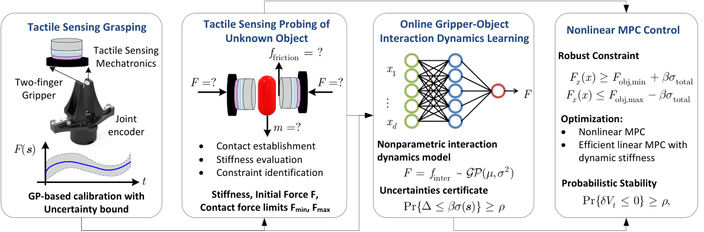

모르는 물체를 그리퍼로 잡을 때 필요한 힘은 하나의 고정값이 아닙니다. 힘이 모자라면 미끄러지고, 너무 크면 눌리거나 변형됩니다. <abbr title="촉각 신호로 물체별 파지력의 안전 범위를 찾아 제어하는 방법 이름">Tactile Sensing-based Secure and Gentle Grasping</abbr>은 이 두 경계를 미리 물체 분류로 정하지 않고, 잡는 과정에서 찾아 제어에 넣습니다.

<figure class="fig"><figcaption>원문 그림 2. 한 채널 촉각 신호의 보정, 물체 탐색, 접촉 동역학 학습, 제약을 포함한 제어기의 순서를 보여 줍니다. (출처: Han, Tactile Sensing-based Secure and Gentle Grasping of Unknown Objects · CC BY 4.0)</figcaption></figure>

## 필요한 힘은 아래와 위를 함께 정해야 해요

논문은 파지력을 두 조건 사이에 두려 합니다. 아래 경계는 물체의 무게와 마찰을 버틸 만큼 커야 한다는 조건이고, 위 경계는 물체가 손상되기 전의 최대 힘입니다. 물체의 질량, 표면, 단단함, 손가락이 닿은 모양이 모두 미지라면 두 경계를 계산으로 한 번에 알 수 없습니다.

그래서 방법은 잡는 과정에서 <abbr title="정해 둔 상태를 차례로 옮겨 가며 조건을 확인하는 제어 절차">유한 상태 기계</abbr>로 탐색 단계를 나눕니다. 물체를 놓치지 않을 최소 힘을 확인하고, 상한 쪽에서는 힘을 올려도 반응 힘이 더 늘지 않는 변화를 손상 위험 신호로 씁니다. 탐색 결과는 한 번 정한 뒤 고정하지 않습니다. 접촉이 바뀌면 하한도 달라질 수 있으므로 제어 중에도 제약을 갱신합니다.

## 한 채널 신호도 힘의 측정값으로 다듬어요

각 손가락에는 얇은 힘 감지 저항 하나가 들어갑니다. 이 센서는 법선 방향 힘만 읽고, 닿는 면적이나 위치가 바뀌어도 같은 힘과 다른 전기 신호를 낼 수 있습니다. 저자들은 센서 위에 탄성 패드를 두어 뾰족한 접촉을 넓게 퍼뜨리고, <abbr title="관측값 주변의 값을 추정하면서 그 추정이 얼마나 불확실한지도 함께 내는 통계 모델">가우시안 프로세스</abbr>로 원시 신호를 힘으로 보정했습니다.

이 보정값과 최근 그리퍼 움직임으로 물체와 그리퍼 사이의 반응을 계속 추정합니다. 이어서 <abbr title="앞으로의 반응을 미리 계산해 현재 명령을 고르는 제어 방식">모델 예측 제어</abbr>가 다음 힘 명령을 만들되, 추정 오차까지 포함해 하한 아래와 상한 위를 피하도록 제한합니다. 논문은 센서 측정을 1,000 Hz보다 빠르게 받고 제어는 100 Hz로 실행했다고 보고합니다. 카메라와 큰 촉각 배열을 쓰지 않아도, 센서값의 불확실성을 제약 폭에 넣는 구성이 남습니다.

여기서 센서값이 흔들린다는 사실을 없애려 하지 않는 점이 중요합니다. 보정 모델이 낸 불확실성만큼 허용 가능한 힘 구간을 좁혀, 확신이 낮은 구간에서 같은 명령을 밀어붙이지 않는 방식입니다. 접촉면이 바뀌면 같은 닫힘 위치도 다른 힘이 될 수 있으므로, 위치 명령과 반응 힘을 한 쌍으로 보는 이유가 됩니다. 기록에도 이 둘을 함께 남겨야 원인을 나눌 수 있습니다.

## 부드러운 물체에서는 상한 확인이 더 먼저 필요해요

저자들은 두부와 마시멜로처럼 쉽게 눌리는 물체도 시험했습니다. 두부의 최소 파지력은 0.5 N, 마시멜로는 0.7 N으로 보고됐습니다. 초기 추정이 만든 2 N 상한을 검증 없이 적용했을 때는 물체 손상이 생겼고, 해당 확인 절차는 측정 힘이 더 증가하지 않는 지점에서 1.3 N을 상한으로 식별했습니다.

이 결과는 어떤 물체든 같은 상한에서 안전하다는 뜻이 아닙니다. 논문도 한 방향의 힘만 읽으며, 물체가 처음부터 그리퍼 작업 범위 안에 있다고 가정합니다. 불규칙한 물체에서는 닿는 위치를 바꾸는 기능이 없고, 마찰력과 비틀림은 측정하지 못합니다. 따라서 이 방법의 값보다 중요한 부분은 미끄럼 방지와 손상 방지를 별도 경계로 기록하고, 그 경계가 관측과 함께 바뀌는지 확인하는 절차입니다.

## 지금 작업과 만나는 지점

이 논문은 저가 로봇팔 모방학습, 양팔·조작, 서보·접촉·저수준 제어 주제와 만납니다. 시연으로 그리퍼 명령을 학습할 때도 물체를 잡았는지 여부만 남기지 않고, 닫힘 명령, 그리퍼 위치나 전류처럼 읽을 수 있는 신호, 미끄럼·변형·놓침 사건을 같은 시간축에 기록하면 접촉 실패의 경계를 나눠 볼 수 있습니다. 바로 시험할 수 있는 범위는 물체마다 같은 닫힘 명령을 반복하는 대신, 실패 사건과 그 직전의 관측값을 따로 표지해 상한 초과와 하한 미달을 구분하는 기록입니다. 이 기록만으로 논문의 촉각 센서나 제어기를 재현할 수는 없지만, 어떤 접촉 신호가 다음 제어 규칙의 근거가 될지 가르는 출발점이 됩니다.

[[2026-10-07_AgenticTactileVLA가_고정_VLA의_접촉_보정을_분리한_방식|AgenticTactileVLA가 고정 VLA의 접촉 보정을 분리한 방식]]은 기존 정책의 끝단에서 접촉 보정을 나눴습니다. 이 논문은 그보다 아래쪽에서 물체별 힘의 하한과 상한을 찾아 제어기에 넣습니다.

---

<!-- src-block -->

출처 — https://arxiv.org/abs/2610.12790
