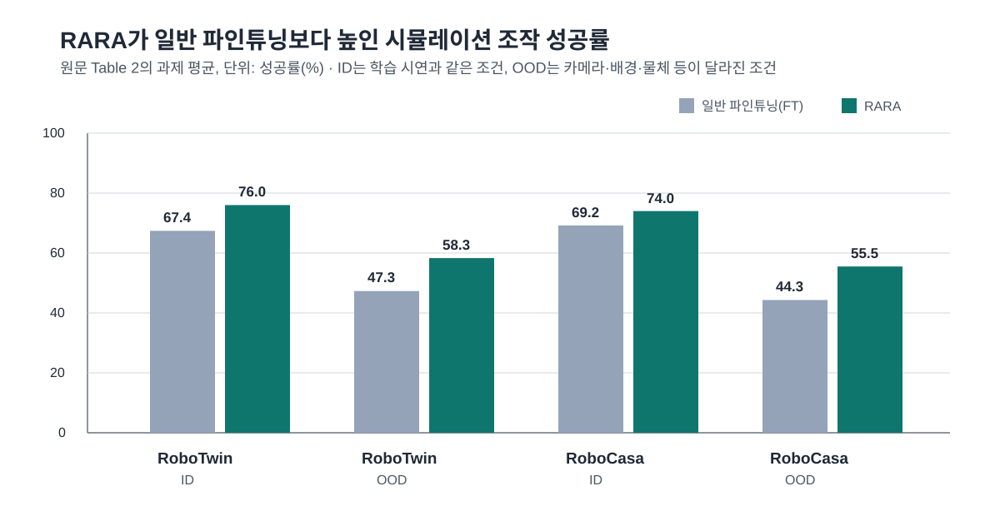

적은 시연으로 로봇 정책을 새 과제에 맞출 때는, 학습에 쓴 장면에서는 잘 움직여도 카메라 각도나 배경, 물체가 바뀌면 성능이 떨어질 수 있습니다. <abbr title="유사한 사전학습 시연을 기준점으로 삼아 새 과제 파인튜닝 중 표현이 크게 바뀌지 않게 하는 방법 이름">RARA</abbr>는 새 과제의 행동을 배우기 전에 비슷한 사전학습 시연을 찾아 시각 표현을 맞추고, 이후 파인튜닝에서도 그 기준점이 무너지지 않게 제한합니다.

<figure class="fig"><figcaption>원문 표 2의 시뮬레이션 과제 평균을 다시 그렸습니다. 두 환경에서 시연과 다른 조건의 차이가 더 크게 나타났습니다. (출처 데이터: Kang et al., RARA · CC BY 4.0)</figcaption></figure>

## 새 시연에 맞추되, 예전에 배운 구분을 잃지 않아요

일반 파인튜닝은 새 과제의 관측과 행동 쌍만으로 정책을 갱신합니다. 시연 수가 적으면 새 장면의 특징이 기존 표현을 덮어쓸 수 있습니다. 논문은 목표 과제의 지시문과 가까운 사전학습 시연 100개를 먼저 찾고, 그 안에서 행동 청크의 시간적 모양이 비슷한 프레임을 짝짓습니다.

첫 단계에서는 새 시연 프레임의 표현을 검색한 시연이 사전학습 때 가졌던 표현에 가깝게 맞춥니다. 둘째 단계에서는 새 시연의 행동 복제 학습을 계속하되, 검색한 시연의 표현이 사전학습 모델에서 멀어지는 정도를 제한합니다. 검색 시연의 행동을 새로 학습시키는 방식이 아니라, 어떤 시각적 구분을 보존할지 정하는 기준점으로 쓰는 구성입니다.

이 구분은 제거 실험에서도 드러납니다. 검색한 시연 대신 같은 수의 무작위 사전학습 자료를 넣으면 <abbr title="두 팔 로봇 조작 데이터를 만들고 평가하는 시뮬레이션 환경">RoboTwin</abbr>과 Open Blender Lid에서 일반 파인튜닝보다 낮아졌고, RoboTwin에서는 최대 17.1%포인트 낮았습니다. 기준점이 많다는 사실만으로는 부족하고, 새 과제와 같은 종류의 동작과 장면을 골라야 합니다.

## 바뀐 장면에서 차이가 더 크게 났어요

저자들은 RoboTwin 네 과제와 <abbr title="가정 환경의 로봇 조작을 평가하는 시뮬레이션 환경">RoboCasa</abbr> 다섯 과제에서 비교했습니다. 시연과 같은 조건에서는 RARA가 일반 파인튜닝보다 각각 8.6%포인트와 4.8%포인트 높았고, 카메라 시점·배경·방해물·물체 조건이 달라진 평가에서는 11.0%포인트와 11.2%포인트 높았습니다.

13개 과제 전체 평균도 같은 경향입니다. 시연과 같은 조건에서는 9.5%포인트, 달라진 조건에서는 13.6%포인트 높았습니다. 실물 Franka 로봇 네 과제에서는 일반 파인튜닝 대비 각각 16.4%포인트와 19.2%포인트 향상을 보고했습니다. 다만 이 실험은 같은 로봇과 행동 공간에서 주로 시각 조건을 바꾼 평가입니다. 다른 팔이나 다른 행동 공간으로 옮겨도 같은 효과가 난다는 근거는 아닙니다.

## 지금 작업과 만나는 지점

이 논문은 저가 로봇팔 모방학습과 양팔·조작 주제에 만납니다. 적은 시연으로 로봇팔 정책을 새 조작 과제에 맞출 때, 학습 손실만으로 결과를 고르지 않고 카메라·배경·물체 배치가 달라진 평가를 따로 두는 이유를 보여 줍니다. 바로 시험해 볼 수 있는 범위는 이미 있는 시연에서 과제와 동작이 비슷한 묶음과 다른 묶음을 나눠, 어느 묶음을 보조 자료로 넣었을 때 시각 조건 변화에 대한 행동 오차가 어떻게 달라지는지 기록하는 일입니다. RARA의 표현 정렬을 재현하지 않더라도, 보조 시연의 유사도와 분포 밖 평가를 분리하면 파인튜닝 결과를 읽는 기준이 남습니다.

[[2026-10-11_Dex-One2Many가_단일_사람_영상의_동작을_관계_제약으로_바꾼_이유|Dex-One2Many가 단일 사람 영상의 동작을 관계 제약으로 바꾼 이유]]는 로봇 손의 형태가 달라질 때도 보존할 관계를 다뤘습니다. RARA는 같은 형태의 정책을 새 장면에 맞출 때, 어떤 사전학습 시연을 기준점으로 남길지에 초점을 둡니다.

---

<!-- src-block -->

출처 — https://arxiv.org/abs/2610.13578
