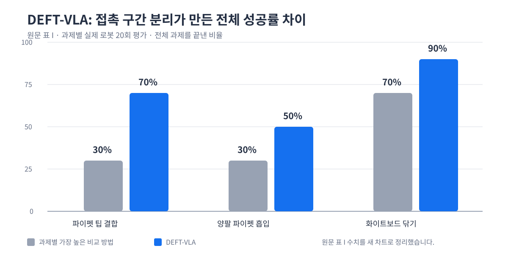

로봇팔이 물체에 닿기 전과 닿은 뒤에는 같은 센서값이 같은 의미를 갖지 않습니다. 접근할 때는 카메라와 관절 위치로 물체와 끝단을 맞추는 일이 먼저입니다. 반면 눌러 끼우거나 닦는 순간에는 화면이 비슷해도 힘이 부족한지, 걸렸는지, 이미 끝났는지가 달라집니다. <abbr title="접촉 전후에 필요한 감각을 나눠, 힘이 필요한 구간만 별도 정책으로 학습하는 로봇 조작 방법 이름">DEFT-VLA</abbr>는 이 전환을 하나의 정책에 계속 넣지 않고, 구간별로 맡을 부분을 나눴습니다.

## 접근과 접촉은 다른 전문가가 맡아요

논문은 먼저 <abbr title="영상과 과제 문장을 함께 읽어 로봇 행동을 고르는 모델">비전·언어·행동 모델</abbr>을 과제 시연 전체로 맞춥니다. 이 기본 전문가는 물체 위치를 찾고, 접근하고, 정렬하는 비접촉 구간을 담당합니다. 이어서 같은 모델에서 시작한 접촉 전문가는 힘·토크 이력을 추가로 받되, 접촉 구간의 시연으로만 후학습합니다. 실행 중에는 구간 판별기가 어느 전문가의 행동을 쓸지 고릅니다.

힘 신호를 받는다고 그 신호를 행동에 쓴다는 보장은 없습니다. 영상의 물체 모양이나 관절 상태가 시연의 진행도와 우연히 함께 바뀌면, 정책은 힘보다 이 쉬운 단서를 따라갈 수 있습니다. 저자들은 접촉 전문가를 학습할 때 영상을 흐리게 하고 로봇 상태 정보를 일부 가렸다가 점차 원래 입력으로 돌렸습니다. 힘 신호는 남겨 두어, 접촉 직전과 완료 뒤처럼 화면은 비슷하지만 필요한 행동이 다른 장면을 구별하게 했습니다.

이 분리는 모델을 둘로 늘리기 위한 장치만은 아닙니다. 접촉과 무관한 접근 동작을 힘 중심 학습으로 바꾸지 않으면서, 접촉 구간에서만 힘 신호를 더 강하게 쓰려는 경계입니다. 파이펫 팁 결합과 양팔 흡입에서는 이 전환을 학습한 구간 판별기가 맡았고, 화이트보드 닦기에서는 접촉 전문가 전환을 사람이 정했습니다. 세 과제 모두에서 자동 전환이 검증된 것은 아니라는 범위도 함께 남습니다.

[[2026-09-16_Touch2Trace_촉각_모방학습으로_케이블_추적을_높인_방식|Touch2Trace의 촉각 모방학습으로 케이블 추적을 높인 방식]]도 접촉이 필요한 순간의 신호와 제어 주기를 함께 다뤘습니다. DEFT-VLA는 빠른 신호를 어떤 모델에 넣을지보다, 그 신호가 행동을 바꿔야 하는 구간을 먼저 분리합니다. 두 결과를 함께 보면 센서를 더하기 전에도 접촉 전환을 기록하고, 그 신호를 읽을 시간 예산을 확인해야 한다는 기준이 남습니다.

## 비교 방법보다 20~40퍼센트포인트 높은 전체 성공률

저자들은 파이펫 팁 결합에 130개, 양팔 파이펫 흡입과 화이트보드 닦기에 각각 50개의 시연을 썼습니다. 각 방법은 과제마다 실제 로봇 20회로 평가했고, 방법마다 같은 시험 배치를 사용했습니다. 전체 성공률은 접근과 접촉을 모두 끝낸 비율입니다.

<figure class="fig"><figcaption>원문 표 1의 전체 성공률을 새 차트로 정리했습니다. 파이펫 팁 결합은 70% 대 30%, 양팔 흡입은 50% 대 30%, 닦기는 90% 대 70%였습니다. 원문 그림은 사용하지 않았습니다.</figcaption></figure>

파이펫 팁 결합은 70%로 가장 높은 비교 방법보다 40퍼센트포인트, 양팔 흡입은 50%로 20퍼센트포인트, 화이트보드 닦기는 90%로 20퍼센트포인트 높았습니다. 개선은 접근보다 접촉 단계에서 두드러졌습니다. 앞선 비접촉 단계를 통과한 시도만 따로 보면, 접촉 단계 성공률은 세 과제에서 93.3%, 50%, 90%였습니다.

힘 신호를 기본 정책 전체에 더한 비교 조건은 세 과제에서 일관되게 좋아지지 않았습니다. 전역 학습 조건은 양팔 흡입에서 5%에 그쳤고, 파이펫 팁 결합과 닦기에서도 기본 조건보다 낮았습니다. 이 결과는 힘·토크 센서가 있으면 자동으로 성능이 오른다는 뜻이 아닙니다. 힘이 판단에 필요한 구간과, 그 신호를 학습에 강하게 반영할 구간을 따로 정해야 한다는 실험 근거입니다.

## 높이가 달라져도 절반은 완수했어요

저자들은 학습에 없던 파이펫 파지 높이에서도 두 파이펫 과제를 확인했습니다. DEFT-VLA의 전체 성공률은 두 과제 모두 50%였고, 비교 방법의 최고값은 각각 10%와 40%였습니다. 기존 조건보다 낮은 수치이므로 높이 변화가 해결됐다고 볼 수는 없습니다. 다만 접촉 단계에 쓴 힘 정보를 새 높이에서도 일부 활용했는지는 별도 시험으로 확인했습니다.

결과의 범위는 세 과제와 논문에 쓴 로봇·힘/토크 센서 구성입니다. 과제당 20회의 평가도 작은 표본이므로, 저가 서보 로봇팔이나 센서가 없는 구성에서 같은 차이를 기대할 근거는 아닙니다. 특히 힘 신호의 품질, 접촉 전환 기준, 시연에서 접촉 구간을 나누는 방식이 달라지면 이 구조의 이점도 다시 확인해야 합니다.

## 지금 작업과 만나는 지점

이 논문은 프로필의 저가 로봇팔 모방학습, 양팔·조작, 서보·접촉·저수준 제어와 만납니다. 시연 기록에서 접근·정렬·접촉·이탈의 전환 시각을 그리퍼 명령, 관절 위치, 읽을 수 있는 부하 신호, 카메라 프레임과 같은 시간축에 남기면, 실패가 접근 단계인지 접촉 단계인지 먼저 나눠 볼 수 있습니다. 바로 시험해 볼 수 있는 범위는 새 동작을 만들지 않고 이미 보존된 시연에서 이 전환 표지가 빠지지 않았는지 확인하는 일입니다. 표지가 있다면 같은 실패를 한 덩어리로 보지 않고, 접촉 전의 위치 오차와 접촉 뒤의 힘·명령 변화를 분리해 다음 기록 항목을 정할 수 있습니다.

---

<!-- src-block -->

출처 — https://arxiv.org/abs/2610.14854
