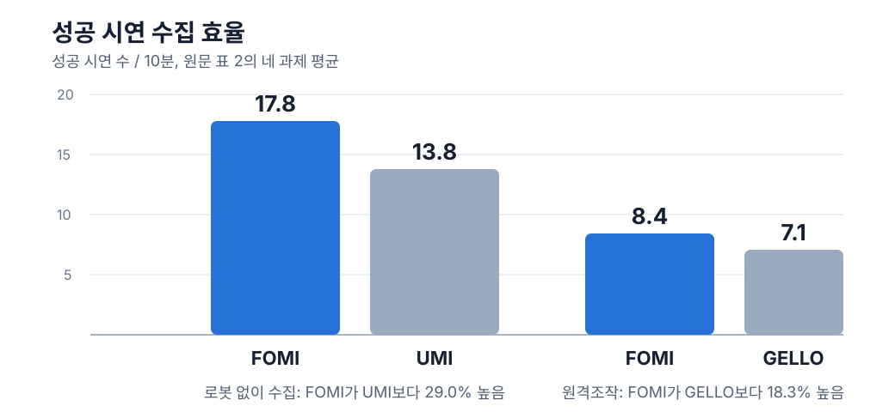

접촉 조작 시연을 모을 때는 그리퍼가 닫힌 정도만으로 충분하지 않은 경우가 있습니다. 물체가 끼었는지, 끝까지 들어갔는지, 너무 세게 누르는지는 손끝에 돌아오는 저항이 있어야 구별하기 쉽습니다. <abbr title="가위형 손잡이로 물체의 저항을 손에 전달해 접촉 조작 시연을 모으는 장치 이름">FOMI</abbr>는 이 저항을 별도 힘 센서나 모터 없이 기구 구조로 전달합니다. 논문은 이 장치로 모은 시연이 접촉 조작 학습에 쓸 수 있는지와, 같은 시간에 성공 시연을 얼마나 더 남길 수 있는지를 함께 비교했습니다.

## 가위형 손잡이가 접촉 저항을 전달해요

FOMI의 손잡이와 그리퍼를 움직이는 링크는 단단히 연결돼 있습니다. 그리퍼가 물체에 닿아 더 닫히지 않으면 저항이 손잡이 쪽으로 돌아옵니다. 조작자는 화면이나 별도 계기판을 보지 않아도 손에서 저항 변화를 느끼고, 누르는 힘이나 다음 움직임을 조절할 수 있습니다.

로봇 없이 시연을 모을 때는 손잡이의 움직임을 그리퍼의 자세와 벌어진 폭으로 바꾸고, 카메라와 자세 추적값을 같은 시간에 기록합니다. 원격조작에서도 같은 손잡이를 쓸 수 있습니다. 이때 손잡이의 자세 변화는 로봇 끝단 자세로, 손잡이 벌어짐은 로봇 그리퍼 명령으로 옮깁니다. 손잡이가 끝까지 닫히는 기계식 멈춤은 그리퍼 명령의 범위를 손에 알려 주는 역할도 합니다. 그리퍼 벌어짐을 명령값으로 바꾸는 보정도 따로 측정했고, 논문에서 가장 낮은 오차는 명령 범위 0~255 가운데 왼쪽 0.80, 오른쪽 0.88이었습니다. 힘을 느끼는 손잡이 구조만 갖춰도 로봇 명령이 어긋나면 시연 데이터가 달라지므로, 기구 감각과 명령 보정을 같이 확인한 구성입니다.

논문이 강조한 결과는 힘을 정책에 입력했다는 점이 아닙니다. 사람에게 접촉 상태를 알리는 장치를 바꿔, 시연을 모으는 단계에서 실패를 줄였다는 점입니다. 실제 학습 정책은 힘이나 촉각 값을 입력으로 쓰지 않았습니다. 이 구분이 없으면 사람의 조작 감각 개선과 로봇 정책의 감각 입력 개선을 같은 효과로 해석하게 됩니다.

## 10분당 성공 시연 수가 두 조건에서 늘었어요

평가는 작은 부품 집기, 관 삽입, 접시 씻기, 파우치 열기의 네 접촉 과제로 구성했습니다. 로봇 경험이 없던 조작자 3명이 모든 인터페이스와 과제를 사용했고, 조건마다 10분 수집 세션을 세 번 반복했습니다. 수집 효율은 10분 동안 완성한 성공 시연 수입니다.

<figure class="fig"><figcaption>원문 표 2의 네 과제 평균을 새 차트로 정리했습니다. 로봇 없이 수집한 조건은 FOMI 17.8건, UMI 13.8건이었고 원격조작 조건은 FOMI 8.4건, GELLO 7.1건이었습니다. 원문 그림은 사용하지 않았습니다.</figcaption></figure>

로봇 없이 수집한 조건에서 FOMI는 평균 17.8건으로 UMI의 13.8건보다 29.0% 높았습니다. 원격조작 조건에서는 평균 8.4건으로 GELLO의 7.1건보다 18.3% 높았습니다. 네 과제 각각에서도 FOMI가 가장 높은 수집 효율을 보였지만, 수치는 같은 조작자 3명의 반복 측정에서 나온 평균입니다. 장치가 달라지거나 익숙한 조작자가 늘면 차이가 같은 크기로 유지된다고 볼 수는 없습니다.

[[2026-09-17_XRoboToolKit-T의_촉각_보조가_시연_안정성을_높인_구조|XRoboToolKit-T의 촉각 보조가 시연 안정성을 높인 구조]]도 시연 중 사람이 접촉 상태를 더 빨리 읽게 하는 장치를 다뤘습니다. FOMI는 손에 전달하는 힘을 기구 구조로 만들고, 시연 수집 효율을 같은 시간 단위로 비교했습니다. 접촉 신호를 센서로 측정해 정책에 넣는 일과, 조작자가 접촉을 알아차려 더 나은 시연을 남기는 일은 서로 다른 평가 항목으로 남습니다.

로봇 없이 모은 시연을 과제별 25개, 50개, 100개로 늘렸을 때 논문의 평균 성공률은 42.0%, 59.1%, 78.4%였습니다. 25개의 원격조작 시연으로 학습한 조건은 평균 성공률 70.5%를 보였습니다. 대상 로봇에서 얻은 원격조작 데이터는 시각과 기구학 차이가 적고, 로봇 없이 모은 데이터는 같은 시간에 더 많이 얻을 수 있다는 차이가 있습니다. 따라서 이 결과는 어느 한 수집법이 항상 낫다는 비교가 아니라, 데이터 양과 대상 로봇 일치도를 함께 바꿔 보는 기준에 가깝습니다.

## 힘이 기록되지 않아 정책은 힘을 입력으로 쓰지 않아요

FOMI는 손에 저항을 전달하지만 그 힘을 학습 데이터에 저장하지는 않았습니다. 정책은 카메라 영상, 끝단의 상대 자세, 그리퍼 명령처럼 시연에 기록된 입력으로만 행동을 배웁니다. 사람은 저항을 바탕으로 시연을 고칠 수 있지만, 정책이 그 저항값을 읽으며 행동하는 것은 아닙니다.

이 한계는 접촉 실패를 다룰 때 확인할 지점을 분명하게 합니다. 시연 수집 단계에서는 사람이 물체 저항을 알아차릴 수 있는지, 학습 단계에서는 그 상태 변화가 영상·그리퍼 명령·자세 변화만으로도 구별되는지를 나눠야 합니다. 논문의 사용자 평가는 3명뿐이고, 특정 그리퍼와 카메라 구성에서 네 과제로 진행됐습니다. 저가 서보 로봇팔이나 다른 물체의 접촉 조건에도 같은 수집 효율과 학습 성능이 나온다는 근거는 아닙니다.

## 지금 작업과 만나는 지점

이 논문은 프로필의 저가 로봇팔 모방학습, 양팔·조작, 서보·접촉·저수준 제어와 만납니다. 접촉이 있는 시연을 남길 때 그리퍼 명령, 관절 위치, 카메라 프레임, 읽을 수 있는 부하 신호를 같은 시간축에 두면 접촉 전 위치 오차와 접촉 뒤 저항 변화를 구분해 볼 수 있습니다. 바로 시험해 볼 수 있는 범위는 새 동작을 만들지 않고, 보존된 시연에 이 표지들이 빠지지 않았는지 확인하는 일입니다. 힘값을 기록하지 않는다면 정책 입력으로 남길 관측값이 무엇인지도 별도로 정할 수 있습니다.

---

<!-- src-block -->

출처 — https://arxiv.org/abs/2610.19839
