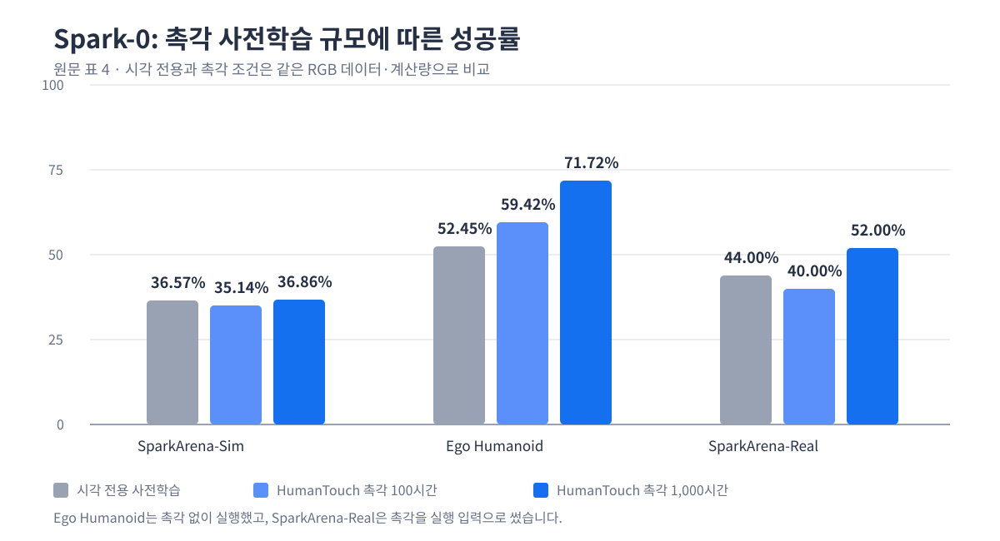

카메라만으로는 손이 물체에 닿았는지, 미끄러지기 시작했는지, 눌린 정도가 맞는지 알기 어렵습니다. <abbr title="촉각을 학습과 실행에 함께 쓰도록 만든 로봇 조작 모델 이름">Spark-0</abbr>는 그 빈자리를 촉각으로 채우되, 촉각을 실행 때만 추가 입력으로 쓰지 않았습니다. 학습 단계에서는 손의 접촉 위치를 시각 토큰에 가르치는 신호로도 쓰고, 실행 단계에서는 힘의 시간 변화와 손바닥·손가락 부위 정보를 행동 모델에 전달했습니다.

## 학습용 접촉 지도와 실행용 촉각을 나눴어요

<abbr title="영상·언어·촉각을 함께 받아 로봇 행동을 고르는 모델">VTLA</abbr>인 Spark-0에는 촉각 경로가 둘 있습니다. 첫 경로는 촉각 장갑 신호에서 손이 닿은 자리를 영상 위의 접촉 지도로 만들어 시각 토큰을 학습시킵니다. 이 지도는 추론 때 제거되므로, 실행할 때 촉각 장갑이 없어도 시각만으로 행동을 낼 수 있습니다.

둘째 경로는 실행용입니다. 손바닥과 손가락 여섯 부위의 힘 이력, 각 촉각점의 3차원 위치와 압력 상태를 행동 전문가에 넣습니다. 같은 점검표를 쓰는 두 방식이 아니라, 하나는 시각 표현이 접촉 위치를 배우게 하고 다른 하나는 지금 손에 걸리는 힘을 행동에 반영하게 합니다.

저자들은 <abbr title="양손 촉각 장갑과 카메라 기록을 함께 모은 1,000시간 사람 손 조작 데이터">HumanTouch</abbr>에 32명이 수행한 100개가 넘는 조작 과제를 담았습니다. 머리와 손목 카메라, 손가락 관절, 손목 자세, 양손 촉각 장갑을 초당 60번 맞춰 기록했습니다. 손마다 460개 감지점 가운데 손가락 굽힘으로 잘못 압력이 잡히는 140개는 빼고 320개를 관측으로 썼습니다.

## 1,000시간 조건에서 낯선 로봇의 시각 실행이 올랐어요

논문은 촉각을 버린 시각 전용 사전학습, HumanTouch 촉각을 100시간과 1,000시간 남긴 조건을 비교했습니다. 시각 데이터와 계산량은 같게 두고, 촉각만 남기거나 뺐습니다. <abbr title="같은 로봇 구성에서 시뮬레이션 시각 과제와 실제 로봇 촉각 과제를 함께 시험하는 평가 묶음">SparkArena</abbr>의 시뮬레이션에서는 세 조건 차이가 작았지만, 낯선 형태의 <abbr title="사람과 닮은 두 팔 로봇에서 보는 조작 평가 묶음">Ego Humanoid</abbr> 평가에서는 1,000시간 조건이 71.72%로 시각 전용의 52.45%보다 19.27퍼센트포인트 높았습니다.

<figure class="fig"><figcaption>원문 표 4의 성공률을 새 차트로 정리했습니다. 시각 전용과 촉각 조건은 같은 카메라 영상 데이터와 계산량으로 비교했습니다. 낯선 휴머노이드 평가는 촉각 없이 실행했고, 실제 로봇 평가는 촉각을 실행 입력으로 썼습니다. 원문 그림은 사용하지 않았습니다.</figcaption></figure>

실제 로봇 촉각 조건에서도 1,000시간은 52.00%로 시각 전용의 44.00%보다 8.00퍼센트포인트 높았습니다. 다만 이 수치는 논문에 쓴 휴머노이드 손, 촉각 장갑, 다섯 과제에서 나온 결과입니다. 저가 서보 로봇팔이나 다른 그리퍼에 같은 폭의 개선을 기대할 근거는 아직 없습니다.

논문의 비교가 알려 주는 범위는 촉각 신호가 있는가보다, 그 신호를 시각 표현 학습에 얼마나 오래 연결했는가에 가깝습니다. 100시간 조건은 Ego Humanoid에서 59.42%까지 올랐지만 실제 로봇 촉각 과제에서는 40.00%로 시각 전용보다 낮았습니다. 1,000시간만 세 평가에서 가장 높은 성공률을 냈으므로, 데이터 양과 과제 분포를 빼고 촉각 입력 하나의 효과로 읽으면 안 됩니다.

## 지금 작업과 만나는 지점

이 논문은 저가 로봇팔 모방학습, 양팔·조작, 서보·접촉·저수준 제어 주제와 만납니다. 시연을 모을 때 카메라와 관절·그리퍼 명령만 나란히 두지 않고, 읽을 수 있는 서보 부하나 접촉 표지를 같은 시간축에 남기면 접촉이 시작된 프레임을 학습용 표지로 쓸 수 있습니다. 바로 시험해 볼 수 있는 범위는 새 촉각 장비를 붙이는 일이 아니라, 이미 남아 있는 시연에서 접근·접촉·이탈 구간을 나눌 시간 표지가 충분한지 확인하고 다음 수집에서 빠진 표지를 추가하는 일입니다.

---

<!-- src-block -->

출처 — https://arxiv.org/abs/2610.22342
