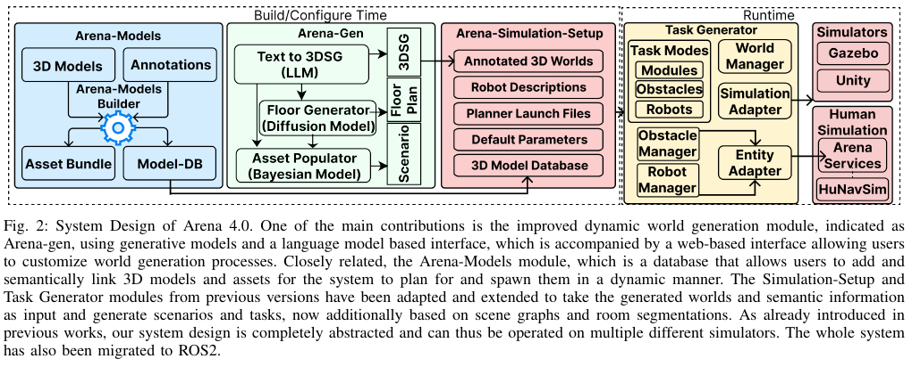
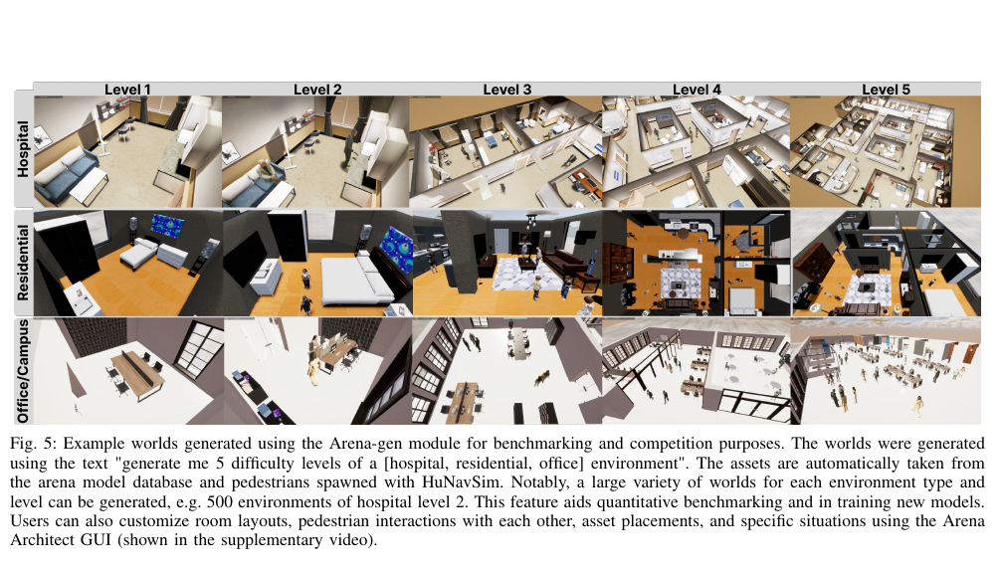

사회적 내비게이션 시험에는 로봇 제어기만큼 세계를 만드는 과정이 중요해요. 복도 폭, 방 연결, 가구 위치, 사람의 역할과 상호작용이 달라지면 같은 정책도 전혀 다른 문제를 만나기 때문이에요. Arena-Rosnav 4.0은 이런 조건을 <abbr title="로봇의 센서 정보와 제어 명령을 여러 프로그램 사이에서 주고받는 소프트웨어 체계">ROS 2</abbr> 기반 도구 묶음에서 만들고, 과제를 배치하고, 여러 시뮬레이터에서 실행하고, 결과를 비교하려는 자원이에요.

4.0의 변화는 단순한 버전 번호가 아니에요. 저자들은 생성 모형을 이용한 Arena-gen, 의미가 붙은 3차원 자산 저장소 Arena-Models, ROS 2 이행, HuNavSim을 이용한 사람 행동 확장을 핵심 기여로 나눠 설명해요. 다만 논문의 사용자 연구는 도구 사용성과 세계 생성 능력을 평가한 것이며, 실제 사람이 로봇 경로를 편안하다고 판단한 사회적 내비게이션 연구는 아니에요.

<figure class="fig"><figcaption>언어 입력과 생성 모형이 만든 세계 정보를 과제 생성기, 시뮬레이터, 사람 행동 모형에 전달하는 전체 구조예요. (출처: Arena-Rosnav 4.0 저자 원고, 그림 2 · <a href="https://creativecommons.org/licenses/by/4.0/">CC BY 4.0</a>, 원문에서 그림 영역 발췌)</figcaption></figure>

## 장면 그래프가 생성 모형과 시뮬레이터 사이를 잇어요

Arena-gen은 문장 입력에서 곧바로 시뮬레이터 파일을 쓰는 단일 모형이 아니에요. 먼저 방, 연결, 물체와 속성을 나타내는 3차원 장면 그래프를 중간 표현으로 만들어요. 그다음 <abbr title="대상과 연결 관계를 따라 정보를 주고받으며 출력을 계산하는 신경망">그래프 신경망</abbr>과 규칙 기반 단계를 거쳐 방 배치와 자산을 채우고, 최종 3차원 환경으로 내보내요. 생성 모형의 표현력과 시뮬레이터가 요구하는 형식을 한 단계에서 모두 해결하지 않고 역할을 나눈 셈이에요.

장면 그래프에는 방과 사물의 계층, 방 사이 연결, 물체의 종류와 관계가 들어가요. 과제 생성기는 이를 읽어 로봇과 사람의 출발점, 목표, 상호작용을 배치할 수 있어요. 단순 점유 지도는 어디가 막혔는지는 알려 주지만 그 공간이 병실인지 대기실인지 말하지 못해요. 의미 정보가 있으면 병원 직원, 환자, 방문객처럼 역할에 맞는 사람 행동을 놓는 실험을 설계할 수 있어요.

중간 표현이 있다고 해서 생성된 세계가 자동으로 물리적으로 타당해지는 것은 아니에요. 문이 벽과 어긋나거나 가구가 통로를 막고, 자산 크기가 방과 맞지 않을 수 있어요. 세계 파일 생성 성공, 충돌 형상 검사, 내비게이션 가능 영역 연결, 과제 성공 가능성을 차례로 확인해야 해요.

설명용으로 방 여섯 개를 잇는 그래프에서 연결 하나가 빠져 두 묶음으로 갈라졌다고 가정해요. 출발점과 목표가 서로 다른 묶음에 있으면 정책 성능과 관계없이 성공률은 0이에요. 세계 생성 품질을 평가하지 않은 채 로봇 실패로 세면 알고리즘 비교가 왜곡돼요. 이 예는 논문 실험값이 아니라 연결성 검사의 필요성을 보여 주는 가정이에요.

## 학습 데이터는 실제 평면도와 생성 세계를 구분해야 해요

장면 그래프 생성 학습 표본은 CubiCasa5K의 실제 평면도 스캔을 바탕으로 해요. 논문은 이 자료에서 적합한 평면도 약 5000개를 사용한다고 설명해요. 미리 학습된 영상 모형으로 방과 물체 영역을 찾고, 자산 범주를 다시 묶고, 관계를 추출해 장면 그래프와 평면도 쌍을 만들어요.

여기서 “실제”는 원본 평면도 스캔의 출처를 가리켜요. 그 평면도에서 생성한 3차원 가구 배치, 사람 행동과 센서 영상까지 실측이라는 뜻은 아니에요. 생성된 병원 세계가 실제 병원의 감염 관리 동선이나 문화적 통행 규칙을 보존한다는 근거도 없어요.

논문은 세계 생성 평가에서 서로 다른 맥락과 난도 요청을 반복해 5000개 생성 세계의 장면 그래프 지표를 계산해요. 방 수, 막다른 방 수, 출입구, 자산, 연결선, 그래프 지름을 난도와 비교해요. 난도는 언어 모형이 추정한 잠재 수치이므로 사람에게 체감되는 내비게이션 난도와 같다고 단정할 수 없어요.

방이 많으면 탐색 경로 후보가 늘 수 있지만, 넓은 홀 하나에 사람 30명이 있는 장면보다 어려운지는 별도 문제예요. 그래프 지름은 방 연결의 길이를 말해도 동적 혼잡, 시야 가림, 문 폭은 모두 담지 못해요. 생성 품질 검증에는 정적 그래프 지표와 동적 과제 지표를 함께 둬야 해요.

## 자산 저장소는 의미와 파일 형식을 함께 관리해요

Arena-Models는 자산 식별자를 찾는 벡터 저장소와 시뮬레이터별 자산 묶음을 나눠요. 사용자는 문장으로 필요한 모형을 찾고 Unity용 구성 요소나 다른 시뮬레이터에서 쓸 수 있는 <abbr title="프로그램 사이에서 3차원 모형과 장면을 교환하는 파일 형식">COLLADA</abbr> 파일을 받을 수 있어요. 실행 때마다 폴더를 모두 읽는 방식보다 검색과 배포 경계를 명확히 하려는 설계예요.

기본 공개판에는 장애물 100개 이상, 사람 모형 15개 이상, 색상·재질 조합 30개 이상이 들어간다고 논문이 적어요. 여기서 30은 사람 행동 수가 아니라 색상과 재질 조합이에요. 외형 다양성과 행동 다양성을 섞어 “30가지 사람 행동”이라고 쓰면 원문을 잘못 옮기게 돼요.

자산의 의미 표시는 장면 배치에 도움을 주지만 충돌 형상과 시각 형상이 일치한다는 보장은 아니에요. 의자 다리가 시각적으로는 보이는데 충돌 상자는 좌판 전체를 채울 수 있고, 사람 외형 크기와 개인 공간 반경도 다를 수 있어요. 자산을 추가할 때는 원점, 단위, 축 방향, 충돌 형상, 저작권과 시뮬레이터별 변환 결과를 함께 검사해야 해요.

## ROS 2 이행 범위는 표의 버전으로 읽어요

논문의 이행 표는 Ubuntu 20에서 22, <abbr title="로봇 프로그램 사이의 센서 정보와 제어 명령 교환을 위한 소프트웨어 체계의 이름">ROS</abbr> Noetic에서 ROS 2 Humble, Python 3.8에서 3.10, 로봇 정보를 시각화하는 도구인 RViz에서 RViz2, Gazebo Classic에서 Gazebo Garden으로 바뀐 구성을 적어요. 명령행 도구에 그래픽 도구가 더해지고, 전체 컨테이너 영상과 지연 불러오기로 설치와 시작 과정도 손봐요.

따라서 Arena 4.0의 “ROS 2 지원”을 모든 ROS 2 배포판과 같은 의미로 읽으면 안 돼요. 논문이 검증한 기준은 Humble이에요. Jazzy에서 메시지 정의, Gazebo 연동, 파이썬 의존성, 실행 파일이 그대로 작동한다는 실험은 이 논문에 없어요. 최신 하드웨어에 옮기기 쉽다는 저자 설명도 특정 소형 컴퓨터에서 실시간 성능을 측정했다는 뜻은 아니에요.

ROS 1판을 함께 유지했다는 설명은 2024년 당시 전환 기간의 맥락이에요. 현재 설치를 결정할 때는 논문 문장보다 저장소의 실제 분기, 최근 변경, 컨테이너 바탕 영상과 문서를 다시 확인해야 해요. 버전이 다른 두 구성을 한 작업 공간에 섞으면 메시지 다리와 환경 변수가 실패 원인이 될 수 있어요.

## 생성 세계와 사람 행동이 한 과제로 이어져요

Arena 4.0은 생성된 방과 자산의 의미 정보를 HuNavSim에 넘겨 사람 출발점과 상호작용을 배치해요. 저자들은 사람과 사람, 사람과 물체의 상호작용을 확장하고 병원·사무실처럼 역할이 구분되는 공간을 표현하려 했어요. 의미 구역에서 위치를 뽑으면 사람을 벽 속이나 가구 위에 두는 단순 무작위 배치보다 상황을 통제하기 쉬워요.

<figure class="fig"><figcaption>같은 공간 종류에서도 방 연결과 자산 수를 바꾸고 HuNavSim 사람을 배치해 여러 난도의 과제를 만들어요. (출처: Arena-Rosnav 4.0 저자 원고, 그림 5 · <a href="https://creativecommons.org/licenses/by/4.0/">CC BY 4.0</a>, 원문에서 그림 영역 발췌)</figcaption></figure>

그림의 예시는 “병원·주거·사무실 환경을 난도 다섯 단계로 생성해 달라”는 입력으로 만든 세계예요. 논문은 같은 종류와 난도에서도 많은 변형을 만들 수 있으며 병원 난도 2만 500개처럼 대량 생성할 수 있다고 설명해요. 이는 변형을 생성할 수 있다는 기능 근거이지 500개가 서로 독립적인 사회 규범을 담았다는 증거는 아니에요.

사람 위치와 행동은 시뮬레이터 내부 정답 상태예요. 실제 카메라나 거리 센서에서 사람을 찾아 추적하는 오차는 별도로 넣어야 해요. 정책이 정답 위치·속도·역할을 받는 시험과 렌더링 센서에서 검출한 값을 받는 시험을 구분하지 않으면 인지 성능이 사라져요.

[[2026-10-17_socialnav_hunavsim|HuNavSim이 로봇에 반응하는 여섯 사람 행동을 만든 방식]]은 사람 행동 계산과 ROS 2 연결을 더 자세히 보여 줘요. Arena 4.0은 그 구성 요소를 세계 의미 정보와 과제 생성에 붙이는 상위 기반이에요. 두 자원의 결과를 합칠 때는 사람 행동 매개변수와 장면 생성 시드를 함께 고정해야 해요.

## 사용자 연구는 사용성 근거예요

저자들은 독일, 스위스, 미국, 싱가포르, 베트남, 일본, 한국의 대학에서 로봇 경험이 서로 다른 참가자 20명을 모집했다고 적어요. 참가자들은 설치와 지정 모듈 사용을 시험하고, 세계 생성과 장면 맞춤 기능을 포함한 플랫폼 경험을 평가했어요. 결과는 대체로 긍정적이었고 신규 사용자와 경험자 모두 생성·맞춤 기능을 장점으로 꼽았어요.

이 표본은 도구의 국제적 사용성을 살피는 데 의미가 있지만 일반 보행자가 로봇을 만난 연구는 아니에요. 참가자 수 20을 사람-로봇 상호작용 안전성 표본으로 다시 쓰면 안 돼요. 과제 성공률, 설치 실패율, 숙련도별 소요 시간과 자유 의견을 도구 평가의 범위에서 읽어야 해요.

사용자 연구가 긍정적이어도 한 번 누르기 설치가 모든 환경에서 보장되는 것은 아니에요. 그래픽 처리장치, 운영체제, 컨테이너, 디스플레이 연결과 저장 공간이 다르면 결과가 달라져요. 새 환경에서는 깨끗한 장치에서 설치 단계와 첫 장면 실행을 별도로 재현해야 해요.

## 생성 지연 수치는 고성능 장치 조건을 붙여야 해요

세계 생성 구성 요소별 평균 지연은 단일 RTX 4080 그래픽카드에서 100개의 빈 캐시 묶음을 실행해 측정했어요. 각 단계는 별도 컨테이너로 구성되어 통신 비용도 포함돼요. 이 조건은 생성 흐름의 상대 병목을 보는 근거이며, 소형 온보드 컴퓨터의 실행 속도 자료가 아니에요.

빈 캐시는 이전 결과를 재사용하지 않은 조건이지만, 100묶음 평균만으로 꼬리 지연과 실패 재시도를 알 수 없어요. 생성형 구성 요소는 입력 길이, 방 수, 자산 검색 결과에 따라 시간이 달라질 수 있어 평균과 상위 백분위, 실패율, 단계별 대기 시간을 함께 남겨야 해요.

설명용으로 다섯 단계가 각각 2·3·8·4·3초 걸린다면 전체는 20초예요. 세 번째 단계를 절반으로 줄여도 전체는 16초라 20%만 개선돼요. 가장 느린 단계 하나뿐 아니라 통신과 순차 의존 관계를 봐야 한다는 계산이며 논문 지연값을 재현한 것은 아니에요.

세계 생성은 사전 작업이고 내비게이션 제어는 실행 중 작업이에요. 생성에 RTX 4080을 썼다는 사실을 로봇 제어도 같은 그래픽카드가 필요하다는 뜻으로 바꾸면 안 되고, 반대로 생성이 끝났다고 시뮬레이션이 저사양 장치에서 실시간이라는 결론도 낼 수 없어요. 두 단계의 장치·시간 측정을 분리해야 해요.

## 난도 요청이 실제 과제 난도인지 검증해야 해요

논문은 방과 장애물 수 같은 구조 지표가 언어 모형이 부여한 난도와 어떻게 변하는지 살펴봐요. 방이 늘수록 연결선과 출입구가 늘고, 그래프 지름은 비교적 낮게 유지되어 여러 경로를 제공한다는 해석을 제시해요. 하지만 로봇 반경, 회전 폭, 사람 밀도, 목표 배치는 그 그래프 지표만으로 정해지지 않아요.

같은 세계에서 정적 최단 경로 길이, 좁은 통로 비율, 사람과의 예상 충돌 구역, 기준 제어기의 성공률을 추가로 측정하면 난도 이름을 행동 결과와 연결할 수 있어요. 기준 제어기 하나만 쓰면 그 제어기의 약점이 난도로 굳어질 수 있으므로 반응형·비반응형, 학습형·규칙형 기준을 둘 이상 두는 편이 좋아요.

설명용으로 난도 4 세계가 방은 12개지만 출발점과 목표가 같은 넓은 복도에 있고, 난도 2 세계는 방 네 개 사이의 좁은 문 세 곳을 지나야 한다고 가정해요. 그래프 크기는 앞이 크지만 실제 통과 난도는 뒤가 높을 수 있어요. 생성기가 붙인 수준과 내비게이션 실험 난도를 따로 기록해야 하는 이유예요.

## 재현은 생성·배치·실행 시드를 나눠요

하나의 시드만 기록해도 언어 생성, 그래프 배치, 자산 선택, 사람 행동, 로봇 출발점이 각자 다른 난수원을 쓰면 같은 장면이 나오지 않을 수 있어요. 생성 결과인 장면 그래프와 세계 파일을 원본 산출물로 보존하고, 자산 저장소 버전과 각 단계 시드를 따로 남겨야 해요.

먼저 고정 세계에서 과제 생성기와 사람 행동만 반복해요. 다음에는 사람을 고정하고 세계 배치만 바꿔요. 마지막에 생성 문장까지 바꾸면 어느 변화가 성공률을 흔들었는지 추적할 수 있어요. 생성 모형의 출력이 비결정적이면 같은 입력을 여러 번 실행해 유효 세계 비율과 구조 분산을 보고해야 해요.

설치 문서는 Ubuntu 22.04를 기준으로 하고 큰 작업 공간에는 약 80GB의 저장 공간을 권고해요. 이는 작은 자료 하나를 내려받는 수준이 아니므로 컨테이너 영상, 자산 묶음, 생성 결과의 용량을 미리 나눠 잡아야 해요. 저장 공간 권고를 실행 중 메모리 요구량으로 혼동해서도 안 돼요.

## 실물 전이는 별도 확인 단계예요

논문은 ROS 2 이행이 최신 로봇과 실제 장치로 옮기기 쉽게 한다고 설명해요. 같은 메시지와 내비게이션 구성 요소를 쓸 수 있다는 것은 연결 비용을 낮춰요. 그러나 생성 세계의 성공이 실물 센서 지연, 미끄러짐, 사람의 상호 양보를 통과했다는 뜻은 아니에요.

실물 전이 전에는 세계 정답 상태를 제거하고 실제 인지 입력으로 바꾸며, 명령 주기와 오래된 명령 비율을 측정해야 해요. 사람 모형의 반경과 실제 보호 거리, 시뮬레이터 충돌 형상과 실제 로봇 외곽도 대조해야 해요. 안전 감시는 학습 정책과 독립된 계층에서 확인해야 해요.

실험 묶음도 단계별로 구성할 수 있어요. 첫 단계는 사람 없는 고정 세계에서 지도·좌표계·동역학을 확인해요. 둘째는 같은 세계에 정해진 사람 궤적을 넣어 반복성을 봐요. 셋째는 로봇에 반응하는 사람 행동을 켜고, 넷째에서 생성 세계와 사람 배치를 함께 바꿔요. 앞 단계가 실패한 채 뒤 단계로 가면 생성기, 사람 모형, 제어기 중 어느 곳이 원인인지 가리기 어려워요.

설명용으로 고정 세계 10개, 사람 배치 5개, 정책 시드 3개를 모두 조합하면 150회 실행이 필요해요. 생성 세계까지 20개로 늘리면 300회예요. 평균 성공률만 보관하지 말고 세계·배치·정책 시드별 결과를 유지해야 어떤 조건에 민감한지 찾을 수 있어요. 이 실행 수는 검증 설계를 설명하는 가정이며 논문 실험 규모가 아니에요.

Arena-Rosnav 4.0의 강점은 세계 생성, 의미 자산, 과제 배치, 사람 행동, 여러 시뮬레이터와 ROS 2 실행을 하나의 흐름으로 묶은 데 있어요. 해석할 때는 Humble 기반 이행을 모든 배포판 호환으로 넓히지 않고, 20명 연구를 도구 사용성 근거로 유지하며, RTX 4080 생성 지연을 온보드 제어 성능과 분리해야 해요. 생성된 다양성은 출발점이고, 연결성·물리 타당성·사람 반응·인지 오차를 통과한 뒤에야 내비게이션 검증 자료가 돼요.

---
<!-- src-block -->
출처 — https://arxiv.org/abs/2409.12471
