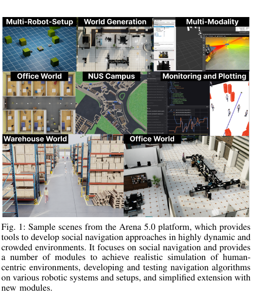
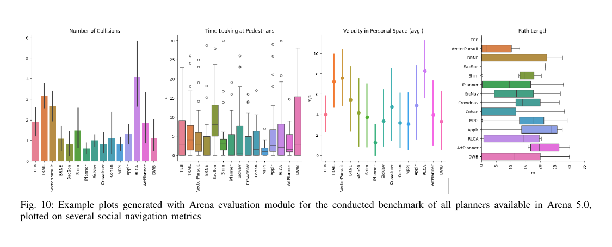

사회적 내비게이션용 시뮬레이션은 사람 모델 하나만 고른다고 완성되지 않아요. 로봇과 센서, 사람의 반응, 건물 구조, 과제 생성, 경로 계획기, 평가 지표가 같은 시간축과 좌표계에서 맞물려야 해요. Arena 5.0은 이 묶음을 <abbr title="로봇 운영체제 2세대">ROS 2</abbr> 환경에서 구성하고, Isaac Sim의 광사실 장면과 Gazebo 기반 실행을 함께 다루려는 연구예요. 원문은 Robotics: Science and Systems 2025 논문으로 발표됐고, 확장된 arXiv 원고는 2026년 10월 8일 올라왔어요. 두 날짜를 하나의 최신 논문 발표일처럼 합치면 안 돼요.

논문의 질문은 “어느 경로 계획기가 가장 좋은가”보다 넓어요. 다양한 로봇·센서·보행자 모형·실내 세계를 한 틀에서 바꾸고, 같은 과제를 여러 계획기에 반복해 결과를 모을 수 있는가를 묻습니다. 광사실 렌더링은 그중 한 층이에요. 사회적 행동의 현실성, 센서 오차, 계산 지연, 실제 사람의 반응까지 자동으로 사실이 되는 것은 아니에요.

<figure class="fig"><figcaption>Arena 5.0이 제공하는 다중 로봇·세계 생성·센서·감시·사무실·창고 장면을 한눈에 보여줘요. 그림의 광사실 외형과 사람 행동의 타당성은 서로 다른 검증 항목이에요. (출처: Arena 5.0 RSS 2025 논문 Fig. 1, 공개 재사용 라이선스 미확인·논지 해설을 위한 부분 인용)</figcaption></figure>

## 여러 도구를 한 실행 계약으로 묶어요

Arena 5.0의 중심에는 실행 설정을 읽는 `arena_simulation_setup`, 과제와 행위자를 배치하는 `task_generator`, 전체 실행을 올리는 `arena_bringup`이 있어요. 그 주변에 로봇 모형, 보행자 시뮬레이터, 전역·지역 경로 계획기, 기록과 평가 모듈이 붙어요. 사용자는 모든 구성 요소를 새로 짜기보다 선택한 조합을 설정 파일에 적고 같은 틀에서 실행할 수 있어요.

이 구조의 이점은 비교 단위를 고정하기 쉽다는 데 있어요. 같은 건물, 시작점, 목표점, 사람 수, 난수 초기값을 두고 계획기만 바꿀 수 있어요. 반대로 구성 요소의 의미가 다르면 이름만 같은 실험이 돼요. 어떤 계획기는 비용지도를 받고, 어떤 계획기는 2차원 라이다를 받고, 어떤 계획기는 보행자 상태나 RGB-D 영상을 받아요. 입력 정보가 다른 계획기의 결과를 한 줄 순위로 정리하면 알고리즘 성능과 센서 특혜가 섞여요.

원문 표에는 DWB, MPPI, CoHAN, BRNE, SACSoN, RLCA, ROSNavRL, TRAIL, SicNav, iPlanner를 비롯한 여러 계획기가 정리돼요. 각 방법은 요구 입력과 계산 방식이 달라요. 예를 들어 보행자 위치가 필요한 방법에 시뮬레이터 정답 상태를 주고, 다른 방법에는 잡음 있는 거리 센서만 주면 비교 조건이 대칭적이지 않아요. Arena가 여러 방법을 실행할 수 있다는 사실과 공정한 비교 설계를 제공한다는 주장은 분리해서 읽어야 해요.

설명용으로 두 계획기가 같은 12m 통로를 이동한다고 가정해요. A는 사람의 정답 위치·속도를 20Hz로 받고, B는 10Hz 검출 결과에 200ms 지연이 있어요. 사람이 1.2m/s로 횡단하면 B의 사람 위치는 단순 계산으로 약 0.24m 오래될 수 있어요. A의 충돌률이 낮아도 계획기 구조 때문인지 관측 차이 때문인지 가를 수 없어요. 이 수치는 원문 실험값이 아니라 입력 계약의 영향을 보여주는 가정이에요.

## Isaac Sim과 Gazebo는 같은 장면도 다르게 계산해요

Arena 5.0은 Isaac Gym과 Isaac Sim을 통합하고 Gazebo 계열 실행도 지원해요. Isaac Sim은 재질·조명·깊이·분할 같은 시각 정보를 풍부하게 만들 수 있어 카메라 기반 인지와 광사실 장면에 유리해요. Gazebo는 <abbr title="로봇의 센서 정보와 제어 명령을 여러 프로그램 사이에서 주고받는 소프트웨어 체계">ROS</abbr> 생태계에서 익숙한 물리·센서 모형과 기존 패키지를 재사용하기 편해요. 플랫폼을 선택할 수 있다는 점은 강점이지만 두 엔진의 결과가 같다는 뜻은 아니에요.

접촉 해석, 마찰, 센서 잡음, 물리 갱신률, 렌더링 시간, 사람 애니메이션의 발 접촉이 다르면 같은 속도 명령도 다른 궤적을 만들어요. 한 엔진에서 충돌하지 않은 계획기가 다른 엔진에서 같은 안전거리를 유지할 것이라고 가정하면 안 돼요. 로봇 바닥 형상과 사람 충돌체가 시각 모델보다 크거나 작아도 충돌 지표가 달라져요.

설명용으로 로봇 제어가 20Hz라면 한 번의 결정을 50ms 안에 끝내야 해요. 센서 생성 18ms, 사람 상태 갱신 12ms, 계획 24ms가 순차 실행되면 합은 54ms예요. 평균값만 보면 각 모듈이 빠르지만 전체 고리는 마감 시간을 넘겨요. 병렬 실행과 시간 동기화가 없다면 오래된 관측으로 다음 명령을 만들 수 있어요. 이 수치는 Arena 측정 결과가 아니라 실시간 계약을 확인하기 위한 예예요.

성능 보고에는 평균 계산 시간뿐 아니라 P95 또는 P99 지연, 실시간 배율, 떨어진 센서 프레임, 물리 시간과 ROS 시간의 차이를 함께 적어야 해요. 원문도 가벼운 시뮬레이터보다 높은 계산 부담과 지연이 생길 수 있음을 한계로 들어요. 광사실 장면을 켠 결과와 끈 결과를 섞으면 병목이 경로 계획기인지 렌더링인지 알기 어려워요.

## 센서 종류가 많아도 인지 실패가 자동으로 생기지는 않아요

지원 센서에는 2차원·3차원 라이다, RGB와 RGB-D 카메라, 관성 측정 장치, 초음파, 발 접촉 등이 포함돼요. 여러 감각을 쓸 수 있어 시각·거리·관성을 결합한 방법을 시험하기 좋아요. 그러나 시뮬레이터가 발행한 보행자 상태를 계획기에 주는 경우와 카메라 영상을 검출기·추적기에 통과시키는 경우는 완전히 달라요.

정답 상태에는 가림에 따른 누락, 사람 식별자 교체, 깊이 구멍, 반사 재질, 흔들리는 외부 보정값이 없어요. 실제와 비슷한 영상도 인지기의 오류 분포가 실제와 같다는 보장은 없어요. 사람 반응 모형이 로봇의 정답 위치를 보는 경우에도 실제 사람처럼 소리나 시야로 로봇을 늦게 발견하는 현상이 빠질 수 있어요.

인지 계층을 검증하려면 세 단계를 나눌 수 있어요. 첫째, 정답 사람 상태를 써서 계획기 자체의 상호작용을 봐요. 둘째, 렌더링된 센서를 실제 인지 흐름에 넣고 검출·추적 오차를 더해요. 셋째, 실제 기록 자료에서 측정한 누락률과 지연을 시뮬레이션에 주입해 민감도를 비교해요. 세 결과가 모두 좋아야 실제 이전 가능성을 더 강하게 말할 수 있어요.

설명용으로 사람 검출 재현율이 95%라고 해도 20명이 각 100프레임 나타나는 장면에는 기대값 기준 100개의 누락 관측이 생겨요. 누락이 독립적이라는 가정도 현실에서는 약해요. 기둥 뒤처럼 연속 가림이 생기면 여러 프레임이 한꺼번에 사라져 제어에 더 큰 영향을 줘요. 이 계산은 원문 성능 수치가 아니라 평균 재현율만으로 안전을 판단할 수 없음을 보이는 예예요.

## 사람 모형은 반응을 만들지만 사람 연구를 대신하지 않아요

Arena 5.0은 HuNavSim과 사회적 힘 모형을 통해 사람 행위자를 움직여요. 목표를 향하는 힘, 사람·장애물에서 멀어지는 힘, 집단 유지와 로봇 반응을 조합해 통로·사무실·창고에서 움직임을 만들 수 있어요. 행위자 역할과 장면 사건을 구성해 정상 근무 시간, 비상 상황, 예상하지 못한 어린이 출현, 로봇을 막거나 향해 움직이는 상호작용도 설정할 수 있어요.

이 다양성은 계획기의 약점을 드러내는 시험 입력이에요. 실제 사람이 그 매개변수대로 느끼고 판단한다는 증거는 아니에요. 사회적 힘 모형은 거리와 속도를 매끄럽게 계산하지만 눈맞춤, 양보 협상, 문화 차이, 로봇 외형에 대한 불안은 별도 모형이나 사람 평가가 필요해요. 사람 애니메이션 종류가 제한되면 외형은 다양해도 행동은 반복될 수 있어요. 원문도 인간 움직임이 사용 가능한 애니메이션 자산에 제한된다고 적어요.

강한 계획기는 평균적인 보행자에게만 잘 움직이는 방법보다 반응 가정이 틀릴 때도 실패를 제한하는 방법이에요. 검증 장면에는 협조적인 사람, 로봇을 못 본 사람, 갑자기 방향을 바꾼 사람, 여러 명이 대화하며 길을 막는 집단을 분리해서 넣어야 해요. 각 행동 유형의 성공률·최소 거리·정지 시간을 따로 보고해야 특정 유형의 실패가 평균에 묻히지 않아요.

설명용으로 60개 장면 가운데 협조형 45개에서 모두 성공하고 비협조형 15개에서 5번 충돌했다고 가정해요. 전체 성공률은 91.7%지만 비협조형만 보면 성공률은 66.7%예요. 배치 비율이 바뀌면 전체 수치가 크게 달라져요. 이것은 Arena 논문 결과가 아니라 층화 보고가 필요한 이유를 보여주는 계산이에요.

## 텍스트와 평면도에서 시험 세계를 만들어요

Arena 5.0의 세계 생성은 자연어 설명이나 평면도에서 출발해요. <abbr title="공간과 물체의 관계를 그래프로 표현한 자료">3DSG</abbr>를 만들고, HouseDiffusion으로 방 배치를 정한 뒤 MiDiffusion으로 물체를 채우는 흐름을 제시해요. 이후 생성된 세계에 시작점·목표점·사람과 사건을 배치해 시험 과제를 만들어요. 사람이 모든 벽과 가구를 손으로 배치하는 비용을 줄이려는 구성이에요.

원문은 약 6만 항목의 자료로 T5-Small 기반 하위 모형 두 개를 학습했다고 설명해요. 제시된 학습 설정은 묶음 크기 16, 10회 학습 반복, AdamW, 학습률 3×10⁻⁵, 준비 단계 500, 가중치 감쇠 0.01, 탈락 비율 0.1, 기울기 누적 4예요. 이 숫자는 세계 생성 모형의 재현 단서이지, 생성된 모든 건물이 건축적으로 타당하다는 보증이 아니에요.

생성 세계는 연결되지 않은 방, 지나치게 좁은 문, 겹친 물체, 로봇 반경보다 작은 통로를 만들 수 있어요. 사용자 연구에서도 일부 잘못된 평면도와 비현실적인 세계가 지적됐어요. 생성 성공을 파일 생성 여부로 정의하지 말고 탐색 가능한 연결성, 충돌 없는 배치, 출입구 폭, 목표 도달 가능성을 검사해야 해요.

설명용으로 문 폭이 0.9m이고 로봇 지름이 0.55m, 양쪽 안전 여유가 각각 0.2m라면 필요한 폭은 0.95m예요. 기하학적으로 로봇 몸체는 통과할 수 있어 보여도 안전 여유를 포함하면 장면이 부적합해요. 이 값들은 원문 세계의 치수가 아니라 생성 후 검사를 설명하기 위한 가정이에요.

원문의 현재 생성 범위는 사무실·병원·창고 같은 제한된 환경 유형에 집중돼요. 예시와 설명에서 환경 이름이 다르게 열거되는 부분도 있어 실제 공개 구성에서 지원하는 목록을 버전별로 확인해야 해요. 주택, 역사, 식당, 야외 광장까지 일반화됐다고 넓혀 말하면 안 돼요.

## 12개 수준의 세계에서 여러 계획기를 반복해요

벤치마크는 병원·사무실·창고 세 범주에 각 4개 수준을 두고, 원문 표의 계획기들을 각 세계에서 15회 실행하는 방식으로 설명돼요. 같은 장면의 무작위성을 반복해 한 번의 우연한 성공을 줄이려는 설계예요. 충돌, 목표 도달 시간, 경로 길이, 평균 속도·가속도·저크뿐 아니라 사람을 바라본 시간, 개인 공간 속도, 사람 쪽으로 움직인 정도 같은 사회 지표도 계산해요.

충돌 판정은 2회 미만이라는 성공 조건과 함께 읽어야 해요. 한 번 접촉한 실행이 성공에 포함될 수 있다면 “성공”을 무충돌과 같은 뜻으로 쓰면 안 돼요. 충돌 횟수와 충돌한 실행 비율, 접촉 강도, 사람과의 충돌인지 벽과의 충돌인지 나눠야 해요. 목표 도달 시간도 실패 실행을 제외하는지 허용 최대 시간으로 넣는지에 따라 순위가 달라져요.

경로 길이와 시간만 줄이면 사람 가까이 빠르게 지나가는 경로가 유리할 수 있어요. 개인 공간 시간만 줄이면 로봇이 지나치게 멀리 돌아 목표 효율이 나빠질 수 있어요. 하나의 종합 점수로 합치려면 가중치가 어떤 운영 가치를 나타내는지 밝혀야 해요. 가중치가 바뀔 때 순위가 뒤집히는지 민감도도 보여줘야 해요.

<figure class="fig"><figcaption>원문 평가 모듈이 생성한 예시로, 충돌 수·보행자 주시 시간·개인 공간 속도·경로 길이는 서로 다른 판단을 만들어요. 한 그래프의 우승자를 전체 우승자로 해석하기 어려운 이유가 드러나요. (출처: Arena 5.0 확장 원고 Fig. 10, 공개 재사용 라이선스 미확인·논지 해설을 위한 부분 인용)</figcaption></figure>

설명용으로 A가 15회 중 14회 도달하고 평균 경로가 18m, B가 15회 모두 도달하고 평균 경로가 20m라고 가정해요. 성공한 실행만 평균내면 A가 짧아 보이지만 실패 1회를 허용 최대 거리 30m로 벌점 처리하면 A의 평균은 `(14×18+30)/15=18.8m`가 돼요. 그래도 B보다 짧지만 성공률 차이를 함께 봐야 판단할 수 있어요. 이 계산은 원문 표 값을 재계산한 것이 아니에요.

15회 반복은 분포를 보기 위한 시작점이에요. 드문 충돌의 확률을 정밀하게 추정하기에는 작을 수 있어요. 계획기·세계·사람 초기값을 함께 층화하고 신뢰구간을 제시해야 해요. 난수 초기값을 계획기마다 다르게 쓰면 장면 난이도 차이가 알고리즘 차이처럼 보일 수 있으니 동일 장면 쌍 비교가 좋아요.

## 사용자 연구는 도구 사용성을 물었어요

원문은 독일·미국·싱가포르·일본·한국의 참가자 20명을 대상으로 설치와 모듈 사용, 과제 구성, 학습·계획기·로봇 설정 경험을 평가했어요. 전문성 수준도 다양하게 구성했어요. 이 연구는 개발 도구의 사용성과 기능 이해를 살피는 근거예요. 보행자가 로봇 경로를 편안하게 느꼈는지 검증한 인간 대상 사회적 수용성 연구와는 다릅니다.

참가자 반응은 전반적으로 긍정적이었지만 안정성, 긴 대기, 잘못된 평면도, 비현실적인 세계, 높은 계산 자원 요구가 지적됐어요. 이 의견은 병목 후보를 알려주지만 특정 하드웨어에서의 지연 시간을 대신하지 않아요. CPU·GPU·메모리, 장면 복잡도, 사람 수, 센서 수를 고정한 성능 측정이 추가로 필요해요.

도구 사용성이 좋다는 결과와 실험 재현성도 구분해야 해요. 설치가 쉬워도 컨테이너 이미지, ROS 2 배포판, Isaac Sim 버전, 그래픽 드라이버, 장면 자산 버전이 바뀌면 결과가 달라질 수 있어요. 실행 설정, 난수 초기값, 계획기 매개변수, 세계 파일, 원시 기록을 묶어 보존해야 다른 연구자가 같은 비교를 반복할 수 있어요.

## 실제 이전은 단계별 차이를 측정해야 해요

Arena 5.0은 많은 조합을 빠르게 거르는 시험장으로 유용해요. 그 결과만으로 실제 사람 옆 주행의 안전과 편안함을 승인하기에는 부족해요. 시뮬레이션에서 쓴 센서·사람·물리 가정이 실제 배치에서 얼마나 어긋나는지 단계별로 측정해야 해요.

첫 단계는 시뮬레이터 안에서 정답 상태와 센서 추정 상태의 결과를 비교하는 일이에요. 둘째는 실제 센서 기록을 재생해 인지 지연과 누락을 포함하는 일이에요. 셋째는 사람 없는 실물 장애물 시험으로 정지 거리와 제어 주기를 확인해요. 넷째는 감독된 저속 사람 상호작용에서 최소 거리와 불편 반응을 기록해요. 앞 단계 실패를 해결하지 않고 다음 단계로 넘어가면 원인을 가리기 어려워요.

시뮬레이션-실제 차이는 성공률 하나보다 변수별로 보는 편이 좋아요. 속도 오차, 회전 지연, 검출 지연, 최소 거리, 충돌체 크기, 마찰, 사람 반응 시간의 분포를 비교해요. 실제 분포가 시뮬레이터 범위 밖에 있으면 모형 매개변수를 넓히고 다시 시험해요.

설명용으로 시뮬레이션 제동 감속도가 1.5m/s²이고 실제가 0.9m/s²이며 주행 속도가 1.0m/s라고 가정해요. 반응 시간을 제외한 제동 거리는 각각 약 0.33m와 0.56m예요. 약 0.23m 차이는 개인 공간 지표를 통과한 경로를 실제에서는 더 위험하게 만들 수 있어요. 이 값은 Arena 실측이 아니라 물리 차이를 점검하는 계산 예예요.

Arena 5.0을 도입할 때는 [[2026-10-17_socialnav_arena-rosnav|Arena-Rosnav 4.0이 사회적 세계를 만드는 방법]]과 버전 차이를 먼저 고정하는 편이 좋아요. 5.0의 광사실 장면·세계 생성·평가 폭은 비교 범위를 넓혀요. 그만큼 센서 입력의 공정성, 사람 모형의 조건, 계산 자원, 생성 세계의 유효성까지 기록해야 결과가 설명력을 가져요. 이 플랫폼의 가치는 현실을 대신하는 데 있지 않고, 현실 시험 전에 실패 가정을 체계적으로 드러내는 데 있어요.

---

<!-- src-block -->
출처 — https://roboticsproceedings.org/rss21/p092.html
