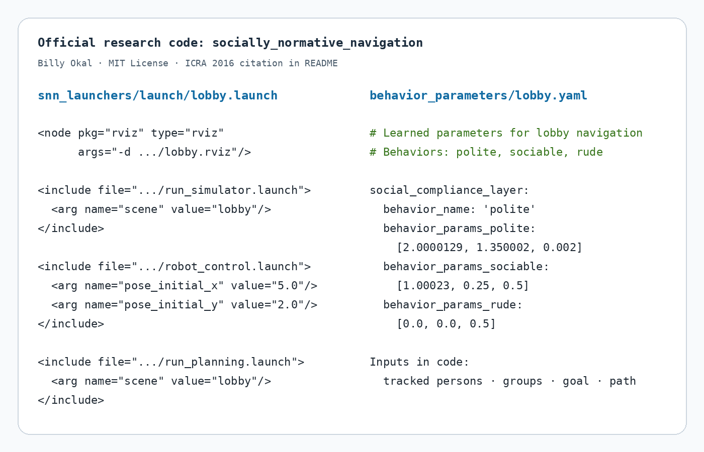

사람이 많은 로비에서 숙련된 운전자가 로봇을 부드럽게 조종했다고 해 볼게요. 기록에는 위치와 속도, 주변 사람, 선택한 경로가 남습니다. 이 경로를 그대로 외우면 같은 로비에서는 흉내 낼 수 있지만 가구 배치나 사람 흐름이 바뀌면 쓸 수 없어요. 반대로 “왜 이 경로를 골랐는가”를 설명하는 비용을 배우면 새로운 장면에서도 비슷한 판단을 할 가능성이 생깁니다.

Billy Okal과 Kai O. Arras가 ICRA 2016에 발표한 *Learning Socially Normative Robot Navigation Behaviors with Bayesian Inverse Reinforcement Learning*은 이 방향을 택했습니다. 사람의 사회적 주행 시연에서 숨은 보상 구조를 역으로 추론하고, 그래프 기반 상태 표현과 표본 궤적으로 큰 주행 공간에 적용하려 했어요. 논문은 실물 로봇과 대규모 보행자 시뮬레이터에서 여러 규범적 행동을 학습했다고 보고합니다.

여기서 <abbr title="사람 시연을 잘 설명하는 보상 함수를 역으로 찾는 학습">역강화학습</abbr>은 행동 분류와 달라요. “이 장면에서는 왼쪽으로 가라”를 외우는 대신, 사람에게 가까이 가는 비용·관계를 가로지르는 비용·목표에서 멀어지는 비용 같은 특징의 가중치를 찾습니다. 같은 가중치를 새 지도와 사람 배치에 적용하면 경로 자체는 달라도 비슷한 선호를 낼 수 있어요.

## 정방향 강화학습을 거꾸로 돌려요

일반 강화학습은 보상이 주어졌을 때 보상을 크게 만드는 정책을 찾습니다. 역강화학습은 전문가 궤적이 주어졌을 때 그 궤적을 합리적으로 만드는 보상을 찾습니다. 관측된 시연을 `D`, 보상 가중치를 `w`라고 하면 핵심 질문은 “`w`가 주어졌을 때 이 시연이 나올 가능성”이에요.

<abbr title="가능한 가중치마다 사전 믿음과 시연 가능성을 결합해 분포로 추론하는 방법">베이지안 역강화학습</abbr>은 하나의 최적 가중치만 내기보다 시연 뒤의 가중치 분포를 다룹니다. 개념적으로는 `사후분포 ∝ 시연 가능도 × 사전분포`예요. 여러 보상 조합이 비슷한 경로를 설명할 수 있다면 불확실성을 남길 수 있습니다.

예를 들어 사람과 거리 유지 특징, 대화 집단 사이를 가로지르는 특징, 목표 방향 이탈 특징이 있다고 합시다. 운전자가 집단을 크게 돌아갔다는 시연 하나만 보면 사람 거리와 집단 관계 중 어느 쪽이 더 중요했는지 완전히 구분하기 어려워요. 여러 장면의 시연과 사전분포를 함께 보면 가능한 가중치가 좁아지지만, 데이터가 말하지 않은 구분을 자동으로 발명하지는 않습니다.

이 점이 베이지안이라는 이름의 실용적 의미예요. 가장 가능성 높은 가중치 하나만 고르면 확신이 과해질 수 있습니다. 여러 가중치 표본을 유지하면 어떤 특징은 강하게 학습됐고 어떤 특징은 애매한지 볼 수 있어요. 다만 원 논문의 전체 수식과 표본화 세부는 IEEE 폐쇄 접근 때문에 이번 검토에서 본문 전체를 재확인하지 못했습니다. 여기서는 제목·초록에서 확인되는 그래프 표현과 표본 궤적 기반 베이지안 IRL 범위를 넘겨 단정하지 않아요.

## 그래프 표현이 필요한 이유

연속 평면의 모든 위치·방향·속도를 상태로 만들면 상태 공간이 매우 커집니다. 반대로 격자를 거칠게 나누면 좁은 통로나 사람 관계 경계가 사라질 수 있어요. 논문은 과제 구조를 담는 유연한 그래프 표현을 만들고, 이 그래프에서 궤적을 표본화하는 방식으로 베이지안 IRL을 확장했다고 초록에 설명합니다.

그래프에서는 중요한 위치와 연결을 노드와 간선으로 표현할 수 있어요. 복도 입구, 사람 주변 우회 지점, 로비 통과 경로처럼 후보를 구조화하면 모든 연속 경로를 열거하지 않고도 의미 있는 궤적을 만들 수 있습니다. 표본 궤적은 보상 가중치가 어떤 경로를 선호하게 하는지 비교하는 데 쓰입니다.

표현은 단순 계산 장치가 아니라 학습 가능한 행동의 경계를 정합니다. 그래프에 대화 집단을 우회하는 연결이 없으면 아무리 좋은 시연을 줘도 그 경로를 표현할 수 없어요. 노드가 너무 성기면 사람과의 미세한 거리 차이가 같은 상태가 되고, 너무 촘촘하면 계산량과 표본 수가 커집니다. “보상을 배웠다”는 말 앞에는 “정해 둔 그래프와 특징 안에서”라는 조건이 붙어요.

## 특징이 없으면 규범도 배울 수 없어요

역강화학습은 사람이 중요하게 여긴 모든 것을 자동으로 찾아내는 마법이 아닙니다. 보통 보상을 특징의 가중합으로 두면, 학습은 주어진 특징 사이의 가중치를 조정합니다. 특징에 없는 개념은 가중치를 아무리 바꿔도 나타나지 않아요.

원저자 공식 코드에는 논문과 연결된 구현의 특징 설계를 볼 수 있습니다. 사회적 비용 함수는 사람과의 거리에서 생기는 방해, 사람 관계를 잇는 선분과의 거리에서 생기는 방해, 목표 방향 이탈을 세 특징으로 계산합니다. `polite`, `sociable`, `rude` 행동마다 세 가중치 묶음을 두고, 로비 설정은 학습된 매개변수라고 표시해요.

이 코드는 논문 본문과 동일한 모든 실험을 재현하는 완결 패키지라고 단정할 수는 없습니다. README는 이 저장소가 SPENCER 프로젝트에서 사용된 연구 코드이며 해당 ICRA 2016 논문을 인용하라고 안내합니다. 코드 구조는 어떤 센서 주제와 비용 특징이 실제 ROS 주행 계층으로 이어졌는지 보여 주는 1차 구현 근거예요.

<figure class="fig"><figcaption>원저자 공식 저장소의 로비 실행 파일과 행동 매개변수 발췌입니다. 시뮬레이터·로봇 제어·move_base 계획을 묶고, 사회적 비용 계층은 추적 사람·집단·목표·경로를 받습니다. 그림은 원문 도식이 아니라 MIT 라이선스 공식 연구 코드의 가독성 편집본이에요. (출처: Billy Okal, <a href="https://github.com/makokal/socially_normative_navigation">socially_normative_navigation</a>, MIT License)</figcaption></figure>

코드의 사회적 비용 계층은 추적된 사람, 집단 관계, 목표, 전역 경로를 구독합니다. 각 비용지도 셀에서 사람·관계·목표 특징을 계산하고, 기존 비용과 사회적 비용 중 큰 값을 주 비용지도에 씁니다. `rude` 행동은 사회적 비용을 0으로 돌려주는 분기도 있어 행동 가중치 차이를 비교할 수 있어요.

사람 관계 방해 특징은 두 사람을 잇는 선분과 후보 위치의 거리를 봅니다. 후보가 관계 선분 가까이에 있으면 문턱과의 차이만큼 비용을 더해요. 사람 방해 특징은 사람과 후보 위치의 거리를 사용합니다. 목표 방향 이탈은 궤적 각 구간이 목표 방향과 이루는 각도를 할인해 더합니다. 이런 특징은 이해하기 쉽지만 사람이 느끼는 모든 사회적 의미를 담지는 못해요.

## 시연은 정답이 아니라 특정 상황의 선택이에요

전문가 시연에는 운전자의 숙련도, 시야, 로봇 크기 인식, 당시 사람 흐름이 함께 들어갑니다. 한 운전자가 왼쪽으로 크게 우회했다고 해서 그 장소의 보편 규범이 왼쪽 우회라는 뜻은 아니에요. 운전자가 카메라 사각을 피했거나, 바닥 장애물을 봤거나, 보수적으로 운전했을 수도 있습니다.

여러 운전자의 시연을 섞으면 서로 다른 선호가 평균으로 뭉개질 수 있어요. 한 사람은 대화 집단을 멀리 돌고 다른 사람은 정중히 감속해 가까이 지나갈 수 있습니다. 하나의 가중치 벡터로 두 행동을 설명하면 어느 쪽도 닮지 않은 중간 정책이 나올 수 있어요. 장소·문화·운전자별 분포를 나누거나 혼합 모델을 쓰는 검토가 필요합니다.

시연 경로가 선택되지 않은 대안을 알려 주지 않는다는 문제도 있어요. 운전자가 한 경로로 성공했더라도 다른 경로가 더 안전했는지 알 수 없습니다. 역강화학습은 시연자가 합리적으로 높은 보상 행동을 골랐다는 가정을 둡니다. 피로, 실수, 센서 지연이 섞인 시연을 모두 규범으로 해석하면 오류도 보상에 들어갑니다.

설명용으로 특징 벡터가 `[사람 근접, 관계 가로지름, 목표 이탈]`이고 두 후보 경로의 누적 특징이 A=`[2,0,5]`, B=`[1,3,2]`라고 합시다. 가중치가 `[3,4,1]`이면 비용은 A가 `2×3+0×4+5×1=11`, B가 `1×3+3×4+2×1=17`이라 A를 고릅니다. 관계 가로지름 특징을 빼면 B 비용은 5가 되어 선택이 뒤집혀요. 특징 하나의 존재가 학습 가능한 규범을 바꾼다는 예입니다.

가중치도 서로 식별되지 않을 수 있습니다. 모든 시연에서 사람 근접과 관계 가로지름이 함께 늘고 줄면 두 특징 중 어느 쪽이 중요한지 구분하기 어려워요. 설명용으로 시연 특징이 늘 `[1,1,0]`과 `[2,2,0]`만 나온다면 가중치 `[3,1,0]`과 `[1,3,0]`은 같은 총비용을 만듭니다. 서로 다른 장면을 수집해야 사후분포가 좁아집니다.

## 공식 코드가 보여 주는 실행 경계

저장소는 ROS 1의 `move_base`, RViz, SPENCER 관련 메시지와 로봇 제어에 의존합니다. `lobby.launch`는 로비 시각화, 시뮬레이터, 로봇 제어, 계획 모듈을 함께 올려요. 복도와 교차로 실행 파일도 따로 있습니다. 현대 ROS 2 시스템에서 바로 빌드되는 패키지로 해석하면 안 됩니다.

사회적 비용은 `costmap_2d::Layer` 플러그인으로 구현됩니다. 현재 사람·관계 상태와 로봇 위치에서 각 셀 비용을 계산하고 기존 비용지도와 최대값으로 합쳐요. 학습 결과가 속도 명령을 바로 내는 종단간 정책이 아니라 전통 계획기의 비용 공간에 들어가는 구조입니다. 전역·지역 계획은 이 비용을 고려해 경로를 고릅니다.

코드에는 사람을 일정 속도로 미래 위치에 전파하는 예측도 보입니다. 사회적 비용의 기본 예측 지평은 초기화 코드에서 2로 설정돼 있고, 로봇 앞쪽 사람만 정속 예측에 넣습니다. 이는 공개 구현의 동작이지 원 논문 전체 방법을 요약하는 유일한 정의는 아니에요. 배치 시 사람 추적이 잘못되면 예측 비용지도도 잘못됩니다.

사람·집단·목표·경로 입력이 모두 존재한다는 점은 센서 단계가 얼마나 중요한지 보여 줘요. 사람 검출기만 연결한다고 관계 특징이 생기지 않습니다. 누가 누구와 관계가 있는지 나타내는 집단 또는 관계 입력이 필요하고, 프레임과 시각도 맞아야 해요. 목표와 전역 경로가 오래되면 목표 이탈 특징도 엉뚱한 방향을 벌점화할 수 있습니다.

## 논문의 실험 주장을 어디까지 읽을 수 있나

공개 초록은 실물 로봇과 대규모 보행자 시뮬레이터에서 세 가지 예시 주행 과제를 다뤘다고 밝힙니다. 같은 단순 특징 집합으로 사회 규범 정도가 다른 복잡한 행동을 학습할 수 있었고, 관련 과제 성능 지표에서 22% 넘는 효율 증가를 보고해요. 이 숫자는 모든 사회적 주행에서 22% 향상됐다는 뜻이 아닙니다.

IEEE 원문은 이번 조사 환경에서 폐쇄 접근이었고, OpenAlex와 Semantic Scholar도 공개 PDF를 제공하지 않았습니다. 따라서 세 과제의 정확한 표본 수, 시뮬레이터 매개변수, 표별 통계는 확인하지 않은 채 재구성하지 않았어요. 저자 공식 코드와 초록을 결합해 구현 경계를 설명하되, 코드의 현재 파일이 논문 표의 모든 조건과 같다고 주장하지 않습니다.

이 제한은 자료가 부족하니 아무것도 말할 수 없다는 뜻은 아니에요. 초록으로는 연구 질문, 그래프 표현, 표본 궤적 기반 베이지안 IRL, 실물·시뮬레이션 사용을 확인할 수 있습니다. 공식 코드로는 ROS 비용지도 계층, 특징 종류, 행동 매개변수, 입력 주제, 예시 장면을 확인할 수 있어요. 확인한 층을 분리하면 과장 없이도 방법의 실용 구조를 이해할 수 있습니다.

## 배운 보상이 새로운 장소에서 실패하는 이유

첫째는 특징 분포 이동입니다. 넓은 로비에서 학습한 사람 거리 가중치를 좁은 복도에 쓰면 모든 통로가 높은 비용이 될 수 있어요. 로봇은 사회적으로 조심스러운 것이 아니라 갈 길을 찾지 못해 멈출 수 있습니다. 환경 폭에 따라 특징을 정규화하거나, 통로별 가중치를 검증해야 해요.

둘째는 관계 주석 오류입니다. 대화 집단을 잇는 선분을 관계 영역으로 두었는데 추적기가 서로 모르는 두 사람을 집단으로 묶으면 통로가 막힙니다. 반대로 실제 대화 집단을 놓치면 로봇이 사이를 가로지를 수 있어요. 관계 분류의 정밀도와 재현율이 경로 성공률에 어떤 영향을 주는지 따로 측정해야 합니다.

셋째는 문화와 시간 변화입니다. 출근 시간의 한 방향 흐름, 점심시간의 대화 무리, 행사 종료 뒤 밀집 흐름은 같은 장소에서도 달라요. 한 번 배운 가중치를 장소의 영구 규범으로 보면 시연이 수집된 시간대의 우연을 굳힐 수 있습니다. 데이터의 날짜·장면·운전자 범위를 남겨야 해요.

넷째는 센서 가림입니다. 사람을 놓치면 사람 근접 비용은 낮아지고 오히려 그쪽 경로가 좋아 보일 수 있어요. “관측 없음”을 “사람 없음”으로 취급하는 순간 학습된 사회 비용이 위험 방향으로 작동합니다. 추적 신뢰도가 낮을 때는 별도 속도 제한이나 알 수 없음 비용이 필요합니다.

다섯째는 가중치의 의미가 절대적이지 않다는 점입니다. 특징의 단위나 범위를 바꾸면 같은 행동을 내려면 가중치도 바뀌어야 해요. 거리 특징을 m에서 cm로 바꾸면 값이 100배 달라집니다. 학습 가중치 숫자만 복사해 다른 구현에 넣으면 같은 정책이 되지 않아요. 특징 정의와 정규화가 모델의 일부입니다.

## 재현은 학습보다 먼저 특징을 감사해야 해요

첫 단계는 특징 계산 단위시험입니다. 사람 한 명, 관계 한 쌍, 목표 하나를 고정하고 후보 셀을 움직이며 사람 방해·관계 방해·목표 이탈 값이 예상 방향으로 변하는지 확인해요. 관계 선분 바깥과 안, 문턱 바로 앞뒤, 사람이 로봇 앞과 뒤에 있을 때를 나눕니다. 비용지도를 그림으로 보는 것만큼 원시 특징 숫자를 저장하는 일이 중요해요.

두 번째는 시연 식별 가능성 시험입니다. 서로 다른 특징 조합을 드러내는 장면을 설계해요. 사람에게 가깝지만 관계를 가로지르지 않는 경로, 사람과 멀지만 집단 사이를 통과하는 경로, 둘 다 피하지만 목표에서 크게 벗어나는 경로가 필요합니다. 시연이 이 세 상황을 모두 포함해야 가중치 역할을 나눌 수 있어요.

세 번째는 운전자와 장소를 분리한 검증입니다. 한 운전자·한 장소에서 학습하고 같은 조건에서 시험하면 시연 재현성만 볼 수 있습니다. 운전자 제외, 장소 제외, 시간대 제외 검증을 따로 해야 규범 일반화를 볼 수 있어요. 전체 시연을 무작위로 섞어 나누면 거의 같은 장면이 학습과 시험에 들어갈 수 있습니다.

네 번째는 센서 오류 주입입니다. 사람 누락, 가짜 사람, 관계 오분류, 속도 지연, 목표 갱신 지연을 하나씩 넣고 경로 길이·최소 거리·집단 침범·정지 시간을 기록해요. 비용지도 최대값과 최소값이 비정상적으로 같아지는지도 확인합니다. 공개 코드가 각 업데이트에서 비용을 0–254로 다시 사상하므로, 이상치 하나가 나머지 비용 대비를 압축할 가능성도 시험할 수 있어요.

다섯 번째는 보상 불확실성을 행동으로 연결하는 시험입니다. 사후분포에서 여러 가중치를 뽑아 같은 장면의 경로를 계산하고, 경로가 크게 갈리는 곳을 찾습니다. 분산이 큰 장면에서는 하나의 최고 가중치 경로를 확신하기보다 감속하거나 보수적 공통 경로를 고를 수 있어요. 베이지안 학습의 장점은 불확실성을 얻는 데 있는데, 배치에서 평균 가중치 하나만 쓰면 그 장점을 잃습니다.

마지막에는 비용지도와 독립된 충돌 감시를 둡니다. 사회 비용은 사람과 관계를 배려하는 경로 선호이고, 센서 사각의 장애물과 제동 거리를 보장하지 않습니다. 학습된 비용이 낮더라도 가까운 장애물이 있으면 속도를 제한해야 해요. 정책 실패와 안전 계층 개입을 함께 기록하면 어떤 특징이나 관측이 문제였는지 되짚을 수 있습니다.

시연에서 비용을 추론하는 이 접근과, 충돌 회피 경험으로 상태의 장기 가치를 학습하는 [[2026-10-17_socialnav_cadrl|CADRL이 충돌 회피를 가치함수로 바꾼 출발점]]을 나란히 보면 학습 대상의 차이가 선명해집니다. 하나는 사람이 택한 경로를 설명하는 보상을 묻고, 다른 하나는 주어진 보상 아래에서 여러 행위자의 미래 결과를 예측해요.

이 연구의 의미는 사람처럼 보이는 경로를 흉내 냈다는 데만 있지 않아요. 시연을 설명하는 보상 특징을 확률적으로 추론하고, 그래프와 표본 궤적으로 현실 규모의 주행 문제에 연결하려 했습니다. 동시에 배운 규범은 시연자, 특징, 그래프, 장소에 묶여 있어요. 공식 코드에서 사람·관계·목표가 별도 입력으로 드러나는 이유도 여기에 있습니다. 역강화학습은 규범을 자동 발견하는 장치라기보다, 무엇을 관측하고 어떤 특징으로 설명할지 명시한 뒤 시연으로 가중치를 좁히는 방법으로 읽는 편이 정확합니다.

---

<!-- src-block -->
출처 — https://doi.org/10.1109/ICRA.2016.7487452
