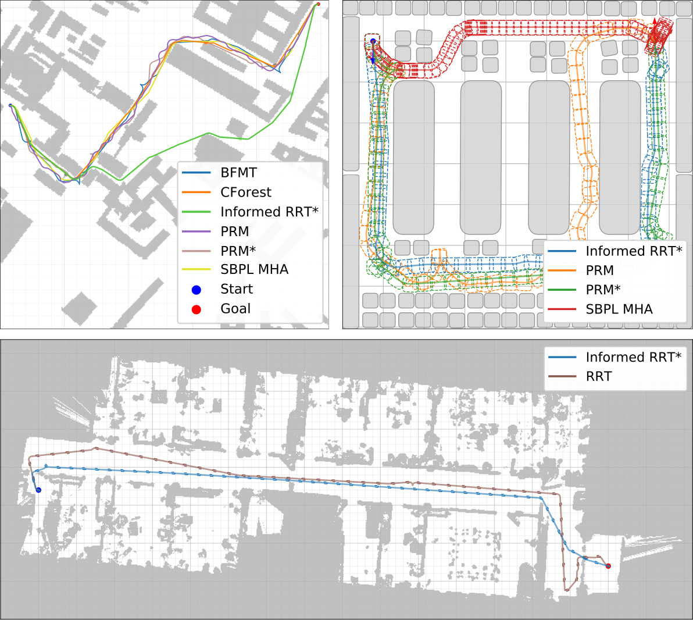
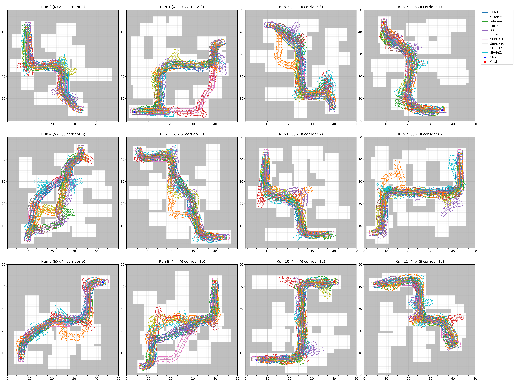

경로 계획기 이름만 바꿔 비교하면 알고리즘의 차이를 제대로 보기 어려워요. 같은 RRT라도 두 상태를 잇는 방법, 충돌 검사, 경로 후처리, 목적 함수가 달라지면 경로 길이와 곡률, 계산 시간이 크게 변해요. Bench-MR은 이 조합을 명시적으로 분리해 바퀴형 비홀로노믹 로봇의 경로 계획을 반복 비교하는 공개 도구예요.

이 도구는 사회적 내비게이션 문헌 지형에서 인접 기준선에 해당해요. 사람을 관찰하거나 사람이 로봇에 반응하는 장면을 평가하는 틀이 아니라, 정적 장애물 속에서 바퀴 로봇이 실행 가능한 경로를 얼마나 빠르고 매끄럽게 찾는지 시험해요. 사회적 경로 계획기가 추가되더라도 사람 편안함·양보·시선 같은 지표는 따로 설계해야 해요.

2021년 IEEE Robotics and Automation Letters 논문은 Bench-MR을 Python 앞단과 C++ 뒷단으로 나눠 소개해요. 사용자는 Jupyter 노트북에서 환경·계획기·연결 함수·후처리·목적 함수를 선택하고, 계산이 많은 평가는 C++에서 실행돼요. 설정과 결과는 JSON으로 오가며, 같은 설정을 여러 계획기와 반복에 적용할 수 있어요.

<figure class="fig"><figcaption>Bench-MR 공식 사이트의 대표 장면은 도시 격자·창고 다각형·실내 점유 격자에서 여러 계획기의 경로가 어떻게 달라지는지 보여줘요. 사람 행위자는 없으며 정적 환경 경로 계획을 비교하는 자료예요. (출처: robot-motion/bench-mr 공식 사이트 자산 · MIT License)</figcaption></figure>

## 계획기 하나가 아니라 전체 조합을 비교해요

Bench-MR의 계획 구성 요소는 계획기, 연결 함수, 충돌 검사기, 후처리, 최적화 기준으로 나뉘어요. 평가 구성 요소는 환경과 성능 지표예요. 같은 계획기를 두고 연결 함수만 바꾸거나, 빠르게 찾은 초기 경로에 여러 후처리를 적용하거나, 목적 함수를 경로 길이에서 장애물 여유로 바꾸는 절제 실험을 만들 수 있어요.

계획기는 <abbr title="열린 움직임 계획 라이브러리">OMPL</abbr>과 <abbr title="격자 기반 탐색 계획 라이브러리">SBPL</abbr> 구현을 함께 지원해요. RRT, PRM, EST, SBL 같은 실행 가능한 경로 우선 방법부터 RRT*, PRM*, Informed RRT*, BIT*, CForest 같은 점근 최적 계열, ARA*, AD*, MHA* 같은 상태 격자 계열을 한 틀에서 고를 수 있어요.

계획기 이름만으로 결과를 예측하면 안 돼요. 표본 기반 계획기는 상태 표본을 어디에 놓고 어떻게 다음 상태까지 확장하는지에 민감해요. 상태 격자 계획기는 미리 정의한 움직임 원시 동작의 해상도와 비용에 민감해요. 같은 시간 안에 찾은 경로가 짧더라도 로봇이 실행하기 어려운 급회전이 많을 수 있어요.

설명용으로 계획기 A가 0.2초에 12m 경로를 찾고 계획기 B가 0.8초에 10m 경로를 찾는다고 가정해요. 제어 주기가 0.5초라면 B는 첫 계획 마감 시간을 놓칠 수 있어요. 반대로 정적 전역 경로를 2초마다 갱신하는 시스템이라면 2m 단축이 더 중요할 수 있어요. 어느 계획기가 낫다는 판단은 운영 시간 한도와 목적 함수에 묶여요. 이 값은 Bench-MR 결과가 아니라 평가 계약의 예예요.

## 연결 함수가 바퀴 로봇의 실행 가능성을 바꿔요

바퀴 로봇은 옆으로 순간 이동할 수 없어요. 상태 공간의 두 점을 직선으로 잇는 것만으로 실제 조향 가능한 경로가 되지 않을 수 있어요. Bench-MR은 Dubins, Reeds-Shepp, 연속 곡률, POSQ 같은 조향 함수를 제공하고, 운동학 자동차와 단일 궤적 자동차 모형의 전방 적분도 지원해요.

Dubins 경로는 전진과 곡률 제한을 다루고, Reeds-Shepp은 전진과 후진을 허용해요. 연속 곡률 연결은 조향이 갑자기 꺾이는 문제를 줄이려 해요. POSQ는 두 자세 사이를 제어 법칙으로 연결해요. 연결 함수가 다르면 같은 표본과 계획기에서도 성공률, 경로 길이, 곡률, 후진 전환 수가 달라져요.

논문 실험에서 운동학 자동차의 무작위 전방 전개를 쓴 RRT·SST와 Reeds-Shepp 연결을 쓴 RRT를 비교했어요. Reeds-Shepp 조합이 해당 조건에서 더 짧은 경로, 더 낮은 정규화 곡률, 더 적은 전후진 방향 전환을 보였어요. 이 결과는 모든 환경에서 RRT가 다른 계획기보다 우수하다는 뜻이 아니라 연결 함수 선택이 계획기 이름만큼 중요하다는 사례예요.

설명용으로 최소 회전 반경이 1.0m인 로봇이 폭 1.2m 막다른 통로에서 180도 돌아야 한다고 가정해요. 점 로봇 격자에서는 회전이 가능해 보여도 차체 길이와 조향 제약을 포함하면 불가능할 수 있어요. 계획 단계의 형상·운동학 모형이 실제 로봇보다 낙관적이면 충돌 없는 경로도 실행에서 실패해요.

## 충돌 검사는 점과 다각형을 구분해요

Bench-MR은 2차원 점유 격자 충돌 검사와 볼록 다각형 충돌 검사를 제공해요. 로봇을 점으로 단순화할 수도 있고 다각형 차체로 표현할 수도 있어요. 장애물까지의 거리장을 만들어 경로 여유 계산과 후처리에 사용할 수도 있어요.

점 로봇은 계산이 가볍지만 차체 회전에 따라 모서리가 장애물에 닿는 현상을 놓쳐요. 원형 팽창은 방향에 무관한 근사라 직사각형 로봇의 긴 축을 과도하게 보수적이거나 낙관적으로 만들 수 있어요. 다각형 검사는 분리 축 정리를 사용해 차체와 장애물의 교차를 보지만 검사 비용이 늘어요.

충돌 검사 시간은 계획기의 다른 부분과 분리해 기록해야 해요. 한 계획기가 많은 후보를 만들고도 빠른 점 검사를 쓰고, 다른 계획기가 적은 후보에 정밀 다각형 검사를 쓰면 전체 시간만으로 탐색 효율을 비교하기 어려워요. Bench-MR은 충돌 검사, 연결 함수 평가, 나머지 계획 단계 시간을 나눠 살필 수 있어요.

설명용으로 한 번의 다각형 검사가 20µs이고 후보 경로마다 300개 상태를 확인하며 500개 후보를 검사한다고 가정해요. 충돌 검사만 `20µs×300×500=3초`가 걸릴 수 있어요. 경로를 따라 상태 간격을 두 배로 넓히면 빨라지지만 얇은 장애물을 건너뛸 위험이 생겨요. 수치는 도구 실측이 아닌 검사 해상도의 절충을 보이는 계산이에요.

## 후처리가 점근 최적 계획기보다 나을 때도 있어요

Bench-MR은 B-Spline, Shortcut, SimplifyMax, GRIPS 같은 경로 후처리를 포함해요. 실행 가능한 경로를 빨리 찾은 뒤 불필요한 굴곡을 줄이는 방식이에요. 논문은 빠른 계획기와 후처리 조합이 주어진 시간 안에서 점근 최적 계획기보다 좋은 결과를 낼 수 있음을 보여줘요.

대표 사례에서 RRT가 0.45초에 초기 경로를 찾고 SimplifyMax가 1ms보다 짧은 시간에 개선했어요. 이 조합은 60초 실행한 Informed RRT*보다 짧은 경로와 비슷한 정규화 곡률을 만들었어요. 점근 최적이라는 이론적 성질은 실행 시간이 충분히 길 때의 수렴 성질이며, 제한 시간에서 언제나 더 좋은 경로를 준다는 뜻은 아니에요.

B-Spline은 모든 경우에 경로 품질을 높이지 않았어요. 논문은 Reeds-Shepp 같은 연결 함수가 실행할 경로와 B-Spline의 작은 회전이 잘 맞지 않아 곡률이 늘 수 있다고 설명해요. 후처리 뒤에도 충돌, 운동학 가능성, 곡률 제한, 전후진 전환을 다시 검사해야 해요.

설명용으로 초기 경로 길이가 14m이고 후처리 뒤 11m가 됐지만 허용 최대 곡률이 0.8m⁻¹에서 1.4m⁻¹로 늘었다고 가정해요. 로봇 허용 최대가 1.0m⁻¹라면 길이는 개선됐어도 실행할 수 없어요. 단일 지표 개선으로 전체 품질을 판단하면 안 되는 이유예요.

## 환경은 정적이고 난이도를 단계적으로 바꿀 수 있어요

환경은 격자와 볼록 다각형 두 부류예요. 미리 정의된 격자에는 Moving AI 도시 지도와 회색조 영상에서 문턱값으로 만든 SLAM 점유 지도가 있어요. 절차 생성 격자는 막힌 셀 비율을 조절한 야외형 환경과 최소 통로 폭을 조절한 실내형 환경을 만들어요.

다각형 환경에는 전진 주차, 후진 주차, 평행 주차, 창고 통로 장면이 있고 SVG 파일로 새로운 환경을 넣을 수 있어요. 무작위 볼록 다각형을 배치한 환경도 만들 수 있어요. 시작·목표 자세와 로봇 형상을 함께 정의하므로 단순 점대점 격자 탐색보다 바퀴 로봇 제약을 반영해요.

논문은 실내형 환경의 최소 통로 폭이 넓어질수록 거의 모든 계획기의 전후진 방향 전환 수가 줄고, 야외형 환경의 막힌 셀 비율이 높아질수록 방향 전환 수가 늘어나는 결과를 보여줘요. 알고리즘 순위가 환경 복잡도에 따라 달라질 수 있다는 뜻이에요. 쉬운 지도 한 장의 평균으로 실제 창고 배치를 대표하면 안 돼요.

<figure class="fig"><figcaption>공식 통로 실험은 12개 서로 다른 격자에서 계획기별 차체 궤적을 겹쳐 보여줘요. 같은 계획기도 통로 구조에 따라 경로 분산과 전후진 전환이 크게 달라져요. (출처: robot-motion/bench-mr 공식 결과 자산 · MIT License)</figcaption></figure>

설명용으로 통로 폭을 로봇 폭의 1.1배, 1.5배, 2.0배로 나누고 각 조건에 같은 50개 초기값을 쓰면 폭 효과와 난수 효과를 구분하기 쉬워요. 조건마다 다른 지도를 새로 뽑으면 통로 폭 외의 구조 차이가 섞일 수 있어요. 짝지은 환경 생성과 난수 초기값 보존이 필요해요. 이 50회는 시험 설계 예이며 원문 반복 수가 아니에요.

## 지표는 경로 길이 외에 곡률과 여유를 봐요

Bench-MR 공식 문서는 허용 최대 곡률, 정규화 곡률, 길이당 각도 변화량, 허용 최대·평균·중앙·최소 장애물 여유, 경로 길이, 매끄러움, 계획 시간, 전후진 방향 전환, 종합 통계를 제공해요. 성공 통계는 경로 발견, 무충돌, 정확 도달을 나눠요. 근사 경로를 반환하는 계획기도 있어 정확 도달 비율을 별도로 둬요.

곡률 지표들은 서로 같은 질문을 하지 않아요. 허용 최대 곡률은 가장 급한 한 구간에 민감하고, 정규화 곡률은 경로 길이와 곡률을 함께 반영해요. 길이당 각도 변화량은 전후진 방향 전환의 큰 방위 변화를 포함할 수 있어요. 방향 전환 수는 로봇이 멈춰 바퀴 방향을 바꿔야 하는 빈도를 나타내요.

장애물 여유를 키우는 목적 함수는 안전해 보이지만 논문 실험에서는 전후진 방향 전환을 크게 늘렸어요. 정규화 곡률 최소화도 OMPL 비용 인터페이스가 두 변을 잇는 순간 생기는 방향 전환을 충분히 반영하지 못해 예상하지 않은 꺾임을 만들 수 있었어요. 목적 함수가 원하는 물리 행동을 실제 지표로 만드는지 확인해야 해요.

공식 통로 통계 그림은 여러 계획기의 곡률·여유·길이·계산 시간·방향 전환 분포를 한 번에 보여줘요. 특정 계획기가 모든 항목에서 우세하지 않아요. 사용자는 자율주행, 창고, 서비스 로봇처럼 과제에 맞는 지표와 허용 기준을 먼저 정해야 해요.

설명용으로 경로 A는 10m, 최소 여유 0.2m, 방향 전환 0회이고 경로 B는 12m, 최소 여유 0.6m, 방향 전환 3회라고 가정해요. 혼잡한 창고에서는 여유가 중요할 수 있고, 승객 탑승 로봇에서는 방향 전환과 급곡률이 더 큰 불편을 만들 수 있어요. 가중 합 하나만 공개하면 이 선택의 이유가 숨어요.

## 재현성은 설정과 결과 파일을 함께 보존해야 해요

Python 앞단은 실험 설정을 만들고 C++ 뒷단 실행을 호출하며 결과 JSON을 읽어 그림을 만들어요. 공식 문서는 Jupyter 노트북 사용을 권장하지만 C++ 실행 파일에 JSON 설정을 넘겨 실행할 수도 있어요. 여러 CPU에서 GNU Parallel로 독립 설정을 병렬 실행하는 예도 있어요.

재현하려면 저장소 커밋, 운영체제, 컴파일러, OMPL과 SBPL의 버전, 계획기 매개변수, 계산 시간 한도, 난수 초기값, 로봇 형상, 지도, 충돌 검사 해상도를 함께 기록해야 해요. 결과 JSON만 남기면 어떤 바이너리와 설정이 만들었는지 알기 어려워요. 노트북 출력도 실행 순서에 따라 오래된 결과가 남을 수 있어요.

난수 초기값은 계획기마다 따로 뽑기보다 같은 환경·시작·목표 묶음에 대응시키는 편이 좋아요. 한 계획기가 우연히 쉬운 표본열을 받고 다른 계획기가 어려운 표본열을 받으면 평균 차이에 난수 운이 섞여요. 완전히 같은 표본을 공유할 수 없는 구현이라면 초기값 목록을 고정하고 반복 순서를 무작위화해 실행 순서와 열 상태의 영향을 줄여야 해요. 제한 시간에 도달해 중단된 실행도 버리지 말고 실패 원인과 마지막 상태를 결과에 남겨야 해요.

종합 점수는 탐색에는 편하지만 원자료를 대신하면 안 돼요. 점수 정규화 범위가 현재 비교 집합에서 정해지면 새 계획기 하나를 추가했을 때 기존 순위가 달라질 수 있어요. 경로 길이·여유·곡률·계산 시간 분포를 함께 보존하고, 종합 점수의 방향과 가중치를 공개해야 다른 적용 환경에서 다시 판단할 수 있어요.

공식 사이트의 차트는 현재 코드에서 자동 갱신될 수 있다고 안내해요. 논문 표와 현재 사이트 그림이 다를 수 있으므로 인용할 때는 시점과 커밋을 적어야 해요. 이 글의 두 이미지는 2026년 10월 17일 공식 사이트에서 받은 원본 자산이며, 코드 저장소의 MIT LICENSE를 확인했어요.

## 사회적 내비게이션에서는 정적 기준선으로 써야 해요

Bench-MR 논문은 복잡한 정적 실내·실외 환경에 초점을 맞추고, 동적 환경은 향후 과제로 남겼어요. 사람을 동적 장애물로 넣는 것만으로 사회적 평가가 되지 않아요. 보행자 궤적, 개인 공간, 집단 통과, 양보, 로봇을 본 사람의 반응 같은 상태와 지표가 현재 기본 구성에는 없어요.

사회적 내비게이션 연구에서는 두 층으로 쓰기 좋아요. 먼저 Bench-MR로 로봇 형상과 조향 제약을 만족하는 정적 경로 계획 구성 요소를 고릅니다. 그다음 [[2026-10-17_socialnav_arena5|Arena 5.0이 광사실 사회적 주행을 시험하는 방식]] 같은 동적 시험장이나 실제 기록에서 사람 상호작용을 평가해요. 정적 환경에서 실패하는 계획기를 사람 장면에 넣기 전에 거를 수 있어요.

반대로 Bench-MR 점수가 좋다는 이유로 사회적으로 좋은 경로라고 말하면 안 돼요. 최소 장애물 여유는 벽과의 거리이고, 최소 사람 거리는 상대 속도와 시선·관계에 따라 의미가 달라요. 매끄러운 경로도 사람 집단 사이를 가르면 불편할 수 있어요. 계산 시간도 센서 인지와 추적, 동적 재계획 비용을 포함하지 않아요.

사회적 계획기를 넣어 비교한다면 정적 장애물 성능을 먼저 같은 조건에서 보고, 이어서 사람 상태 입력을 추가했을 때 생긴 변화만 따로 봐야 해요. 경로가 길어진 까닭이 사람을 배려한 결과인지, 검출 흔들림 때문에 계획이 불안정해진 결과인지 구분해야 합니다. 사람 없는 장면과 사람이 있는 장면에 같은 로봇 형상·조향 함수·충돌 검사를 유지하면 변화의 원인을 더 잘 좁힐 수 있어요. 실제 사람 평가에서는 이동 경로 수치와 함께 멈칫함, 양보 이해, 불편 보고를 별도 관측으로 남겨야 해요.

Bench-MR의 가장 중요한 교훈은 “최고 계획기” 목록보다 비교 조건을 쪼개는 방식이에요. 계획기, 연결, 충돌 검사, 후처리, 목적 함수, 환경, 지표를 각각 기록하면 성능 변화의 원인을 찾을 수 있어요. 사회적 내비게이션에서도 사람 모형, 관측 방식, 경로 계획, 제어, 사회 지표를 같은 방식으로 분리해야 어떤 개선이 실제 행동을 바꿨는지 설명할 수 있어요.

---

<!-- src-block -->
출처 — https://robot-motion.github.io/bench-mr/
