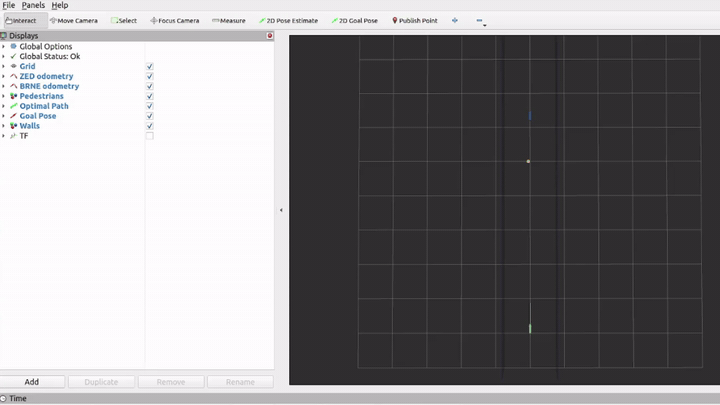
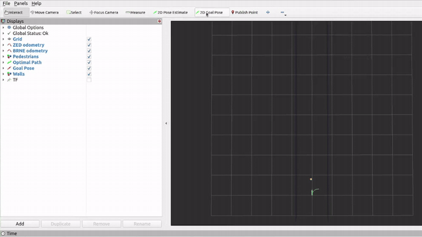

군중 속 경로 계획은 사람을 움직이는 장애물로 예측한 뒤 로봇만 피하게 만드는 문제보다 복잡해요. 로봇이 왼쪽으로 움직이면 사람도 오른쪽으로 양보할 수 있고, 사람이 계속 직진하면 로봇은 더 크게 돌아야 해요. <abbr title="베이즈 규칙 내시 균형, 여러 행위자의 후보 행동 분포를 서로의 비용으로 함께 조정하는 방법">BRNE</abbr>는 로봇과 사람 각각의 후보 궤적에 확률 가중치를 두고, 서로 가까워지는 비용을 반영해 분포를 반복 갱신해요.

Katie Hughes의 `brne_social_nav` 저장소는 이 알고리즘을 ROS 2에서 실행하도록 묶은 공개 구현이에요. Python과 C++ 구현, ZED2i 기반 보행자 추적 변환, Unitree Go1 제어 연결, 시뮬레이션 실행, 실물 통로 시험 기록이 한 저장소에 있어요. 이 글은 알고리즘 원 논문의 전체 성능을 재평가하기보다 이 배포판이 어떤 관측을 받고 무엇을 명령하며 어디까지 실물 근거를 남겼는지 읽어요.

<figure class="fig"><figcaption>공식 이동 보행자 시연에서는 보행자 표식과 로봇 후보 경로가 RViz 통로 위에서 함께 움직여요. 이는 설정된 추정 상태를 받은 경로 계획 시연이며, 영상 기반 검출 성능 자체를 보여주는 장면은 아니에요. (출처: katie-hughes/brne_social_nav README 공식 moving-pedestrian 영상, 저장소 최상위 공개 라이선스 미확인·해설을 위한 짧은 영상 인용)</figcaption></figure>

## 한 경로 대신 여러 후보의 무게를 바꿔요

구현은 각 행위자마다 일정한 수의 후보 궤적을 만들어요. 로봇 후보는 선속도와 각속도 조합에서 생성하고, 사람 후보는 현재 위치와 속도로 직선 이동한 평균 궤적 주위에 시간 상관을 가진 변동을 더해요. 후보 두 개가 시간축에서 가까워질수록 비용이 커지고, 비용이 큰 후보의 확률 가중치는 줄어들어요.

핵심은 한 번의 최근접 거리만 보는 대신 궤적 분포를 결합한다는 점이에요. 로봇이 정면으로 갈 후보가 사람의 직진 후보 대부분과 충돌하면 그 무게가 낮아져요. 옆으로 돌아가는 후보가 여러 사람 분포와 덜 겹치면 선택 가능성이 높아져요. 사람 쪽 분포도 같은 상호 비용의 영향을 받기 때문에 모든 사람이 고정 경로를 유지한다고 가정하지 않아요.

공개 Python 구현의 `costs_nb`는 두 후보 궤적 사이의 각 시점 제곱거리를 비선형 함수에 넣고, 시간축에서 가장 큰 비용에 `cost_a3`를 곱해요. `weights_update_nb`는 다른 행위자의 후보 가중치로 기대 비용을 모아 지수 함수로 새 무게를 계산해요. 이 갱신을 코드에서 10번 반복한 뒤 로봇 후보에는 통로 경계 마스크를 적용해요.

“균형”이라는 이름이 실제 사람이 합리적으로 행동을 조율한다는 뜻은 아니에요. 사람 후보 분포, 비용 함수, 반복 횟수, 추적 속도가 설계자의 가정이에요. 실제 사람이 멈추거나 갑자기 방향을 바꾸면 현재 속도를 중심으로 만든 후보가 틀릴 수 있어요. 어린이, 휠체어, 여러 명이 손을 잡고 걷는 집단처럼 독립 행위자 가정이 약한 경우도 별도 시험이 필요해요.

설명용으로 로봇 후보가 왼쪽·직진·오른쪽 세 개이고 초기 무게가 모두 1이라고 가정해요. 사람 분포와의 기대 비용이 각각 0.2, 2.0, 0.5라면 `exp(-비용)`은 약 0.82, 0.14, 0.61이에요. 정규화하면 직진 후보가 크게 줄어요. 원 구현은 후보가 훨씬 많고 비용을 반복 갱신하므로 이 세 후보 계산은 원리만 보여주는 가정이에요.

## 기본 설정은 2.5초 앞의 196개 후보를 봐요

저장소의 `brne.yaml` 기본값은 재계획 10Hz, 시간 간격 0.1초, 25단계, 행위자당 후보 196개예요. 따라서 명목 예측 구간은 `0.1초×25=2.5초`예요. 최대 고려 행위자는 로봇을 포함해 5개이고, 보행자 수가 더 많으면 가까운 사람을 골라 제한해요.

로봇 속도 설정은 허용 최대 선속도 0.6m/s, 허용 최대 각속도 1.0rad/s, 명목 선속도 0.4m/s, 열린 공간 속도 0.6m/s예요. 사람 기록을 유지하는 시간은 0.5초, 가까운 정지 기준은 0.5m, BRNE 활성 거리는 6.0m, 목표 도달 기준은 0.5m로 설정돼요. 통로 y 범위는 기본 -1.5m부터 1.5m예요.

이 수치들은 배포판 기본값이지 모든 로봇의 안전값이 아니에요. 로봇 폭, 제동 거리, 센서 지연, 보행자 속도에 맞춰 다시 검증해야 해요. 특히 보행자 기록을 0.5초 유지하면 가려진 사람을 잠시 보존할 수 있지만, 사람이 방향을 바꾼 뒤 오래된 속도를 계속 적용할 수도 있어요.

설명용으로 사람이 1.4m/s로 걷고 추적이 0.5초 끊기면 단순 직선 외삽 위치는 0.7m 이동해요. 실제 사람이 90도로 방향을 바꿨다면 예측과 실제 위치 사이 거리는 더 커질 수 있어요. 정지 기준 0.5m보다 큰 오차가 생길 수 있으므로 기록 유지 시간은 인지 안정성과 오래된 상태 위험 사이의 절충이에요. 이 값 계산은 기본 설정의 민감도를 설명하며 저장소의 측정 결과가 아니에요.

후보 수 196은 짝수의 제곱근 조건을 만족하도록 선택됐어요. 코드가 선속도 쪽 해상도를 각속도보다 더 많이 배분하기 때문이에요. 후보를 늘리면 행동 공간을 더 촘촘히 덮을 수 있지만 행위자 수와 후보 조합의 비용 행렬이 커져 계산 부담도 증가해요. 기본값을 작은 컴퓨터에 그대로 옮길 수 있는지는 주기 측정으로 확인해야 해요.

## 입력은 사람의 위치와 속도예요

경로 계획 노드는 `pedestrians`, `goal_pose`, `brne_odom`을 구독하고 명령 묶음과 최적 경로를 발행해요. 보행자 메시지에는 위치·속도·시간이 들어가요. 계획기는 이미지나 원시 점군을 받지 않아요. 센서에서 사람을 찾아 식별자와 속도를 유지하는 앞단이 이미 작동한다는 전제예요.

실물 구성에서 ZED2i가 제공하는 사람 객체 메시지를 `convert_zed` 노드가 저장소의 간단한 `PedestrianArray`로 바꿔요. 사람 위치를 `brne_odom` 좌표계로 변환하고 시각화를 위한 원통과 속도 화살표를 만들어요. ZED 주행거리계도 로봇 상태에 사용해요. 계획기의 사회적 판단은 이 변환된 위치·속도의 품질에 묶여 있어요.

사람 검출이 없는 프레임, 식별자 교체, 속도 튐, 깊이 오차는 BRNE 수식 안에서 자동으로 해결되지 않아요. 검출이 잘못된 사람 궤적을 여러 후보로 넓혀도 중심 자체가 틀리면 안전한 경로를 고른다고 보장할 수 없어요. 가까운 4명만 고려하는 기본 구성에서는 다섯 번째 사람이 빠지는 방식도 확인해야 해요.

설명용으로 센서의 사람 위치 표준편차가 0.15m이고 사람 반경과 로봇 반경의 합이 0.65m라고 가정해요. 평균 예측 경로 사이가 0.75m여도 2표준편차 여유를 빼면 0.45m가 되어 형상 합보다 작아요. 평균 거리만 안전해 보여도 불확실성까지 포함하면 겹칠 수 있어요. 이 수치는 장치 성능 측정값이 아니라 불확실성 검증 예예요.

저장소는 낮은 2차원 라이다 기반 사람 인지 구현을 제공하지 않아요. ZED2i 객체 추적을 기준으로 구성돼요. 따라서 다른 로봇에서 낮은 라이다를 주행과 충돌 감시에만 쓰려는 조건과 충돌하지 않게 하려면, 사람 상태 입력은 별도 RGB-D 추적기에서 공급하고 라이다에 새 사람 인지 역할을 얹지 않아야 해요.

## 시뮬레이션은 관측과 제어 연결을 빠르게 확인해요

`sim.launch.xml`은 ZED 없이 시뮬레이션된 주행거리계와 보행자 상태를 발행해 전체 흐름을 확인해요. 정적 보행자는 0명부터 3명까지 고를 수 있고, 이동 보행자 한 명을 켜 서비스 호출로 움직일 수 있어요. RViz에서 목표를 주면 로봇 경로가 보행자 표식을 피해 움직여요.

이 시연은 ROS 2 주제와 좌표계, 목표 입력, 계획 결과를 확인하는 통합 시험이에요. 사람 검출기, 실제 로봇 동역학, 통신 끊김을 포함한 시험은 아니에요. 이동 보행자의 속도와 위치도 설정 파일에서 정해져 실제 사람의 반응과 다르게 움직여요.

시뮬레이션 실행은 `n_peds`로 정적 사람 수를 바꾸고 `sim_moving`으로 이동 사람을 켜요. 이동 장면은 목표를 `(6.0, 0.0)`으로 지정한 뒤 `move_ped` 서비스를 호출하는 재현 절차가 README에 남아 있어요. 따라서 영상만 보고 경로를 추측할 필요 없이 같은 시작 조건을 만들 수 있어요. 다만 난수 초기값, CPU 주기, 시뮬레이션 시간 동기화는 README에서 완전히 고정하지 않으므로 두 실행의 명령열이 같은지는 별도 비교해야 해요.

설정 파일에서 사람 위치와 이동 속도를 바꿀 수 있으므로 한 장면에 맞춘 경로만 보지 말고 횡단 시작 시각과 속도를 체계적으로 바꿔야 해요. 보행자가 로봇보다 먼저 통로 중앙에 들어오는 경우와 늦게 들어오는 경우는 같은 두 궤적이라도 회피 방향을 다르게 만들 수 있어요. 서비스 호출 시각과 센서 메시지 시각을 기록해야 실패를 다시 만들 수 있어요.

<figure class="fig"><figcaption>정적 보행자 시연은 로봇 경로가 한 점 장애물을 피해 굽는 기본 동작을 보여줘요. 정적 표식 회피 성공을 다중 사람 상호 양보의 증거로 넓히지 않아야 해요. (출처: katie-hughes/brne_social_nav README 공식 static-pedestrian 영상, 저장소 최상위 공개 라이선스 미확인·해설을 위한 짧은 영상 인용)</figcaption></figure>

Python과 C++ 구현은 같은 행동을 목표로 하지만 동일성은 주장만으로 확보되지 않아요. Python 쪽 난수 생성기는 시드 1로 초기화돼 있고, C++ 쪽은 Armadillo 난수 생성 흐름을 사용해요. 같은 후보 표본이 만들어지는지, 부동소수점 연산과 반복 순서가 같은지 비교해야 해요. 언어 선택 뒤 궤적 해시와 명령 시퀀스 허용 오차를 기록하는 회귀 시험이 필요해요.

설명용으로 10Hz에서 30초 주행하면 300회의 재계획이 생겨요. 언어 구현 사이에 각 회전 명령이 평균 0.002rad/s만 달라도 누적 자세 차이는 단순 합으로 0.06rad가 될 수 있어요. 폐루프에서는 상태가 다시 입력되므로 단순 합과 다르지만 작은 차이가 후보 선택 경계를 넘길 가능성을 보여줘요. 이 값은 실제 비교 결과가 아니에요.

## 노트북 탑재와 Orin Nano 구성이 달라요

저장소는 Unitree Go1에 노트북을 올리는 구성과 Jetson Orin Nano를 올리는 구성을 나눠 설명해요. 탑재 노트북 구성에서는 ZED 보행자 추적, ZED 주행거리계, BRNE 계산을 모두 노트북이 맡아요. 외부 컴퓨터는 RViz 시각화와 목표 설정에 사용해요.

Orin Nano 구성에서는 탑재 보드가 ZED 보행자 추적만 맡고, 외부 컴퓨터가 BRNE 노드와 시각화를 실행해요. README는 Orin Nano CPU가 BRNE 알고리즘을 감당하기 부족하다고 명시해요. 따라서 저장소가 Orin Nano에서 전체 경로 계획을 독립 실행했다고 쓰면 틀려요. 네트워크 연결이 끊기면 외부 계산 결과도 로봇에 도달하지 않으므로 통신 감시와 로컬 정지 계층이 필요해요.

구성별로 안전 경로가 달라질 수 있어요. 탑재 노트북은 센서와 계획이 한 컴퓨터에 있어 네트워크 왕복이 줄지만 무게·전력·열 문제가 생겨요. Orin Nano와 외부 컴퓨터 분리는 탑재 부담을 줄이지만 무선 지연과 끊김을 추가해요. 평균 주기만 재지 말고 메시지 시간표, 계획 결과 나이, 명령 만료 시간을 기록해야 해요.

설명용으로 센서 변환 30ms, 외부 전송 25ms, 계획 55ms, 명령 귀환 25ms라면 총 135ms예요. 사람이 1.2m/s로 움직이면 그동안 0.162m 이동할 수 있어요. 무선 지연이 순간 100ms 늘면 이동 오차는 0.12m 더 커져요. 이는 장치 실측이 아닌 분산 실행 검증을 위한 가정이에요.

## 실물 통로 기록은 성공과 실패를 함께 남겼어요

`trials/README.md`에는 작은 통로에서 목표를 약 6m 앞에 두고 진행한 실물 시험 결과가 있어요. 기본 시험 설정은 재계획 10Hz, 0.1초 간격, 최대 행위자 5, 후보 196, 예측 25단계, 허용 최대 선속도 0.6m/s예요. 정적 보행자 한 명, 정적 두 명, 이동 한 명, 이동 두 명, 네 명 장면의 기록이 남아 있어요.

정적 한 명 시험은 5회 모두 목표에 도달했고 기록된 최근접 사람 거리는 1.32836~1.54368m예요. 정적 두 명 표에는 5회 결과가 있지만 1회와 2회 값이 완전히 같아요. 작성자는 화면 녹화가 손상돼 정확히 무엇이 잘못됐는지 확인할 수 없다고 적었어요. 이 두 행을 독립 반복으로 세어 평균을 내면 자료 품질 문제를 숨기게 돼요.

이동 한 명 시험 5회에서는 한 번 6회의 비상 정지가 기록됐어요. 이동 두 명 시험은 세 번만 완료됐고 첫 실행에서 비상 정지 110회와 23.6915초가 기록됐어요. 마지막 두 시험은 무선 접속점 문제와 로봇 과열 때문에 수행하지 못했다고 적혀 있어요. 성공 장면만 보여주지 않고 운영 실패를 공개한 점은 배치 조건을 판단하는 중요한 근거예요.

네 명 장면 기록은 시간 17.7492초, 직선 거리 5.52631m, 주행 거리 6.81133m, 경로 비율 1.23253, 최근접 사람 거리 1.66046m, 비상 정지 0회를 보여줘요. 한 번의 시연이므로 다중 사람 성능 분포를 대표하지 않아요. 사람의 역할·속도·반응, 센서 누락, 반복 횟수를 추가로 기록해야 해요.

실물 기록의 `E-STOP`은 로봇이 얼마나 오래 멈췄는지와 어떤 조건이 발동했는지를 함께 봐야 해요. 제어 주기마다 연속으로 횟수를 세면 110회가 110개의 독립 위험 사건을 뜻하지 않을 수 있어요. 한 번의 긴 정지가 여러 주기에 걸쳐 기록됐을 가능성이 있어 시작·해제 시각을 묶어 사건 단위로 재구성해야 해요.

## 배포판의 권리와 재현 범위를 확인해야 해요

저장소 최상위에는 별도 LICENSE 파일이 없어요. `crowd_nav`, `pedestrian_tracking`, `crowd_nav_interfaces`의 패키지 메타데이터에는 MIT가 적혀 있지만 `brne_py`에는 Proprietary가 적혀 있어요. C++ `brnelib`에는 패키지 메타데이터 파일이 보이지 않아요. 저장소 전체를 MIT로 단정하거나 Python 구현을 자유 재배포할 수 있다고 가정하면 안 돼요. 사용하려는 파일별 권리를 저자에게 확인해야 해요.

최신 얕은 복제에서 확인한 마지막 커밋은 2024년 3월 21일이고 해시는 `ae25f4f`로 시작해요. ROS 2 배포판과 ZED SDK 버전은 README에 고정돼 있지 않으며 Armadillo 12.6.6을 당시 안정판으로 안내해요. 현재 환경에서 그대로 빌드된다는 보장은 없어요. 설치 검증은 고정된 컨테이너나 별도 작업공간에서 의존성 버전을 기록하며 해야 해요.

BRNE 배포판을 평가할 때는 알고리즘, 인지, 컴퓨팅 배치, 안전 정지를 따로 보아야 해요. 알고리즘은 후보 분포와 비용의 가정을 검증하고, 인지는 ZED2i의 누락과 속도 오차를 재며, 배치는 탑재·외부 컴퓨터의 지연을 비교하고, 안전 계층은 오래된 명령과 네트워크 끊김에서 멈추는지 확인해요. 이 네 층이 합쳐져야 실물 군중 주행의 근거가 돼요.

이 구현은 [[2026-10-17_socialnav_arena5|Arena 5.0이 광사실 사회적 주행을 시험하는 방식]] 같은 시험장에서 경로 계획기의 한 후보로 비교할 수 있어요. 비교할 때는 BRNE에 정답 보행자 상태를 주고 다른 계획기에 센서 추정값을 주는 불균형을 피해야 해요. 실제 배치에서는 “균형 계산이 있다”는 문장보다 어느 컴퓨터에서 몇 Hz로 돌고, 사람 상태가 얼마나 오래됐으며, 정지가 몇 사건으로 발생했는지가 더 중요한 검증 기록이에요.

---

<!-- src-block -->
출처 — https://github.com/katie-hughes/brne_social_nav
