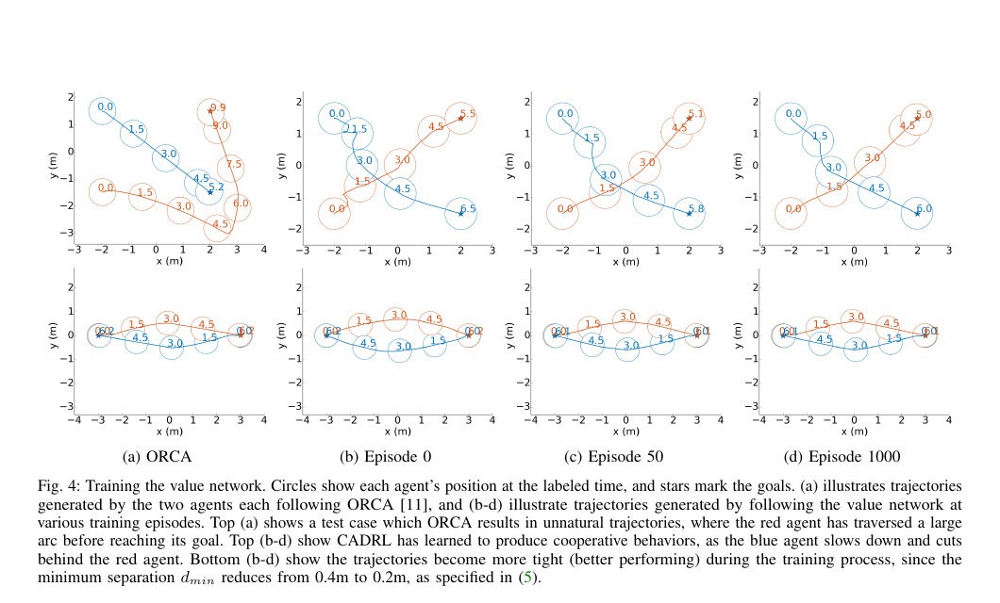

마주 오는 사람을 피하는 일은 얼핏 간단해 보여요. 지금 부딪히지 않을 속도를 고르면 될 것 같기 때문이에요. 하지만 한 걸음 옆으로 비킨 행동이 몇 초 뒤 상대의 선택을 바꾸고, 그 반응이 다시 로봇의 진로를 바꿉니다. 눈앞의 안전한 속도만 고르면 서로 같은 방향으로 흔들리거나, 한쪽이 필요 이상으로 크게 돌아가거나, 둘 다 멈추는 일이 생겨요.

2016년 공개되고 2017년 학회에 실린 <abbr title="충돌 회피를 심층 강화학습으로 푸는 방법">CADRL</abbr>은 이 문제를 “다음 순간에 충돌하나”가 아니라 “이 상태에서 목적지까지 얼마나 잘 도달할 수 있나”로 바꿔 보았습니다. 논문의 제목은 *Decentralized Non-communicating Multiagent Collision Avoidance*이고, 출판본 제목은 *Collision Avoidance with Deep Reinforcement Learning*이에요. 핵심은 다른 사람의 목적지를 입력받지 않은 채, 지금 관측되는 움직임과 로봇 자신의 항법 상태로 미래 가치를 근사하는 데 있습니다.

이 구분은 중요해요. 사람의 위치와 속도를 추적할 수 있다는 말과 그 사람이 어디로 가려는지 안다는 말은 전혀 다릅니다. CADRL은 다른 에이전트의 목적지 같은 의도를 숨은 상태로 남겨 둬요. 그래서 사람의 비공개 목표를 센서 입력으로 요구하는 방식으로 설명하면 논문의 문제 설정을 거꾸로 읽게 됩니다.

## 한 번의 회피보다 남은 시간을 학습해요

CADRL의 행동은 로봇이 선택할 속도 벡터예요. 매 관측 시점마다 후보 속도를 적용했을 때의 다음 상태를 만들고, 그 상태의 가치를 신경망으로 평가합니다. 가치가 높은 후보를 선택한 뒤 다음 센서 갱신에서 같은 과정을 반복해요. 온라인에서는 한 단계만 내다보지만, 가치함수가 오랜 결과를 요약하므로 단순한 반응 규칙보다 먼 효과를 반영할 수 있습니다.

보상은 목적지 도달, 충돌, 가까운 통과를 구분합니다. 목적지에 닿으면 양의 보상, 충돌하면 큰 음의 보상, 충돌하지 않았더라도 두 에이전트 사이의 최소 간격이 정한 문턱보다 작으면 거리에 따라 음의 보상을 줘요. 아무 사건도 없으면 즉시 보상은 0이고, 할인된 미래 가치가 속도 선택을 가릅니다. 안전 거리 하나만 최적화하는 규칙이라기보다 도달 시간과 간격의 절충을 학습하는 구조예요.

논문의 상태 표기는 로봇과 사람을 다르게 다룹니다. 각 에이전트에서 밖으로 보이는 상태는 평면 위치, 평면 속도, 반경입니다. 로봇은 여기에 자신의 목적지, 선호 속도, 방향 같은 내부 항법 상태를 더 알고 있어요. 반대로 이웃의 목적지와 선호 속도는 관측되지 않는 것으로 둡니다. 정책이 보는 것은 “내 전체 상태와 상대의 관측 가능한 상태”의 결합이지, 양쪽의 전체 계획이 아니에요.

센서 시스템으로 옮길 때는 논문 속 상태가 원시 센서값이 아니라는 점도 분리해야 합니다. 카메라 픽셀이나 라이다 거리열이 곧 사람의 위치·속도·반경이 되지는 않아요. 검출, 좌표 변환, 동일 인물 연결, 속도 추정, 반경 또는 안전 여유 추정이 먼저 수행돼야 합니다. 논문 시뮬레이션은 이 가공된 상태가 주어지는 조건에서 정책을 평가합니다. 따라서 “CADRL이 카메라 영상을 입력받는다”고 줄이면 인식 단계 전체가 사라집니다.

## ORCA 궤적을 베끼는 학습이 아니에요

학습은 두 단계로 진행됩니다. 먼저 <abbr title="서로 절반씩 회피한다고 가정해 충돌 없는 속도를 계산하는 방법">ORCA</abbr>가 만든 500개 궤적, 약 2만 개 상태·가치 쌍으로 가치망을 초기화합니다. 각 궤적의 상태에 목적지까지 걸린 시간을 연결하고, 신경망이 그 값을 근사하도록 학습해요. 이 초기 단계만 보면 기존 회피기를 모방하는 것처럼 보일 수 있습니다.

하지만 두 번째 단계에서 정책은 자신의 가치 추정으로 새 궤적을 만들고, 그 경험을 다시 학습 자료에 섞습니다. 무작위 행동을 일부 선택하는 탐색도 포함돼요. 초기 ORCA 궤적보다 더 빠른 경로를 발견하면 가치망의 판단이 바뀝니다. 원 논문의 그림 4는 이 차이를 잘 보여 줘요. 위쪽 사례에서 ORCA는 한 에이전트를 큰 호로 밀어내지만, 학습이 진행된 정책은 한쪽이 늦추고 다른 쪽 뒤로 지나가면서 더 짧게 협력합니다. 아래쪽 정면 교차에서는 학습 회차가 늘수록 궤적이 촘촘해집니다.

<figure class="fig"><figcaption>초기 ORCA 자료로 시작해 강화학습이 진행되면서 협력적 경로가 달라지는 모습이에요. 위쪽은 큰 우회를 줄이고, 아래쪽은 정면 교차 간격이 학습과 함께 좁아집니다. Chen·Liu·Everett·How, 원논문 그림 4 부분 인용. (출처: <a href="https://arxiv.org/abs/1609.07845">arXiv 1609.07845</a>, arXiv 비독점 배포 라이선스·별도 CC 재이용 허가는 확인되지 않음)</figcaption></figure>

원문은 초기화에 쓰인 궤적이 최적일 필요가 없다고 강조합니다. 가치망이 배우는 목표는 ORCA가 고른 행동 자체가 아니라 그 상태에서 목적지까지 남은 시간이에요. 그래서 초기 정책의 결함을 넘어설 여지가 생깁니다. 다만 시작 자료의 분포가 너무 좁으면 학습이 방문하는 상태도 좁아질 수 있어요. 초기 궤적이 “정답”은 아니지만, 탐색이 시작되는 지형을 정한다는 점은 남습니다.

협력을 유도하는 학습 표적도 눈여겨볼 만해요. 로봇 하나의 도달 시간만 줄이면 상대가 크게 손해 보더라도 로봇은 좋은 행동이라고 배울 수 있습니다. 논문은 두 에이전트가 직선 최단 시간보다 추가로 쓴 시간을 함께 고려해, 한쪽이 상대를 과하게 밀어내는 해를 억제합니다. 중앙 제어기가 양쪽 명령을 내리는 설정이 아니라 각 에이전트가 같은 원리로 움직이는 분산 설정에서도 양보가 나타나도록 만든 장치예요.

## 두 사람 문제를 여러 사람으로 늘리는 근사

학습된 가치망은 두 에이전트의 결합 상태를 받습니다. 사람이 셋, 넷으로 늘어났을 때 모든 상태를 한 번에 넣으면 입력 크기가 달라져 같은 망을 쓰기 어렵습니다. CADRL은 로봇과 각 이웃의 쌍을 따로 평가한 뒤, 후보 행동에서 가장 나쁜 쌍의 가치를 기준으로 선택하는 방식으로 확장합니다. 가장 위험한 이웃을 우선하는 셈이에요.

이 근사는 계산이 단순하고 사람 수가 달라도 적용할 수 있지만, 사람과 사람 사이 관계를 표현하지 못합니다. 두 사람이 나란히 걷는 집단인지, 서로 교차하는 낯선 사람인지, 대화 중인 무리인지가 같은 위치·속도 배열에서도 다르게 해석될 수 있어요. 각 쌍의 최악값만 고르면 여러 약한 상호작용이 합쳐져 생기는 위험도 놓칠 수 있습니다. 이후 [[2026-10-17_socialnav_sarl|SARL이 군중 속 중요한 사람을 골라 본 방법]]과 [[2026-10-17_socialnav_rgl|RGL이 사람 사이 관계를 그래프로 읽은 주행 정책]]은 바로 이 빈틈을 다룹니다.

논문은 회전 제약도 별도로 실험합니다. 자유롭게 어느 방향으로든 속도를 낼 수 있는 점 질량과 실제 바퀴 로봇은 움직임이 달라요. 최소 회전 반경을 1.0m로 둔 예에서는 가능한 속도 후보를 현재 방향에 맞게 제한합니다. 차동구동 로봇은 제자리 회전도 가능하므로 또 다른 후보 집합을 써요. 같은 가치함수를 쓰더라도 후보 행동 집합이 달라지면 실제 경로가 달라진다는 뜻입니다.

## 숫자 하나로 보는 가치함수의 역할

다음은 원 논문의 측정 결과가 아니라 구조를 이해하기 위한 설명용 가정이에요. 로봇이 목적지까지 직선으로 6m 남았고 선호 속도가 1m/s라고 합시다. 사람을 무시하면 최소 시간은 6초예요. 후보 A는 지금 속도를 유지해 6.4초 만에 도착하지만 최소 간격이 0.1m까지 줄어 가까운 통과 벌점을 받습니다. 후보 B는 0.6초 감속한 뒤 사람 뒤로 지나가 7.0초가 걸리지만 최소 간격 0.5m를 지켜요.

한 단계 반응기는 A의 현재 이동량만 보고 더 좋아 보인다고 판단할 수 있습니다. 반면 가치함수는 “A를 택한 다음 상태에서 큰 벌점과 우회가 남는가”를 학습값에 담을 수 있어요. 할인율을 설명용으로 0.9, A의 즉시 벌점을 -0.25, 다음 상태 가치를 0.6이라고 두면 평가값은 `-0.25 + 0.9 × 0.6 = 0.29`입니다. B의 즉시 보상이 0이고 다음 가치가 0.5라면 `0 + 0.9 × 0.5 = 0.45`예요. 당장 전진량이 작은 B가 장기적으로 더 높은 값을 받을 수 있습니다.

이 계산은 가치함수의 출력이 확률이나 안전 보증이 아니라는 점도 보여 줘요. 0.45라는 숫자는 “45% 안전하다”는 뜻이 아닙니다. 학습 때 정의한 보상과 할인에 따른 상대적 선호예요. 보상 크기나 거리 문턱을 바꾸면 같은 장면의 값도 바뀝니다. 충돌하지 않는다는 형식 보증과 학습된 고가치 행동을 구분해야 합니다.

## 논문의 평가는 무엇을 증명했나

CADRL은 무작위 교차 사례와 여러 에이전트 배치에서 ORCA와 비교됩니다. 원문은 무작위 시험에서 목표까지 걸린 추가 시간을 사용해 출발 거리와 선호 속도의 차이를 제거해요. 두 에이전트 교차에서는 CADRL이 ORCA보다 평균 경로 품질을 26% 넘게 개선했다고 보고합니다. 학습은 ORCA가 만든 세 초기 자료 집합으로 반복됐고, 시험 사례의 도달 시간 차이가 5% 미만이었다고 적어요.

온라인 계산은 두 에이전트에서 반복당 평균 5.7ms, 열 에이전트를 분산 제어할 때 62ms로 보고됐습니다. 오프라인 학습은 당시 실험 장비에서 3시간 미만이었고, 1,000회 강화학습 구간은 약 2.5시간이었습니다. 이 수치는 당시 신경망 크기와 구현, 하드웨어, 후보 행동 수에 묶인 값이에요. 오늘날의 로봇 컴퓨터에서 같은 시간이 나온다는 뜻도, 카메라 추적까지 포함한 전체 지연이라는 뜻도 아닙니다.

실험이 보여 준 것은 이상화한 원형 에이전트들이 무통신 조건에서도 더 협력적인 경로를 만들 수 있다는 점입니다. 사람 참여 실험에서 편안함이나 예측 가능성을 설문으로 검증한 연구는 아니에요. 사람을 CADRL 정책으로 제어하는 시뮬레이션은 양쪽이 비슷한 회피 원리를 공유하는 조건입니다. 실제 보행자는 로봇을 보지 못하거나, 로봇이 비킬 것이라 가정하거나, 갑자기 멈출 수 있습니다.

## 실제 센서에서 먼저 깨지는 다섯 가정

첫째, 관측 상태가 정확하다는 가정이에요. 사람 위치가 10cm 흔들리고 속도가 프레임마다 바뀌면 한 단계 뒤 상태도 흔들립니다. 가치망은 학습 때 보지 못한 고주파 오차를 의도 변화로 받아들일 수 있어요. 속도 추정에는 시간 창과 공분산이 필요하고, 추적 신뢰도가 낮을 때는 정책 출력을 그대로 실행하지 않는 문턱이 필요합니다.

둘째, 사람의 반경이 하나의 원으로 표현된다는 가정입니다. 논문에서 반경은 물리적 크기와 여유를 압축한 값이에요. 옆으로 선 사람, 가방을 든 사람, 유모차, 여러 명이 나란히 걷는 경우는 원 하나로 충분하지 않습니다. 반경을 크게 잡으면 안전해 보이지만 좁은 복도에서 통로 전체를 막아 정지하기 쉬워요. 작게 잡으면 계산상 충돌이 없어도 사람이 불편할 만큼 가까워질 수 있습니다.

셋째, 사람의 현재 속도가 짧은 미래를 대표한다는 가정이에요. 문 앞에서 방향을 바꾸거나 대화 상대에게 붙는 행동은 최근 속도만으로 예측하기 어렵습니다. CADRL의 가치망은 시뮬레이션 분포에서 이런 불확실성을 간접적으로 배울 뿐, 추적 공분산이나 여러 미래 가설을 명시적으로 입력받지 않습니다.

넷째, 행동이 계산한 대로 실행된다는 가정입니다. 바퀴 미끄러짐, 제어 지연, 속도 제한, 회전 중 번역 속도 감소가 있으면 후보 상태와 실제 상태가 어긋나요. 논문은 회전 제약을 넣을 수 있음을 보였지만 특정 로봇의 지연과 제동 거리를 자동으로 보장하지 않습니다. 학습 정책 바깥에 기구학 제한과 속도 명령 검사가 있어야 해요.

다섯째, 충돌 벌점이 곧 사회적 규범이라는 가정입니다. CADRL은 충돌 회피와 효율, 협력적 양보를 보여 주지만 우측 통행이나 추월 방향을 명시적으로 학습하지는 않습니다. 좌우 규범을 보상에 넣은 후속 연구가 [[2026-10-17_socialnav_sa-cadrl|SA-CADRL이 우측 통행을 보상으로 만든 방법]]이에요. CADRL의 자연스러운 곡선을 사회적으로 바람직하다는 사람 평가와 같은 것으로 보면 안 됩니다.

## 재현할 때 분리해야 할 입력과 평가

정책 자체를 재현하려면 먼저 원 논문처럼 완전한 시뮬레이션 상태를 주는 시험을 만들어야 합니다. 여기서는 위치·속도·반경이 정확하고, 사람 수와 초기 배치를 통제해 가치망과 행동 선택이 구현대로 동작하는지 확인해요. 그다음 같은 장면에 위치 잡음, 속도 지연, 추적 누락, 사람 식별 교환을 하나씩 넣습니다. 두 시험을 섞으면 정책 문제와 인식 문제를 구분하기 어려워집니다.

예를 들어 10Hz 추적에서 한 프레임이 빠지면 0.2초 간격으로 속도를 계산하게 됩니다. 사람이 1.2m/s로 걷는 동안 0.24m를 이동해요. 위치 오차가 각 관측에서 ±0.08m라면 두 점 차분의 속도 오차의 최대 범위은 설명용 단순 계산에서 `(0.08 + 0.08) / 0.2 = 0.8m/s`까지 갈 수 있습니다. 실제 필터는 오차를 줄이지만, 원자료 두 점만으로 얻은 속도는 보행 속도와 맞먹는 오차를 낼 수 있다는 뜻이에요. 이런 입력으로 가치망의 미세한 경로 차이를 비교하면 정책보다 추적기가 결과를 지배합니다.

평가는 성공률과 충돌률만으로 끝내지 않는 편이 좋아요. 목표 도달 시간, 최소 사람 간격, 정지 시간, 방향 전환 횟수, 속도 변화량, 추적 신뢰도가 낮을 때의 감속 여부를 함께 봐야 합니다. 사람을 가림 처리한 구간과 정상 관측 구간을 나누면 실패가 어느 입력에서 시작됐는지도 찾을 수 있어요. CADRL이 개선하려 한 “불필요한 큰 우회”는 추가 시간으로, 새로 생길 수 있는 “위험한 촘촘한 통과”는 최소 거리와 근접 지속 시간으로 따로 측정해야 합니다.

마지막 안전 계층은 가치망과 독립적으로 두는 편이 타당합니다. 학습 정책이 높은 가치를 준 속도라도 짧은 거리의 장애물이나 사람이 확인되면 감속·정지할 수 있어야 해요. 이 계층은 CADRL이 틀렸음을 증명하는 장치가 아니라, 학습 분포 밖 입력과 제동 한계를 처리하는 역할을 합니다. 정책은 여러 안전 후보 가운데 효율적인 것을 고르고, 충돌 감시는 실행 가능한 최종 속도를 제한하는 식으로 책임을 나누면 됩니다.

## 같은 성공률 뒤에 숨는 행동 차이

정책 두 개가 모두 100번 중 95번 목적지에 도착했다고 해서 같은 성질을 가졌다고 말하기는 어려워요. 하나는 사람 앞에서 일찍 감속해 넓게 비키고, 다른 하나는 끝까지 빠르게 접근하다 마지막 순간에 크게 꺾을 수 있습니다. 둘 다 충돌하지 않았지만 사람이 느끼는 예측 가능성과 제어 여유는 다릅니다. CADRL의 도달 시간 지표는 불필요한 우회를 잘 드러내지만, 접근 속도와 방향 변화까지 요약하지는 않아요.

그래서 교차 시험에서는 최소 거리만 기록하지 말고 최소 거리 시점의 상대 속도도 함께 봐야 합니다. 설명용 가정으로 최소 거리가 같은 0.4m인 두 경로를 생각해 볼게요. 경로 A는 상대 속도 0.2m/s에서 0.4m를 지나고, 경로 B는 1.4m/s에서 같은 간격을 통과합니다. 기하학적 간격은 같아도 센서 지연 0.1초 동안 추가로 닫히는 거리는 각각 0.02m와 0.14m예요. 오차나 급정지가 생겼을 때 남는 여유가 크게 달라집니다.

또 하나는 가장 위험한 한 사람만 보는 확장 방식의 특성이에요. 왼쪽 사람과의 가치가 0.42, 오른쪽 사람과의 가치가 0.41이라면 최솟값은 0.41입니다. 두 사람이 동시에 좁혀 오는 상태라도 쌍별 가치가 독립적으로 계산되면 “양쪽 사이에 갇힘”이라는 조합을 별도 특징으로 표현하지 못해요. 사람 수를 늘린 시험에서는 가장 가까운 사람 수가 아니라 로봇 주변의 각도 분포, 탈출 가능한 방향의 폭, 동시에 가까워진 사람 수를 함께 기록해야 이 근사의 실패를 볼 수 있습니다.

정지 사례도 하나로 묶지 않는 편이 좋아요. 목표 바로 앞에서 사람 때문에 기다린 정지는 합리적인 양보일 수 있고, 좌우 행동의 가치가 비슷해 선택이 계속 바뀐 정지는 진동 문제일 수 있습니다. 속도가 0에 가까운 구간을 검출한 뒤 주변 사람이 실제로 통과했는지, 후보 행동의 1·2위 가치 차이가 작았는지, 추적 식별자가 바뀌었는지 연결해 보면 원인을 나눌 수 있어요. 성공률 하나로는 이 차이를 볼 수 없습니다.

이런 기록은 후속 모델 비교에도 필요합니다. 주의집중이나 그래프 관계를 넣은 정책이 성공률을 1–2% 높였더라도, 계산 지연이 늘어 제어 주기가 흔들리거나 근접 상대 속도가 커지면 실제 이득이 아닐 수 있어요. CADRL을 기준선으로 삼는 이유는 오래됐기 때문만이 아니라, 입력과 행동 선택이 비교적 명료해 이런 차이를 해석하기 쉽기 때문입니다.

CADRL의 가장 오래 남은 아이디어는 특정 신경망 모양이 아니에요. 다른 사람의 비공개 목적지를 알아야만 협력할 수 있다는 전제를 버리고, 관측 가능한 상태에서 장기 결과를 압축한 가치함수를 학습했다는 점입니다. 동시에 그 가치가 사회적 정당성이나 안전 보증을 대신하지 않는다는 한계도 분명합니다. 이 둘을 함께 읽어야 후속 모델의 복잡성이 실제로 무엇을 더했는지 판단할 수 있어요.

---

<!-- src-block -->
출처 — https://ieeexplore.ieee.org/document/7989037
