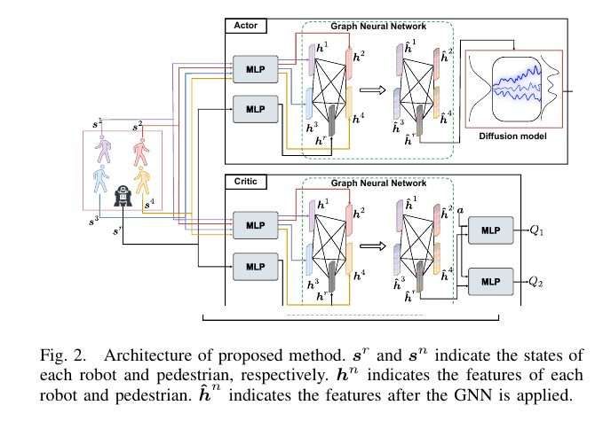
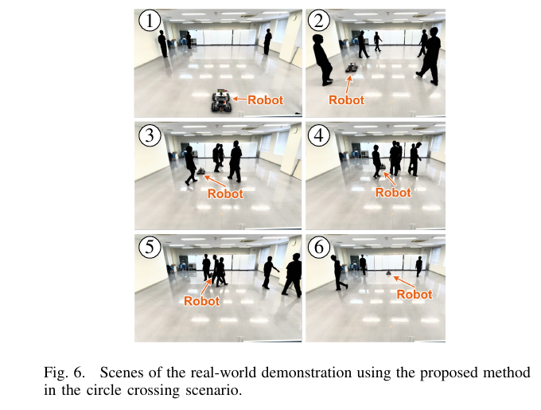
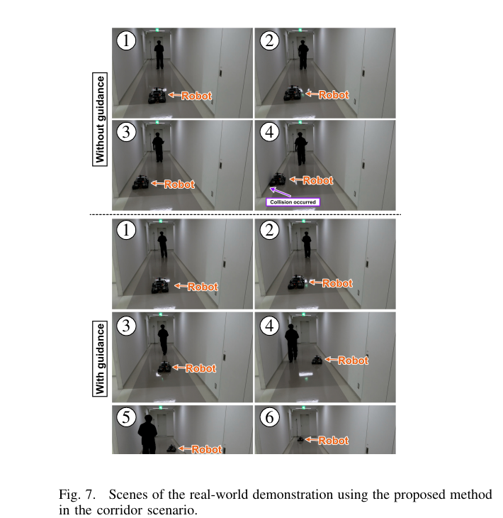

사람을 피하는 행동은 하나의 평균 속도로 모이지 않을 수 있어요. 마주 오는 사람 왼쪽과 오른쪽을 지나는 두 선택이 모두 유효한데 <abbr title="평균 주변에 값이 몰리는 종 모양 분포 하나로 행동을 나타내는 정책">가우시안 정책</abbr>이 둘의 평균을 내면 정면으로 향할 수 있어요. COLSON은 확산 모델로 여러 행동 모드를 표현하고, 생성 과정에 비용 변화 기울기를 더해 훈련에서 보지 않은 벽 회피와 특정 사람 동행 목적을 재학습 없이 유도해요.

## 가우시안 대신 확산 과정으로 행동을 생성해요

로봇 상태에는 목표 상대 위치, 속도, 방향이 있고, 사람 상태에는 로봇 중심 좌표의 위치와 속도가 있어요. 행동은 전방향 로봇의 x·y 속도예요. 사람 수가 달라지는 입력은 그래프 신경망으로 처리하고 행동 선택망·가치 평가망 구조가 가치와 행동을 학습해요.

일반적인 연속 <abbr title="좋은 보상과 행동 탐색을 함께 고려해 연속 제어 정책을 배우는 강화학습 방법">SAC</abbr> 계열은 행동 분포를 가우시안으로 두는 경우가 많아요. 서로 떨어진 두 안전 행동을 표현할 때 단일 가우시안은 중간에도 확률을 줄 수 있어요. 확산 정책은 잡음에서 시작해 여러 잡음 제거 단계를 거치며 더 복잡하고 여러 봉우리를 가진 분포를 만들 수 있어요. 왼쪽·오른쪽 회피 후보를 동시에 유지할 수 있다는 기대예요.

COLSON은 행동 가치가 커지는 방향을 확산 모델의 학습에 반영해요. 논문은 탐색과 수렴을 조절하는 계수 α를 훈련 중 1에서 목표값으로 점차 바꾸는 방법도 제안해요. 작은 값은 탐색을 늘리지만 최종 분포 수렴을 어렵게 하고, 큰 값은 가치 높은 행동에 집중하게 해요.

<figure class="fig"><figcaption>그래프 신경망이 가변 사람 상태를 처리하고, 가치 평가망의 행동 변화 기울기가 확산 행동 선택망의 잡음 제거를 학습시켜요. (출처: Matsumoto et al., COLSON, Fig. 2)</figcaption></figure>

설명용으로 안전한 x속도가 -0.5와 +0.5m/s 두 곳에 몰리고 0m/s 방향은 사람과 충돌한다고 해볼게요. 평균이 0인 단일 봉 분포는 위험한 중앙에 높은 밀도를 둘 수 있어요. 두 봉우리를 따로 표현하면 양쪽 후보를 유지할 수 있어요. 이는 논문 샘플을 재현한 값이 아니라 다봉 분포의 필요성을 보이는 가정이에요.

## 학습은 사람 회피만, 새로운 목적은 생성 유도로 더해요

기본 훈련 환경에는 정적 벽이 없고, 목표로 가면서 사람을 피하는 목적만 있어요. 정적 장애물과 동행은 훈련 뒤에 추가되는 새로운 조건이에요. 확산 생성의 각 단계에서 후보 행동의 비용 변화 기울기를 계산해 원하는 쪽으로 잡음 제거 경로를 밀어요.

벽 생성 유도는 후보 행동을 적용한 다음 로봇 위치와 가장 가까운 벽 점 사이 거리를 비용으로 만들어요. 벽에 가까워지는 후보에는 반대 방향 변화 기울기를 넣어 다른 행동 모드로 옮겨요. 별도 환경에서 정책을 다시 훈련하지 않고 후보 추출 시점의 계산만 바꿔요.

동행 생성 유도는 목표 보행자의 이전 위치와 로봇의 다음 예상 위치 사이 거리를 줄여요. 기본 정책은 모든 사람을 피하도록 배웠으므로 목표도 멀리하려고 해요. 생성 유도가 목표를 따라가도록 당기고, 기본 분포는 다른 사람 회피 능력을 유지하려고 해요.

이 조합은 하드 제약이 아니에요. 생성 유도 척도가 작으면 벽을 피하지 못하고, 크면 원래 사람 회피 분포를 크게 왜곡할 수 있어요. 논문 정적 장애물 표에서도 벽 충돌은 크게 줄지만 보행자 충돌은 0에서 2.8%로 늘어요. 한 목적을 추가하면서 다른 안전 지표가 나빠질 수 있음을 보여줘요.

설명용으로 기본 점수가 왼쪽 행동을 1.0만큼 밀고 벽 생성 유도가 오른쪽으로 0.8만큼 민다고 가정하면 합은 왼쪽 0.2예요. 척도를 1.5로 높이면 오른쪽 0.2로 방향이 바뀌어요. 실제 점수 차원과 크기는 다르지만 생성 유도 계수가 행동 모드를 바꾸는 방식을 보여줘요.

## 10만 회 시행과 100단계 생성으로 기본 정책을 배워요

훈련은 CrowdNav 원형 횡단의 사람에게 로봇이 보이는 조건에서 사람 5명을 두고 10만 회 시행 동안 진행돼요. 훈련 시작 전 <abbr title="서로 회피 책임을 나누어 충돌하지 않을 속도를 고르는 방법">ORCA</abbr>로 2,000회 시행의 자료를 모으고, <abbr title="행동의 가치 변화 정보를 확산 모델의 점수함수 학습에 넣는 방법">QSM</abbr>과 유도 강도를 점차 바꾸는 조절 버전의 α 목표값을 400으로 둬요. 행동 하나를 만들 때 잡음 제거 100단계를 사용해요.

보상은 사람 충돌 -0.25, 표면 간격 0.2m 아래 근접 패널티, 목표 도달 +1, 그 외 0의 형태예요. 사람과 충돌하지 않고 목표에 도달하는 기본 능력을 학습해요. 정적 장애물 충돌이나 목표 동행 거리는 이 기본 보상에 들어 있지 않아요.

100단계 행동 생성은 풍부한 분포를 만들 수 있지만 제어 지연을 늘릴 수 있어요. 논문 표의 실행 시간은 한 회 시행 전체 시간과 혼동하지 않게 정의를 확인해야 해요. 확산 추론의 행동별 지연, 센서·추적 시간, 생성 유도 변화 기울기 계산을 따로 측정해야 실시간 주기를 알 수 있어요.

설명용으로 잡음 제거 한 단계가 0.4ms라면 100단계는 연결망 호출만 약 40ms예요. 두 생성 유도의 변화 기울기가 단계마다 추가되면 더 늘어요. 실제 RTX 4090 측정치가 아니라 단계 수와 지연의 선형 부분을 보여주는 가정이에요. 갱신 단계 수를 줄이면 분포 품질과 생성 유도 효과가 어떻게 바뀌는지 측정해야 해요.

유도 계수를 점차 바꾸는 방법의 비교는 훈련 초기값 다섯 개로 수행하고 표의 ±는 초기값 간 표준편차예요. 성능이 좋은 단일 저장 상태가 아니라 학습 안정성을 보는 근거예요. 하지만 환경 초기값, 사람 모델, 실제 센서 오차까지 포함한 분산은 아니에요.

## 사람 수와 행동 모형이 달라도 QSM-A가 강해요

평가는 ORCA와 사회력 모델 두 사람 모형, 사람에게 로봇이 보이는 조건과 보이지 않는 조건에서 해요. 각 시험 상황은 500회 시행이고, 사람 수를 5명에서 20명까지 늘린 비교도 있어요. QSM-A는 가우시안 정책과 다른 확산 생성 강화학습 기준보다 높은 성공률과 낮은 충돌 경향을 보이고, 사람이 늘 때 성능 하락이 상대적으로 작아요.

여기서 “사람에게 로봇이 보이지 않는다”는 것은 센서가 사람을 검출하지 못한다는 뜻이 아니에요. 보행자가 로봇 위치를 인지하지 않고 움직이는 상호작용 설정이에요. 로봇 정책에는 사람 상태가 제공돼요. 이를 카메라·레이저 거리 센서 검출 누락에 강하다는 결과로 일반화하면 안 돼요.

사회력 모델로 사람 행동을 바꾸는 시험은 ORCA 훈련 분포 밖 운동에 대한 일반화를 보여줘요. 그러나 두 시뮬레이터 모두 명시된 운동 규칙을 따르고 실제 사람의 멈춤·대화·가림을 포함하지 않아요. 사람 상태가 정확히 주어지는 정책 평가와 센서부터 사람 추적기 성능을 분리해야 해요.

사람 수 20명에서 구조가 입력을 처리해도 연산량은 늘어요. 연결 구조 정보 압축망에서 대상과 연결 관계를 처리하는 연산과 생성 유도의 사람별 충돌 평가가 증가할 수 있어요. 성공률 곡선과 함께 행동 지연 <abbr title="전체 관측의 95퍼센트가 이 값 이하에 들어오는 지연 기준">P95</abbr>를 사람 수별로 재야 실시간 규모 확장성을 확인할 수 있어요.

## 벽 생성 유도는 0.6%에서 97.2% 성공으로 바꿔요

정적 장애물 시험은 앞에서 오는 사람 3명과 벽이 있는 환경이에요. 생성 유도가 없으면 사람을 피하려고 왼쪽으로 움직이다 벽에 부딪혀 벽 충돌 99.4%, 성공 0.6%를 기록해요. 벽 생성 유도를 켜면 벽 충돌 0%, 성공 97.2%가 되고 반대 행동 후보를 선택해요.

하지만 보행자 충돌은 생성 유도 없음 0%에서 생성 유도 있음 2.8%로 늘어요. 생성 유도가 없는 경우 벽에 먼저 부딪혀 사람과 만날 기회가 적다는 관측 중단 효과도 있어 단순 비교가 어렵다고 논문이 설명해요. 한 회 시행이 어디서 종료되는지에 따라 뒤쪽 위험의 관측 기회가 달라져요.

벽 생성 유도는 가장 가까운 벽 점을 안다는 가정이 있어요. 실물에서는 지도, 레이저 거리 센서, 자기 위치 추정이 이 점을 제공해요. 벽이 유리거나 움직이는 물체이거나 지도가 오래되면 변화 기울기 방향이 틀릴 수 있어요. 벽 회피를 학습하지 않고 실행 중 기하에 의존하므로 이 입력 품질이 중요해요.

설명용으로 자기 위치 추정이 벽 쪽으로 0.2m 치우치면 생성 유도는 실제보다 이르게 강해져 사람 쪽으로 로봇을 밀 수 있어요. 반대로 벽 반대쪽으로 0.2m 틀리면 늦게 반응해요. 실제 논문 오차가 아니라 벽 비용에 자기 위치 추정 여유 거리가 필요한 이유를 보여줘요.

## 동행 생성 유도는 거리를 줄이지만 성공·충돌이 나빠져요

동행 시험에는 사람 5명이 있고 그중 한 명이 목표예요. 생성 유도가 없으면 성공 96.4%, 충돌 3.6%, 목표와의 <abbr title="두 경로의 점 순서를 유지하며 대응시킬 때 가장 큰 점 사이 거리로 경로 차이를 재는 지표">불연속 프레셰 거리</abbr> 2.07m예요. 생성 유도를 켜면 목표 궤적을 더 가까이 따라 거리가 1.20m로 약 40% 줄지만 성공은 92.0%, 충돌은 7.4%로 나빠져요.

동행 목적이 추가되면 로봇은 목표 가까이 머물기 위해 다른 사람 회피 여유를 줄일 수 있어요. “재학습 없이 새 목적을 수행”했다는 결과와 “모든 원래 지표를 유지”했다는 주장은 달라요. 생성 유도의 편익과 안전 비용을 같은 표에서 봐야 해요.

목표의 이전 위치를 따라가는 비용은 지연을 포함해요. 목표가 급회전하면 로봇은 방금 있던 위치로 움직여 뒤늦게 꺾을 수 있어요. 목표 속도와 회전율, 추적 지연별 프레셰 거리와 최소 사람 거리를 측정해야 해요.

설명용으로 목표가 1m/s로 걷고 상태가 0.3초 오래됐다면 목표 위치는 0.3m 뒤처져요. 거리 1.20m의 일부가 제어기 성능보다 관측 지연에서 생길 수 있어요. 이는 논문 지연 측정치가 아니라 동행 입력의 시간 정렬을 점검하는 계산이에요.

## 실물은 온보드 Orin과 외부 RTX 4090을 함께 써요

실물 플랫폼은 <abbr title="비스듬한 작은 롤러를 이용해 차체 방향을 돌리지 않고 옆으로도 이동할 수 있는 바퀴">메카넘 휠</abbr>을 쓰는 이동 로봇, UST-20LX 2D 레이저 거리 센서, Jetson AGX Orin이에요. ROS 2 Humble에서 <abbr title="레이저 관측과 여러 위치 후보를 비교해 지도 속 로봇 위치를 찾는 방법">AMCL</abbr>로 위치를 추정하고 <abbr title="레이저 관측에서 사람을 찾는 검출기">LFE</abbr>로 사람을 검출해요. 보행자 검출과 제안 방법의 계산 부하를 나누기 위해 AMD Ryzen 9 7900 <abbr title="프로그램의 일반 계산을 맡는 중앙 처리 장치">CPU</abbr>와 NVIDIA RTX 4090이 있는 별도 컴퓨터도 사용해요.

<figure class="fig"><figcaption>원형 횡단 시연에서 로봇이 여러 사람 사이를 지나 목표로 이동해요. (출처: Matsumoto et al., COLSON, Fig. 6)</figcaption></figure>

<figure class="fig"><figcaption>약 2m 복도에서는 생성 유도가 없을 때 벽에 충돌하고, 켰을 때 사람과 벽을 피해 통과해요. (출처: Matsumoto et al., COLSON, Fig. 7)</figcaption></figure>

실물 시연은 원형 횡단, 폭 약 2m의 복도, 목표와 다른 사람 한 명이 있는 동행 대상 시험 상황예요. 복도에서 생성 유도가 없으면 벽과 충돌하고, 켜면 사람과 벽을 모두 피하는 연속 장면을 보여줘요. 동행 대상에서도 생성 유도에 따라 목표를 따라가는 행동 변화가 나타나요.

이 결과는 정량 반복 안전 통계보다 적용 가능성을 보이는 시연이에요. 사람 수, 반복 횟수, 실패 분포, 행동 지연, 네트워크 연결 방식 등 시스템의 전체 조건이 제시되지 않아요. 외부 RTX 4090을 썼으므로 Orin 단독 또는 Raspberry Pi 성능으로 일반화할 수 없어요.

실물 재현에서는 검출기, 추적기, 행동 정책, 생성 유도, AMCL, 로봇 본체 제어기를 구간별로 자원과 처리 시간을 측정해야 해요. 잡음 제거 100단계와 생성 유도 변화 기울기가 제어 주기 안에 들어가는지, 사람 수가 늘 때 꼬리 지연이 커지는지 봐야 해요. 최종 영상 속 부드러운 움직임만으로 계산 여유를 알 수 없어요.

## 생성 유도는 분포 밖 요구를 만족시키는 만능 제약이 아니에요

확산 분포에 안전한 행동 후보가 있어야 생성 유도가 그쪽으로 이동할 수 있어요. 훈련에서 본 적 없는 좁은 기동이나 후진이 필요하지만 분포가 해당 행동에 거의 확률을 주지 않으면 변화 기울기만으로 찾기 어려울 수 있어요. 새 목적이 원래 능력과 양립 가능한지 먼저 확인해야 해요.

생성 유도 비용이 국소적으로 평평하거나 잘못된 지역 최솟값을 가지면 변화 기울기가 유용한 방향을 주지 못해요. U자 장애물의 가장 가까운 점에서 멀어지는 행동이 출구 반대쪽으로 로봇을 밀 수 있어요. 정적 벽 한두 개의 성공을 복잡한 미로 회피로 확대할 수 없는 이유예요.

여러 생성 유도를 동시에 쓰면 변화 기울기가 충돌해요. 벽에서 멀어지는 방향과 목표를 따라가는 방향, 다른 사람을 피하는 기본 점수가 서로 반대일 수 있어요. 단순 합, 우선순위, 제약 투영 중 어떤 결합을 쓸지 정해야 해요. COLSON의 두 예시는 각각 새 목적을 보여주며 복잡한 다중 목적 전체를 검증하지 않아요.

설명용으로 벽 변화 기울기 크기 2, 동행 대상 1, 로봇 본체 점수 1이 서로 120도 방향이면 벡터합이 작아져 행동이 불안정해질 수 있어요. 각 항의 척도만 키우면 다른 조건을 압도해요. 실제 차원의 변화 기울기와 다른 기하 예시지만 충돌 진단에 각 항의 방향·크기 로그가 필요함을 보여줘요.

생성 유도가 행동을 크게 바꾼 경우에는 원래 정책 후보와 최종 명령을 함께 남겨야 해요. 사람이 가까운 순간에 어떤 목적이 우선됐는지 확인할 수 있어야 서로 충돌하는 비용을 수정할 수 있어요.

## 검증은 생성 분포와 최종 선택을 모두 기록해요

한 행동만 저장하면 확산 생성이 다양한 후보를 만들었는지 알 수 없어요. 같은 상태에서 여러 잡음 초기값으로 행동을 뽑고, 생성 유도 전·후의 분포와 최종 행동을 저장해요. 안전한 모드가 원래 있었는지, 생성 유도가 새 모드로 이동했는지 볼 수 있어요.

잡음 제거 갱신 단계를 100·50·20으로 줄이는 지연과 품질 사이 곡선도 필요해요. 성공, 충돌, 분포 다양성, 생성 유도 비용, 행동 P95를 같이 측정해요. 갱신 단계 감소로 평균 지연은 줄지만 드문 위험 행동이 늘 수 있으므로 평균 누적 보상만으로 결정하지 않아요.

실물 실패 주입은 레이저 거리 센서 벽 누락, AMCL 0.1·0.2·0.4m 오차, 사람 추적 대상 1·3·5 프레임 누락, 목표 식별자 교환을 포함해요. 각 경우에 기본 점수와 생성 유도가 어느 방향으로 변했는지 기록해요. 검출기가 사람을 놓치면 확산 정책이 부분 관측을 알아서 복원하지 않아요.

[[2026-10-17_socialnav_sonic|SoNIC이 예측 오차를 주행 제약으로 바꾼 방법]]은 사람 궤적의 불확실성 영역 침범을 제약 강화학습 비용으로 넣어요. COLSON은 복잡한 행동 분포를 학습한 뒤 생성 단계의 유도로 벽·동행 목적을 추가해요. 하나는 학습된 누적 비용 제약, 다른 하나는 배포 시 변화 기울기 유도이며 둘 다 물리 안전 하드 제약은 아니에요.

COLSON의 기여는 확산 생성이라는 이름보다 행동 분포와 새 목적의 분리에 있어요. 사람 회피에서 여러 행동 모드를 학습하고, 벽·동행 비용을 잡음 제거에 넣어 재학습 없이 행동을 바꿔요. 그 대가로 100단계 추론, 생성 유도 척도, 목적 간 충돌, 외부 RTX 4090 계산이 생겨요. 새 조건에서 성공했다는 결과는 해당 생성 유도와 실험 범위에 한정하고, 복잡한 환경에서는 후보 포괄 범위와 지연을 다시 측정해야 해요.

---
<!-- src-block -->
출처 — https://arxiv.org/abs/2503.13934
