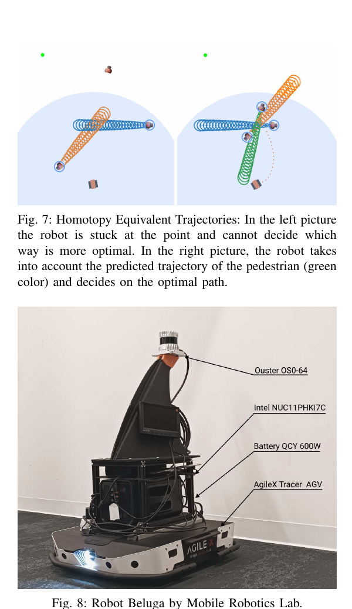
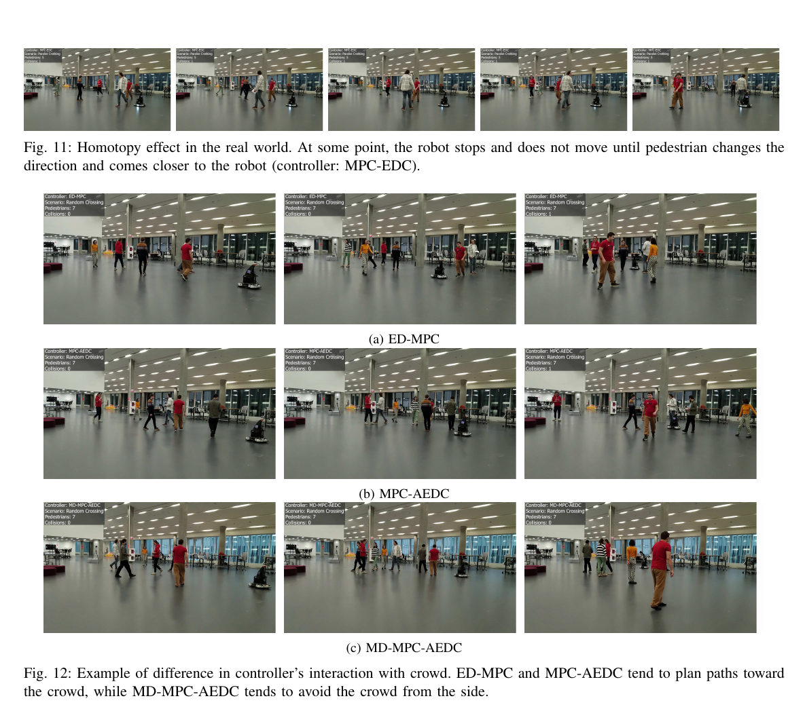

사람의 미래 위치를 점 하나로 예측하면 오차의 방향과 크기가 사라져요. 불확실성까지 타원이나 공분산으로 표현하면 더 많은 정보를 얻지만, 그 영역을 무조건 피하도록 만들면 통로가 막힐 수 있어요. 이 연구는 사람 예측 불확실성을 사회적 주행 최적화에 넣는 여러 비용과 제약을 같은 틀에서 비교하고, 필요할 때 제약을 완화하는 적응형 변수가 목표 도달과 여유 사이를 어떻게 바꾸는지 살펴봐요.

## 같은 예측도 거리 정의에 따라 다른 경로를 만들어요

비교의 출발점은 유클리드 거리예요. 로봇과 예측 사람 위치 사이의 직선 거리를 계산하고 기준보다 가까우면 비용을 높이거나 제약을 걸어요. 계산과 해석이 단순하지만 예측 오차가 진행 방향으로 길게 늘어났는지, 옆 방향으로 좁은지 구분하지 못해요. 모든 방향에 같은 원형 여유를 둬요.

<abbr title="공분산으로 축척된 공간에서 두 점 사이의 거리를 재는 값">마할라노비스 거리</abbr>는 예측 공분산을 사용해 오차가 큰 방향과 작은 방향을 다르게 봐요. 사람의 진행 방향으로 불확실성이 크면 그 축의 차이를 덜 뜻밖으로 보고, 확실한 축의 작은 차이를 더 크게 평가할 수 있어요. 타원체 접근은 공분산에서 만든 불확실성 타원을 기하 장애물처럼 다뤄요. 이름은 비슷해도 비용의 모양과 최적화 기울기가 달라요.

논문은 유클리드 거리, 마할라노비스 거리, 타원체 계열의 목적함수와 제약, 그리고 적응형 버전을 폭넓게 비교해요. 예측 평균은 등속도 모형으로 만들고, 공분산은 CovarianceNet에서 받아요. 더 복잡한 생성 예측기의 전체 분포를 그대로 최적화하지 않아요. 비교 결과는 이 예측 구성과 최적화 근사 안에서 읽어야 해요.

설명용으로 사람의 진행 방향 표준편차가 0.8m, 옆 방향이 0.2m라고 해볼게요. 평균에서 진행 방향으로 0.4m 차이는 0.5표준편차지만, 옆으로 0.4m 차이는 2표준편차예요. 유클리드 거리는 둘 다 0.4m로 보지만 공분산 거리에서는 의미가 달라져요. 이는 논문 데이터의 수치가 아니라 거리 정의의 차이를 보여주는 가정이에요.

## 적응형 제약은 막힌 문제에 완화량을 결정 변수로 줘요

비적응 제약은 정해진 안전 경계를 반드시 만족하는 해만 허용해요. 여러 사람의 불확실성 영역이 겹치거나 좁은 통로를 가로막으면 실행 가능한 경로가 사라질 수 있어요. 멈추는 것이 안전한 경우도 있지만, 예측 불확실성이 과하게 커진 탓이라면 로봇은 실제로 비어 있는 공간에서도 계속 멈춰요.

적응형 제약은 <abbr title="제약을 얼마나 완화했는지를 나타내고 비용으로 벌점을 받는 추가 변수">슬랙 변수</abbr>를 최적화에 넣어요. 제약을 조금 어기면 목표로 진행할 수 있지만 그 완화량에는 비용이 붙어요. 최적화기는 목표 접근 이득과 안전 경계 완화 비용을 함께 비교해요. 고정 임계값을 끄고 켜는 것보다 연속적으로 조정할 수 있다는 장점이 있어요.

설명용으로 원래 요구 거리가 1.0m인데 현재 가능한 최대 거리가 0.85m라고 해볼게요. 비적응 하드 제약은 해가 없어요. 적응형 문제는 슬랙 0.15m를 선택하고 그만큼의 벌점을 낼 수 있어요. 슬랙 비용이 너무 작으면 사람 가까이 지나가는 해를 자주 고르고, 너무 크면 비적응 제약처럼 멈춰요. 0.15m는 작동 원리를 보이는 가정이며 논문 설정을 재현한 수치가 아니에요.

적응형이라는 말이 안전 경계를 자동으로 학습한다는 뜻은 아니에요. 슬랙의 비용 가중치와 최대 범위는 설계자가 정하고, 주어진 예측과 로봇 모형 안에서 최적화돼요. 센서가 사람을 놓치면 제약이 생기지 않고, 위치가 틀리면 잘못된 곳에서 완화량을 계산해요. 유연한 실행 가능성과 물리 안전 보장은 다른 층위예요.

## 1,800개 시뮬레이션이 방법별 경향을 비교해요

시뮬레이션은 PyMiniSim과 Headed Social Force 보행자 모형을 사용하고, do-mpc·CasADi·MUMPS로 문제를 풀어요. 세 가지 시나리오에서 보행자 수를 3명부터 8명까지 바꾸고, 각 인원 조건을 100회 실행해 시나리오당 600회, 전체 1,800회를 구성해요. 제한 시간은 20초예요. 다양한 초기 상태에서 성공과 충돌, 거리, 시간의 경향을 비교할 수 있는 규모예요.

로봇은 비홀로노믹 유니사이클 모형이고, 시뮬레이션 사람은 로봇에 반응하지 않아요. 로봇이 사람을 피하면 사람은 원래 운동을 계속해요. 상호 양보와 협상까지 검증한 결과가 아니라, 움직이는 외부 객체의 예측 불확실성 아래에서 경로를 푸는 비교예요.

적응형 제약 방법들은 목표 도달과 사회적 여유의 균형에서 강한 결과를 보여요. 반면 불확실성을 쓰는 비적응 방법은 보수성이 커지거나 해를 찾지 못할 수 있어요. 마할라노비스 근사는 3차원에서 쓰던 거친 식을 2차원에 재사용하는 한계가 있고, 모든 방법이 조정값에 민감해요. “불확실성을 넣으면 항상 낫다”보다 “어떤 거리와 완화 구조로 넣는지가 결과를 바꾼다”가 논문의 중심에 가까워요.

성공률만 보면 완화가 많아도 좋은 방법처럼 보일 수 있어요. 적용 검증에는 에피소드당 최대 슬랙, 슬랙 누적 시간, 사람별 최소 거리, 목표 시간, 정지 시간을 함께 기록해야 해요. 설명용으로 두 방법이 모두 95% 성공하더라도 하나는 슬랙을 평균 0.02m, 다른 하나는 0.30m 사용했다면 같은 안전 경계를 유지한 결과가 아니에요. 성공이 어떤 제약 비용으로 얻어졌는지 보여줘야 해요.

## 같은 경로 계열 안에서 멈추는 문제도 남아요

비선형 최적화는 초기 경로와 같은 <abbr title="장애물을 넘지 않고 연속 변형할 수 있는 같은 우회 방향의 경로 묶음">호모토피</abbr> 안에서 국소해를 찾기 쉬워요. 사람 무리 왼쪽으로 시작한 해가 막혔는데 오른쪽에는 길이 있어도, 최적화기가 장애물 사이를 가로질러 다른 경로 계열로 옮기지 못할 수 있어요. 실행 가능한 전역 경로가 존재해도 로봇이 멈추는 이유예요.

<figure class="fig"><figcaption>국소 최적화는 초기 경로의 우회 방향에 묶일 수 있고, 실물 Beluga는 별도 인식·추적 파이프라인 위에서 같은 최적화를 실행해요. (출처: Akhtyamov et al., Robotics and Autonomous Systems 183, Fig. 7·8)</figcaption></figure>

여러 초기해를 동시에 풀거나 전역 경로가 서로 다른 우회 방향을 제안하도록 만들면 이 문제를 줄일 수 있어요. 그러나 후보 수만큼 계산량이 늘어요. 설명용으로 한 후보의 최악 풀이 시간이 40ms이고 세 후보를 직렬로 풀면 120ms가 될 수 있어요. 실제 구현은 병렬화와 조기 종료에 따라 다르지만, 경로 다양성과 제어 주기 사이의 비용이 생긴다는 점은 같아요.

정체 시험은 사람을 통로 중앙에 멈추게 한 뒤 왼쪽과 오른쪽 여유를 번갈아 열어 보는 방식이 좋아요. 초기 경로 방향, 슬랙 가중치, 예측 공분산을 바꾸면서 다른 경로 계열로 전환하는지 기록해요. 목표 실패를 전부 “사회적으로 양보함”으로 세지 않고, 해 없음·국소해·의도적 정지·시간 초과로 나누어야 해요.

## Beluga 실물 시스템은 인식 분포 차이를 드러내요

실물 플랫폼 Beluga는 AgileX Tracer 베이스, Intel NUC11PHKi7C, Ouster OS0-64 라이다를 사용해요. Ubuntu 22.04와 ROS 2 Humble 위에서 SLAM Toolbox와 Nav2 AMCL로 위치를 추정하고, MVXFasterRCNN으로 사람을 검출한 뒤 Hungarian 방식의 연결을 포함한 추적기로 궤적을 만들어요. 시뮬레이션에서는 정답에 가까운 사람 상태를 쓰지만 실물에서는 긴 인식 체인을 거쳐요.

실물 시나리오는 평행 보행과 무작위 교차이고 사람 수는 3·5·7명이에요. 여러 방법을 실제 사람 사이에서 비교하고 ED-MPC, MPC-AEDC, MD-MPC-AEDC가 질적으로 강한 결과를 보였어요. 다만 대부분의 설정에서 받아들인 성공 결과가 한 번이고, 일부는 한두 번 재시도한 뒤 가장 나은 결과를 사용해요. 반복 분포를 갖춘 통계적 안전 검증으로 확대해서는 안 돼요.

<figure class="fig"><figcaption>위쪽 그림 11은 경로 계열에 묶여 로봇이 멈추는 실물 사례, 아래 그림 12는 군중 쪽으로 향하거나 옆으로 피하는 제어기 행동 비교예요. 반복 횟수가 적어 질적 사례로 읽어야 합니다. (출처: Akhtyamov et al., Robotics and Autonomous Systems 183, Fig. 11·12)</figcaption></figure>

논문이 강조하는 시뮬레이션과 실물의 차이는 인식이에요. 훈련·평가 분포와 다른 센서 장면, 검출 실패, 추적 오류 때문에 충돌이 발생해요. 최적화가 공분산을 사용해도 검출되지 않은 사람에게는 공분산이 없고, 잘못 연결된 궤적에는 엉뚱한 평균과 불확실성이 붙어요. 예측 불확실성만 다루고 관측 존재 불확실성을 빼면 안전 경계가 비는 순간이 생겨요.

실물 검증에서는 사람별로 검출 유지율, ID 교환, 위치 오차, 예측 오차, 제약 생성 여부를 같은 타임라인에 놓아야 해요. 충돌이나 근접이 생긴 프레임에서 사람이 아예 없었는지, 잘못된 ID였는지, 공분산이 작았는지, 슬랙이 커졌는지를 확인할 수 있어요. 최종 궤적 영상만으로는 최적화 실패와 인식 실패를 구분하기 어려워요.

## 공분산이 정확하지 않으면 불확실성 비용도 잘못돼요

공분산은 단순히 큰 값을 줄수록 안전한 숫자가 아니에요. 실제 오차보다 작으면 위험 영역을 축소하고, 실제보다 크면 불필요한 우회와 정체를 만들어요. 방향이 틀리면 사람의 진행축이 아닌 옆축으로 타원이 늘어나 계획기를 잘못 밀어낼 수 있어요. 평균 예측 오차와 공분산 보정 상태를 함께 평가해야 해요.

보정 검사는 “예측 타원 안에 실제 위치가 약속한 비율로 들어오는가”를 예측 시각별로 보는 방식이 좋아요. 0.5초 뒤에는 맞지만 3초 뒤에는 과소 추정될 수 있어요. 사람 속도, 회전, 가림, 센서 거리별로 나누면 어떤 조건에서 타원이 무너지는지 보여요. 전체 평균 포함률 하나는 빠른 사람의 위험을 느린 사람 다수로 가릴 수 있어요.

설명용으로 90% 영역이라고 부른 타원에 실제 위치가 70%만 들어오면 100번 중 약 20번은 기대보다 더 바깥에 있어요. 반대로 99%가 들어오지만 타원이 통로 전체를 덮으면 보정은 보수적이어도 주행 가능성이 낮아요. 포함률과 타원 면적, 목표 성공률을 함께 그려야 예측 품질과 운용 비용을 볼 수 있어요.

마할라노비스 거리의 역공분산 계산도 수치적으로 민감해요. 한 축 분산이 거의 0이면 행렬이 나빠지고 작은 위치 변화가 큰 거리 변화로 바뀔 수 있어요. 최소 분산 바닥값이나 정규화를 쓰더라도 그 값이 회피 폭을 바꿔요. 정지한 사람, 막 추적이 시작된 사람, 동일 위치 관측이 반복된 사람을 따로 넣어 유한한 비용과 기울기가 나오는지 확인해야 해요.

## 사람 설문과 궤적 지표는 다른 질문에 답해요

실물 실험에는 23명의 자원자가 참여해 지능적으로 보였는지, 사람처럼 보였는지, 자신감 있게 움직였는지 등을 1점부터 5점까지 평가해요. 이는 충돌률이나 거리와 다른 주관 지표예요. 넓은 거리를 둔 로봇이 안전해도 머뭇거리면 자신감 점수가 낮을 수 있고, 빠르게 통과한 로봇이 자신감 있어 보여도 일부 사람에게 불편할 수 있어요.

설문 결과를 해석할 때는 사람이 참가자이면서 평가자인지, 각 방법을 몇 번 경험했는지, 순서가 무작위였는지 같은 조건이 중요해요. 논문의 제한된 실물 반복에서는 강한 일반화보다 관찰된 선호 신호로 읽는 편이 맞아요. 후속 시험은 최소 거리와 슬랙 사용량, 제어 변화량, 설문 응답을 실행 단위로 연결하면 어떤 행동이 평가를 바꿨는지 분석할 수 있어요.

사회적 주행의 “좋음”은 하나의 축이 아니에요. 충돌하지 않음, 목표 도달, 사람과의 여유, 예측 가능한 움직임, 지나치지 않은 정체가 동시에 필요해요. 적응형 제약은 이 충돌을 숨기지 않고 완화량이라는 숫자로 드러낼 수 있어요. 다만 완화량을 보고하지 않으면 유연성의 비용이 다시 사라져요.

## 재현은 예측·최적화·인식을 단계별로 고정해요

첫 단계에서는 녹화된 사람 평균 궤적과 공분산을 모든 방법에 똑같이 제공해 비용·제약만 비교해요. 둘째 단계에서는 예측기를 바꾸되 검출·추적은 정답으로 고정해 예측 오차 영향을 봐요. 셋째 단계에서 실제 검출·추적을 연결해 누락과 ID 교환을 포함해요. 이 순서면 성능이 떨어진 지점을 찾을 수 있어요.

각 단계의 필수 로그는 로봇 상태와 제어, 사람 관측과 예측, 공분산, 제약값, 슬랙, 최적화 상태, 풀이 시간이에요. 모든 값에 같은 기준 시각을 붙여야 해요. 공분산은 예측 시각마다 달라지므로 첫 스텝 값 하나만 저장하면 긴 지평에서의 보수성을 복구할 수 없어요.

## 제약 완화에는 운용 한도를 따로 둘 수 있어요

슬랙을 비용으로만 누르면 계산기는 큰 목표 이득을 위해 예상보다 많은 완화를 선택할 수 있어요. 그래서 에피소드당 최대 슬랙, 연속 완화 시간, 단위 시간 누적 슬랙에 별도 한도를 두고 그 경계를 넘으면 감속이나 정지로 전환하는 운용 규칙을 검토할 수 있어요. 이는 논문의 최적화 식이 자동으로 제공하는 보장이 아니라, 완화량을 시스템 상태로 노출했을 때 추가할 수 있는 감시예요.

설명용으로 순간 슬랙 0.10m까지 허용하되 1초 동안 누적값이 0.30m·s를 넘으면 정지한다고 가정해요. 짧은 한 번의 완화와 사람 옆을 계속 비집고 가는 행동을 다르게 다룰 수 있어요. 구체 숫자는 로봇 제동과 사람 선호 실험으로 정해야 하며, 이 예는 순간 최댓값만으로는 지속 위험을 표현하기 어렵다는 점을 보여줘요.

완화가 어느 사람에게 집중되는지도 중요해요. 같은 사람의 경계를 반복해서 줄이면 전체 평균 슬랙은 작아도 특정 보행자에게 지속적으로 부담을 줄 수 있어요. 사람 ID별 누적 슬랙과 최소 거리를 저장하고, ID 교환이 생겼을 때 통계가 끊기지 않는지 확인해야 해요. 사회적 비용은 로봇 기준 합계뿐 아니라 개인별 분포에서도 봐야 해요.

비상 감속이 개입하면 최적화 결과와 실행 결과를 분리해 기록해요. 계획 궤적이 제약을 완화했고 안전 계층이 속도를 잘라 실제 거리를 지켰다면, 최종 성공을 최적화기 단독 성능으로 세면 안 돼요. 원 명령, 제한 명령, 개입 원인, 개입 지속 시간을 함께 공개해야 비교가 재현돼요.

[[2026-10-17_socialnav_sonic|SoNIC이 예측 오차를 주행 제약으로 바꾼 방법]]은 공분산 모형 대신 순차 예측 오차를 이용해 불확실성 구간을 적응시키고, 강화학습의 비용 제약으로 연결해요. 두 방법 모두 불확실성을 공간 여유로 바꾸지만, 하나는 온라인 최적화의 슬랙을, 다른 하나는 보정 점수와 누적 비용을 사용해요. 어떤 표현을 쓰든 센서 누락과 물리 제동을 자동으로 해결하지 않는다는 경계는 같아요.

이 연구의 강점은 특정 비용 하나를 승자로 선언하는 데 있지 않아요. 동일한 사람 예측 위에서 거리 정의와 제약 완화가 주행 결과를 어떻게 바꾸는지, 시뮬레이션의 정돈된 상태가 실물 인식 체인에서 어디서 깨지는지 함께 보여줘요. 적응형 제약은 실행 가능성을 높이지만 그때 사용한 슬랙을 안전 부채처럼 기록해야 해요. 실물 적용의 우선순위는 더 복잡한 비용보다 검출 누락·추적 교환·공분산 보정을 먼저 수치화하는 데 있어요.

---
<!-- src-block -->
출처 — https://www.sciencedirect.com/science/article/pii/S0921889024002148
