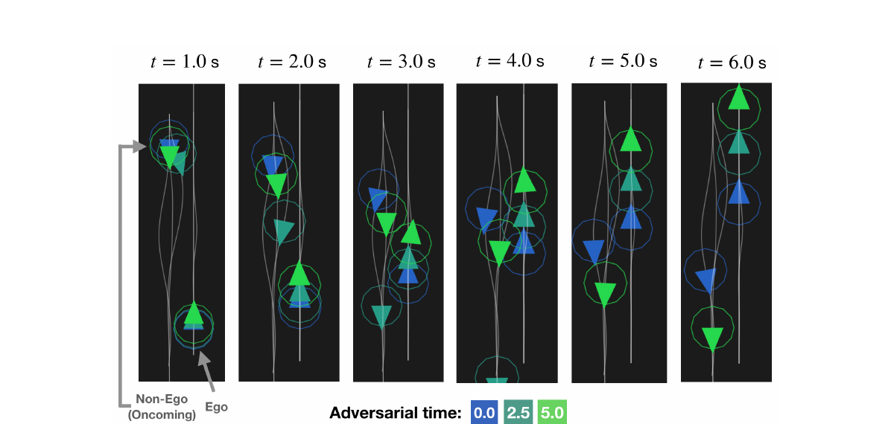
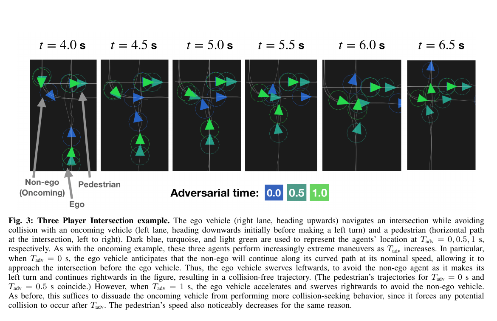

다른 운전자가 늘 협조적으로 움직인다고 가정하면 계획은 빠르고 효율적일 수 있지만, 상대가 잠깐 주의를 놓친 순간에는 여유가 부족해져요. 이 연구는 상대가 전체 시간 동안 악의적으로 행동한다고 두지 않고, 예측 구간의 앞부분에서만 비협조적으로 움직인 뒤 다시 협조한다고 상상해요. 그 짧은 구간의 길이를 바꾸어 방어성의 정도를 조절하는 동적 게임 접근이에요.

이 논문은 자동차 교통 시뮬레이션 연구예요. 실내 이동 로봇이 사람의 편안함을 평가한 실물 사회적 주행 논문은 아니에요. 다만 상대의 행동 모형이 틀릴 수 있다는 문제를 비용 구조에 넣는 방법은 사회적 로봇 주행의 인접 아이디어로 읽을 수 있어요.

## 여러 행위자가 각자 비용을 줄이는 게임을 풀어요

문제는 유한 시간의 <abbr title="여러 행위자가 서로의 미래 행동을 고려하며 각자의 비용을 줄이는 제어 문제">일반합 동적 게임</abbr>으로 표현돼요. 각 차량과 보행자는 상태와 제어 입력을 가지고, 차선·속도·목표·충돌 여유에 관한 서로 다른 비용을 최소화해요. 한 중앙 계획기가 모두의 공통 비용을 줄이는 구조가 아니라 각 행위자의 최적 반응이 서로 맞물린 내시 해를 찾아요.

자기 차량은 다른 행위자도 자기 비용을 줄일 것이라고 예측해요. 상대 차량은 차선을 지키고 목표 속도를 따르며 충돌을 피하려는 비용을 가진다고 보는 식이에요. 이 모형이 맞으면 상호작용을 고려한 부드러운 궤적을 만들 수 있어요. 하지만 실제 상대가 휴대전화를 보거나 자기 차량을 인지하지 못하면 협조 비용 가정이 잠시 깨져요.

논문은 증강 자전거 모형을 사용해 자동차의 위치·방향·속도와 조향을 표현해요. 차선과 속도, 차량 사이 근접 조건이 들어가고 공동 근접 제약의 책임은 자기 차량 쪽에 둬요. 상대가 제약을 지켜 줄 것이라고 믿기보다 자기 차량이 충돌 회피 책임을 가지도록 만든 선택이에요.

## 예측 앞부분에만 비협조 비용을 넣어요

핵심 매개변수는 (T_{adv})예요. 예측 구간 ([0,T]) 중 처음 ([0,T_{adv}))에서는 상대의 비용을 자기 차량에 불리한 방향으로 바꾸고, 이후 ([T_{adv},T])에서는 원래 협조 비용으로 되돌려요. 논문이 말하는 비협조 가정 구간은 실제 상대가 악의를 가졌다는 판정이 아니라, 자기 차량이 잠깐 인식되지 않을 가능성을 상상하는 비용 구간이에요.

<figure class="fig"><figcaption>상대가 비협조적일 수 있다고 보는 구간이 길수록 자기 차량이 더 일찍 차선을 피하며 여유를 만들어요. (출처: Chiu et al., ICRA 2021, Fig. 2)</figcaption></figure>

(T_{adv}=0)이면 전체 구간에서 상대가 협조한다고 봐요. 값이 커질수록 상대가 더 오래 자기 차량을 무시할 수 있다고 가정하고, 자기 차량은 더 일찍 감속하거나 옆으로 물러나요. 한계에서 전체 지평을 비협조 구간으로 두면 최악 상대에 가까운 매우 보수적인 계획이 돼요. 하나의 매개변수로 낙관적 상호작용과 방어적 상호작용 사이를 이동해요.

설명용으로 전체 지평이 15초이고 (T_{adv}=2.5)초라면 앞 16.7% 구간을 비협조 비용으로 계산해요. (T_{adv}=5)초면 33.3%예요. 비율이 두 배가 된다고 경로 여유도 정확히 두 배가 되지는 않아요. 차량 동역학과 차선 경계, 상대 초기 상태가 비선형으로 결합하기 때문이에요. 이 비율 계산은 매개변수의 크기를 읽기 위한 설명이에요.

## 방어성은 확률이 아니라 비용 모형의 선택이에요

(T_{adv})가 2.5초라고 해서 상대가 2.5초 동안 방심할 확률이 계산된 것은 아니에요. 논문은 상대 주의 상태를 센서로 추정해 확률 분포를 만들지 않아요. 설계자가 “얼마 동안 상대의 협조를 기대하지 않을 것인가”를 정하고 그 가정 아래 게임을 풀어요. 위험 선호를 드러내는 해석 가능한 손잡이지만 통계적으로 보정된 신뢰도는 아니에요.

실제 운용에서 값을 정하려면 상대 유형과 장면별 결과를 봐야 해요. 마주 오는 차량, 교차로 회전 차량, 가려진 보행자는 반응 시간과 가능한 행동이 달라요. 모든 장면에 긴 (T_{adv})를 쓰면 차선을 크게 벗어나거나 불필요하게 멈출 수 있고, 짧게 쓰면 빠른 위험에 늦게 반응할 수 있어요.

설명용으로 상대가 10m 앞에서 5m/s로 접근하고 두 차량의 상대 속도가 10m/s라고 해볼게요. 단순 직선 계산의 충돌 시간은 1초예요. (T_{adv}=0.5)초와 2초는 이 장면에서 의미가 크게 달라요. 실제 게임은 조향·감속·차선 제약을 함께 풀지만, 매개변수를 절대 시간으로만 정하고 장면의 충돌 임박도를 무시하면 방어 수준이 일관되지 않을 수 있음을 보여줘요.

시간 대신 예측 충돌 시간이나 가시성, 상대의 양보 증거로 (T_{adv})를 바꾸는 확장은 가능해 보여요. 하지만 이는 논문이 검증한 방법이 아니에요. 적용하려면 값 변경이 경로 불연속을 만들지 않는지, 추정 오류가 보수성을 잘못 낮추지 않는지 새로 시험해야 해요.

## ILQGames는 국소 피드백 내시 해를 계산해요

논문은 ILQGames와 증강 라그랑주 방법으로 제약된 게임을 풀어요. 비선형 동역학과 비용을 현재 궤적 주변에서 반복적으로 근사하고, 각 행위자의 피드백 전략을 갱신해 국소 내시 해를 찾아요. 초기 궤적과 근사점에 의존하므로 가능한 모든 전략 중 전역적으로 가장 좋은 해를 증명하지 않아요.

예측 지평은 15초, 시간 간격은 0.1초예요. 약 150개 시간 단계를 따라 여러 행위자의 상태와 제어 상호작용을 계산해요. 계산 복잡도는 시간 지평에는 선형, 행위자 수에는 대략 세제곱으로 증가해요. 사람과 차량을 많이 넣을수록 급격히 비싸지는 구조예요.

설명용으로 행위자 수가 2명에서 4명으로 늘 때 다른 조건이 같고 세제곱 항이 지배한다면 연산 규모는 (4^3/2^3=8)배가 될 수 있어요. 실제 구현에는 고정 비용과 희소 구조가 있어 정확히 8배가 되지는 않아요. 이 계산은 교통 장면의 소수 행위자 결과를 밀집 군중으로 그대로 확장하기 어려운 이유를 보여줘요.

논문 보고에서 마주 오는 차량 문제의 고정 (T_{adv}) 계산은 0.5초 미만이고, 차량 둘과 보행자가 있는 세 행위자 문제는 0.75초 미만이며 모두 표준 노트북의 단일 스레드에서 1초 안에 풀려요. 계획 지평 15초보다 계산이 짧다는 의미는 있지만, 10Hz 이상의 반응 제어를 매번 새로 푸는 실시간 성능을 입증한 것은 아니에요. 0.1초 제어 간격과 최악 계산 시간의 차이를 별도로 다뤄야 해요.

이 계산이 오프라인 한 번인지, 재계획마다 어떤 초기화를 쓰는지, 새 관측을 받을 때 풀이가 얼마나 빨리 수렴하는지가 실제 적용을 좌우해요. 이전 해를 이어 쓰면 빨라질 수 있지만 장면이 급변하면 잘못된 국소해에 머물 수 있어요. 평균 풀이 시간보다 P95와 실패·비수렴 비율, 중단 시 사용할 안전 행동이 필요해요.

## 마주 오는 차량에서는 일찍 여유를 만들어요

첫 시나리오는 좁은 도로에서 자기 차량과 두 상대 차량이 마주 오는 상황이에요. 협조만 가정하면 서로 차선을 지키며 조정할 것으로 기대하지만, 상대가 자기 차량을 고려하지 않는 구간을 넣으면 자기 차량이 더 적극적으로 옆으로 빠져요. (T_{adv})가 0, 2.5, 5초로 늘 때 방어적 회피가 커지는 그림이 이를 보여줘요.

이 행동이 항상 더 안전하다고 단정할 수는 없어요. 옆으로 피할 공간에 정적 장애물이나 다른 차량이 있으면 새로운 위험을 만들 수 있어요. 논문 장면의 도로 경계와 차량 수 안에서 나온 해예요. 실제 도로에서는 지도 오차, 타이어 한계, 노면, 보이지 않는 행위자까지 고려해야 해요.

방어성의 비용은 차선 이탈량, 목표 속도 손실, 승차감, 경로 길이로 측정할 수 있어요. (T_{adv})를 늘려 최소 거리가 커져도 급조향이 커지면 실행 가능성과 안정성이 나빠질 수 있어요. 최소 거리와 함께 최대 횡가속도, 조향 변화율, 차선 경계 여유를 기록해야 해요.

상대가 실제로 협조하는 조건도 반복해야 해요. 항상 비협조 사례만 시험하면 긴 (T_{adv})가 유리하게 보여요. 협조 90%, 짧은 방심 9%, 긴 비협조 1% 같은 설명용 혼합을 만들어 기대 지연과 최악 거리 사이를 그릴 수 있어요. 이 비율은 실제 교통 통계가 아니라 평가 설계를 설명하는 가정이에요. 현실 적용에는 관측 자료로 빈도를 정해야 해요.

## 교차로 시나리오는 보행자도 게임 행위자로 넣어요

두 번째 시나리오에는 자기 차량, 좌회전하는 상대 차량, 횡단하는 보행자가 있어요. (T_{adv})를 0, 0.5, 1초로 바꾸며 상대 차량이 잠깐 자기 차량을 무시할 수 있다고 가정해요. 방어 구간이 길어지면 자기 차량은 교차로 진입을 더 늦추고 여유를 만들어요.

<figure class="fig"><figcaption>교차로 예시는 차량 두 대와 보행자의 상호 비용을 계산하지만, 시뮬레이션이며 실물 보행자 편안함 평가는 아니에요. (출처: Chiu et al., ICRA 2021, Fig. 4)</figcaption></figure>

보행자가 게임에 등장한다고 이 연구가 실내 사람 인지 주행으로 바뀌는 것은 아니에요. 보행자는 교차로 교통 행위자이고, 개인 공간이나 사회 규범, 사람 설문을 다루지 않아요. 자동차가 방어적으로 진입 시점을 조절하는 문제예요. 사회적 내비게이션 문헌에서는 상대 모형 불일치에 대비하는 게임 이론의 인접 사례로 두는 편이 정확해요.

교차로에서는 차량과 보행자의 시간 규모가 달라요. 차량은 조향과 가속 제약이 크고 보행자는 낮은 속도에서 방향을 더 빨리 바꿀 수 있어요. 모두에게 같은 비협조 가정 구간 의미를 부여하면 상대 비용의 해석이 달라질 수 있어요. 행위자별 (T_{adv})나 비용을 쓰는 확장은 계산량과 조정 항목을 늘려요.

설명용으로 보행자가 1.4m/s로 걷고 횡단 지점까지 2m 남았다면 도달 시간은 약 1.43초예요. 차량의 (T_{adv}=1초)는 이 시간의 큰 비율이에요. 반면 30m 떨어진 차량에는 같은 1초가 짧을 수 있어요. 고정 시간 매개변수를 상대별 충돌 임박도와 함께 해석해야 해요.

## 실내 로봇으로 옮길 때는 비용의 의미부터 바꿔야 해요

실내 로봇과 보행자 사이에도 “상대가 잠깐 로봇을 보지 못한다”는 상황은 있어요. 휴대전화를 보거나 선반 뒤에서 나오거나 대화 중인 사람이 해당돼요. 그러나 자동차 차선 비용을 복도 개인 공간 비용으로 이름만 바꾸면 충분하지 않아요. 로봇의 비홀로노믹 또는 전방향 동역학, 보행자의 급회전, 정적 가구, 시야 가림을 다시 모델링해야 해요.

특히 사람을 비협조 상대로 부르는 표현은 실제 의도와 섞이지 않게 해야 해요. 모델 안의 비협조 비용은 로봇이 상대에게 인지되지 않는 짧은 가능성을 시험하는 장치예요. 사람을 적대적 존재로 분류하거나 행동 의도를 판정한 결과가 아니에요. 사용자에게 설명할 때는 “잠깐 반응하지 않는 가정”처럼 행위 수준으로 말하는 편이 정확해요.

실내에서는 긴 방어 구간이 복도 정체를 만들 수 있어요. 마주 오는 사람이 양보할 것으로 보이지 않는다고 계속 가정하면 로봇이 문 앞이나 벽 쪽으로 지나치게 물러날 수 있어요. 목표 도달과 최소 거리뿐 아니라 사람의 진로 침범, 멈춤 시간, 재시도 횟수, 우회 공간의 정적 안전을 함께 평가해야 해요.

[[2026-10-17_socialnav_constrained-social-optimization|적응형 제약이 사람 예측 불확실성을 다루는 방식]]은 사람 위치 예측의 공분산과 슬랙을 다루고, 이 게임 연구는 상대의 비용 모형이 잠시 틀릴 가능성을 다뤄요. 하나는 상태 예측 오차, 다른 하나는 행위자 의도·반응 모형 오차에 가깝다는 차이가 있어요. 둘을 함께 쓴다면 같은 위험을 중복해 지나치게 보수적으로 만들지 않는지 확인해야 해요.

## 검증은 협조 모형이 맞는 경우와 깨지는 경우를 나눠요

첫 대조군은 모든 상대가 기본 협조 비용대로 움직이는 경우예요. (T_{adv}) 증가가 안전 여유를 얼마나 늘리고 효율을 얼마나 잃는지 봐요. 둘째는 상대가 처음 0.5·1·2초 동안 자기 차량을 무시하는 경우예요. 셋째는 방심 시작 시각이 예측 중간에 나타나는 경우예요. 논문 구조처럼 항상 첫 구간에만 비협조가 있다고 두었을 때 놓치는 실패를 찾을 수 있어요.

넷째는 상대 모형이 전혀 다른 경우예요. 갑자기 정지하거나 후진하거나 차선을 바꾸는 행동을 넣어요. 방어 비용이 상정한 방향과 다른 이상 행동에도 여유가 생기는지 확인해요. (T_{adv})가 길어도 비협조 비용 모형 자체가 가능한 행동을 빠뜨리면 강건하지 않을 수 있어요.

각 실행에서 최소 거리, 충돌, 목표 시간, 차선 이탈, 제어 변화, 풀이 시간, 수렴 상태를 저장해요. 행위자별 비용과 공동 제약의 활성 상태도 필요해요. 결과 궤적만 보면 자기 차량이 왜 감속했는지, 상대 비용 변화인지 근접 제약인지 구분하기 어려워요.

국소해 민감도는 여러 초기 궤적에서 같은 장면을 풀어 확인해요. 모두 비슷한 방어 경로로 수렴하면 결과가 안정적이고, 일부는 왼쪽·일부는 오른쪽으로 크게 갈리면 초기화가 행동을 결정해요. 실시간 시스템에서는 이전 해가 초기화로 쓰이므로 작은 관측 변화가 경로 계열을 바꾸는지도 연속 프레임으로 확인해야 해요.

## 물리 안전을 주장하려면 별도 계층이 필요해요

게임의 근접 제약과 방어 비용은 모형 안의 상태 궤적을 다뤄요. 실제 차량의 위치 오차, 조향 지연, 제동 성능, 상대 검출 누락은 밖에 있어요. 계산이 0.5초 걸리는 동안 장면이 바뀌면 새 해를 적용할 때 이미 가정한 초기 상태와 달라져요. 최악 지연을 상태 예측과 안전 여유에 포함해야 해요.

설명용으로 상대 속도 8m/s, 자기 속도 5m/s로 접근하고 계산·명령 지연이 0.5초면 상대 거리는 그동안 6.5m 줄 수 있어요. 고속 교통에서 0.5초 미만이라는 풀이 시간도 짧다고만 말하기 어려워요. 논문 장면의 실제 상대 방향과 거리에 따라 달라지며, 이 값은 지연 규모를 보여주는 가정이에요.

런타임 충돌 감시, 제동 가능 거리 검사, 센서 중복은 게임 해법과 별도예요. 안전 계층이 명령을 제한했다면 원 게임 궤적과 실행 궤적을 둘 다 남겨야 해요. 방어적 계획 덕분에 안전했는지, 마지막 순간의 비상 제동이 막았는지 구분할 수 있어요.

센서가 상대를 놓친 경우에는 게임의 행위자 목록 자체가 달라져요. 비용을 아무리 방어적으로 바꾸어도 존재하지 않는 노드에는 대응하지 못해요. 검출 누락 시험과 상대 비용 오차 시험을 분리하고, 둘이 동시에 발생하는 조건을 마지막에 더해야 해요. 그래야 인식 계층과 게임 모형의 취약성을 서로 대신 설명하지 않아요.

이 연구의 결과는 두 가지 시뮬레이션과 소수 행위자의 국소 게임 해에 관한 것이에요. 실물 차량 시험이나 실내 사람 편안함 연구로 확대할 근거는 없어요. 그럼에도 상대가 항상 합리적으로 반응한다는 단일 모형과, 전체 시간 내내 최악이라고 보는 극단 사이에 “잠깐 반응하지 않을 수 있다”는 중간 가정을 둔 점은 유용해요. 방어성 매개변수의 의미, 계산 지연, 국소해, 다른 위험 계층을 분리할 때 인접 방법으로 정확히 활용할 수 있어요.

---
<!-- src-block -->
출처 — https://arxiv.org/abs/2011.04815
