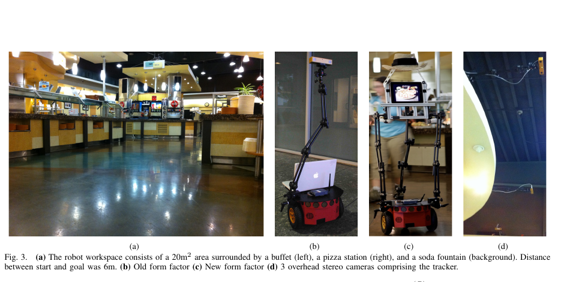
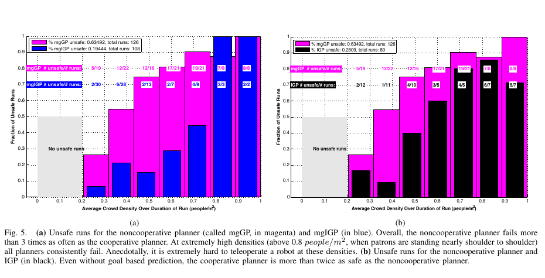

밀집 군중에서 안전을 위해 멈추는 로봇은 충돌을 피할 수 있지만 목적지에는 도달하지 못합니다. 모든 사람의 미래 영역을 고정 장애물처럼 피하면 통로가 사라지고, 빈틈이 생길 때까지 기다리면 뒤의 흐름까지 막아요. 반대로 사람 사이의 작은 틈을 무리하게 파고들면 안전과 신뢰를 잃습니다. 이 논문은 그 사이에서 중요한 가정을 바꿉니다. 사람은 로봇의 움직임을 보고 반응하며, 로봇도 그 반응 속에 포함된 행위자라는 가정입니다.

Peter Trautman과 동료들은 사람마다 미래 궤적을 따로 예측한 뒤 로봇만 피하게 하는 비협력 계획과, 사람·로봇의 궤적을 함께 묶는 협력 계획을 실제 구내식당에서 비교했습니다. <abbr title="여러 목표 후보를 가진 상호작용 가우시안 과정 계획기">mgIGP</abbr>는 각 보행자의 목표 후보와 이동 시간을 확률적으로 표현하고, 모든 행위자 사이의 충돌 없는 공동 궤적에 높은 확률을 줍니다. 예측 분포에서 가능성이 큰 로봇 궤적을 고르는 일이 곧 행동 선택이 됩니다.

이 결과가 특별한 이유는 실물 군중 주행의 규모에 있습니다. 점심시간의 자연스러운 방문객 사이에서 488회 완료 주행을 모았고, 비협력 계획기와 협력 계획기, 반응형 계획기, 사람이 조종한 기준을 비교했습니다. 그러나 사람을 감지한 장치는 천장 스테레오 카메라였고 안전 담당자가 로봇 가까이에서 비상 정지를 준비했습니다. 큰 실험 수가 배포 조건까지 같다는 뜻은 아닙니다.

## 독립 예측은 로봇을 군중에서 지워 버려요

비협력 예측은 각 사람의 과거를 보고 앞으로 갈 경로를 따로 만듭니다. 로봇은 그 예측을 침범하지 않는 궤적을 찾습니다. 이 계산에서 사람의 미래는 로봇이 어느 쪽으로 움직이든 그대로예요. 사람은 로봇을 보지 않으며 양보하지 않는 것으로 표현됩니다.

낮은 밀도에서는 이 보수성이 큰 문제가 아닐 수 있습니다. 사람 사이에 충분한 빈 공간이 있으면 로봇 혼자 돌아갈 수 있어요. 밀도가 높아지면 각 사람의 불확실한 미래가 겹쳐 통행 가능한 영역이 거의 사라집니다. 실제 사람은 눈앞의 로봇을 보고 속도나 방향을 조금 바꾸지만 비협력 모델에는 그 가능성이 없습니다.

협력 모델은 사람과 로봇 궤적의 조합을 하나의 공동 분포로 봅니다. 로봇이 앞으로 나가면 사람이 약간 옆으로 비키고, 사람이 먼저 지나가면 로봇이 속도를 줄이는 조합처럼 서로 맞물린 미래를 평가해요. 충돌에 가까운 조합의 확률을 낮추는 상호작용 항이 행위자들을 묶습니다.

이 관점에서는 “가장 가능성 높은 군중 미래”와 “로봇이 선택할 행동”이 분리되지 않습니다. 로봇도 공동 미래의 한 궤적이므로, 가능성 높은 공동 표본에서 로봇 부분을 실행합니다. [[2026-10-17_socialnav_unfreezing|완벽한 개인 예측만으로도 군중 앞 로봇은 왜 얼어붙는가]]에서 제시한 공동 추론을 목표 후보가 여러 개인 현장 계획으로 확장한 셈입니다.

협력은 친절한 성격값이 아닙니다. 모델 안에서는 서로의 궤적이 충돌하지 않도록 결합되는 수학적 관계예요. 사람이 실제로 로봇을 보지 못하거나 양보할 수 없는데 협력을 기대하면 위험합니다. 협력 모델은 사람에게 부담을 전가해도 높은 진행률을 얻을 수 있으므로 물리 안전과 사회적 공정성을 따로 평가해야 합니다.

## 목표 후보는 직선 하나보다 군중 흐름을 잘 담아요

구내식당 사람들은 아무 방향으로나 무한히 걷지 않습니다. 음식대, 피자 코너, 음료대, 출입구처럼 자주 향하는 장소가 있어요. 논문은 과거 궤적에서 이런 목표와 이동 시간 분포를 만들고, 한 사람의 미래를 여러 목표 성분의 혼합으로 표현합니다.

관측 몇 프레임이 들어오면 각 목표 후보가 현재 움직임을 얼마나 잘 설명하는지에 따라 가중치가 바뀝니다. 음료대 방향으로 이어지는 관측은 그 목표 성분의 확률을 높이고, 멈추거나 방향을 바꾸면 다른 성분이 살아날 수 있어요. 목표 하나를 정답처럼 넣는 오라클보다 불확실성을 보존합니다.

그다음 여러 사람과 로봇의 궤적 표본을 뽑고 상호작용 항으로 가중합니다. 충돌에 가까운 표본은 낮은 가중치를 받고 서로 지나갈 수 있는 공동 표본이 남습니다. 매 제어 주기마다 새 관측으로 이 과정을 반복해 다음 로봇 명령을 정합니다.

목표 혼합이 있다고 해서 목표를 정확히 안다는 뜻은 아닙니다. 후보 목록에 없는 출구, 줄 합류, 지인과의 대화, 갑작스러운 정지는 표현되지 않아요. 과거 구내식당 빈도는 시간대와 배치가 바뀌면 달라집니다. 모델은 목표 불확실성을 다루지만 목표 집합 자체의 누락까지 자동으로 해결하지 않습니다.

설명용 가정으로 한 보행자에게 음료대 0.6, 출구 0.3, 정지 0.1의 목표 확률이 있다고 하겠습니다. 로봇이 음료대로 가는 직선만 피하면 나머지 0.4의 행동을 무시합니다. 세 후보 각각에서 안전한 공동 궤적의 비율이 0.8, 0.5, 0.2라면 단순 가중 안전 질량은 `0.6×0.8 + 0.3×0.5 + 0.1×0.2 = 0.65`입니다. 이는 논문 결과가 아니라 혼합 확률을 읽는 자체 계산입니다.

최고 확률 목표 0.6만 남기면 안전 질량을 0.8로 오해할 수 있습니다. 후보 확률과 조건부 안전을 함께 합쳐야 해요. 더구나 후보 밖 행동의 확률은 계산에 없으므로 0.65를 실제 충돌 회피 확률로 부를 수 없습니다.

## 식당 실험은 사람을 각본대로 움직이지 않았어요

실험장은 뷔페, 피자대, 음료대 사이 약 20제곱미터 공간이었습니다. 로봇은 6미터 떨어진 두 점 사이를 지나갔고, 점심시간 방문객은 정해진 대본 없이 움직였습니다. 입구에는 촬영과 로봇 운행을 알리는 표지가 있었어요.

<figure class="fig"><figcaption>실험 공간과 로봇 외형, 천장 추적 장치를 한 장에 모았습니다. 저자들은 낮은 로봇이 군중에서 잘 보이지 않아 몸체와 화면 얼굴을 높였고, 이는 계획 알고리즘 밖의 외형도 상호작용에 영향을 준다는 근거입니다. (출처: Trautman et al., Robot Navigation in Dense Human Crowds: The Case for Cooperation, Fig. 3, https://las.inf.ethz.ch/files/trautman13robot.pdf)</figcaption></figure>

사람 추적에는 천장 3.5미터 높이의 스테레오 카메라 세 대가 쓰였습니다. 계획기에는 충돌 가능성이 큰 다섯 트랙만 제공됐습니다. 저자들은 이를 신뢰할 수 있는 온보드 추적기의 지역 관측과 비슷하다고 설명하지만, 센서 위치와 가림 조건은 크게 다릅니다. 천장 시점은 사람 몸에 가려지는 로봇 시점보다 식별자 유지가 쉬울 수 있어요.

로봇 외형도 실험 도중 중요한 변수였습니다. 낮은 초기 형태가 군중에게 잘 보이지 않자 사람 몸통처럼 부피를 키우고 화면 얼굴과 모자를 달았습니다. 사람의 협력을 모델링하려면 사람이 로봇을 알아차려야 한다는 현실적인 조치예요. 동시에 알고리즘 비교 결과가 외형과 분리된 순수한 소프트웨어 효과는 아니라는 점도 보여 줍니다.

안전 담당자는 모든 주행에서 로봇 가까이에 머물며 비상 정지를 준비했습니다. 저자들도 담당자의 존재가 군중 행동과 알고리즘 성능에 영향을 줬을 가능성을 적습니다. 각 알고리즘에 같은 절차를 적용해 비교 공정성을 높였지만, 무감독 배포의 절대 안전성을 증명하지는 않습니다.

약 석 달 동안 800회가량을 시도해 488회 완료 데이터를 모았습니다. 완료된 주행만 분석할 때 시작하지 못한 사례나 기록 실패가 어떤 기준으로 빠졌는지 살펴야 합니다. 시도 대비 완료 비율은 약 `488/800=0.61`입니다. 이 61%는 알고리즘 성공률이 아니라 수집 과정의 규모를 읽는 계산이며, 제외 사유 없이는 성능으로 해석할 수 없어요.

## 협력 계획은 비협력 계획보다 덜 자주 중단됐어요

논문은 사람과 벽에 실제로 닿게 두지 않았습니다. 로봇이 사람 1미터 안에 들어왔고 어느 쪽도 충돌을 피하는 진행을 보이지 않으면 담당자가 속도 명령을 0으로 만들고 그 주행을 안전하지 않은 것으로 분류했습니다. 따라서 그래프의 ‘불안전’은 실제 충돌 횟수가 아니라 비상 정지 기준에 걸린 비율입니다.

<figure class="fig"><figcaption>자홍색 비협력 계획기의 비상 정지 비율이 파란색 mgIGP와 검은색 IGP보다 높았습니다. 밀도가 0.8명/제곱미터를 넘으면 모든 자율 계획기가 어려워졌다는 경계도 함께 보입니다. (출처: Trautman et al., Robot Navigation in Dense Human Crowds: The Case for Cooperation, Fig. 5, https://las.inf.ethz.ch/files/trautman13robot.pdf)</figcaption></figure>

전체 집계에서 비협력 계획기의 불안전 비율은 약 0.63, 여러 목표 협력 계획기는 약 0.19였습니다. 비율을 나누면 `0.63/0.19≈3.32`로, 이 실험 조건에서는 비협력 방식이 세 배 이상 자주 비상 정지 기준에 걸렸습니다. 목표 혼합을 뺀 협력 계획기도 약 0.28로 비협력 방식보다 낮았습니다.

이 비교에서 핵심은 정밀한 개인 목표 예측보다 상호작용 결합의 효과가 컸다는 점입니다. 목표 혼합이 없는 협력 계획기도 비협력 계획보다 나았고, 여러 목표 협력 계획기는 더 개선됐어요. “각 사람을 더 정확히 맞히기”와 “사람과 로봇이 서로 바꿀 미래를 표현하기” 중 후자가 밀집 장면에서 더 큰 차이를 만들 수 있다는 증거입니다.

하지만 3.32배를 보편적인 안전 향상 계수로 쓸 수 없습니다. 주행 수가 밀도 구간과 계획기마다 다르고, 비상 정지 규칙과 로봇 외형, 천장 추적, 식당 동선에 묶인 값입니다. 절대 충돌 확률이나 다른 로봇의 인증 수치로 옮길 수 없어요.

고밀도에서는 협력 계획도 무너졌습니다. 평균 밀도 0.8명/제곱미터를 넘는 구간에서 모든 자율 계획기의 안전성이 크게 떨어졌고, 사람 조종도 어렵다고 보고합니다. 협력 모델은 얼어붙음을 줄였지만 물리적으로 비어 있는 공간과 사람 반응 시간을 만들어 내지는 못합니다.

## 멈추기만 하는 반응형 안전은 밀도를 왜곡해요

반응형 기준 계획기는 사람을 짧게 예측하고 가능한 속도 프로파일 가운데 충돌 위험이 낮은 가장 빠른 값을 골랐습니다. 밀도가 높아지면 앞으로 갈 수 있는 속도가 거의 없어져 정지해요. 0.55명/제곱미터보다 높은 시작 조건에서는 진행이 매우 느리거나 멈춰 실험을 완주하기 어려웠습니다.

여기에는 평가상의 함정이 있습니다. 로봇이 오래 기다리는 동안 군중 밀도가 낮아지면 주행 전체 평균 밀도도 내려갑니다. “평균 밀도 0.5에서 성공”이라는 기록이 실제로는 0.8에서 시작해 멈춘 뒤 0.3이 될 때 이동한 결과일 수 있어요. 시간 평균 하나만 보면 어려운 순간을 피한 정지 전략이 더 쉬운 구간에서 평가된 것처럼 보입니다.

배포 평가에서는 시작 밀도, 최대 밀도, 이동 중 밀도, 정지 중 밀도를 나눠야 합니다. 밀도별 도착 시간과 함께 밀도 임계값을 넘은 채 전진한 거리도 기록하면 기다림으로 난이도를 낮춘 전략을 구분할 수 있어요.

설명용 예를 들어 60초 주행에서 처음 30초는 0.8명/제곱미터로 정지하고, 다음 30초는 0.3에서 이동했다고 하겠습니다. 단순 시간 평균은 `(0.8×30 + 0.3×30)/60 = 0.55`입니다. 로봇은 0.8 군중을 통과하지 않았지만 기록에는 평균 0.55 주행으로 남습니다. 이 계산은 논문 데이터를 재산출한 값이 아니라 평균 밀도 지표의 함정을 보여 주는 자체 예입니다.

효율도 도착 시간만 보면 부족합니다. 로봇이 빠르게 도착했지만 열 명이 크게 비켰다면 비용을 사람에게 넘긴 셈입니다. 사람의 추가 이동 거리, 감속량, 대화 중단, 줄 흐름 교란을 함께 측정해야 협력의 부담이 균형 있게 분배됐는지 알 수 있습니다.

## 공동 분포는 계산량과 모델 밖 행동을 남겨요

사람 수가 늘면 공동 궤적의 차원이 커집니다. 각 사람에게 세 목표 후보가 있고 다섯 사람만 고려해도 목표 조합은 단순 계산으로 `3^5=243`개입니다. 로봇 후보까지 곱하고 각 조합에서 연속 궤적 표본을 만들면 계산량이 빠르게 늘어요. 논문 구현이 충돌 가능성이 큰 다섯 트랙만 계획기에 넣은 이유를 이 관점에서 볼 수 있습니다.

다섯 명 밖의 사람을 버려도 안전 센서가 그들을 무시하면 안 됩니다. 예측·협력 계획의 상세 모델은 가까운 핵심 트랙에 쓰고, 나머지 검출에는 별도 충돌 감시와 속도 제한을 적용할 수 있어요. 선택에서 빠진 사람이 갑자기 진입하면 계획 분포가 표현하지 못한 위험입니다.

상호작용 항이 충돌 없는 공동 궤적을 선호해도 사람이 로봇에게 협력할 능력이 있는지는 알지 못합니다. 벽에 붙은 사람, 카트를 끄는 사람, 시각·청각 신호를 인지하지 못한 사람은 옆으로 비킬 여유가 없어요. 모델이 가능한 곡선만 보고 사회적 책임까지 추론하면 로봇이 취약한 사람에게 양보를 요구할 수 있습니다.

또한 확률이 높은 행동이 안전 기준을 대신하지 않습니다. 군중이 로봇 앞에서 갈라지는 공동 미래가 데이터상 흔해도, 제동 거리와 위치 오차를 포함한 최악 조건에서 충돌할 수 있어요. 확률 계획 위에 독립적인 속도·정지 감시를 두고, 모델 신뢰도가 낮을 때 보수적인 상태로 전환해야 합니다.

[[2026-10-17_socialnav_orca|여러 이동체의 상호 충돌 회피를 선형계획으로 푸는 법]]처럼 상호 책임을 명시적으로 반씩 나누는 방식과도 가정이 다릅니다. 여기서는 특정 책임 비율보다 관측된 공동 궤적의 가능성을 사용합니다. 어느 쪽도 사람이 로봇 규칙을 알고 따른다는 보장은 없으므로 비협조 행위자 시험이 필요합니다.

## 천장 추적 성능을 온보드 센서에 넘겨선 안 돼요

천장 카메라는 실험 공간을 넓게 내려다보고 여러 사람의 위치를 약 20헤르츠로 추적했습니다. 로봇 시점 카메라나 LiDAR는 앞사람 뒤의 보행자를 놓치고, 가까운 몸체가 시야 대부분을 가릴 수 있어요. 추적 식별자가 바뀌면 한 사람의 과거가 다른 사람에게 붙어 존재하지 않는 급회전이 생깁니다.

설명용 지연 계산에서 추적과 계획 합산 지연이 0.2초이고 사람이 1.4미터/초로 걸으면 관측 뒤 `1.4×0.2=0.28미터`를 이동합니다. 로봇 제동 지연까지 더하면 공동 분포가 현재가 아니라 과거 장면을 최적화할 수 있어요. 타임스탬프 정렬과 지연 보상은 모델식 밖의 필수 조건입니다.

추적 신뢰도가 낮을 때 목표 혼합이 넓어지는 것만으로 충분하지 않습니다. 사람을 놓쳤다는 사실과 사람이 여러 목표 중 어디로 갈지 모른다는 사실은 다른 불확실성이에요. 전자는 존재 확률과 가림 지속시간, 후자는 조건부 궤적 분포로 표현해야 합니다.

온보드 재현에서는 센서 단계와 계획 단계를 분리해 평가합니다. 먼저 녹화된 센서에서 위치·속도·식별자 오차를 측정하고, 같은 정답 궤적을 각 계획기에 넣어 알고리즘 차이를 비교해요. 그다음 실제 추적 출력을 넣어 전체 성능을 봅니다. 두 결과의 차이가 센서 손실입니다.

외형도 센서만큼 중요한 입력입니다. 사람들이 로봇을 일찍 발견할수록 협력 반응을 보일 시간이 늘어납니다. 높이와 조명, 이동 소리, 화면 얼굴을 바꾸면 같은 계획기가 다른 군중 반응을 얻을 수 있어요. 모델 버전과 함께 로봇 외형 및 신호 조건을 남겨야 합니다.

## 재현 실험은 세 가지 협력을 분리해야 해요

첫째는 기하 협력입니다. 사람이 로봇을 보고 최소한의 옆 이동을 하는지 측정합니다. 둘째는 시간 협력으로, 한쪽이 감속해 다른 쪽을 먼저 보내는지 봅니다. 셋째는 사회적 협력으로, 누가 더 많이 양보했는지와 부담이 특정 집단에 몰렸는지 평가해요. 공동 궤적 성공 하나로 세 층을 합치면 원인을 알 수 없습니다.

시뮬레이션에서는 사람 정책을 네 종류로 나눌 수 있습니다. 로봇과 공동으로 피하는 정책, 직진을 고수하는 정책, 늦게 반응하는 정책, 로봇 쪽으로 잘못 움직이는 정책이에요. 협력 계획이 첫 조건에서만 좋고 나머지에서 급격히 위험해지면 배포에는 신뢰도 기반 후퇴 전략이 필요합니다.

실물 시험은 낮은 밀도에서 시작해 중간 밀도로 올리고, 모델 밖 행동이 들어오면 자동으로 속도를 줄이도록 설계합니다. 성공률, 비상 정지, 최소거리, 도착 시간 외에 사람의 추가 경로 길이와 감속량을 기록해요. 안전 담당자의 위치와 개입 기준도 공개해야 비교가 가능합니다.

통계에서는 주행을 독립 표본으로만 세지 않도록 주의해야 합니다. 같은 시간대의 같은 사람들이 여러 번 지나가고, 날씨나 메뉴가 군중 흐름을 바꿀 수 있어요. 날짜와 시간대를 묶은 계층 분석이나 세션별 신뢰 구간이 필요합니다. 밀도 구간별 표본 수가 작으면 전체 비율 하나보다 불확실성을 함께 보여 줘야 해요.

이 논문의 강한 메시지는 정밀한 개인 예측 하나로 밀집 군중을 풀 수 없다는 점입니다. 사람과 로봇이 서로 반응할 공동 미래를 표현했을 때 비협력 계획보다 비상 정지가 줄었고, 반응형 정지가 통과하지 못한 밀도에서도 진행했습니다. 자연스러운 구내식당에서 수백 회 실물 주행으로 이를 비교한 점은 고전 연구 가운데 드문 근거입니다.

그 결과를 현장에 옮길 때는 천장 추적, 안전 담당자, 로봇 외형, 다섯 명 트랙 제한, 비상 정지 정의를 함께 가져와야 합니다. 협력을 기대하는 계획은 사람이 로봇을 볼 수 있고 움직일 여유가 있을 때만 성립합니다. 예측 분포와 별개인 충돌 감시, 비협조 시험, 사람에게 전가된 부담 측정이 있어야 “함께 길을 만든다”는 표현이 안전과 사회성을 모두 뜻할 수 있습니다.

---

<!-- src-block -->
출처 — https://journals.sagepub.com/doi/10.1177/0278364914557874
