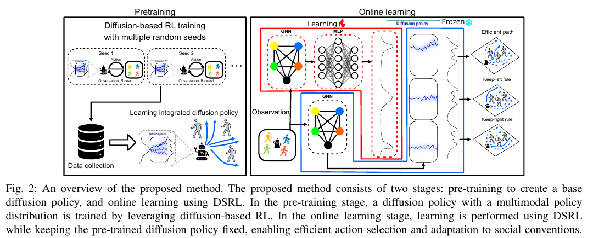
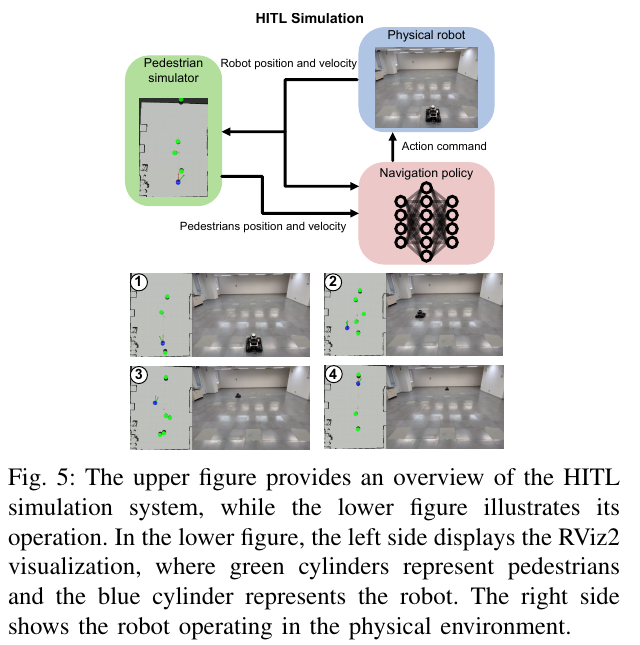

새 공간에서 통행 방향을 바꾸려면 로봇의 모든 주행 능력을 다시 학습해야 할까요. 이미 사람을 피하며 목적지에 가는 정책이 있다면 그 능력을 유지하면서 가능한 행동 중 무엇을 선호할지 조정하는 방법을 생각할 수 있습니다. Nagahisa 등의 2026년 연구는 <abbr title="무작위 값에서 출발해 여러 단계의 정제를 거쳐 이동 행동을 만드는 학습 정책">확산 정책</abbr>을 고정하고, 그 입력 잡음을 고르는 학습으로 통행 행동을 바꾸는 접근을 다뤄요.

## 기본 정책과 입력 선택을 분리해요

<figure class="fig"><figcaption>왼쪽은 기본 정책을 만드는 단계, 오른쪽은 고정된 확산 정책에 들어갈 잡음 선택을 학습하는 단계예요. (출처: Nagahisa et al., Performance-Preserving Online Adaptation in Social Navigation via Diffusion Steering, Fig. 2; 원문 부분 인용, 공개 CC 재사용 허가 미확인)</figcaption></figure>

논문은 여러 초기화로 학습한 정책의 성공 데이터를 모아 기본 확산 정책을 만들고, 배치 단계에서는 그 확산망의 가중치를 유지합니다. 학습되는 잡음 정책과 행동 가치·잡음 가치 추정망을 연결해 어떤 입력에서 좋은 행동이 나오는지 고르게 해요. 행동을 만드는 망 전체를 갱신하는 대신 입력 선택을 조정하는 구조입니다. ‘잡음만 학습한다’는 표현은 기본 확산망을 고정한다는 뜻으로 읽어야 하며 가치 추정망까지 모두 멈춘다는 뜻은 아닙니다.

이 구분은 학습으로 바뀔 수 있는 범위를 제한하는 데 도움이 됩니다. 그러나 가중치가 그대로라는 사실과 실제 출력 행동이 그대로라는 사실은 다릅니다. 같은 함수도 넣는 입력이 바뀌면 다른 결과를 만들어요. 따라서 기본 망의 파일이 변하지 않았음을 확인하는 것만으로 주행 성능 보존을 검증했다고 할 수는 없습니다.

## 여러 행동의 분포를 남기는 이유가 있어요

사람과 마주쳤을 때 왼쪽으로 피하는 행동과 오른쪽으로 피하는 행동이 모두 가능할 수 있습니다. 두 선택이 각각 괜찮다고 해서 그 가운데를 향하는 행동도 괜찮은 것은 아니에요. 설명용으로 두 우회 방향 사이에 사람이 서 있다면 평균 방향은 사람 쪽을 가리킬 수 있습니다. 행동을 하나의 평균과 주변 흔들림으로만 표현할 때 놓칠 수 있는 구조예요.

<abbr title="한 상황에서 좋은 행동이 한곳에만 모이지 않고 서로 떨어진 여러 선택지에 모이는 성질">다봉성</abbr>은 이런 여러 행동 무리를 표현하는 관점입니다. 설명용으로 왼쪽 통과 확률 0.45, 오른쪽 통과 확률 0.45, 대기 확률 0.10을 가정해 볼 수 있어요. 왼쪽 통행 환경에서 이를 0.80, 0.10, 0.10으로 바꾸면 가능한 행동을 모두 새로 만드는 대신 선호 비율을 바꾼 셈입니다. 이 숫자는 논문에서 측정한 확률이나 실제 정책 출력이 아닌 원리 설명용 입력입니다.

선택지를 여러 개 보존했다고 적절한 선택이 자동으로 나오는 것은 아닙니다. 지금 관측에서 어느 선택이 가능한지, 상대 사람이 어느 쪽으로 움직이는지 판단해야 해요. 왼쪽이 벽으로 막힌 장면에서는 왼쪽 선호를 강하게 하는 것만으로 해결되지 않습니다. 기본 정책이 제공하는 행동 범위와 선택 정책이 읽는 상태를 함께 확인해야 해요.

## 잡음 공간은 동작을 만드는 입력의 좌표예요

이 연구에서 말하는 잡음은 센서 오류를 일부러 더하는 것과 다릅니다. 확산 정책의 행동 생성에 사용하는 내부 입력이에요. 같은 사람 배치에서도 잡음 값이 다르면 다른 우회 후보가 만들어질 수 있습니다. 학습의 목적은 그 입력과 결과 행동 사이의 관계를 이용해 더 적절한 행동을 고르는 데 있어요.

설명용으로 관측 상태를 하나로 고정하고 잡음 입력만 바꾸는 시험을 생각할 수 있습니다. 각 입력에서 나온 행동을 적용하지 않고 계산만 모은 뒤, 전진·대기·좌우 우회 중 어느 행동 무리가 존재하는지 봐요. 입력 거리가 가깝다고 행동도 반드시 비슷한지는 별도로 확인해야 합니다. 내부 입력 공간의 모양을 몸체가 움직이는 공간의 거리처럼 읽으면 안 돼요.

잡음 선택이 바뀐 뒤에는 출력 행동의 분포를 함께 기록할 수 있어요. 잡음 값이 크게 바뀌었지만 행동은 거의 같을 수 있고, 작은 입력 차이에서 행동 방향이 크게 달라질 수도 있습니다. 어느 값이 좋은지 배우는 추정망이 필요한 이유와 연결됩니다. 학습 상태를 이해하려면 입력 숫자와 최종 행동을 같은 기록에서 볼 수 있어야 해요.

## 행동 가치와 잡음 가치를 나누는 질문

서로 다른 잡음이 거의 같은 행동을 만들면 실제로 실행한 경험을 공유할 여지가 있습니다. 행동이 비슷한데 입력 이름이 다르다는 이유로 매번 처음부터 배워야 하면 비효율적이에요. 행동 결과를 평가하는 관점과 그 행동을 만들 잡음을 평가하는 관점은 다른 질문입니다. 앞은 무엇을 했을 때 좋았는지, 뒤는 무엇을 넣어 그 행동을 만들지 묻습니다.

설명용으로 서로 다른 입력 세 개가 모두 느린 좌회피를 만들었다고 가정하겠습니다. 실제로 실행한 한 번의 결과가 느린 좌회피의 가치를 알려 주면 나머지 두 입력도 그 행동과의 관계를 이용해 평가할 수 있어요. 그렇다고 한 경험으로 모든 상태의 좌회피가 좋다는 결론을 낼 수는 없습니다. 상태, 사람 배치와 목표가 달라지면 행동의 가치도 달라지기 때문입니다.

가치 추정 오류는 선택의 편향으로 나타날 수 있습니다. 특정 잡음에 높은 값을 주는 추정이 잘못되면 기본 정책을 고정해도 그 입력이 반복 선택될 수 있어요. 기본 망 갱신의 위험을 줄이는 설계와 가치 학습 오류를 검증하는 일은 함께 필요합니다. 반복 선택 횟수와 실제 결과를 대조하면 과도한 낙관을 관찰할 수 있어요.

## 성공한 데이터만 모으면 무엇이 보이지 않을까요

기본 정책을 만들 때 성공 실행을 모으는 선택은 목적지 도달과 회피를 잘하는 행동에 학습을 집중하게 할 수 있습니다. 동시에 실패했던 상태에서 무엇을 하면 안 되는지에 관한 정보는 줄어들 수 있어요. 성공 데이터에 드물게 등장한 장면에서 같은 품질이 유지되는지는 별도 시험 문제입니다. 데이터 선택 규칙을 정책의 적용 범위와 연결해 읽어야 해요.

설명용으로 넓은 통로의 성공 경로가 대부분이고 좁은 문 앞 대기는 거의 없는 자료를 생각할 수 있습니다. 서로 다른 초기화에서 데이터를 모아도 모두 같은 넓은 통로만 경험했다면 환경 다양성은 늘지 않아요. 초기화 다양성, 행동 다양성, 공간 다양성은 서로 다른 축입니다. 데이터가 여러 출처에서 왔다는 말만으로 셋을 모두 얻었다고 볼 수 없습니다.

검증에서는 같은 시작 상태에서 서로 다른 기본 정책이 만든 후보를 비교할 수 있어요. 우회 방향이나 대기 행동이 실제로 다양해졌는지, 새 행동이 생겼지만 실패도 늘었는지 확인합니다. 성공률과 행동 분포를 함께 보면 다양성과 성능의 교환 관계가 드러나요. 단순히 정책 수가 늘었다는 설정값을 다양성의 결과 지표로 대신할 수는 없습니다.

## 성능 보존은 학습 도중의 곡선을 요구해요

배치 뒤 적응은 최종 정책만 좋은지 묻는 학습과 다릅니다. 학습 중에도 로봇을 계속 사용하는 상황이라면 중간 정책의 실패가 실제 부담이 됩니다. 마지막 성공률만 비교하면 적응 초기에 크게 나빠졌다가 복구된 과정을 숨길 수 있어요. 성능 보존이라는 표현을 평가하려면 시간에 따른 성공과 이동시간을 함께 봐야 합니다.

설명용으로 기본 정책 성공률을 0.90, 새 정책의 마지막 성공률을 0.94라고 가정하겠습니다. 학습 초반의 100회에서는 0.60이었다면 최종 4%포인트 개선과 초반 30%포인트 하락이 함께 존재해요. 반대로 모든 중간 구간이 0.89 이상이었다면 같은 최종값도 배치 의미가 달라집니다. 이 수치는 논문 결과가 아닌 평가 곡선이 필요한 이유를 보여 주는 가정입니다.

구간별 평균만으로도 드문 큰 실패를 놓칠 수 있습니다. 시나리오별 실패 수, 최악 구간, 회복에 걸린 학습량을 함께 볼 수 있어요. 기본 정책을 고정했다는 구조적 사실과 특정 실험에서 성능 하락이 작았다는 관찰을 구분해야 합니다. 그 관찰을 모든 보행 환경의 형식적 보장으로 확대하지 않는 것이 중요해요.

## 통행 규칙은 방향의 기준까지 정의해야 해요

논문은 지정 구역과 좌·우 통행 보상을 시험하며, 좌우를 환경을 위에서 보았을 때의 방향으로 정의합니다. 로봇의 현재 몸 방향을 기준으로 한 좌우와 같다고 가정하면 보상 의미가 달라질 수 있어요. 방향 규칙을 재현하려면 어느 좌표와 어느 행위자의 진행을 기준으로 했는지 적어야 합니다. ‘왼쪽으로 피한다’는 짧은 표현에는 이 조건이 숨어 있어요.

설명용으로 복도의 북쪽에서 남쪽으로 내려오는 로봇과 남쪽에서 북쪽으로 올라오는 로봇을 생각해 볼 수 있습니다. 지도 왼쪽을 택하는 규칙과 각자의 왼쪽을 택하는 규칙은 같은 경로를 만들지 않습니다. 경로를 그려 보면 한 경우에는 같은 통로로 모이고 다른 경우에는 분리될 수 있어요. 이는 특정 지역의 올바른 규범을 선언하는 예시가 아니라 좌표 정의의 차이를 보여 주는 상황입니다.

실제 장소의 규칙이 맞는지는 별도의 근거가 필요합니다. 통행 표지, 사람 흐름, 좁은 문 우선권처럼 문맥이 바뀌면 고정 선호가 충돌할 수 있어요. 규범 보상에서 높은 값을 받았다고 사람들이 편안했다고 결론내릴 수는 없습니다. 규칙 준수와 사람 평가를 각각 관찰해야 합니다.

## 실물 로봇과 가상 보행자를 연결한 실험이에요

<figure class="fig"><figcaption>실물 몸체는 움직이지만 보행자는 시뮬레이터 안에 있어요. 실제 사람과 반복 상호작용한 사용자 연구와 구분해야 합니다. (출처: Nagahisa et al., 원논문 Fig. 5; 원문 부분 인용)</figcaption></figure>

실물 연동 실험은 최대 초당 0.5미터, 6×9미터 공간에서 가상 보행자 다섯 명과 좌·우 통행 조건을 사용하고 500개 에피소드 동안 적응합니다. 센서와 위치 추정은 탑재 컴퓨터가 맡지만 추론·학습은 외부 RTX 5080 컴퓨터에서 실행해요. 이 구성은 몸체 운동을 포함한 학습을 확인하는 근거입니다. 실제 보행자의 감정이나 반응, 소형 컴퓨터의 전체 온보드 실행을 입증하는 근거는 아닙니다.

기본 문제 설정은 사람의 상대 위치·속도를 받으며 평면의 두 속도 성분을 낼 수 있는 전방향 로봇을 가정합니다. 실물과 시뮬레이션을 연결하면 바퀴 응답과 위치 추정 같은 일부 현실 조건을 포함할 수 있습니다. 그러나 가상 보행자가 받는 관측과 움직임 규칙은 여전히 시뮬레이션의 일부예요. 사람 검출 누락이나 상대의 갑작스러운 양보가 동일하게 들어간다고 가정할 수는 없습니다. 실험에서 현실화한 요소와 가상으로 남긴 요소를 나눠 적어야 적용 범위를 판단할 수 있어요.

## 적응의 보상은 주행 목적과 충돌할 수 있어요

원하는 통행 방향 보상을 강하게 주면 목적지 진행보다 그쪽 공간에 머무는 행동이 유리해질 수 있습니다. 충돌 회피 벌점이 있어도 다른 보상과 종료 조건이 어떻게 합쳐지는지에 따라 결과가 달라져요. 보상 합계가 늘었다는 이유만으로 기본 주행 목적도 나아졌다고 결론내리면 안 됩니다. 성공률과 통행 규칙 준수를 따로 보고해야 해요.

설명용으로 목표 도달 보상을 1, 규칙 위반 벌점을 한 번에 0.1이라고 가정하면 위반 여섯 번의 합은 0.6입니다. 여기에 시간 할인과 에피소드 길이까지 들어가면 오래 대기하는 행동과 짧게 위반하고 도착하는 행동의 순위가 바뀔 수 있어요. 이 숫자는 논문의 보상 설정이 아닌 누적 보상 민감도를 설명하는 가정입니다. 실제 비교에서는 어떤 항목이 총보상의 변화를 만들었는지 분해할 수 있어요.

통행 방향이 고정된 장면에서 학습한 뒤 반대 규칙 장면으로 옮기면 이전 적응이 얼마나 남는지도 볼 수 있습니다. 새 규칙을 잘 따르지만 이전 장소에서 목적지 도달이 나빠졌다면 보존의 범위를 더 좁혀 보고해야 해요. 한 환경의 적응 성과와 여러 환경을 오가는 유지 능력은 다른 결과입니다. 고정된 기본 망은 그런 검증을 설계할 기반이지만 검증을 생략할 이유는 아닙니다.

## 잡음 범위를 제한해도 입력 오류는 남아요

학습 입력의 범위를 제한하면 관찰하지 못한 내부 값으로 크게 벗어나는 일을 줄일 수 있습니다. 그러나 사람 위치가 잘못되거나 목표 좌표가 뒤집힌 상태까지 정상으로 만드는 것은 아니에요. 같은 제한 범위 안의 입력도 잘못된 관측에 조건화되면 부적절한 행동을 만들 수 있습니다. 내부 탐색의 범위와 외부 인지의 정확도를 나눠야 해요.

재생 시험에서는 사람 위치 오차, 속도 오차, 관측 지연을 따로 바꿀 수 있습니다. 설명용으로 초당 1.2미터의 접근에서 관측이 0.25초 오래되면 그동안의 상대 이동은 0.30미터입니다. 잡음 정책이 어느 값을 택하든 관측 시각의 오해는 남을 수 있어요. 이 계산은 해당 논문의 측정값이 아니라 인지 지연이 만드는 차이를 보여 주는 입력입니다.

기본 정책과 적응 정책을 같은 오류 조건에 넣으면 적응 자체가 입력 오류를 더 증폭했는지 비교할 수 있어요. 정상 입력의 성공률이 유지됐더라도 지연 조건에서 실패가 늘면 성능 보존 주장을 조건부로 써야 합니다. 학습 보상에 없는 실패를 따로 시험하는 방식이 배치 판단에 도움이 됩니다.

## 적응을 멈춘 뒤의 복귀도 별도 동작이에요

기본 확산망을 고정해도 학습된 잡음 선택은 남습니다. 적응 학습을 멈췄다는 사실만으로 처음의 행동 분포로 돌아가는 것은 아니에요. 새 장소의 규칙을 계속 따를지, 기본 선택으로 돌아갈지, 이전 장소의 선택을 불러올지 정해야 합니다. 이 선택은 보상 최적화와 구별되는 운영 상태의 문제예요.

설명용 검증에서는 같은 관측 기록을 기본 선택, 적응된 선택, 복원된 선택에 각각 넣어 볼 수 있습니다. 기본 확산망은 동일하게 두고 출력 행동 분포가 어떻게 달라지는지 비교해요. 복원 뒤에도 차이가 남으면 내부 이력이나 전처리 상태 등 모델 밖의 조건이 바뀌었는지 확인할 수 있습니다. 가중치 파일 하나만 같다는 검사보다 행동의 재현 조건을 넓게 보는 방법입니다.

복원 시험에도 정상 입력과 지연 입력을 함께 둘 수 있어요. 특정 통행 방향은 돌아왔지만 관측 공백에서 대기 행동이 달라진다면 복원이 일부 상태에만 성립한 셈입니다. 어떤 구성 요소를 되돌렸고 어떤 이력은 유지했는지 기록해야 합니다. 온라인 학습이 있다는 이유로 행동 변화의 원인을 모두 학습망에 돌리지 않게 하는 검증입니다.

## 적용 전에 비교할 것은 고정한 것과 바뀐 것이에요

이 연구의 구현을 검토할 때는 기본 확산망, 잡음 선택망, 두 가치 추정의 버전과 갱신 시점을 구분할 수 있습니다. 관측과 보상, 선택된 잡음, 생성 행동을 연결하면 어떤 학습 변화가 행동을 바꿨는지 추적할 수 있어요. 외부 계산 컴퓨터와 통신을 사용하는 구성이라면 명령 지연과 연결 공백도 별도 입력입니다. 모델 갱신 비용과 실행 지연을 모두 측정해야 실제 계산 예산을 판단할 수 있습니다.

온라인 적응은 학습 후의 정책 점수뿐 아니라 학습 중 실패와 환경 전환을 평가하게 만듭니다. 가능한 행동을 보존하면서 선택을 바꾸는 구조는 이 질문을 구체적으로 다룰 수 있게 해요. 확인된 근거는 가상 보행자를 포함한 시뮬레이션과 실물 연동 실험의 범위에 있습니다. 사람 참여 평가와 인지 오류, 통신 지연을 더한 검증이 있어야 같은 선택을 새로운 장소의 행동 품질로 연결할 수 있습니다.

기본 행동 분포를 만드는 확산 학습은 [[2026-10-17_socialnav_colson|COLSON이 확산 행동 분포를 제약 없이 유도한 방법]]과 함께 읽을 수 있어요. 분포를 만드는 학습과 그 분포에서 통행 행동을 고르는 적응은 다른 단계이며, 각 단계의 실험 조건을 나눠 비교해야 합니다.

---

<!-- src-block -->

출처 — https://arxiv.org/abs/2609.24317
