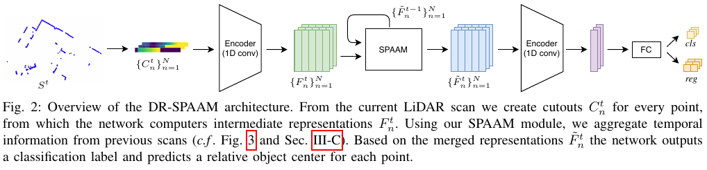
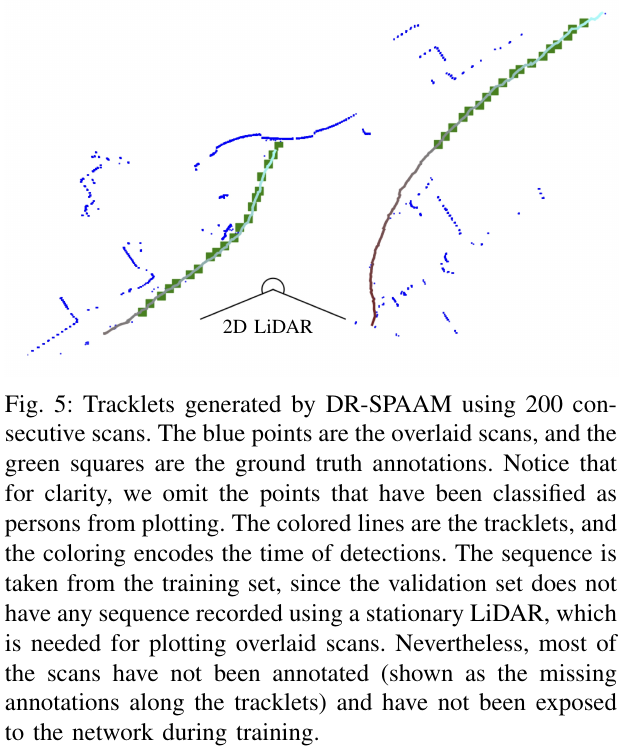

한 번의 이차원 라이다 스캔에는 사람을 구분할 정보가 적어요. 멀리 있는 다리는 몇 개의 점으로만 보이고, 잠깐 가려지면 이전에 있던 사람도 사라진 것처럼 나타나요. 여러 시점의 관측을 함께 쓰면 도움이 되지만, 로봇과 사람이 모두 움직이므로 과거 점을 같은 배열 위치에 더하는 것만으로는 충분하지 않아요.

DR-SPAAM은 과거 원시 스캔을 매번 다시 처리하는 대신, 이전 관측에서 얻은 특징을 보관하고 현재 특징과의 유사도로 연결해 갱신해요. 원 논문은 이 공간 대응과 재귀적 누적을 결합해 사람 검출을 개선했어요. 검출기라는 역할을 먼저 기억해야 해요. 이 구조가 과거를 사용한다는 사실만으로 완성된 사람 추적이나 사회적 주행 정책이 생기는 것은 아니에요.

## 과거 스캔을 다시 자르는 대신 특징을 이어 받아요

거리점 주변을 실제 공간 크기에 맞춰 잘라 특징을 얻는 출발점은 DROW 계열과 같아요. DR-SPAAM은 현재 특징과 과거의 이웃 특징을 비교하고, 비슷한 부분에 큰 가중치를 줘 과거 정보를 정렬해요. 그 결과를 현재 정보와 합친 표현으로 다음 시점까지 전달하고, 그 표현에서 사람 여부와 중심 위치를 계산해요.

<figure class="fig"><figcaption>현재 스캔의 특징과 앞서 누적한 특징을 연결한 뒤 분류와 위치를 계산해요. 과거 원시 입력 전체를 매번 다시 처리하는 구조와 구분해야 해요. (출처: Jia·Hermans·Leibe, <a href="https://arxiv.org/pdf/2004.14079">DR-SPAAM</a>, Fig. 2, 방법 비평을 위한 그림 영역 인용)</figcaption></figure>

이 차이는 계산을 어디에 쓰는지로 이해할 수 있어요. 설명용으로 새 관측 하나를 처리하는 비용이 4ms라고 가정해요. 매 갱신마다 과거 다섯 관측을 모두 다시 처리하면 단순 부분만 20ms가 들 수 있어요. 이미 얻은 특징을 이어 쓸 수 있다면 현재 처리 4ms에 연결·갱신 비용을 더하는 구조가 돼요. 실제 시간은 구현에 따라 달라지며 이 계산은 논문 측정값이 아니에요.

다만 특징을 보관한다고 모든 과거 정보를 무료로 얻는 것은 아니에요. 이전 표현을 현재 대상과 잘못 연결하면 오류도 누적돼요. 처리량을 줄인 이득과 기억을 잘못 이어 받은 위험을 함께 봐야 해요. 새 정보를 계산하는 시간뿐 아니라 연결을 확인하고 오래된 상태를 버리는 규칙도 시스템 일부가 돼요.

이 관점은 센서 기록을 재생하는 시험에도 적용돼요. 같은 스캔을 한 장씩 독립 처리한 결과와 순서를 유지해 누적한 결과를 비교하면 시간 정보의 기여를 볼 수 있어요. 누적 기능을 켜 놓고 프레임 순서를 섞으면 다른 알고리즘을 시험하는 셈이에요. 평가 도구가 시퀀스 경계와 초기 상태를 어떻게 다루는지부터 확인해야 해요.

## 같은 광선 번호가 같은 사람을 뜻하지 않아요

라이다 배열의 한 칸은 특정 방향을 가리켜요. 사람이 옆으로 움직이거나 로봇이 회전하면 같은 사람이 다른 칸으로 이동해요. 어제의 한 칸과 오늘의 같은 칸을 무조건 더하면 사람 특징과 배경 특징이 섞일 수 있어요. 여기서 필요한 것은 배열 위치의 동일함보다 관측 내용의 대응이에요.

설명용으로 대상이 4m 앞에서 옆으로 0.2m 이동하면 방위가 약 2.86도 바뀌어요. 각도 간격을 0.5도로 가정하면 약 여섯 칸을 이동한 크기예요. 대상이 같은 사람이어도 같은 인덱스의 과거 특징을 읽는 방식은 다른 지점을 볼 수 있어요. 이 예는 유사도 기반 연결이 필요한 이유를 보일 뿐 논문의 정확한 검색 범위나 오차를 재현한 값은 아니에요.

이웃 영역을 검색하면 작은 이동을 따라갈 가능성이 생겨요. 그러나 범위를 지나치게 넓히면 서로 닮은 두 사람이나 의자 다리를 같은 대상으로 연결할 수 있어요. 범위가 너무 좁으면 빠른 횡단을 놓칠 수 있어요. 가까운 물체의 큰 각도 이동과 먼 물체의 작은 각도 이동이 같은 설정에서 어떻게 처리되는지도 봐야 해요.

로봇 이동 보정의 유무와 사람의 자체 이동도 나눠야 해요. 로봇이 정지한 조건에서 사람이 이동하는 시험, 사람이 정지한 조건에서 로봇이 회전하는 시험, 둘 다 움직이는 시험은 다른 실패를 드러내요. 최종 검출률만 비교하면 무엇을 보정한 효과인지 알기 어려워요. 각 조건에서 중심 오차와 연결된 특징의 위치를 함께 남기는 편이 좋아요.

## 특징 기억은 도움이 되지만 잘못된 흔적도 남길 수 있어요

<abbr title="이전 시점에 계산한 표현을 현재 입력과 합쳐 다음 시점으로 전달하는 방식">재귀적 특징 누적</abbr>은 짧은 가림이나 드문 관측에 유용할 수 있어요. 현재 한 장의 정보가 약할 때 과거에 보였던 형태가 판단을 도와줘요. 반대로 과거에 잘못 읽은 물체가 있으면 현재 정보가 약한 동안 그 오류가 버텨 남을 수 있어요. 기억을 갖는 검출기는 순간 정확도와 오류 지속 시간을 함께 봐야 해요.

설명용으로 현재와 과거를 절반씩 섞는 단순 갱신을 생각해요. 새 근거가 계속 들어온다면 오래된 정보의 남은 가중치는 한 번 뒤 0.5, 두 번 뒤 0.25, 세 번 뒤 0.125로 줄어요. 이는 설명용 지수 감쇠 계산이며 실제 신경망의 출력 확률이 같은 비율로 줄어든다는 뜻은 아니에요. 비선형 변환과 잘못된 공간 연결 때문에 출력은 더 오래 유지될 수도 있어요.

가림에서 벗어난 사람이 새 위치에 나타날 때 이전 흔적과 새 검출이 동시에 남는지 확인해야 해요. 두 검출을 한 사람으로 연결하지 못하면 후속 계획기는 사람 수를 과대평가할 수 있어요. 반대로 새 사람의 특징을 이전 사람으로 흡수하면 대상 전환을 놓칠 수 있어요. 신뢰도뿐 아니라 중복과 식별자 바뀜을 함께 기록해야 해요.

오래된 상태를 초기화할 조건도 필요해요. 센서 연결이 끊겼다가 복구됐거나, 기록을 처음으로 되돌렸거나, 로봇의 위치가 불연속으로 바뀌었다면 이전 특징을 그대로 이어 쓰기 어려워요. 초기화 전후의 빈 출력이나 첫 검출 지연도 정상 동작의 일부로 정의해야 해요. 논문의 누적 구조를 구현할 때 놓치기 쉬운 실행 계약이에요.

## 논문의 속도는 최적화 버전과 장치를 함께 읽어요

논문 표의 최적화된 버전은 <abbr title="영상 처리 등에 쓰는 병렬 연산 장치">GPU</abbr>가 있는 노트북에서 초당 87.2회, Jetson AGX에서 22.6회 처리해요. 같은 표에는 최적화 전 버전도 있으므로 모델 이름만 보고 시간을 옮기면 안 돼요. 전처리·신경망·후처리의 합과 장치 조건을 함께 읽어야 해요.

[저자 구현의 설명](https://github.com/VisualComputingInstitute/DR-SPAAM-Detector)은 논문의 투표 후처리를 다른 중복 억제 방식으로 바꿨다고 밝혀요. 저장소 표와 원 논문의 수치가 다른 이유도 함께 적혀 있어요. 같은 DR-SPAAM 이름이라도 논문 표의 실행 경로와 내려받은 코드의 실행 경로가 같다고 가정하지 않는 편이 좋아요.

초당 처리 횟수의 역수는 한 처리의 대표 시간으로 읽을 수 있어요. 설명용으로 22.6회를 단순 역산하면 약 44.2ms예요. 그러나 센서 메시지를 기다리는 시간, 다른 작업과의 경쟁, 명령 소비자가 결과를 받는 시간까지 포함한 종단 지연은 이 값과 다를 수 있어요. 평균 추론 시간이 충분해도 가끔 길게 밀리는 구간은 별도 문제예요.

Jetson의 결과를 Raspberry Pi의 결과로 옮길 수는 없어요. 연산 장치, 메모리 대역폭, 실행 라이브러리, 입력 점 수와 후처리 구현이 달라요. Pi에서의 처리량·온도·전력·통신 지연은 이 논문이 측정한 값이 아니에요. 논문에서 실시간이라고 표현한 범위와 새 시스템이 실시간 요구를 충족하는지는 따로 판단해야 해요.

비교하려면 동일 입력과 동일 후처리로 장치별 시간을 재야 해요. 모델 추론만 잰 조건과 입력 변환부터 출력 생성까지 잰 조건을 분리하고, 초기 실행과 안정 상태도 구분해야 해요. 다른 프로세스가 없는 벤치마크 결과를 영상 중계·지도 처리와 함께 실행한 성능으로 부르면 안 돼요. 처리 시간의 분모가 무엇인지 먼저 고정해야 해요.

## 처리량이 충분해도 오래된 검출이 나올 수 있어요

센서보다 검출기가 느리면 메시지 대기열이 쌓일 수 있어요. 설명용으로 센서가 10Hz이고 한 번 처리에 150ms가 든다고 해볼게요. 입력은 100ms마다 오는데 처리에는 150ms가 걸리므로 매 주기마다 밀려요. 모든 메시지를 순서대로 끝까지 처리하면 출력은 계속 나오지만 점점 과거 장면이 돼요.

검출 결과의 생성 시각만 보면 이 문제를 놓칠 수 있어요. 실제로는 센서 관측 시각에서 결과 소비 시각까지의 나이를 재야 해요. 대기열 길이를 제한해 오래된 입력을 버릴 수도 있지만, 그러면 시간 간격이 불규칙해져 누적 상태가 학습 때와 달라져요. 최신 입력만 쓰는 정책과 시간 일관성 유지 사이의 선택을 명시해야 해요.

시간을 건너뛰었을 때 특징 기억이 어떤 물리적 길이를 나타내는지도 달라져요. 같은 세 번의 갱신이라도 30Hz에서는 짧은 순간이고 3Hz에서는 훨씬 긴 시간이에요. 모델의 갱신 횟수와 현실의 경과 시간을 같은 것으로 취급하면 가림·속도 변화에 대한 해석이 틀릴 수 있어요. 누적 계수와 입력 주기를 함께 기록해야 해요.

저자가 주파수를 낮춘 시험을 했다는 사실은 유용한 근거예요. 그래도 임의의 센서 고장이나 긴 중단까지 견딘다는 보장은 아니에요. 일정한 간격으로 일부 스캔을 남긴 시험과 무작위 지연·연속 손실·재연결은 입력 구조가 달라요. 새 시스템에서는 규칙적 저주파와 불규칙 손실을 다른 조건으로 다뤄야 해요.

## 짧은 궤적 연결은 완성된 추적 시스템이 아니에요

원 논문은 특징 유사도를 이용해 검출을 짧은 궤적으로 잇는 예도 보여 줘요. 이 결과는 시간 연결의 가능성을 보여 주는 부가 분석이에요. 여러 사람이 가리고 다시 나타나는 장면에서 장기 식별자를 유지하는 전체 추적 평가와는 구분해야 해요.

<figure class="fig"><figcaption>짧은 검출 연결의 예예요. 원 캡션은 고정 센서가 필요한 시각화를 위해 훈련 시퀀스를 사용했다고 밝히며, 이 그림을 보류된 평가 자료의 장기 추적 점수로 읽으면 안 돼요. (출처: Jia·Hermans·Leibe, <a href="https://arxiv.org/pdf/2004.14079">DR-SPAAM</a>, Fig. 5, 시간 연결 범위 비평을 위한 부분 인용)</figcaption></figure>

두 사람이 교차할 때 서로의 위치가 가까워지면 가장 비슷한 특징이 같은 사람이 아닐 수 있어요. 한 사람이 오래 가려졌다가 돌아오면 연결할 이전 검출 자체가 없을 수도 있어요. 검출이 잘 된 프레임 비율과 사람별 식별자를 잘 유지한 비율은 다르게 움직여요. 검출 결과를 추적기로 넘길 때 새 대상 생성·종료·재등장 규칙이 추가돼야 해요.

속도 추정도 시간 차이에 민감해요. 설명용으로 두 중심의 위치 차이가 0.1m이고 관측 간격이 0.1초라면 속도는 1m/s예요. 같은 위치 차이를 0.2초 간격으로 읽으면 0.5m/s가 돼요. 메시지 수신 시각을 관측 시각 대신 쓰면 통신 지연이 사람 속도로 섞일 수 있어요.

추적 결과를 사회적 주행 입력으로 쓰려면 식별자뿐 아니라 시각·좌표계·불확실성·가림 상태도 필요해요. 현재 보이지 않는 사람을 이전 속도로 얼마나 유지할지, 불확실성이 커지면 어떤 행동을 허용할지는 검출기의 범위를 넘어가요. 검출 네트워크가 과거 특징을 쓴다는 이유로 후속 추적과 예측을 생략하지 않는 편이 좋아요.

## 공개 코드의 메시지 형식은 의미 계약의 출발점이에요

기존 저장소 첫머리는 <a href="https://github.com/VisualComputingInstitute/2D_lidar_person_detection">후속 통합 저장소</a>도 안내해요. 논문 재현에 쓰는 버전과 현재 통합 코드를 구분해 기록해야 해요.

저자 예제는 <abbr title="로봇 프로그램 사이에서 센서와 상태 자료를 주고받도록 돕는 소프트웨어 체계">ROS</abbr> 노드를 제공해 거리 스캔을 받고 검출 위치와 시각화 표시를 내보내요. 저장소의 기존 예제가 있다는 사실과 ROS 2 Jazzy에서 곧바로 사용할 수 있다는 주장은 달라요. 실행 도구와 메시지 형식, 시간 처리, 모델 실행 환경을 확인해야 해요.

위치 목록에는 대상을 언제 봤는지, 어떤 좌표계에서 계산했는지, 위치가 얼마나 확실한지 같은 정보가 충분히 실려 있지 않을 수 있어요. 받는 쪽이 형식만 맞췄다고 사람 상태가 준비됐다고 판단하면 안 돼요. 검출 중심을 속도·식별자와 함께 전달할 별도 변환 계층이 필요할 수 있어요. 필요한 필드와 누락 시 동작을 먼저 정하는 편이 좋아요.

화면에 보이는 원이 실제 로봇 좌표와 맞는지도 확인해야 해요. 센서 기준 오른쪽이 지도 기준 왼쪽으로 바뀌거나, 회전이 두 번 적용되면 그림은 그럴듯해도 위치가 틀려요. 저장된 정지 장면에서 알려진 표적 위치를 여러 방향에 놓고 좌표 변환을 검산할 수 있어요. 로봇을 움직이지 않는 재생 시험만으로도 상당한 연결 오류를 찾을 수 있어요.

[[2026-10-17_socialnav_people-msgs|ROS 사람 메시지 people_msgs의 좌표와 신뢰도 계약]]과 연결해 읽으면 좋아요. 검출기와 메시지 형식은 서로 다른 계층이에요. 검출 중심이 한 번 나왔다는 사실을 오래 유효한 사람 상태로 바꾸지 않도록 관측 만료와 신뢰도의 의미를 정해야 해요.

## 누적 상태가 고장에 반응하는 과정을 별도로 봐요

센서 값의 일부를 잠깐 비우는 시험은 한 프레임 정확도 시험과 달라요. 관측이 끊긴 동안 과거 특징이 검출을 유지하는지, 없는 대상의 흔적을 남기는지, 복구 뒤 새 입력으로 얼마나 빨리 바뀌는지를 봐야 해요. 결과가 유지됐다는 사실만으로 기억이 도움이 됐다고 판단할 수는 없어요. 실제 대상이 남은 조건과 떠난 조건을 함께 비교해야 해요.

입력 점의 일부가 무효값이 되는 경우도 원인별로 나눠요. 최대 거리 밖이라 반환이 없는 점과, 통신 과정에서 빠진 점, 센서가 고장 난 구간은 같은 숫자로 표현될 수 있지만 의미는 달라요. 전처리가 무효값을 가까운 장애물처럼 바꾸면 현재 관측과 기억이 모두 오염돼요. 유효성 표시와 대체값을 기록하고, 모델 앞에서 무엇을 버렸는지 확인할 수 있어야 해요.

이 시험은 성능을 높였다는 주장이 아니라 적용 전에 필요한 진단 설계예요. 먼저 저장 자료에 통제된 누락을 넣어 상태 변화를 확인하고, 최종 사람 검출과 원시 거리 충돌 감시의 반응을 따로 기록해요. 어느 계층이 실패를 막았는지 알아야 검출기의 시간 기억을 실제 안전 성능과 혼동하지 않을 수 있어요.

## 검출 성능과 사회적 안전은 서로 다른 검증 대상이에요

DR-SPAAM은 이차원 거리 관측에서 사람 특징을 시간에 걸쳐 결합하는 방법을 제공해요. 그 결과는 사람이 어느 방향으로 양보할지, 대화 집단을 어느 쪽으로 지날지, 추월할 때 얼마나 여유를 둘지 결정해 주지 않아요. 검출·추적·예측·행동 정책·충돌 감시를 각각의 역할로 보는 편이 정확해요.

기존 라이다가 주행과 충돌 감시를 맡는 구성이라면 그 역할을 유지한 채 이 연구를 비교 자료로 읽을 수 있어요. 모델을 추가하는 판단에는 센서 높이와 시야, 실제 사람 관측 품질, 계산 여유, 실패 시 대체 동작에 대한 별도 근거가 필요해요. 논문의 Jetson 처리량이나 짧은 궤적 그림이 특정 로봇의 준비 상태를 대신하지 않아요.

[[2026-10-17_socialnav_drow|DROW가 휠체어·보행 보조기를 거리 신호에서 찾은 방식]]에서 시작한 거리 정규화와 중심 투표에, DR-SPAAM은 공간 대응과 과거 특징 기억을 더했어요. 이 발전을 읽을 때는 정확도가 오른 이유와 계산이 줄어든 위치를 함께 보면 좋아요. 배포 판단은 관측 시각, 누적 상태, 좌표 의미와 후처리 구현까지 같은 조건으로 맞춘 뒤에 내려야 해요.

---
<!-- src-block -->
출처 — https://arxiv.org/abs/2004.14079
