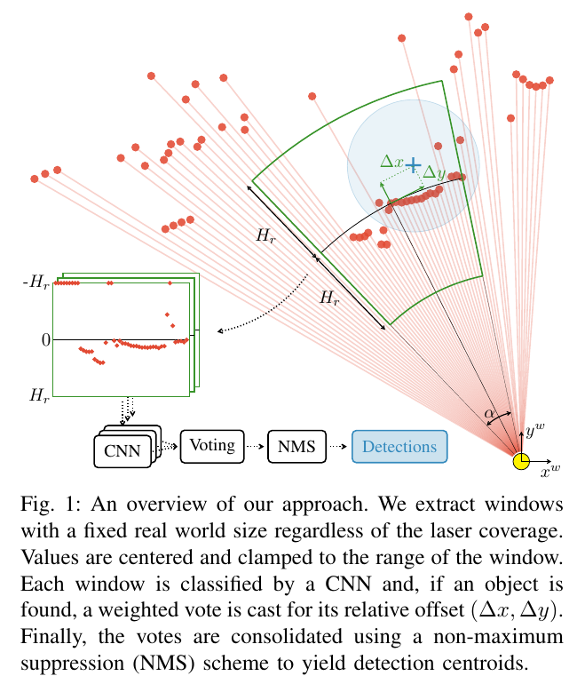
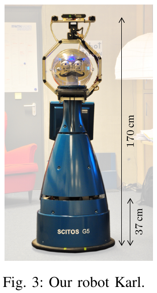

로봇 주변에 점이 있다고 해서 그 점이 사람인지, 휠체어인지, 의자 다리인지 알 수 있는 것은 아니에요. 이차원 라이다는 한 높이에서 잘린 거리 단면을 주므로, 영상과 다른 방식으로 대상을 구분해야 해요. DROW는 거리 신호를 실제 공간 크기에 맞춰 잘라 보고, 여러 관측 지점이 대상의 중심에 표를 던지게 만든 검출 방법이에요.

먼저 연구 대상을 구분해야 해요. 여기서 대표 원문으로 다루는 초기 DROW는 2016년 공개된 휠체어·보행 보조기 검출 연구예요. [저자 코드 저장소](https://github.com/VisualComputingInstitute/DROW)는 초기 연구와 이후 사람 검출 연구를 함께 담고 있어요. 저장소에 사람 검출 기능이 있다는 사실을 초기 논문이 일반 보행자까지 같은 조건으로 검증했다는 뜻으로 읽으면 안 돼요.

## 같은 물체라도 멀어지면 걸리는 광선 수가 달라져요

DROW는 각 거리점 주위에서 일정한 실제 공간 폭을 잘라 같은 길이의 입력으로 다시 표본화해요. 중심 거리의 차이를 제거하고 멀리 떨어진 배경을 제한한 뒤, <abbr title="인접한 입력 패턴을 함께 보며 특징을 배우는 신경망">CNN</abbr>이 종류와 중심까지의 상대 변위를 예측해요. 여러 점의 중심 투표를 모아 중복을 정리하면 최종 검출 위치가 나와요.

<figure class="fig"><figcaption>거리에 따라 광선 수가 달라지는 입력을 실제 공간 폭으로 정규화하고, 각 창이 대상 중심의 상대 위치에 투표해요. (출처: Beyer·Hermans·Leibe, <a href="https://arxiv.org/pdf/1603.02636">DROW</a>, Fig. 1, 방법 비평을 위한 그림 영역 인용)</figcaption></figure>

이 설계를 이해하는 데는 신경망 층 수보다 관측 기하가 먼저예요. 설명용으로 각도 간격이 0.5도인 센서에서, 거리 2m의 인접 광선 간격은 약 1.75cm이고 8m에서는 약 6.98cm예요. 같은 폭의 물체라도 멀리 있을수록 더 적은 점으로 보여요. 계산은 거리와 각도 간격의 곱으로 근사한 예이며 논문 검출 오차를 뜻하지 않아요.

고정된 광선 개수만 잘라 보면 가까운 곳에서는 물체 일부를, 먼 곳에서는 물체와 넓은 배경을 한꺼번에 볼 수 있어요. 실제 폭을 맞추는 전처리는 이 차이를 줄여요. 다만 멀리 있는 관측에 없던 점을 새로 측정하는 것은 아니에요. 적은 점을 보간해 입력 길이를 맞추더라도 원래의 정보 부족은 남아요.

거리 정규화를 다른 센서에 옮길 때는 각도 배열과 유효 거리부터 확인해야 해요. 같은 길이의 배열이라도 시야각이 다르면 실제로 보는 폭이 달라져요. 앞뒤 방향이 반대이거나 시계·반시계 순서가 바뀌면 좌우 패턴도 뒤집혀요. 입력 형태가 맞는지와 물리적 관측이 같은지는 따로 검증해야 해요.

## 보이는 표면점과 검출 중심은 다른 위치예요

라이다는 물체에서 가장 먼저 반사되는 표면을 관측해요. 사람이 서 있다면 가까운 다리 쪽 표면이 먼저 보이고, 휠체어라면 바퀴·프레임·발판의 일부가 거리점으로 남을 수 있어요. 이 점들의 평균을 내는 것과 대상 중심을 추정하는 것은 다른 문제예요. 가림 방향이 바뀌면 보이는 점의 평균은 대상이 정지해 있어도 움직여요.

중심 투표는 관측된 국소 모양에서 대상 중심까지의 변위를 배운다는 점이 중요해요. 설명용으로 물체 중심이 벽에서 0.8m 떨어져 있는데 가까운 측면만 보인다고 해볼게요. 보이는 표면점이 중심보다 0.2m 로봇 쪽에 있다면, 그 표면을 중심으로 취급하는 후속 계산은 대상 위치를 0.2m 잘못 놓아요. 이는 모델 성능 수치가 아니라 표면과 중심의 구분을 보여 주는 가정이에요.

반대로 중심이 정확히 검출돼도 충돌 판단에는 물체 크기가 필요해요. 휠체어의 중심 한 점만 주변 지도에 넣으면 발판이나 회전 반경을 빠뜨릴 수 있어요. 검출 결과에 원을 씌울 때도 센서가 관측한 단면, 물체의 실제 외곽, 로봇과 필요한 여유를 구분해야 해요. 검출기 출력만으로 정밀한 형상이나 자세를 얻었다고 말할 수는 없어요.

후속 시스템에서는 좌표의 의미를 명시하는 편이 좋아요. 출력이 물체 중심인지, 관측 단면의 대표점인지, 가장 가까운 표면인지에 따라 안전 거리 계산이 달라져요. 같은 위치 배열 형식을 쓴다는 이유로 의미가 다른 점들을 섞으면, 학습 검출은 맞았는데 회피 거리가 틀리는 문제가 생겨요. 시각화에서도 중심과 관측점을 서로 다른 표시로 남겨야 해요.

## 센서 높이는 물체의 어느 단면을 배울지 정해요

원 논문은 요양 시설에서 SCITOS G5에 장착한 SICK S300을 사용했고, 스캔 높이는 바닥에서 약 37cm였어요. 이 높이에서 휠체어와 보행 보조기가 만드는 모양을 학습한 결과예요. 높이가 다른 센서에 같은 가중치를 넣는 일은 입력 배열만 바꾸는 작업으로 끝나지 않아요.

<figure class="fig"><figcaption>높이는 관측 단면의 일부예요. 이 장비 사진은 논문의 수집 구성을 보여 주며, 다른 로봇의 설치 높이나 검출 성능을 증명하지 않아요. (출처: Beyer·Hermans·Leibe, <a href="https://arxiv.org/pdf/1603.02636">DROW</a>, Fig. 3, 센서 구성 비평을 위한 부분 인용)</figcaption></figure>

설명용으로 같은 의자라도 낮은 높이에서는 바퀴와 다리, 높은 높이에서는 좌판이나 등받이가 나타날 수 있어요. 휠체어와 일반 의자 사이의 차이를 배웠다고 해도, 다른 높이에서 남는 부품이 서로 비슷해지면 분류 근거가 바뀌어요. 센서를 기울이면 바닥과 여러 높이의 구조물이 한 스캔에 함께 들어가므로 차이는 더 커져요.

실제 적용을 검토한다면 높이·기울기·지면 경사를 묶어 시험해야 해요. 같은 평지에서 높이만 바꾸는 조건과, 같은 높이에서 경사만 바꾸는 조건을 분리하면 어떤 변화가 검출을 흔드는지 알 수 있어요. 문턱을 넘을 때 센서 자세가 변하는 순간도 별도 구간으로 남겨야 해요. 전체 평균 검출률만 보면 짧고 위험한 실패가 가려질 수 있어요.

이 논문을 읽었다고 충돌 감시용 낮은 라이다를 사람 인식 센서로 바꿀 필요는 없어요. 기존 주행·충돌 감시는 원래의 관측 역할을 유지할 수 있고, 사람 의미 정보는 별도 센서와 검증된 처리 계층에서 얻을 수 있어요. 자료 검토와 실물 센서 역할 변경은 다른 작업이에요. 검출기의 존재는 특정 로봇 구성이 준비됐다는 증거가 아니에요.

## 주석 수와 독립적인 물체 수를 구분해야 해요

초기 자료는 약 46만4천 스캔 중 약 2만4천 스캔에 보조기 중심 주석을 붙였어요. 같은 대상을 연속해서 관측한 항목도 포함되므로 주석 개수가 서로 다른 휠체어나 사람의 수와 같지는 않아요. 검출 성능을 읽을 때는 장면과 시간의 반복을 함께 봐야 해요.

예를 들어 한 휠체어를 100장 연속 관측한 자료와 서로 다른 휠체어 100대를 한 장씩 관측한 자료는 같은 100개 주석이어도 일반화 근거가 달라요. 전자는 한 모양의 가림·각도 변화를 보기 좋고, 후자는 형태 다양성을 보기 좋아요. 어느 쪽도 나쁘다고 할 수 없지만 수치 하나로 합치면 무엇을 배웠는지 알기 어려워요. 이 예의 개수는 자료 구조를 설명하기 위한 가정이에요.

분할도 프레임을 무작위로 나누는 데서 끝내면 안 돼요. 거의 같은 거리점이 훈련과 평가에 들어가면 새 장소 성능보다 같은 장면 기억을 재는 시험이 될 수 있어요. 장소를 보류하는 분할, 물체 종류를 보류하는 분할, 날짜를 보류하는 분할은 서로 다른 실패를 드러내요. 모델을 고르는 검증 자료와 최종 시험 자료의 역할도 나눠야 해요.

주석이 없는 스캔을 모두 배경으로 취급하는 오류도 피해야 해요. 주석이 드문 자료에서는 그 프레임에 대상이 없다는 뜻과 아직 표시하지 않았다는 뜻이 다를 수 있어요. 훈련 도구가 두 상태를 구분하는지 확인해야 해요. 잘못된 배경 라벨은 실제 보조기를 보면서도 검출하지 않도록 학습시키는 원인이 돼요.

## 검출 허용 반경과 실제 안전 여유는 다른 기준이에요

검출 평가에서는 예측 중심이 정답 중심과 충분히 가까우면 맞은 것으로 세요. 그 허용 반경은 평가자가 정한 대응 규칙이에요. 로봇이 사람이나 보조기 옆을 지날 때 허용할 물리 간격과 같지 않아요. 검출 평가를 통과한 중심이라도 좁은 문에서는 위치 오차가 클 수 있어요.

설명용으로 대응 반경을 0.5m로 둔 평가에서 중심 오차 0.3m인 검출은 맞은 것으로 셀 수 있어요. 그런데 실제 통로의 남는 폭이 0.2m라면 그 검출을 정밀 주차나 근접 통과 근거로 쓸 수 없어요. 검출의 정답 판정과 제어의 오차 예산을 별도로 둬야 하는 이유예요. 여기의 반경과 통로 값은 논문 결과를 인용한 조합이 아니라 설명용 조건이에요.

정밀도는 검출한 것 중 실제 대상의 비율이고, 재현율은 실제 대상 중 찾아낸 비율이에요. 사람이 없는 의자를 자주 휠체어로 부르면 정밀도가 낮아지고, 가려진 보조기를 놓치면 재현율이 낮아져요. 임계값을 높여 오검출을 줄이면 놓치는 대상이 늘 수 있어요. 한 임계값의 점수보다 두 지표가 함께 바뀌는 곡선을 보는 편이 좋아요.

실제 운영에서는 놓친 한 번의 비용과 잘못 멈춘 한 번의 비용도 달라요. 사람 앞에서 검출이 끊기는 문제와 빈 통로에서 유령 검출이 남는 문제를 따로 기록해야 해요. 후단 안전 계층이 어느 실패를 막을 수 있는지도 확인해야 해요. 원시 거리 충돌 감시가 남아 있어도, 의미 오검출 때문에 경로가 계속 막히는 문제는 별도로 생길 수 있어요.

## 중복 억제는 가까운 두 대상을 합칠 수도 있어요

여러 관측점이 같은 대상에 투표하므로 하나의 물체에서 검출 후보가 여러 개 나오는 것은 자연스러워요. 가까운 후보를 정리하지 않으면 하나의 보조기가 여러 장애물로 나타나요. 그러나 억제 범위를 넓히면 서로 붙어 있는 두 대상을 하나로 합칠 수 있어요. 이 단계는 보기 좋은 출력 정리를 넘어 대상 개수의 의미를 바꿔요.

설명용으로 두 대상 중심 간격이 0.6m인데 중복을 합치는 거리를 0.7m로 둔다면, 두 후보 중 하나를 지울 수 있어요. 반대로 같은 대상에서 중심 후보가 0.4m 벌어졌는데 억제 거리가 0.3m라면 중복이 남을 수 있어요. 실제 구현의 알고리즘과 점수에 따라 결과는 달라지지만, 하나의 거리로 모든 장면을 해결하기 어렵다는 점은 같아요. 숫자는 후처리의 민감도를 보이는 가정이에요.

따라서 가까이 선 두 사람, 나란히 놓인 보조기, 사람과 빈 의자가 붙은 장면을 따로 시험해야 해요. 대상 수가 맞는지와 중심 위치가 맞는지도 분리해야 해요. 한 대상을 둘로 쪼갠 경우를 평균 위치 오차만으로는 찾기 어려워요. 검출 전 후보와 억제 후 결과를 함께 저장하면 오류가 어느 단계에서 생겼는지 확인할 수 있어요.

후처리를 바꿨다면 원 논문의 성능표를 그대로 붙이면 안 돼요. 학습 가중치가 같아도 중심 투표 방식이나 중복 억제 규칙이 바뀌면 평가가 달라져요. 모델 이름만으로 동일 구현이라고 판단하지 않고, 전처리·출력 변환·평가 대응 규칙까지 기록해야 해요. 이 구분은 후속 DR-SPAAM 코드의 논문·구현 수치 차이를 읽을 때도 필요해요.

## 미지의 물체를 거절하는 능력도 확인해야 해요

훈련 자료의 범주가 휠체어·보행 보조기·배경이라면, 처음 보는 물체도 이 범주 중 하나의 점수를 받아요. 높은 분류 점수가 실제로 익숙한 대상이라는 뜻과 같지는 않아요. 의료용 카트나 비슷한 금속 프레임이 들어오면 모양 일부가 보조기와 닮을 수 있어요. 알려진 범주를 잘 나누는 시험과 모르는 대상을 잘 거절하는 시험은 구분해야 해요.

평가 목록에는 가짜 대상도 구체적으로 넣는 편이 좋아요. 빈 휠체어, 사람이 앉은 일반 의자, 이동식 선반, 유모차처럼 낮은 단면이 닮을 수 있는 물체를 선정하고 실제 거리점을 비교해요. 이런 대상에서 검출이 나왔다는 사실만으로 모델을 잘못됐다고 단정할 수는 없어요. 무엇을 검출 대상으로 정의했는지와 후속 시스템이 그 결과로 어떤 행동을 하는지가 먼저예요.

신뢰도는 점수 순서를 정하는 데 유용하지만 확률로 믿기 전에 보정 여부를 봐야 해요. 설명용으로 0.9 이상 점수를 받은 후보가 100개이고 그중 실제 대상이 70개라면, 그 점수를 곧바로 90% 정확도로 읽을 수 없어요. 이 예는 모델의 실제 성능이 아니라 점수와 확률의 차이를 보여 주는 가정이에요. 거리·가림·장소를 나누면 같은 점수의 의미도 달라질 수 있어요.

물체가 없는 통로에서 오래 유지되는 오검출은 한 프레임 오검출보다 운영에 큰 영향을 줄 수 있어요. 반대로 대상이 빠르게 접근하는 동안 두세 번 연속 놓치는 문제는 전체 재현율에서 작게 보여도 위험해요. 연속 오류의 길이와 최초 검출 거리를 따로 기록하면 평균 점수에 가려진 실패를 볼 수 있어요. 근접 주행을 다룬다면 그 지표를 제동 여유와 연결해야 해요.

설명용으로 로봇이 0.4m/s로 이동하며 대상 검출이 0.5초 늦었다면 그 사이 0.2m를 진행해요. 이 값은 중심 위치 오차와 다른 시간 오차예요. 둘을 단순히 같은 오차 항으로 섞기보다, 관측 시각과 중심 위치를 별도로 기록해야 원인을 가릴 수 있어요. 원시 거리 기반 정지가 개입했다면 그 사건도 함께 남겨야 해요.

복구는 검출 성공률만큼 중요한 항목이에요. 오검출 때문에 멈춘 뒤 언제 경로를 다시 열지, 대상이 사라졌을 때 몇 번의 관측으로 종료할지, 불확실한 상태를 사람 있음으로 유지할지를 명시해야 해요. 이 결정은 DROW 모델 한 개가 제공하는 답이 아니에요. 검출 결과를 소비하는 시스템이 별도로 정하고 검증할 책임이에요.

## 사람 검출과 사회적 주행 사이에는 여러 판단이 남아요

검출 위치는 그 순간 어디에 대상이 있는지 알려 줘요. 같은 대상이 다음 프레임에도 이어지는지, 어느 방향으로 움직이는지, 대화 중인 집단인지까지 자동으로 정해 주지는 않아요. 시간에 걸쳐 관측을 연결하는 추적과 미래 움직임 예측은 다른 단계예요. 대상이 누구인지 알아도 지나가는 방향과 양보 규범은 주행 정책이 판단해야 해요.

검출된 휠체어를 일률적으로 느리거나 비협조적인 대상으로 취급하는 것도 근거가 없어요. 보조기 종류와 실제 이동 능력·의도는 같지 않아요. 필요한 것은 장면에서 관측한 움직임, 통행 공간, 충분한 여유와 상호 이해예요. 감지한 범주를 사람의 성격이나 의도로 확장하지 않는 편이 정확해요.

[[2026-10-17_socialnav_dr-spaam|DR-SPAAM이 과거 라이다 특징을 누적해 사람을 찾은 방식]]은 과거 관측의 특징을 이어 사용해 사람 검출을 개선한 후속 계열이에요. 두 글을 함께 읽을 때는 초기 보조기 검출, 후속 사람 검출, 시간 정보 결합의 발전을 나눠 보면 좋아요. 어느 단계도 완성된 사회적 주행이나 특정 저전력 보드의 안전 성능을 대신 증명하지 않아요.

적용 검증은 기록된 스캔으로 입력 순서와 좌표를 확인하고, 대상 중심과 표면 거리의 차이를 본 뒤, 장소·높이·가림 조건을 나눠 평가하는 순서가 적절해요. 실물에서 사람 옆을 움직이기 전에 센서 단면과 검출 의미가 맞는지 확인할 수 있어야 해요. DROW의 유용한 출발점은 거리 신호에 맞춘 표현 설계이며, 그 설계를 다른 환경으로 옮길 때의 관측 조건까지 함께 읽어야 해요.

---
<!-- src-block -->
출처 — https://arxiv.org/abs/1603.02636
