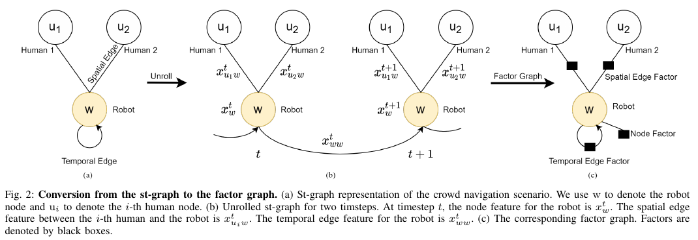
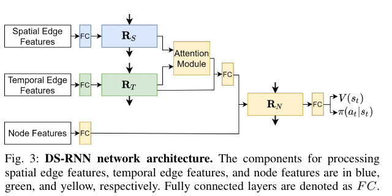
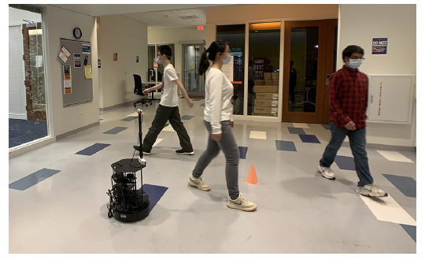

사람이 많은 곳에서 로봇은 매 순간 보이는 사람 수가 달라져요. 누군가는 시야 밖으로 나가고, 누군가는 가림 뒤에서 나타나며, 같은 사람도 검출기가 한두 프레임 놓칠 수 있어요. DS-RNN은 이 가변적인 장면을 고정 길이 벡터 하나로 눌러 담기보다, 로봇과 각 사람의 관계를 공간 간선으로, 로봇의 연속 상태를 시간 간선으로 나눠 학습해요.

## 장면을 사람 목록이 아닌 시공간 그래프로 표현해요

논문의 <abbr title="시간에 따라 노드와 간선이 변하는 그래프 표현">시공간 그래프</abbr>에는 로봇 노드 하나와 관측된 사람 노드 여러 개가 있어요. 같은 시각의 로봇과 각 사람 사이에는 공간 간선이 놓이고, 이전 시각의 로봇과 현재 로봇 사이에는 시간 간선이 놓여요. 사람끼리의 간선이나 각 사람의 긴 시간 이력을 모두 만드는 대신, 주행 결정을 내리는 로봇을 중심으로 필요한 관계를 정리한 구조예요.

입력도 이 구조를 따라 갈라져요. 로봇 상태에는 위치, 속도, 목표 위치, 최대 속도, 진행 방향, 반지름이 들어가요. 사람 쪽에는 관측 위치만 사용해요. 논문은 사람 속도와 반지름을 실제 센서에서 안정적으로 얻기 어렵다는 이유로 빼요. 시뮬레이터가 알고 있는 완전한 상태를 학습 입력으로 그대로 쓰지 않은 선택은 실물 이전을 염두에 둔 설계예요.

<figure class="fig"><figcaption>공간 관계와 시간 관계를 분리해 요인 그래프로 바꾸는 원문 구조예요. (출처: Liu et al., ICRA 2021, Fig. 2)</figcaption></figure>

<figure class="fig"><figcaption>사람별 공간 관계와 로봇 시간 이력을 합쳐 가치와 정책을 출력하는 신경망입니다. (출처: Liu et al., ICRA 2021, Fig. 3)</figcaption></figure>

각 공간 간선은 사람 위치와 로봇 상태의 상대 관계를 공유하는 순환망에 넣어요. 사람 수가 늘어도 같은 가중치를 반복 사용하므로 입력 차원이 사람 수에 비례해 새로 생기지 않아요. 여러 공간 간선의 은닉 상태는 주의 집중으로 합쳐지고, 로봇의 시간 간선 은닉 상태와 함께 노드 순환망으로 들어가요. 마지막 출력은 행동 정책과 상태 가치예요.

이 분리는 계산상의 편의만 뜻하지 않아요. 공간 순환망은 “지금 어느 사람이 로봇의 다음 행동에 영향을 주는가”를, 시간 순환망은 “로봇이 방금 어떤 운동 상태를 거쳐 왔는가”를 담당해요. 하나의 순환망이 사람 순서와 시간 이력을 뒤섞을 때 생길 수 있는 의존성을 구조로 제한한 셈이에요. [[2026-10-17_socialnav_rgl|RGL이 사람 사이 관계를 그래프로 읽은 주행 정책]]이 사람과 사람 사이 관계까지 그래프로 전파한다면, DS-RNN은 로봇 중심의 공간·시간 분해를 택해 입력 규모와 역할을 더 명시적으로 만들어요.

## 부분 관측은 누락을 복구한다는 뜻이 아니에요

논문이 다루는 부분 관측은 주로 제한된 시야각과 장면 안에서 달라지는 사람 수예요. 학습과 평가에서는 시야각을 0도부터 360도까지 바꾸고, 로봇의 시야 안에 들어온 사람만 정책에 제공해요. 이 조건에서 구조가 고정된 사람 수를 전제로 하지 않는다는 점을 확인해요. 하지만 센서가 사람을 놓친 프레임에 그 사람을 자동으로 복원하는 모듈은 아니에요.

예를 들어 검출기가 오른쪽 사람을 0.4초 동안 잃었다고 해볼게요. 이는 설명용 가정이에요. 그 사람에 대응하는 공간 간선이 입력 목록에서 사라지면, 주의 집중은 남은 사람만으로 계산돼요. 로봇 시간 순환망은 로봇 자신의 이력을 기억하지만, 사라진 사람의 위치와 속도를 별도 트랙 상태로 외삽하지 않아요. 따라서 “부분 관측에 강하다”를 “검출 누락을 견딘다”로 바꾸어 읽으면 안 돼요.

센서와 정책 사이에는 사람 검출, 동일 인물 연결, 로봇 좌표계로의 변환이 필요해요. 논문의 실물 시스템도 RGB-D 카메라의 영상에서 YOLOv3로 사람을 찾고 Deep SORT로 추적한 뒤 위치를 정책에 전달해요. 이 앞단이 만든 사람 위치가 이미 정책의 관측이에요. 카메라 원본을 DS-RNN이 받아 사람을 찾는 구조는 아니므로, 검출 성능과 정책 성능을 한 지표로 합치면 실패 원인을 구분하기 어려워져요.

첫 검증은 검출 누락률을 독립 변수로 두는 방식이 적합해요. 기록된 정확한 궤적에서 사람 관측을 무작위로 지우는 경우, 연속 0.2·0.5·1.0초 동안 지우는 경우, 가림 경계에서만 지우는 경우를 나눠요. 각 조건에서 충돌률뿐 아니라 최소 거리, 급정지 횟수, 목표 도달 시간, 정책 출력의 방향 변화량을 함께 봐야 해요. 무작위 한 프레임 누락에는 버티지만 연속 누락에서 위험해진다면, 정책보다 추적기의 수명 관리와 불확실성 전달이 먼저 보강돼야 해요.

## 학습 목표는 도달·충돌·근접·진행을 함께 계산해요

정책은 <abbr title="현재 정책으로 수집한 경험을 이용해 안정적으로 정책을 갱신하는 강화학습 방법">PPO</abbr>로 학습해요. 보상은 목표 도달에 양의 값, 충돌에 큰 음의 값, 사람과 0.25m보다 가까워진 상황에 거리 기반 음의 값, 목표까지의 잠재 거리 감소에 진행 보상을 줘요. 논문 설정에서 충돌은 -20, 도달은 +10이에요. 근접 항은 충돌하기 전의 불편한 접근에도 학습 신호를 제공해요.

설명용 계산으로 로봇과 가장 가까운 사람의 표면 간격이 0.20m라고 두면, 0.25m 경계 안으로 0.05m 들어온 상태예요. 이때 근접 패널티가 거리 차이에 비례한다면 0.24m와 0.10m를 같은 위험으로 처리하지 않고 후자를 더 강하게 밀어낼 수 있어요. 다만 정확한 패널티 크기는 논문의 보상식과 계수에 의해 정해지며, 이 예의 숫자는 동작 방향을 읽기 위한 값이에요.

잠재 거리 보상은 한 스텝 전 목표 거리와 현재 목표 거리의 차이를 사용해요. 설명용으로 0.25초 동안 목표 거리가 4.00m에서 3.90m로 줄었다면 진행량은 0.10m예요. 반대로 사람을 피하려고 옆으로 움직여 목표 거리가 4.05m가 되면 즉시 진행 보상은 음수가 될 수 있어요. 이 때문에 충돌 회피를 위해 필요한 우회가 장기 가치에서 보상받도록 할인된 미래 보상과 충분한 탐색이 필요해요.

학습은 병렬 환경 12개에서 경험을 모으고, 갱신마다 30스텝짜리 에피소드 묶음을 사용해요. 전체 훈련은 천만 스텝 규모예요. 사람은 ORCA로 움직이며 로봇에 반응하지 않는 설정이에요. 정책이 사람의 반응까지 상호 학습한 결과라기보다, 독립적으로 움직이는 보행자 사이에서 로봇이 회피하는 법을 학습한 결과로 보는 편이 정확해요.

## 사람 수가 바뀌어도 같은 관계 모듈을 재사용해요

시뮬레이션 공간은 12m×12m이고 로봇은 전방향 이동을 할 수 있어요. 시야각 실험은 사람 5명, 군집 규모 실험은 10·15·20명을 사용하며 조건마다 보지 못한 500개 사례를 평가해요. 공유 공간 순환망 덕분에 사람 수가 달라져도 모형 구조는 유지돼요. 하지만 계산량과 관측 혼잡도까지 일정한 것은 아니에요.

사람이 (N)명일 때 공간 간선 상태를 만드는 연산은 대략 (N)번 필요하고, 주의 집중도 (N)개의 점수를 정규화해요. 설명용으로 한 사람의 공간 인코딩이 0.4ms라고 가정하면 5명은 약 2ms, 20명은 약 8ms가 돼요. 실제 시간은 하드웨어, 배치, 구현에 따라 달라지지만, 가중치 공유가 연산 횟수 자체를 상수로 만들지는 않는다는 점은 같아요. 사람 수 변화에 대한 구조적 수용성과 실시간 처리 여유는 따로 측정해야 해요.

주의 가중치도 곧 안전 우선순위라고 단정하기 어려워요. 학습된 가중치는 최종 보상을 높이기 위한 내부 결합 계수예요. 가까운 사람에게 높은 값을 주는 경향이 있어도, 그 값이 충돌 확률이나 거리 여유로 보정된 수치는 아니에요. 가중치를 설명 자료로 쓸 때는 사람 위치를 조금씩 움직여 정책 출력이 얼마나 달라지는지 함께 측정해야 해요.

장면 순서에 대한 시험도 필요해요. 같은 사람 집합을 입력 배열에서 섞었을 때 출력 행동이 같아야 공유 모듈과 집계가 순열 변화에 안정적이라고 말할 수 있어요. 차이가 난다면 패딩, 마스크, 추적 ID 순서, 구현의 배치 방식이 원인일 수 있어요. 논문 구조의 의도와 실제 코드 경로가 일치하는지 확인하는 간단하면서 강한 검사예요.

## 실물 실험은 정책 밖의 관측 파이프라인을 드러내요

실물 플랫폼은 TurtleBot 2i와 Intel RealSense D435, T265를 사용해요. D435의 수평 시야각은 약 69.4도여서 시뮬레이션의 넓은 시야와 차이가 커요. 사람 검출과 추적, 정책 계산은 ROS를 통해 원격 호스트에서 처리돼요. 온보드 단독 처리 성능을 입증한 실험으로 읽을 수는 없어요.

<figure class="fig"><figcaption>RGB-D 검출과 추적 결과를 원격 정책 계산으로 보내 주행한 실물 사례예요. 좁은 카메라 시야와 추적 오차가 정책 입력의 경계를 만들어요. (출처: Liu et al., ICRA 2021, Fig. 1)</figcaption></figure>

실물에서는 위치 노이즈뿐 아니라 지연도 상대 위치를 바꿔요. 설명용으로 사람이 로봇 쪽으로 1.2m/s로 걷고, 영상·추적·통신·정책 지연 합이 250ms라면 최신 실제 위치와 정책이 사용한 위치 사이에 최대 0.30m 차이가 생길 수 있어요. 논문의 근접 경계 0.25m보다 큰 값이에요. 이 계산은 논문 측정치가 아니라 지연 시험의 필요성을 보이는 가정이에요.

따라서 재현 시에는 평균 추론 시간 하나보다 관측 시각과 명령 적용 시각을 기록해야 해요. 사람 위치 메시지의 타임스탬프, TF 변환 시각, 정책 계산 시작·끝, 속도 명령 발행, 베이스 적용 시각을 한 로그로 맞추면 지연의 위치를 구분할 수 있어요. P50만 보면 간헐적 정체가 숨으므로 P95와 최대값도 필요해요.

카메라 시야 밖 사람을 고려하지 않는 정책은 회전 동작에서 특히 취약해요. 로봇이 목표를 향해 회전하는 동안 방금 왼쪽에 있던 사람이 화면 밖으로 나가면 공간 간선이 사라질 수 있어요. 이때 마지막 관측을 잠시 유지하는 추적기, 시야 밖 불확실성을 키우는 표현, 별도 안전 감시 중 하나가 필요해요. DS-RNN 본체가 제공하는 기능과 시스템이 추가해야 할 기능을 분리해야 해요.

## 성공률만으로는 구조의 가정을 확인할 수 없어요

논문의 시뮬레이션은 사람 수와 시야각을 바꾸며 성공, 충돌, 시간 등을 비교해요. 이 결과는 가변 입력을 처리하는 구조가 기준 방법보다 유리하다는 근거가 돼요. 그러나 보행자가 로봇에 반응하지 않는 ORCA 환경과 실제 사람의 양보·멈춤·재접근은 다른 폐루프예요. 상대가 로봇 행동을 보고 바꾸는 순간, 다음 관측 분포도 정책 행동에 의해 달라져요.

실패 검증은 최소 네 축으로 나누는 편이 좋아요. 첫째, 검출을 놓치거나 다른 사람으로 ID가 바뀌는 관측 실패예요. 둘째, 사람이 급정지하거나 되돌아서는 운동 예측 실패예요. 셋째, 의자나 벽 가까이에서 회피 공간이 줄어드는 정적 환경 실패예요. 넷째, 원격 계산과 통신 지연이 늘어나는 시스템 실패예요. 네 조건을 한꺼번에 섞으면 충돌이 정책, 센서, 지도, 지연 중 어디에서 시작됐는지 알기 어려워요.

안전 판단에는 최악 조건도 넣어야 해요. 사람 20명 평균에서 성공하더라도 한 사람이 시야 가장자리에서 빠르게 진입하는 사례에 반복 실패할 수 있어요. 최소 거리의 평균 대신 하위 5백분위, 연속 근접 시간, 긴급 정지 개입 횟수를 기록하면 드문 위험을 볼 수 있어요. 목표 도달 실패도 충돌과 멈춤을 나눠야 지나치게 보수적인 정책을 좋은 결과로 오인하지 않아요.

## 좌표와 마스크가 맞아야 구조의 장점이 유지돼요

논문 구조를 구현할 때 가장 먼저 확인할 값은 좌표 기준이에요. 사람 위치를 지도 좌표로 넣고 로봇 속도만 몸체 좌표로 넣으면, 같은 장면도 로봇 방향에 따라 전혀 다른 숫자 관계가 돼요. 학습 때 사용한 상대 좌표와 배포 때 만든 상대 좌표의 축 방향, 각도 부호, 길이 단위를 작은 고정 사례로 대조해야 해요. 로봇 앞 1m에 사람이 있을 때와 왼쪽 1m에 있을 때 입력 벡터가 기대한 축에 놓이는지 확인하면 큰 오차를 빨리 찾을 수 있어요.

가변 인원을 배치로 묶을 때는 패딩과 마스크가 함께 움직여야 해요. 설명용으로 한 장면에 3명, 다른 장면에 8명이 있으면 짧은 장면은 5개의 빈 항목을 채울 수 있어요. 빈 항목의 위치가 0이라도 주의 점수 계산에 포함되면 로봇 원점에 가상의 사람이 생긴 것처럼 작동할 수 있어요. 소프트맥스 전에 빈 항목 점수를 제외하고, 사람이 0명인 장면에서도 분모와 은닉 상태가 유한한지 검사해야 해요.

추적 ID가 바뀌는 문제는 공간 순환망의 시간 상태와 맞물려요. 사람 A가 가림 뒤에서 다시 나타났는데 새 ID를 받으면, 정책은 이전 A의 상태를 버리고 새 사람의 관계를 시작할 수 있어요. 반대로 서로 교차한 두 사람의 ID가 바뀌면 관계 이력이 다른 사람에게 붙을 수 있어요. ID 교환 전후에 동일한 물리 궤적을 넣고 정책 행동의 불연속을 측정하면 순환 상태가 추적기에 얼마나 민감한지 알 수 있어요.

로봇 시간 간선도 리셋 규칙이 필요해요. 목표가 바뀌거나 위치 추정이 재초기화되거나 제어기가 긴급 정지한 뒤에도 이전 은닉 상태를 계속 쓰면, 현재 운동과 맞지 않는 이력이 남아요. 리셋 직후 첫 관측에서 은닉 상태를 0으로 두는 경우와 유지하는 경우를 비교하고, 속도 명령이 갑자기 튀지 않는지 확인해야 해요. 이는 학습 구조를 바꾸지 않고 배포 경계를 명확히 하는 검사예요.

## 안전 계층과 정책의 역할을 따로 시험해요

학습 정책의 충돌 패널티는 경험 분포 안에서 위험 행동을 줄이지만, 모든 입력에 대한 거리 제약을 증명하지 않아요. 실물에서는 정책 명령 뒤에 속도·가속도 한계, 정적 장애물 감시, 비상 정지 같은 독립 계층을 둘 수 있어요. 이 계층이 개입한 횟수를 숨기면 정책이 안전했던 것처럼 보일 수 있으므로, 원래 명령과 제한 뒤 명령을 함께 기록해야 해요.

설명용으로 정책이 0.8m/s를 명령했지만 현재 관측의 정지 가능 거리가 0.45m이고 시스템이 0.4m/s로 제한했다고 해볼게요. 최종 주행이 충돌 없이 끝나도 정책 출력 자체가 안전 조건을 만족한 것은 아니에요. 반대로 제한기가 너무 자주 속도를 0으로 만들면 충돌률은 낮지만 목표 도달률과 사람 흐름 방해가 나빠질 수 있어요. 정책 평가표에는 제한기 개입률, 개입 지속 시간, 개입 후 회복 시간도 들어가야 해요.

시뮬레이션에서 같은 제한기를 켜고 끈 대조군을 만들면 두 계층의 기여를 나눌 수 있어요. 정책만 쓴 조건, 안전 계층만 쓴 단순 목표 추종 조건, 둘을 합친 조건을 같은 초기 상태에서 반복해요. 충돌·정체·최소 거리·시간을 함께 보면 DS-RNN이 경로 선택을 개선한 부분과 마지막 순간의 제동이 막은 부분이 갈려요. 실물 시험은 이 대조를 통과한 뒤 저속·소수 보행자부터 넓히는 순서가 맞아요.

DS-RNN의 핵심 성과는 부분 관측을 없앤 데 있지 않아요. 관측된 사람 수가 달라지는 문제를 로봇 중심의 공간 관계와 시간 이력으로 분해하고, 같은 관계 모듈을 재사용할 수 있게 한 데 있어요. 실제 시스템에서는 검출·추적·지연·시야 밖 상태가 이 구조 앞에 남아요. 이 경계를 유지하면 시뮬레이션 정책의 기여와 센서 파이프라인의 기여를 따로 시험할 수 있어요.

---
<!-- src-block -->
출처 — https://arxiv.org/abs/2011.04820
