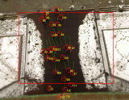

사람의 다음 위치를 예측하는 연구에서는 짧은 좌표열을 입력하고 그 뒤의 좌표열을 맞히는 평가가 널리 쓰입니다. 이 형식을 대표하는 고전 자료가 <abbr title="스위스 연방 공과대학교 취리히 캠퍼스에서 공개한 보행자 영상·궤적 자료">ETH</abbr> 보행자 데이터셋이에요. ETH 컴퓨터 비전 연구실의 공식 설명은 복잡한 장소를 걷는 사람을 조감 시점에서 촬영하고 수작업으로 주석했다고 밝힙니다. 이 자료는 2009년 다중 사람 추적 논문에서 사회적 행동을 반영한 동역학 모델을 학습하는 데 쓰였어요.

오늘날 논문에서 “ETH/UCY”라고 부르는 벤치마크와 원자료는 구분해서 읽어야 합니다. 원자료는 영상과 주석이라는 관측 기록이고, 벤치마크는 연구 공동체가 그 기록을 일정한 시간 간격의 보행자 좌표열로 정리해 반복 사용하는 평가 관행입니다. 어느 전처리본을 썼는지, 좌표 단위와 장면 이름을 어떻게 맞췄는지에 따라 같은 이름 아래에서도 실제 입력이 달라질 수 있어요.

<figure class="fig"><figcaption>ETH 공식 자료가 보여 주는 원 장면입니다. 고정된 높은 시점은 사람 간 상대 위치를 읽기 좋지만, 이동 로봇의 가림과 시야 흔들림은 담지 않습니다. (출처: ETH Computer Vision Lab, <a href="https://vision.ee.ethz.ch/datsets.html">BIWI Walking Pedestrians dataset</a>)</figcaption></figure>

## 조감 좌표가 만들어 주는 깨끗한 질문

높은 곳에 고정한 카메라는 보행자의 머리와 몸이 겹치는 일을 줄여 줍니다. 바닥 평면의 위치로 투영하면 사람 한 명의 움직임을 `시간, 식별자, x, y` 같은 간결한 열로 표현할 수 있어요. 배경이 움직이지 않으므로 카메라 자체의 이동을 보정할 필요도 적습니다. 이런 조건은 “최근 움직임을 보고 몇 초 뒤 어디에 있을까”라는 질문을 모델 구조와 손실 함수에 집중해 비교하기 좋게 만듭니다.

그러나 깨끗한 입력은 현실이 깨끗하다는 뜻이 아닙니다. 조감 카메라는 사람이 가로수나 다른 사람 뒤로 사라지는 시간을 줄여 주고, 영상 전체의 보행 공간을 한눈에 봅니다. 바닥을 달리는 로봇은 자신의 몸체 높이에서 사람을 보고, 가까운 사람 하나가 뒤쪽 군중을 가리며, 회전할 때 시야가 움직여요. ETH에서 작은 평균 위치 오차를 얻은 모델이 로봇 센서에서도 같은 품질을 낸다고 이어 말할 근거는 없습니다.

이 차이는 입력 표현에서도 드러납니다. 궤적 예측기는 이미 정리된 사람 좌표를 받지만 로봇은 RGB나 LiDAR에서 사람을 찾아 식별자를 이어 붙여야 합니다. 검출 누락, 위치 흔들림, 잘못 이어진 추적 ID가 예측기 앞에서 생겨요. 정답 좌표만 넣은 평가는 예측 모듈의 조건부 성능이고, 실제 로봇 파이프라인의 전체 성능이 아닙니다.

## 원래 목적은 미래 예측 전용 벤치마크가 아니었어요

공식 페이지는 이 자료가 “You'll Never Walk Alone: Modeling Social Behavior for Multi-target Tracking”에 쓰였다고 설명합니다. 논문의 초점은 혼잡한 장면에서 각 사람을 독립 입자로 보지 않고, 주변 사람과 목적지에 따른 사회적 힘을 동역학 모델에 넣어 다중 대상을 더 잘 추적하는 것이었습니다. 미래 궤적은 추적의 탐색 범위를 줄이는 수단이었어요.

이 배경을 알면 데이터 해석이 달라집니다. 사람이 서로 가까워질 때 회피하는 패턴, 목적지를 향하는 경향, 현재 속도를 유지하려는 경향이 중요합니다. 뒤에 등장한 신경망 벤치마크가 같은 좌표를 관측 구간과 예측 구간으로 나눠 쓰더라도, 자료가 처음부터 모든 미래 가능성을 표집하도록 설계된 것은 아니에요.

한 사람이 같은 지점에서 왼쪽이나 오른쪽으로 갈 수 있는데 기록에는 실제로 택한 한 경로만 남습니다. 예측기가 다른 쪽의 타당한 경로를 냈을 때 좌표 오차는 크게 측정될 수 있어요. 데이터의 한 실현을 유일한 의도 정답으로 취급하면 다중 가능성을 놓칩니다.

[[2026-10-17_socialnav_trajectory-feature-prediction|사람 사이 상호작용으로 다음 궤적을 예측한 방법]]은 이런 좌표열에서 개인 운동과 집단 상호작용을 분리하려 했습니다. ETH 자료는 그 질문을 만들기 좋은 기반이지만, 사람의 말이나 시선, 목적지 표지, 로봇에 대한 반응까지 제공하는 자료는 아닙니다.

## 픽셀과 미터를 섞으면 작은 오차도 의미가 바뀌어요

영상의 픽셀 좌표는 원근 때문에 위치마다 실제 거리가 다릅니다. 화면 위쪽의 10픽셀과 아래쪽의 10픽셀이 같은 미터 길이가 아닐 수 있어요. 바닥이 평면이라는 가정 아래 호모그래피를 적용하면 영상 좌표를 바닥 좌표로 옮길 수 있지만, 보정 행렬과 축 방향을 함께 보존해야 합니다.

설명용 가정으로 한 전처리에서 1픽셀이 4센티미터에 해당한다고 하겠습니다. 예측 끝점이 12픽셀 어긋나면 `12×0.04=0.48미터`입니다. 다른 위치에서 1픽셀이 2센티미터라면 같은 픽셀 오차는 0.24미터예요. 픽셀 평균만 보고 두 장면을 비교하면 실제 거리를 두 배 다르게 평가할 수 있습니다.

좌표축의 순서도 흔한 함정입니다. 원본 주석의 열이 `y, x`인데 로더가 `x, y`로 읽으면 경로가 대각선 축을 기준으로 뒤집힙니다. 화면 좌표는 아래로 갈수록 y가 커지지만 로봇 지도는 위를 양의 y로 둘 수 있어요. 한 프레임을 배경 위에 다시 그려 사람이 실제 발밑에 놓이는지 확인하지 않으면 모델은 실행되면서도 잘못된 기하를 학습합니다.

단위 검증은 속도로도 할 수 있습니다. 설명용으로 0.4초 간격의 두 점이 0.6미터 떨어져 있으면 속도는 `0.6/0.4=1.5미터/초`입니다. 같은 열을 픽셀로 오해해 60미터 이동으로 읽는다면 즉시 비현실적인 값이 나와요. 좌표 범위, 보행 속도 분포, 배경 재투영을 함께 검사해야 합니다.

## 시간 간격은 모델의 기억 길이를 결정해요

많이 쓰이는 전처리에서는 0.4초 간격으로 좌표를 뽑아 여덟 시점을 관측하고 열두 시점을 예측합니다. 이는 각각 3.2초와 4.8초에 해당해요. 이 숫자는 ETH 공식 페이지가 규정한 유일한 사용법이 아니라 후속 연구에서 굳어진 평가 설정입니다. 따라서 원본 프레임률, 샘플링 단계, 보간 여부를 논문마다 확인해야 합니다.

설명용으로 사람이 1.2미터/초로 곧게 걷는다고 하겠습니다. 4.8초 뒤에는 `1.2×4.8=5.76미터`를 이동합니다. 0.1미터/초의 속도 편향만 있어도 끝점에는 0.48미터 오차가 생겨요. 장기 예측은 작은 속도 차이를 증폭합니다.

샘플링 간격을 길게 하면 저장점은 줄지만 급한 방향 전환이 사라집니다. 0.4초 사이에 잠깐 멈추고 다시 걷는 행동은 두 점만 보면 느린 직선 이동처럼 보일 수 있어요. 반대로 원본 영상의 모든 프레임을 거의 같은 샘플로 사용하면 인접 학습 예제가 강하게 중복됩니다. 데이터 개수는 늘어도 독립적인 상호작용 수는 늘지 않습니다.

보간도 정답을 매끄럽게 바꿉니다. 가려진 구간의 앞뒤 점을 직선으로 이으면 실제 우회나 정지를 제거할 수 있어요. 보간된 점과 수작업 점을 같은 신뢰도로 학습하지 말고, 마스크나 품질 표식으로 구분하는 편이 안전합니다.

## 평균 오차는 사람 가까이의 위험을 숨길 수 있어요

평균 변위 오차는 예측 구간의 각 시점에서 예측 위치와 기록 위치의 거리를 평균합니다. 최종 변위 오차는 마지막 시점의 거리만 봐요. 두 값은 좌표 예측의 정확도를 읽기 쉽지만 로봇이 안전하게 지나갈 수 있는지 말해 주지는 않습니다.

설명용으로 열두 예측점 중 열한 점이 0.1미터 오차이고, 사람과 마주치는 한 점이 1.2미터 오차라고 하겠습니다. 평균은 `(11×0.1+1.2)/12≈0.19미터`입니다. 수치만 보면 작아 보이지만 충돌 판단에 필요한 한 시점이 크게 틀렸어요. 최소 분리 거리, 충돌 시간, 경로가 사람 앞과 뒤 중 어느 쪽을 지나는지도 별도로 봐야 합니다.

최종 오차가 작아도 중간 경로가 잘못될 수 있습니다. 예측이 사람의 실제 경로를 가로질러 갔다가 마지막에 같은 목표로 돌아오면 끝점은 맞아요. 반대로 안전하게 우회한 다중 모드 예측이 기록된 한 경로와 다르면 끝점 오차가 커질 수 있습니다.

평가에서는 좌표 오차와 의사결정 오차를 분리하는 편이 좋습니다. 첫째는 미래 위치를 얼마나 맞혔는지, 둘째는 그 예측을 쓴 계획기가 감속·정지·우회를 제대로 택했는지입니다. 예측 성능이 조금 좋아져도 로봇 행동이 같다면 배포 가치는 제한적일 수 있어요.

## 무작위 창 분할은 같은 사람을 양쪽에 놓을 수 있어요

긴 궤적을 여러 관측·예측 창으로 자르면 이웃한 창은 대부분의 점을 공유합니다. 이를 무작위로 훈련과 시험에 나누면 같은 사람의 같은 보행 구간이 양쪽에 들어갈 수 있어요. 모델은 새로운 상호작용을 일반화하기보다 거의 본 장면을 이어 맞힐 수 있습니다.

설명용으로 길이 40인 궤적에서 길이 20인 창을 한 칸씩 옮기면 21개 예제가 생깁니다. 첫 두 창은 19점을 공유하므로 중복률이 `19/20=95%`예요. 예제 수 21을 독립 장면 21개로 세면 검정의 불확실성을 크게 낮춰 보이게 됩니다.

분할 단위는 최소한 원본 영상 구간이나 사람 궤적이어야 합니다. 더 엄격하게는 장소 전체를 보류해 배경과 보행 흐름이 달라질 때 일반화되는지 확인합니다. 널리 쓰이는 장면 보류 방식도 전처리본과 장면 묶음이 정확히 같아야 비교가 성립해요.

사람 ID가 장면마다 다시 시작되는지도 확인해야 합니다. 숫자 7이 서로 다른 영상의 다른 사람일 수 있어요. 파일명과 장면 ID를 합쳐 전역 식별자를 만들지 않으면 서로 무관한 궤적을 하나로 잇는 오류가 생길 수 있습니다.

## 장면의 고정 배경은 강한 힌트이자 누수 경로예요

보행자는 잔디를 가로지르기보다 길을 따르고, 출입구와 모서리에서 방향을 바꿉니다. 장면 영상을 함께 쓰면 이런 물리적 제약을 학습할 수 있어요. 이는 유용한 맥락입니다. 다만 동일 장면의 다른 시간만 시험하면 모델이 사회적 상호작용보다 보행 통로의 평균 흐름을 기억해도 높은 점수를 얻습니다.

배경 의존성을 확인하려면 세 평가를 나눌 수 있습니다. 좌표만 넣는 조건, 배경 지도를 더한 조건, 다른 날이나 다른 장소로 옮긴 조건이에요. 배경 추가가 같은 장면에서는 크게 좋아지지만 장소 보류에서는 사라진다면 모델의 이득은 사회적 추론보다 장면 기억에 가깝습니다.

지도 정렬 오차도 시험해야 합니다. 설명용으로 호모그래피가 3도 회전해 있고 카메라에서 10미터 떨어진 지점을 본다면 횡방향 오차는 `10×sin(3°)≈0.52미터`입니다. 사람 한 명 폭에 가까운 차이라 통로 경계와 충돌 판단을 바꿀 수 있어요.

고정 카메라 자료에서는 카메라 보정이 한 번 맞으면 계속 맞는다는 전제가 숨어 있습니다. 실제 설치에서는 바람, 유지보수, 줌 변경으로 영상이 조금 움직일 수 있어요. 원본 영상의 고정 물체를 추적해 보정이 구간 전체에서 유지되는지 확인해야 합니다.

## 사람의 목표는 관측된 끝점과 같지 않아요

궤적의 마지막 기록점은 영상 밖으로 나간 위치이거나 주석이 끝난 지점일 뿐, 사람이 원래 가려던 목적지라는 보장은 없습니다. 모델이 마지막 점을 목표 정답으로 학습하면 카메라 경계를 사람 의도로 오인할 수 있어요.

특히 짧게 등장한 사람은 몇 걸음만 남깁니다. 관측 구간과 예측 구간을 만들 수 있다는 이유만으로 장기 의도를 알 수 있는 것은 아니에요. 멈춤, 대화, 갑작스러운 방향 전환도 영상 밖 원인과 연결될 수 있습니다.

로봇 목표와 사람 목표도 분리해야 합니다. 사람 예측기가 사람의 미래 분포를 만들고, 계획기는 로봇의 목적지와 동역학을 넣어 행동을 고릅니다. 사람의 기록 끝점을 로봇이 향해야 할 목표처럼 사용하면 문제 정의가 뒤섞여요.

실제 배포에서는 사람 목표를 하나의 점보다 여러 가능한 방향과 확률로 표현하는 편이 낫습니다. 경로 계획기는 그 불확실성을 받아 위험을 계산하고, 새 관측이 들어올 때 예측을 갱신해야 합니다.

## 로봇에 대한 반응은 이 자료에서 측정되지 않았어요

ETH 장면에는 보행자가 있지만 사회적 이동 로봇과 상호작용하도록 설계된 실험은 아닙니다. 사람이 다가오는 로봇을 보고 속도를 바꾸거나 먼저 양보하는 반응, 로봇의 크기와 소음에 따른 거리 변화는 이 자료만으로 검증할 수 없어요.

기록된 사람끼리의 회피를 사람과 로봇 사이에 그대로 대입하는 것도 위험합니다. 사람은 상대의 몸 방향과 시선을 읽지만 바퀴 로봇의 의도를 다르게 해석할 수 있어요. 로봇이 갑자기 회전하거나 멈출 때 사람의 반응 지연도 달라집니다.

따라서 ETH로 학습한 예측기를 사회적 주행에 쓰려면 두 단계가 더 필요합니다. 먼저 실제 로봇 센서에서 검출·추적·예측의 연결 성능을 확인합니다. 다음으로 사람이 로봇을 보고 반응하는 통제된 실물 장면에서 최소거리, 양보 방향, 멈춤 시간, 주관적 불편을 측정해요.

이 경계는 데이터의 가치를 낮추지 않습니다. ETH는 짧은 보행 궤적 예측과 상호작용 모델을 비교하는 공통 언어를 만들었습니다. 다만 그 언어로 답할 수 있는 질문과 로봇 배포가 요구하는 질문이 다릅니다.

## 재현할 때는 원본에서 평가표까지 연결해야 해요

첫째, 공식 원자료와 사용한 전처리본의 관계를 기록합니다. 파일 해시, 장면 이름, 좌표 열 순서, 단위, 샘플링 간격, 보간 규칙을 남겨야 같은 결과를 다시 만들 수 있어요. “ETH/UCY를 사용했다”는 문장만으로는 부족합니다.

둘째, 주석을 원 영상 위에 다시 그립니다. 여러 프레임에서 사람 위치가 발밑에 맞는지, ID가 끊기거나 바뀌지 않는지, 영상 경계에서 좌표가 튀지 않는지 확인해요. 속도와 가속도의 상위 구간을 보고 비현실적인 점프를 찾습니다.

셋째, 창 생성 뒤 중복과 분할을 감사합니다. 같은 원본 프레임이나 같은 사람이 훈련과 시험에 동시에 들어가지 않는지 검사하고, 장면 보류 결과를 함께 냅니다. 평균뿐 아니라 장면별 분포와 드문 교차 사례를 보여 줘야 해요.

넷째, 정답 사람 좌표와 자동 추적 좌표를 분리해 평가합니다. 자동 입력에는 검출 누락률, 위치 잡음, ID 전환을 함께 보고합니다. 예측기 성능 저하가 모델 자체인지 앞단 지각 오류인지 구분할 수 있어요.

다섯째, 계획기 연결 평가는 별도로 설계합니다. 예측 오차와 로봇의 최소거리, 정지 횟수, 목표 도달 시간, 사람의 추가 우회량을 함께 측정합니다. 기록 재생은 사람 반응을 바꾸지 못하므로, 닫힌 고리 시뮬레이션과 실물 사용자 평가가 필요해요.

ETH 보행자 데이터의 힘은 작은 좌표 문제를 오래 비교할 수 있게 만든 데 있습니다. 고정 조감도, 수작업 주석, 반복 가능한 장면은 모델의 상호작용 표현과 시간 예측을 분해하기 좋습니다. 동시에 그 장점이 로봇 시점의 가림, 센서 오차, 카메라 운동, 사람과 로봇의 상호 반응을 제거합니다.

그래서 좋은 사용법은 점수 하나를 배포 가능성으로 확대하지 않는 것입니다. 좌표와 시간의 정의를 복원하고, 장면 누수를 막고, 다중 미래와 위험 시점을 따로 평가하며, 실제 로봇 입력과 사람 반응으로 후속 검증해야 해요. 그 경계를 지킬 때 ETH는 낡은 영상이 아니라 예측 모듈의 가정이 어디서 깨지는지 선명하게 보여 주는 기준 자료가 됩니다.

---

<!-- src-block -->
출처 — https://vision.ee.ethz.ch/datsets.html
