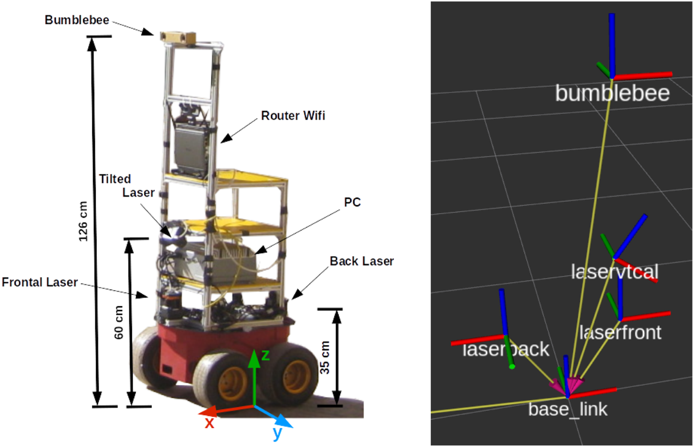

FROG는 이동 로봇의 무릎 높이 2차원 라이다로 사람을 찾기 위한 2025년 데이터셋과 벤치마크예요. 2014년의 동명 로봇 과제와는 다른 자료예요. 카메라보다 색과 조명에 덜 민감한 거리 센서로 사람을 검출하고, 기존 자료보다 훨씬 촘촘한 연속 주석으로 프레임 사이의 실패까지 평가하려는 설계예요.

자료는 413,486개 스캔과 1,020,483개 사람 주석을 제공해요. 센서는 40Hz로 180도 범위를 읽고 한 스캔은 720개 거리값으로 저장돼요. 수집 로봇의 전방 라이다는 로봇 기준 앞쪽 0.22m, 바닥에서 0.33m 높이에 있어요. 이 숫자들은 한 장의 점열이 어떤 신체 단면을 보고, 로봇 좌표로 옮길 때 어떤 변환이 필요한지를 정해요.

## 무릎 높이에서는 사람이 두 다리 점열로 보여요

0.33m 높이의 라이다는 얼굴이나 몸통 윤곽보다 종아리와 무릎 주변의 수평 단면을 봐요. 보행 주기에 따라 두 다리가 붙었다가 벌어지고, 긴 옷이나 가방, 카트가 단면을 바꿔요. 의자 다리와 테이블 다발은 사람 다리와 비슷한 작은 곡선으로 나타날 수 있어요. 카메라 사람 검출기를 낮은 라이다에 그대로 옮길 수 없는 이유예요.

<figure class="fig"><figcaption>논문 그림 1의 수집 로봇이에요. 전방 라이다는 로봇 기준 x=0.22m, z=0.33m에 있어 무릎 부근 단면을 관측해요. (출처: Amodeo 외, <a href="https://www.frontiersin.org/journals/robotics-and-ai/articles/10.3389/frobt.2025.1671673/full">FROG: a new people detection dataset for knee-high 2D range finders</a>, 그림 1, CC BY 4.0)</figcaption></figure>

180도를 720개 거리값으로 나누면 설명용 평균 각 간격은 약 0.25도예요. 실제 빔 배치와 끝점 포함 방식은 센서 정의를 따라야 하지만, 같은 사람도 거리가 멀어질수록 몸에 닿는 빔 수가 줄어든다는 점은 분명해요. 가까운 사람은 센서 시야 밖으로 일부 잘릴 수 있고 먼 사람은 두세 점만 남을 수 있어요. 거리 구간별 성능을 따로 보는 이유예요.

센서 원점을 로봇 회전 중심으로 착각하면 검출 위치에 체계 오차가 생겨요. 전방 라이다의 x=0.22m를 무시하면 정면 검출도 로봇 기준에서 22cm 밀려요. 로봇이 회전하면 평행 이동만으로는 충분하지 않고 센서 자세까지 포함한 좌표 변환이 필요해요. 사람 원을 비용지도에 넣기 전에 원 스캔 점과 변환된 중심을 몇 장 겹쳐 보는 검사가 유용해요.

## 모든 스캔에 주석이 있다는 점이 FROG의 차이예요

저자들은 FROG가 전 스캔의 100%에 주석을 제공한다고 설명해요. 비교 대상으로 든 DROW는 스캔의 5%에 주석이 있어요. FROG는 DROW보다 주석된 스캔이 17배, 사람 주석이 100배 많고 로봇 이동 거리도 두 배를 넘는다고 보고해요. 이 비교는 같은 비율의 일부 프레임만 보는 자료보다 연속 검출 실패를 더 촘촘히 셀 수 있다는 뜻이에요.

413,486개 스캔에 1,020,483개 사람 주석이 있으므로 스캔당 평균 주석 수는 약 2.47개예요. 이 평균만으로 군중 밀도를 설명할 수는 없어요. 사람이 없는 스캔과 여러 명이 겹친 스캔의 분포가 다르고, 같은 사람이 수백 프레임 반복해서 세어지기 때문이에요. 독립된 사람 수나 장면 수로 바꾸지 말고 프레임 단위 주석 합계라고 불러야 해요.

40Hz에서는 스캔 간격이 1/40=0.025초예요. 한 사람이 5초 동안 보이면 약 200개 스캔에 등장해요. 이 중 199개를 맞히고 교차 순간 한 번 놓치면 프레임 재현율은 높지만 추적 식별자는 그 한 번에 끊길 수 있어요. 완전 주석의 가치는 평균 점수를 키우는 데 있지 않고 짧은 누락이 언제 생겼는지 찾는 데 있어요.

전 스캔 주석은 평가 표본의 독립성을 보장하지 않아요. 25ms 차이의 이웃 스캔은 거의 같은 사람과 배경을 담아요. 행을 무작위로 학습과 평가에 나누면 같은 보행 순간의 앞뒤가 양쪽에 들어갈 수 있어요. 연속 기록이나 수집 주행을 통째로 묶어 분할하고, 장소를 떼어 놓은 평가를 더해야 새 배경에서의 성능을 볼 수 있어요.

## HDF5 배열은 스캔과 가변 길이 사람 목록을 나눠 저장해요

공식 데이터 페이지는 <abbr title="큰 배열을 계층적으로 저장하는 파일 형식">HDF5</abbr> 구조를 설명해요. `scans`는 N×720 거리 배열이고, `timestamps`는 각 스캔의 시각값이에요. `circles`는 사람마다 x, y, 반지름, 거리, 각도, 각반지름 여섯 값을 담아요. `circle_idx`와 `circle_num`은 각 스캔이 `circles`의 어느 구간을 쓰는지 알려줘요.

사람 수가 프레임마다 달라서 모든 주석을 고정 폭 행에 넣지 않은 구조예요. 로더는 i번째 스캔에 대해 시작 인덱스부터 사람 수만큼의 원을 잘라야 해요. 인덱스를 한 칸 잘못 읽으면 다음 스캔의 사람을 현재 점열에 붙이게 돼요. 모든 행에서 시작 인덱스와 개수의 합이 전체 원 배열 길이를 넘지 않는지, 주석 구간이 의도치 않게 겹치지 않는지 검사할 수 있어요.

`split` 배열은 학습·검증 자료에 제공되는 분할 정보예요. 자체 분할을 만들더라도 공식 분할의 단위와 다른지 밝혀야 비교가 가능해요. 원시 <abbr title="로봇 장치 사이에서 메시지를 주고받는 소프트웨어 체계">ROS</abbr> 기록 파일과 정렬되지 않은 오도메트리도 별도 제공되므로 HDF5 벤치마크와 원시 기록을 같은 입력으로 부르면 안 돼요. 어떤 파일과 센서 흐름을 썼는지 결과표에 적어야 해요.

거리값의 무효 표기도 확인해야 해요. 0, 무한대, 센서 최대거리 가운데 무엇이 관측 실패를 뜻하는지 잘못 읽으면 빈 빔이 가까운 장애물로 바뀔 수 있어요. 첫 스캔 몇 장을 극좌표에서 직교좌표로 그려 공식 예시와 좌우 방향, 시작 각도를 맞추는 검사가 필요해요.

스캔과 원 주석을 함께 그릴 때는 원 중심만 찍지 말고 반지름도 표시해야 해요. 중심이 다리 점 사이에 놓이는지, 원이 주변 의자 점까지 덮는지 보면 주석이 뜻하는 공간 범위를 이해할 수 있어요. 각도와 각반지름을 다시 직교좌표로 바꾼 결과가 x, y, 반지름과 맞는지 비교하면 단위나 축을 잘못 읽은 로더를 찾을 수 있어요.

공식 분할을 불러온 뒤에는 각 분할의 스캔 수와 사람 주석 수를 다시 세야 해요. 인덱스만 나누고 원 배열 전체를 공유해도 구현은 돌아갈 수 있지만 잘못된 구간을 읽으면 평가 사람 수가 달라져요. 분할별 빈 스캔 비율과 스캔당 사람 수 분포도 기록하면 한쪽에 한산한 구간이 몰렸는지 확인할 수 있어요.

## 원형 주석은 사람의 위치를 나타내지만 자세는 말하지 않아요

FROG는 사람을 원으로 표시해 중심 거리로 검출을 연결할 수 있게 해요. 원은 몸의 정확한 외곽, 바라보는 방향, 개인 식별자를 뜻하지 않아요. 다리가 벌어진 한 사람에서 검출 두 개가 생기거나 가까운 두 사람이 하나로 합쳐질 수 있어요. 사람 존재를 찾는 문제와 지속 추적, 집단 관계를 알아내는 문제를 분리해야 해요.

설명용으로 예측 중심과 정답 중심이 0.28m 떨어졌다고 해 볼게요. 연결 문턱이 0.3m면 맞은 검출이고 0.2m면 틀린 검출이에요. 같은 출력도 문턱에 따라 정밀도와 재현율이 달라져요. 논문 성능을 비교할 때는 중심 거리 문턱과 연결 규칙을 모델 이름만큼 분명하게 적어야 해요.

문턱을 넓히면 위치가 흔들리는 검출도 맞은 것으로 인정하고, 좁히면 가까운 두 사람을 나누는 능력을 더 엄격하게 봐요. 0.3m와 0.5m 결과를 나란히 내는 설명용 민감도 시험은 사람 존재와 위치 정밀도를 구분하는 데 도움이 돼요. 이 문턱들은 로봇 안전거리나 제동거리와 다른 평가 값이에요.

검출 성능은 <abbr title="사람이라고 예측한 결과 가운데 실제 사람인 비율">정밀도</abbr>와 <abbr title="실제 사람 가운데 검출기가 찾아낸 비율">재현율</abbr>을 함께 봐야 해요. 의자를 사람으로 보는 오검출과 사람을 놓치는 누락은 후단에서 다른 문제를 만들어요. 사회적 거리 계획에서는 중심 오차 분포, 가까운 두 사람의 분리율, 연속 누락 최대 길이도 추가로 필요해요.

## 논문 벤치마크는 사람 검출기 사이의 비교예요

논문은 ROS leg_detector, PeTra, DROW3, DR-SPAAM과 제안한 1차원 신경망 계열을 비교해요. 공식 데이터 페이지는 거리 문턱별 정밀도와 재현율, <abbr title="정밀도와 재현율의 조화평균">F1</abbr> 표와 가중치를 제공해 재현을 돕고 있어요. 이 표는 낮은 2차원 라이다에서 사람 중심을 찾는 성능을 답하며, 사람의 목표나 양보 의도를 평가한 결과는 아니에요.

제안 모델의 최적화된 ROS 구현은 500Hz를 넘는 처리율을 보고해요. 센서는 40Hz이므로 새 스캔은 25ms마다 한 번 와요. 모델이 2ms 안에 끝나도 센서가 관측하지 않은 새 정보를 500번 만드는 것은 아니에요. 높은 처리 여유는 작은 컴퓨터에서 다른 노드와 자원을 나누거나 여러 스캔을 함께 처리할 때 쓸 수 있어요.

전체 지연은 센서 시각에서 속도 명령까지 재야 해요. 설명용으로 센서 대기 12.5ms, 전처리 4ms, 추론 2ms, 추적 6ms, 계획 18ms가 걸리면 합은 42.5ms예요. 추론만 보면 500Hz 수준이어도 명령은 한 스캔 주기보다 늦게 나와요. 이 합은 논문 장치의 실측이 아니라 끝단 지연을 계산하는 예예요.

처리율 비교에는 입력 크기와 전처리도 포함해야 해요. 한 모델이 원시 720개 거리값을 받고 다른 모델은 사람이 만든 특징을 받는다면 신경망 시간만 비교해서는 전체 비용을 알 수 없어요. 동일한 컴퓨터와 스레드 수에서 파일 읽기, 전처리, 후처리까지 같은 경계로 재야 실제 배포 선택에 쓸 수 있어요.

검출 표의 정밀도와 재현율을 읽을 때는 가장 좋은 한 문턱만 고르지 않는 편이 좋아요. 사람 판정 신뢰도를 낮추면 더 많은 사람을 찾지만 의자와 카트 오검출도 늘 수 있어요. 신뢰도 전 구간의 곡선과 실제 계획기가 감당할 수 있는 오검출 비용을 함께 봐야 작동점을 정할 수 있어요. 안전 장애물 층을 별도로 유지한다면 사람 누락의 충돌 위험은 줄일 수 있지만, 사회적 여유 거리 적용은 여전히 실패할 수 있어요.

장거리 사람과 가까운 사람의 오류도 같은 값으로 섞으면 안 돼요. 먼 사람은 빔이 적어 존재 검출이 어렵고, 가까운 사람은 시야 경계에서 몸 일부가 잘릴 수 있어요. 로봇 계획 관점에서는 가까운 누락이 더 급한 반면, 미리 양보 경로를 만들려면 먼 사람의 안정된 검출이 필요해요. 거리 구간별 정밀도·재현율과 중심 오차를 함께 두면 어느 계획 단계에 쓸 수 있는지 판단하기 쉬워요.

## 프레임 점수에서 추적 품질로 넘어가는 다리가 필요해요

사회 내비게이션은 사람 위치를 한 번 찾고 끝나지 않아요. 시간에 따라 같은 사람을 연결하고 속도와 불확실성을 추정해야 해요. FROG의 원 주석에는 지속 식별자가 없으므로 검출 벤치마크 점수만으로 추적 품질을 계산할 수 없어요. 원시 기록과 별도 연계 규칙, 또는 추가 식별 주석이 필요해요.

연속 누락은 프레임 재현율에서 작게 보일 수 있어요. 40Hz에서 0.25초 누락은 열 스캔이고, 걷는 사람은 그동안 위치를 바꿔요. 추적기는 마지막 속도로 예측할 수 있지만 시간이 길어질수록 공분산을 키워야 해요. 다시 나타난 검출을 새 사람으로 만들지 기존 궤적에 붙일지에 따라 추적 단절 횟수가 달라져요.

검출 원을 계획기로 넘길 때는 신뢰도와 위치 불확실성을 함께 보내는 편이 좋아요. 중심 하나만 확정값으로 넘기면 가까운 두 사람이 합쳐진 경우나 먼 사람의 희소점을 표현하지 못해요. 계획기는 불확실한 영역에서 속도를 낮추고 새 스캔을 기다릴 수 있어요.

사람으로 분류되지 않은 라이다 점도 일반 장애물 지도에는 남겨야 해요. 분류기가 긴 옷이나 카트를 놓쳤다고 원 점까지 지우면 충돌 감시가 약해져요. 사람 의미 층과 기하학적 장애물 층을 따로 유지하면 사람 검출 실패가 곧 장애물 삭제로 이어지지 않아요.

두 층의 수명도 다르게 둘 수 있어요. 원시 장애물 점은 새 스캔으로 빠르게 갱신하고, 사람 추적은 잠깐 가려져도 불확실성을 키우며 유지해요. 사람 의미를 너무 오래 남기면 이미 지나간 자리를 계속 피하고, 너무 빨리 지우면 가림 순간에 사회적 여유가 사라져요. FROG의 연속 주석은 검출 누락 길이를 재는 데 쓰이고, 적절한 추적 수명은 로봇 속도와 가림 조건을 넣어 별도로 정해야 해요.

## 완전 주석은 실패 지도를 만드는 데 써야 해요

FROG의 밀도는 어떤 장면에서 검출이 끊기는지 사건 단위로 분석할 때 빛나요. 실패를 의자 다리, 쇼핑 카트, 긴 옷, 나란히 걷는 두 사람, 센서 가까이 잘린 사람, 먼 거리 희소점으로 나눌 수 있어요. 각 범주에서 오검출, 누락, 중심 오차, 연속 누락 길이를 따로 세면 수정해야 할 표현과 후처리가 달라져요.

전체 스캔 평균은 긴 쉬운 복도 구간에 끌릴 수 있어요. 혼잡 교차, 문 모서리, 사람끼리 겹치는 짧은 구간은 비중이 작아도 로봇 계획에는 위험해요. 프레임 평균과 함께 사건별 최악값, 거리 구간별 점수, 사람 수별 점수를 내야 완전 주석의 장점을 살릴 수 있어요.

수집 주행 단위로 불확실성을 계산하는 것도 중요해요. 이웃 413,486개 스캔을 독립 표본으로 놓으면 신뢰구간이 지나치게 좁아져요. 같은 장소와 주행에서 나온 오차는 서로 연관돼요. 주행 또는 장소 묶음을 재표집 단위로 삼으면 새로운 환경으로 옮길 때의 변동을 더 정직하게 나타낼 수 있어요.

완전 주석은 시간에 따른 성능 변화도 보여줘요. 로봇이 모서리를 돌기 전, 사람이 처음 나타나는 순간, 서로 가장 가까워지는 순간, 멀어지는 순간으로 사건을 나눌 수 있어요. 검출이 늦게 시작되지만 이후 안정적인 모델과 일찍 찾지만 흔들리는 모델은 전체 F1이 같아도 계획기에 주는 가치가 달라요. 첫 검출까지 걸린 시간과 교차 순간의 연속 누락을 사건별로 보고하면 이 차이가 드러나요.

다른 라이다로 옮길 때는 720개 입력을 단순히 늘리거나 줄이는 것보다 각도와 거리의 물리 의미를 보존해야 해요. 더 넓은 시야를 잘라 쓰는지, 낮은 해상도를 보간하는지, 회전 방향이 같은지에 따라 사람 모양이 달라져요. 재표본화한 스캔을 원 센서 각도에 겹쳐 보고, 가까운 물체 경계가 흐려지지 않았는지 확인해야 해요. 센서 높이가 바뀌면 재표본화만으로 해결되지 않으므로 새 높이에서 별도 검증 자료가 필요해요.

로봇이 정지한 구간과 움직이는 구간도 분리할 가치가 있어요. 이동 중에는 자세 오차와 스캔 왜곡이 검출 모양에 섞이고, 정지 중에는 배경이 안정적이에요. 두 조건의 차이가 크다면 검출기 자체보다 좌표 보정이나 움직임 보상이 병목일 수 있어요. 원시 오도메트리가 정렬되지 않았다는 조건을 기억하고, 보정 방법을 결과와 함께 공개해야 비교가 가능해요.

FROG가 제공하는 근거는 낮은 2차원 라이다 사람 검출까지예요. 100% 스캔 주석, DROW보다 17배 많은 주석 스캔과 100배 많은 사람 주석, 두 배를 넘는 이동 거리는 연속 검출 평가의 폭을 넓혀요. 이 결과를 지속 추적이나 사회 규범 이해로 부르려면 식별자·의도·관계 주석과 별도 실물 평가가 더 필요해요. 검출 의미 층과 충돌 감시 층을 분리하면 이 자료의 장점을 쓰면서 범위 밖의 안전 주장도 피할 수 있어요.

시간 특징을 쓰는 검출 방식은 [[2026-10-17_socialnav_dr-spaam|DR-SPAAM이 과거 라이다 특징을 누적해 사람을 찾은 방식]]과 이어서 볼 수 있어요. FROG의 완전 주석은 연속 입력 모델이 교차와 가림에서 실제로 누락을 줄였는지 프레임마다 확인할 수 있지만, 지속 식별자가 없다는 경계는 그대로 남아요.

---

<!-- src-block -->
출처 — https://www.frontiersin.org/journals/robotics-and-ai/articles/10.3389/frobt.2025.1671673/full
