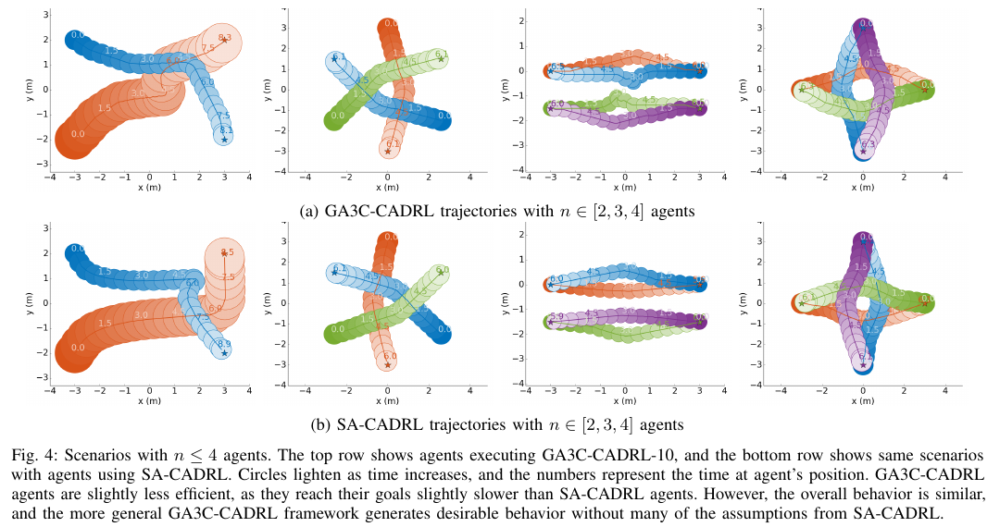
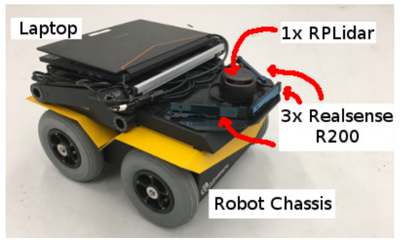

사람이 둘일 때 잘 피하는 정책이 사람이 열 명일 때도 잘 작동하리라는 보장은 없어요. 입력 칸을 사람 세 명분으로 고정하면 네 번째 사람부터 버려야 하고, 사람 수만큼 입력층을 늘리면 학습해야 할 가중치가 계속 커집니다. 가까운 몇 명만 고르면 지금은 멀지만 곧 길을 막을 사람을 놓칠 수 있어요.

2018년 <abbr title="그래픽 처리장치와 중앙처리장치에서 비동기 학습하는 충돌 회피 강화학습">GA3C-CADRL</abbr>은 가변 인원 문제를 순환 신경망으로 풀었습니다. 논문 *GA3C-CADRL: Learning a Distributed Control Policy for Multi-Agent Navigation*은 가치함수에서 후보 행동을 다시 계산하던 이전 방식 대신 정책이 행동 확률을 바로 출력하도록 바꿔요. 사람 수가 몇 명이든 각 사람 상태를 차례로 읽어 고정 길이 기억으로 압축합니다.

제목의 GA3C는 GPU/CPU Asynchronous Advantage Actor-Critic을 뜻해요. 2017년 SA-CADRL과 다른 논문이며 저자도 Michael Everett, Yu Fan Chen, Jonathan P. How입니다. [[2026-10-17_socialnav_sa-cadrl|SA-CADRL이 우측 통행을 보상으로 만든 방법]]이 먼저이고, 이 연구는 2018년 IROS에서 임의 수 사람 입력과 빠른 정책 질의를 다뤘습니다.

## 왜 가치망에서 정책망으로 바꿨나

CADRL 계열의 초기 정책은 후보 행동마다 다음 상태를 만들어 가치망에 넣습니다. 다른 사람이 짧은 시간 동안 현재 속도를 유지한다고 가정해 다음 위치를 계산하고, 보상과 미래 가치가 가장 큰 행동을 골라요. 이때 얼마 동안 진행시킬지를 정하는 시간 간격이 필요합니다. 너무 짧으면 후보 상태들이 신경망의 수치 잡음보다 가깝고, 너무 길면 사람이 같은 속도로 계속 간다는 가정이 틀어집니다.

원 논문은 이전 구현에서 1초가 경험적으로 학습 수렴에 쓰였지만 이 값에 강한 이론적 근거가 없다고 지적합니다. 사람이 많아질수록 로봇 행동에 대한 다른 사람의 반응이 커져 정속 전파 가정도 약해져요. GA3C-CADRL은 현재 상태에서 행동 분포를 내는 정책망을 학습해, 후보마다 임의 시간만큼 다른 사람을 전파하는 단계를 없앴습니다.

망은 가치와 정책을 함께 출력합니다. 가치 출력은 현재 상태에서 앞으로 받을 할인 보상을 맞추고, 정책 출력은 예상보다 좋은 결과를 만든 행동의 확률을 높여요. 엔트로피 항은 초기에 여러 행동을 탐색하도록 돕습니다. 여러 시뮬레이션 에이전트가 만든 경험을 줄에 모으고 그래픽 처리장치가 묶음으로 학습해 비동기 처리 효율을 높입니다.

행동은 속도와 방향 변화의 조합 11개로 이산화됩니다. 선호 속도에서는 ±30도 사이 여섯 방향, 절반 속도와 정지에서는 -30도·0도·30도를 사용해요. 실제 차량의 회전 한계를 흉내 낸 후보입니다. 보상은 목적지 도달 +1, 충돌 -0.25, 0–0.2m 근접에서 거리에 따른 음수, 그 밖에는 0으로 정의됩니다. 매 단계 고정 벌점 대신 1보다 작은 할인율로 빠른 도달을 유도해요.

이 숫자는 사회적 편안함의 보편 기준이 아닙니다. 0.2m는 학습 보상에서 근접을 구분하는 값이고, 사람마다 필요한 거리는 다를 수 있어요. 정책이 충돌하지 않는 것과 사람이 편안하다고 느끼는 것도 다릅니다. 이 논문의 평가 목표는 우선 다중 에이전트 충돌 회피와 도달 효율입니다.

## 사람 목록을 LSTM 기억으로 바꿔요

로봇 상태는 목적지까지 거리, 선호 속도, 방향, 반경으로 이루어집니다. 사람마다 들어가는 관측 상태는 로봇 기준 위치, 속도, 반경, 로봇과의 거리, 두 반경의 합이에요. 사람의 비공개 목적지는 넣지 않습니다. 각 사람 상태를 <abbr title="앞서 본 입력을 내부 기억에 남기는 순환 신경망">LSTM</abbr>에 하나씩 넣고 마지막 은닉 상태를 주변 전체의 고정 길이 표현으로 사용합니다.

입력 순서는 임의가 아니에요. 먼 사람부터 가까운 사람 순서로 넣어 가장 가까운 사람이 마지막 기억에 큰 영향을 주도록 합니다. 순환망이 오래된 입력 일부를 잊을 수 있다는 성질을 위험 우선순위로 활용한 셈입니다. 이 선택은 사람 수가 늘어도 입력 차원을 고정하지만, 순서와 기억 용량에 따라 먼 사람의 정보가 약해질 수 있다는 대가가 있습니다.

거리순은 간단하지만 미래 위험순과 같지 않아요. 1m 옆에서 같은 방향으로 걷는 사람보다 3m 앞에서 빠르게 마주 오는 사람이 더 급할 수 있습니다. 추적 오차로 두 사람의 거리 순서가 매 프레임 바뀌면 LSTM 입력 순서도 뒤집혀 출력이 흔들릴 수 있어요. 실제 적용에서는 거리 동률 처리, 위험도 정렬 비교, 입력 순서 변화에 대한 행동 안정성을 시험해야 합니다.

설명용 가정으로 다섯 사람의 거리가 `4.2, 3.1, 2.7, 1.4, 0.9m`라고 해 볼게요. 먼 순서부터 입력하면 0.9m 사람이 마지막에 들어갑니다. 그런데 2.7m 사람의 접근 속도가 1.8m/s이고 0.9m 사람은 같은 방향으로 0.1m/s 차이만 난다면 단순 충돌 시간은 전자가 더 짧을 수 있어요. 거리 기억 순서가 시간 위험을 자동으로 표현해 주지는 않습니다.

## 네 명까지 배운 뒤 열 명까지 확장했어요

학습은 두 단계로 나뉩니다. 첫 단계에서는 최대 네 에이전트가 있는 장면에서 수렴시키고, 두 번째 단계에서 최대 열 에이전트 장면으로 이어 학습합니다. 첫 단계 정책은 GA3C-CADRL-4, 두 번째 단계까지 마친 정책은 GA3C-CADRL-10으로 부릅니다. 입력이 순환형이라 네 명으로 배운 망도 더 많은 사람 상태를 받을 수 있지만, 다양한 길이의 목록을 학습에서 경험했는지가 성능에 영향을 줘요.

다중 에이전트 한 회차에는 여러 에이전트가 같은 정책으로 움직입니다. 논문 구현은 한 장면의 여러 에이전트 경험을 모두 학습 묶음에 넣어 공동 보상을 개선합니다. 어떤 에이전트가 먼저 목표에 도착해도 남은 에이전트의 경험 처리가 어긋나지 않도록 비동기 학습 절차를 수정했어요.

전체 학습은 NVIDIA GTX1060이 있는 컴퓨터에서 약 200만 회차, 약 12시간 후 수렴했다고 보고합니다. 단순 장면 첫 단계는 약 150만 회차에서 수렴했어요. 이전 SA-CADRL 네 사람 가치망은 약 8시간이었지만, GA3C-CADRL은 다른 사람의 동역학 구조를 미리 주지 않고 정책과 가치를 함께 학습합니다. 학습시간 비교는 망과 회차, 초기화가 달라 단순 속도 순위로 읽기 어렵습니다.

학습된 망의 한 번 질의는 i7-7700K 중앙처리장치에서 평균 0.4–0.5ms로, 이전 가치망 기반 선택보다 약 20배 빨랐다고 원문은 적습니다. 실행에는 그래픽 처리장치가 필수는 아니었어요. 다만 이 시간은 정돈된 사람 상태가 이미 준비된 뒤 신경망을 한 번 평가한 값입니다. 사람 검출, 추적, 좌표 변환, 센서 동기화, 안전 검사는 포함하지 않습니다.

## 궤적이 비슷해도 내부 가정은 달라요

원 논문 그림 4는 두 명부터 네 명까지 같은 장면에서 GA3C-CADRL-10과 SA-CADRL 궤적을 비교합니다. 전체 모양은 비슷하고 SA-CADRL이 조금 더 빨리 도착해요. 새 정책이 적은 인원에서 기존 강한 기준선을 유지하면서, 고정 입력과 정속 전파 가정을 줄였는지 확인하는 비교입니다.

<figure class="fig"><figcaption>같은 2–4명 장면에서 위쪽 GA3C-CADRL과 아래쪽 SA-CADRL을 비교한 원논문 그림 4예요. 경로 모양은 비슷하지만 새 정책이 약간 늦게 도착합니다. Everett·Chen·How, 원논문 부분 인용. (출처: <a href="https://arxiv.org/abs/1805.01956">arXiv 1805.01956</a>, arXiv 비독점 배포 라이선스·별도 CC 재이용 허가는 확인되지 않음)</figcaption></figure>

적은 인원에서 약간 느린 결과는 실패가 아닙니다. 모델이 더 적은 가정을 받고도 비슷한 협력 경로를 배웠다는 것이 논문의 비교 목적이에요. 반대로 “새 모델이므로 모든 조건에서 더 좋다”는 주장도 아닙니다. 적은 사람 장면에서는 SA-CADRL의 추가 도달 시간이 더 짧은 경우가 보고됩니다.

사람이 여섯 명 이상이면 차이가 커집니다. SA-CADRL은 가까운 세 사람만 입력받지만 GA3C-CADRL은 모든 사람 상태를 순환망에 넣을 수 있어요. 여섯 명 사례에서 실패율은 SA-CADRL 9.4%, GA3C-CADRL-10 1.8%로 약 5분의 1이 됐습니다. 여덟 명에서는 15.2% 대 4.2%, 열 명에서는 20.8% 대 4.0%였어요. SA-CADRL 실패는 충돌보다 멈춤이 많은 편이었다고 논문은 덧붙입니다.

이 결과는 인원 수 외에 장면 크기도 봐야 해요. 열 명 시험은 6m×6m, 그보다 적은 시험은 4m×4m로 설정됐습니다. 그래서 열 명 성공률이 여덟 명보다 약간 좋은 것은 인원이 많아도 밀도가 더 높지 않았기 때문이에요. “열 명을 96% 성공했다”만 떼어 쓰면 밀도 조건을 놓칩니다.

평균 추가 시간은 두 정책 모두 성공한 사례만 계산했습니다. 한 정책이 빠르지만 충돌한 사례는 시간 비교에서 빠질 수 있어요. 논문도 이 지표가 실패가 적은 알고리즘에 약간 불리할 수 있음을 각주로 밝혀요. 실패율과 성공 사례의 시간은 함께 읽어야 합니다.

## 실물 데모는 센서 단계의 불확실성을 보여 줘요

저자들은 3차원 라이다 없이 작은 지상 로봇에 정책을 배치했습니다. 센서 구성은 위치 추정과 장애물 검출에 쓰는 2차원 라이다 한 대, 사람 분류와 장애물 검출에 쓰는 Intel RealSense R200 세 대예요. 센서와 계산 장치의 높이는 3인치 미만이고 당시 가격을 1,000달러 미만으로 보고했습니다.

<figure class="fig"><figcaption>원논문 그림 5의 실물 구성입니다. 한 대의 2차원 라이다와 세 대의 깊이 카메라를 낮은 적재 높이에 묶었어요. (출처: Everett et al., <a href="https://arxiv.org/abs/1805.01956">arXiv 1805.01956</a>, arXiv 비독점 배포 라이선스·별도 CC 재이용 허가는 확인되지 않음)</figcaption></figure>

사람 위치와 속도는 2차원 라이다 스캔 군집으로 추정하고, 카메라 RGB 분류기로 그 군집이 사람인지 표시했습니다. 이는 “깊이 영상에서 사람 상태가 바로 나왔다”는 구성과 달라요. 라이다가 기하를, 카메라가 의미 분류를 나눠 맡았습니다. 3차원 라이다를 빼 가격은 줄었지만 지각 범위와 정확도 불확실성이 커졌다고 논문도 인정합니다.

원문은 로봇이 사람 보행 속도로 여러 어려운 장면을 주행하는 영상을 제시합니다. 그러나 실물 구간의 사람 수별 성공률, 충돌률, 편안함 설문을 표로 보고하지는 않습니다. 시뮬레이션의 500개 무작위 사례 수치를 실물 성능으로 옮기면 안 돼요. 실물은 정책과 저비용 센서 연결 가능성을 보여 주는 데모입니다.

## 기억이 많아져도 사회적 이해가 생기는 것은 아니에요

GA3C-CADRL이 모든 사람 상태를 읽는다고 해서 집단 관계를 이해하는 것은 아닙니다. LSTM은 순차 입력에서 유용한 압축을 배우지만, 두 사람이 함께 걷는 집단인지 우연히 가까운지는 명시적으로 표시되지 않아요. 또 한 결정 시점 안에서 사람 목록을 읽는 용도이지, 같은 사람의 긴 시간 이력을 추적하는 구조로 설명하면 안 됩니다. 논문 그림 2의 “기억”은 그 시점의 여러 이웃을 순서대로 합치는 기억이에요.

사람 식별자가 바뀌면 위치·속도 상태가 다른 사람에게 붙습니다. 이 모델은 각 시점 목록을 거리순으로 다시 넣으므로 ID 교환에 어느 정도 둔감해 보일 수 있지만, 속도 추정 자체는 이전 프레임의 동일 인물 연결에 의존해요. 추적 오류를 없애는 모델은 아닙니다.

행동 공간도 11개로 제한됩니다. 좁은 문이나 급한 회피에서 필요한 방향이 후보 사이에 있으면 가장 가까운 이산 행동을 택해야 해요. 0.5ms 추론이 빠르더라도 제어 주기, 차동구동 변환, 가속도 제한을 거치면 실제 경로가 달라집니다. 학습 때의 순간 방향 변화와 실물 바퀴의 회전 응답 차이를 따로 검증해야 합니다.

보상은 충돌과 0.2m 근접, 목표 도달을 중심으로 합니다. 우측 통행, 추월 방향, 대화 집단 보존, 뒤에서 접근할 때의 놀람 같은 규범을 학습한 증거는 없어요. 이름에 다중 행위자 주행이 들어가도 사회적 편안함 전체를 다룬 모델은 아닙니다. 효율적인 공동 회피 기준선으로 읽는 편이 정확합니다.

순환망의 고정 길이 기억도 용량이 무한하지 않아요. 사람 수가 늘면 모든 사람의 위치·속도를 똑같이 선명하게 보존하기 어렵고, 먼 순서 입력은 오래된 정보를 잊도록 유도합니다. 설명용으로 은닉 벡터가 64개 숫자이고 사람 스무 명이 각 일곱 개 상태값을 준다면 원 입력은 140개 숫자예요. 신경망은 이를 단순 저장하지 않고 행동에 필요한 요약을 배우지만, 학습 분포 밖에서 어떤 정보를 버렸는지 알기 어렵습니다.

사람 수와 밀도도 분리해야 합니다. 같은 열 명이라도 6m×6m에 고르게 퍼진 장면과 2m 폭 문 앞에 모인 장면은 난도가 달라요. 원문에서 열 명 장면이 더 큰 영역을 쓴 이유를 기억하면, 정책 입력 길이 일반화와 국소 밀집 일반화를 같은 결과로 묶지 않게 됩니다. 시험표에는 총 인원과 함께 로봇 2m 안 인원, 최소 간격, 통로 폭을 기록하는 편이 좋아요.

학습 정책을 여러 에이전트가 공유한다는 조건도 현실과 다릅니다. 시뮬레이션에서는 모든 에이전트가 같은 정책으로 경험을 만들 수 있지만, 사람은 서로 다른 속도와 양보 성향을 가집니다. 일정 속도 보행자, ORCA 보행자, 갑자기 멈추는 보행자를 섞어 정책이 어느 행동모델에 의존하는지 확인해야 합니다.

## 재현에서는 사람 수보다 관측 품질을 먼저 흔들어요

첫 단계는 논문과 같은 완전 상태 시뮬레이션입니다. 사람 수 2·3·4·5·6·8·10, 장면 크기, 초기 속도와 반경을 고정한 뒤 성공·충돌·정지·추가 시간을 재현해요. 네 명 이하에서 SA-CADRL과 비슷하고 여섯 명 이상에서 실패가 줄어드는지 확인합니다. 열 명 장면 크기가 다르다는 조건도 유지해야 표와 비교할 수 있어요.

다음에는 사람 상태 목록을 흔듭니다. 가장 먼 사람부터 가까운 사람 순서를 반대로 넣기, 같은 거리 사람의 순서를 매 프레임 바꾸기, 한 사람을 0.5초 누락하기, 접근 속도에 0.4m/s 오차를 더하기를 나눠 시험해요. 행동 분포의 최대 확률과 선택 방향이 얼마나 변하는지 기록하면 LSTM 압축이 입력 순서와 잡음에 얼마나 민감한지 볼 수 있습니다.

설명용으로 제어가 10Hz이고 0.4–0.5ms 추론이라면 신경망 질의는 100ms 주기의 0.5% 미만입니다. 하지만 사람 검출 45ms, 추적 20ms, 좌표 변환과 제어 10ms가 걸린다고 가정하면 전체는 75ms가 돼요. 정책망만 빠르다는 사실로 전체 지연을 판단할 수 없습니다. 이 숫자는 구조 설명용이며 원 논문의 시스템 측정값이 아니에요.

마지막으로 독립 충돌 감시를 둡니다. 학습 정책은 사람 상태가 잘 만들어졌을 때 효율적인 속도를 고르고, 거리 센서 기반 감시는 미검출 장애물과 제동 한계를 처리해요. 추적 신뢰도가 떨어지면 사람 목록을 0명으로 보내 빠르게 주행하는 대신 속도를 낮추는 규칙이 필요합니다. “입력이 비었음”과 “주변에 사람이 없음”을 같은 상태로 취급하면 가장 위험한 오해가 생깁니다.

GA3C-CADRL의 성과는 순환망을 썼다는 한 문장보다 분명합니다. 가치망 후보 평가에 있던 임의 시간 전파를 없애고, 사람 수가 달라져도 같은 정책망을 쓰며, 여섯 명 이상에서 고정 입력 기준선의 정지와 충돌을 줄였어요. 그 대신 거리순 기억, 이산 행동, 정돈된 사람 상태라는 새 검증 지점이 생겼습니다. 모델이 일반화한 범위와 센서가 만들어야 할 입력 사이를 분리해 읽어야 이 연구를 현실적인 기준선으로 쓸 수 있습니다.

---

<!-- src-block -->
출처 — https://arxiv.org/abs/1805.01956
