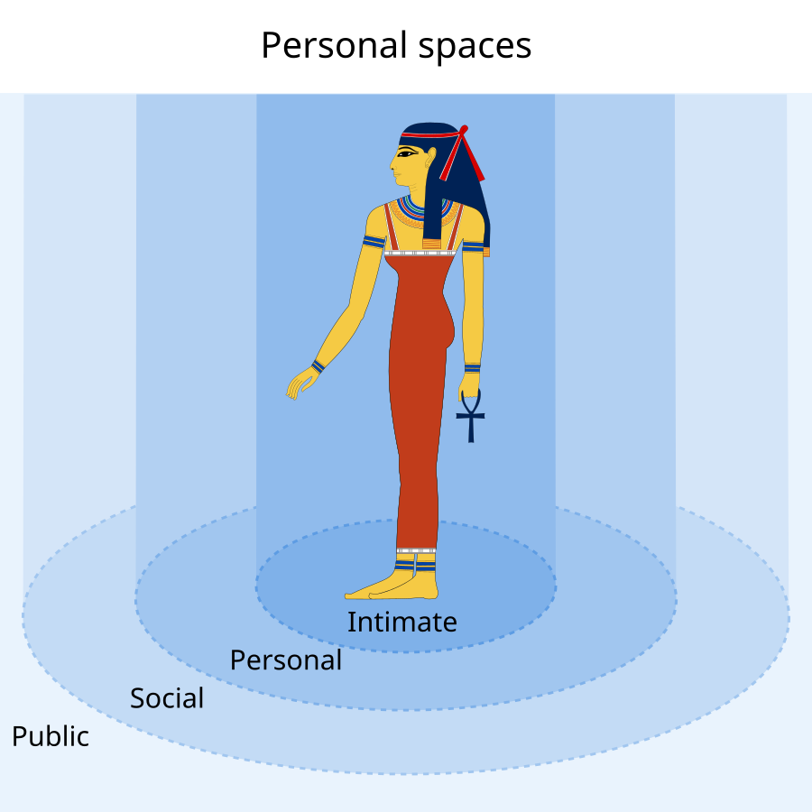

사람 옆을 지나는 로봇에 "몇 미터 떨어져야 하는가"를 묻는 순간, 하나의 안전 반경부터 정하고 싶어져요. 에드워드 T. 홀의 1966년 책 『The Hidden Dimension』은 이런 환산을 경계하게 만드는 출발점입니다. 홀은 <abbr title="사람이 공간과 거리를 사용해 관계와 의사를 드러내는 방식을 연구하는 분야">근접학</abbr>을 사람 둘 사이의 거리표로만 다루지 않았어요. 감각, 자세, 시선, 관계, 문화, 건축 환경이 공간 사용을 어떻게 바꾸는지 함께 보았습니다.

로봇 연구에서 이 책을 읽는 이유도 네 구간의 숫자를 가져오기 위해서가 아닙니다. 로봇 주위에 동그란 금지 구역을 하나 그렸을 때 빠져나가는 변수가 무엇인지 확인하는 데 가치가 있어요. 거리 자체는 관측할 수 있지만, 같은 거리의 의미는 장면마다 달라집니다. 대화를 거는 로봇이 정면 1미터에 멈추는 것과 뒤에서 1미터까지 다가오는 것은 같은 행동이 아니에요.

## 공간은 몸 주변의 동심원이 아니에요

홀은 미국인의 상호작용을 설명하면서 친밀, 개인, 사회, 공공 거리라는 구분을 제시했습니다. 이 분류는 공간 사용에 언어처럼 차이가 있다는 점을 드러내는 관찰 틀입니다. 뒤에 붙은 센티미터 값을 모든 사람에게 적용하는 국제 규격으로 읽으면 원래 문제의식과 멀어져요. 책의 구성도 인간 거리 장 하나로 끝나지 않고, 동물의 거리 조절, 감각 기관, 시각 공간, 건축, 여러 문화권의 공간 사용을 차례로 다룹니다.

아래 그림은 홀의 분류를 설명하려고 만든 공개 교육 자료입니다. 원을 같은 간격으로 그리지 않았고 숫자도 적지 않았다는 점이 중요해요. 제작자 설명도 사회와 문화에 따라 거리가 달라지므로 반지름만 표현했다고 밝힙니다.

<figure class="fig"><figcaption>네 거리 구간은 공간 의미를 구분하는 관찰 틀이지 모든 사람에게 적용할 로봇 안전 반경이 아닙니다. (출처: Jeff Dahl, Personal spaces.svg, https://commons.wikimedia.org/wiki/File:Personal_spaces.svg · 확인 라이선스 CC BY-SA 4.0)</figcaption></figure>

동심원 그림은 이해하기 쉽지만 세 가지 정보를 지웁니다. 첫째, 사람은 앞과 뒤를 같은 방식으로 보지 않아요. 둘째, 대화 상대와 지나가는 낯선 사람에게 허용하는 위치가 다릅니다. 셋째, 출입구나 좁은 복도에서는 공간을 선택할 여지가 줄어듭니다. 로봇 비용 지도에 원 하나만 넣으면 이 세 차이가 모두 동일한 거리 비용으로 합쳐집니다.

원형 반경은 충돌 여유를 표현할 때는 유용합니다. 로봇 몸체와 사람 몸체의 크기, 정지 오차, 센서 오차를 합쳐 물리적으로 들어가면 안 되는 구역을 만들 수 있어요. 그러나 불편함이나 상호작용의 적절성을 같은 원에 넣으면 문제가 생깁니다. 충돌하지 않는다는 물리 조건과 반갑게 다가온다는 사회 조건은 입력도 다르고 실패했을 때의 대응도 달라요.

## 같은 1미터가 다른 뜻을 갖는 조건

거리 하나를 사회적 의미로 바꾸려면 적어도 방향, 상대 운동, 관계, 활동을 함께 봐야 합니다. 사람이 로봇을 바라보고 손짓하는 장면에서는 접근 자체가 요청일 수 있어요. 반대로 사람이 다른 사람과 마주 보고 대화하고 있다면 둘 사이를 가르는 1미터 통과는 방해가 됩니다. 사람의 위치만 같아도 몸의 방향과 집단 관계가 바뀌면 경로 비용의 모양이 바뀌어야 해요.

방향을 넣는 가장 간단한 방법은 사람 중심의 비용을 원이 아니라 타원으로 두는 것입니다. 앞쪽 반축을 길게, 뒤쪽 반축을 다르게 둘 수 있어요. 하지만 타원 하나로 끝내면 또 다른 고정 규칙이 됩니다. 뒤쪽 접근을 더 비싸게 할지, 옆쪽 통과를 더 비싸게 할지는 로봇의 역할과 알림 수단에 따라 달라집니다. 운반 로봇이 사람 뒤를 조용히 추월하는 장면과 안내 로봇이 말을 걸기 위해 시야 안으로 들어가는 장면은 원하는 행동이 반대일 수 있습니다.

상대 속도도 거리의 의미를 바꿉니다. 1.2미터 떨어진 로봇이 정지해 있으면 사람이 상황을 파악할 시간이 있지만, 초당 1미터로 다가오면 1초 남짓 뒤에 같은 자리를 침범합니다. 위치만 쓰는 개인공간 비용은 이 차이를 보지 못해요. 접근 속도, 접근 각도, 예상 충돌 시간 가운데 하나를 별도 항으로 넣어야 정적인 거리와 다가오는 위협을 구분할 수 있습니다.

관계는 센서만으로 알아내기 어렵습니다. 서로 마주 보는 두 사람이 반드시 대화 집단인 것은 아니고, 가까이 선 두 사람이 일행이라는 보장도 없어요. 그래서 로봇은 관계를 확정된 표지처럼 쓰기보다 신뢰도를 가진 가설로 다루는 편이 안전합니다. 집단 확률이 낮으면 통과 속도를 줄여 관측을 더 모으고, 확률이 높아지면 둘 사이를 가로지르는 후보 경로의 비용을 높이는 식입니다.

## 문화 차이는 반경 선택 문제가 아니에요

홀의 비교는 독일, 영국, 프랑스, 일본, 아랍권 사례를 별도 장에서 다룹니다. 여기서 얻을 결론을 "문화 A는 0.8미터, 문화 B는 1.2미터"로 축약하면 사람을 국적별 상수로 분류하게 됩니다. 한 문화 안에서도 장소, 역할, 친밀도, 혼잡도에 따라 공간 사용은 달라져요. 박물관 관람객, 병원 방문객, 출근길 승객이 같은 반응을 보인다고 가정할 수 없습니다.

로봇 시스템에서 문화 맥락은 초기값과 적응 문제로 나누는 편이 낫습니다. 초기값은 서비스 장소에서 보수적으로 정한 기본 행동입니다. 적응은 사람의 실제 반응을 관찰해 속도와 접근 방향을 바꾸는 과정이에요. 사람이 뒤로 물러서거나 몸을 돌리면 접근을 멈추고, 시선을 유지하며 가까이 오라는 몸짓을 보이면 천천히 거리를 줄이는 식입니다. 이때 국적 추정은 필요하지 않습니다.

규범을 학습할 때도 평균 거리 하나보다 조건부 분포가 더 많은 정보를 줍니다. "로봇과 사람 사이 평균 1.1미터"는 누가 누구에게 접근했는지, 좁은 통로였는지, 대화 중이었는지 알려주지 않아요. 장면 조건을 묶어 `P(선호 거리 | 활동, 방향, 혼잡, 로봇 역할)`처럼 기록해야 합니다. 공개 데이터가 이런 조건을 제공하지 않으면, 거리 모델의 정밀도보다 라벨의 빠진 맥락이 더 큰 한계가 됩니다.

문화 차이를 반영한다는 말이 사용자에게 모든 조정을 맡긴다는 뜻도 아닙니다. 설정 화면에서 "개인공간 0.9미터"를 고르게 하면 숫자의 의미를 모르는 사용자가 안전과 예절을 함께 책임져야 해요. 서비스 운영자는 충돌 여유를 고정된 하한으로 관리하고, 사회적 여유는 장면과 반응에 맞춰 제한된 범위에서 바꾸는 구조를 설계해야 합니다.

## 설명용 가정으로 비용을 나눠 보기

다음은 홀의 실험 결과가 아니라 로봇 설계를 이해하기 위한 설명용 가정입니다. 사람 위치를 원점, 사람이 바라보는 방향을 x축 양의 방향으로 두고 후보 경로의 한 점을 `(x, y)`라고 해볼게요. 충돌 방지 항, 방향성 불편 항, 접근 속도 항을 따로 계산합니다.

|항목|설명용 식|의미|
|---|---|---|
|물리 여유|몸체 반경과 위치 오차를 더한 하한|이 안쪽은 사회적 선호와 무관하게 금지|
|방향성 비용|앞·옆·뒤마다 다른 타원 거리|시야와 접근 방향을 구분|
|접근 비용|거리 감소율이 클수록 증가|같은 거리에서 정지와 돌진을 구분|
|집단 비용|두 사람 사이 연결 구역에 가중|대화 집단을 가르는 경로 억제|

설명용 수치로 사람과 로봇의 물리 반경 합이 0.55미터이고 위치 추정 여유를 0.15미터로 잡으면, 0.70미터 안쪽은 금지 구역이 됩니다. 이 값은 개인공간 선호가 아니라 몸체와 오차를 합한 공학적 하한이에요. 사회적 비용은 그 바깥에서 시작합니다. 앞쪽 1.4미터, 옆쪽 1.0미터, 뒤쪽 1.2미터를 완만한 비용 구역으로 놓을 수 있지만, 이 숫자들은 논문에서 얻은 기준이 아니라 조정 절차를 설명하기 위한 가정입니다.

후보 A가 사람 정면 1.1미터를 지나고 후보 B가 측면 0.9미터를 지난다고 해보죠. 원형 비용만 보면 A가 더 멀어 유리합니다. 사람이 로봇을 바라보며 대화를 요청했다면 A가 자연스러울 수 있지만, 사람이 앞의 작업대를 보고 있다면 A는 시야를 막을 수 있어요. 활동 상태가 바뀌면 같은 기하에서 경로 순위가 뒤집힙니다. 비용 함수에 거리만 넣어서는 이 역전을 표현할 수 없습니다.

또 다른 후보 C가 뒤쪽 1.3미터를 초당 0.2미터로 지나고 후보 D가 옆쪽 1.0미터를 초당 0.8미터로 지난다고 가정해볼게요. 방향성 비용만 보면 C가 불리할 수 있지만 접근 속도와 노출 시간을 함께 보면 D가 더 갑작스러운 동작이 될 수 있습니다. 이 계산은 최적 반경을 찾는 문제가 아니라 어떤 변수를 서로 분리해 기록해야 하는지 보여 줍니다.

## 고정 반경이 깨지는 실제 배포 장면

좁은 문에서 1.2미터 개인공간을 강제하면 통로 전체가 막힐 수 있습니다. 플래너는 충돌하지 않는 경로가 있어도 사회적 비용 때문에 움직이지 못해요. 이때 반경을 일괄 축소하면 넓은 공간에서도 지나치게 가까워집니다. 문맥을 인식해 좁은 구역에서는 속도를 낮추고, 의도를 일찍 보이며, 통과 뒤 여유를 회복하는 상태 전환이 필요합니다.

대화 집단에서는 반대 문제가 생깁니다. 각 사람에게 원형 반경을 둘러도 두 원 사이에 빈틈이 남을 수 있어요. 로봇은 수학적으로 가장 싼 그 틈을 통과하지만, 사람에게는 대화를 가르는 행동으로 보입니다. 사람별 비용에 집단 연결 비용을 더해야 하는 이유입니다. 집단 추정이 불확실하면 경로 후보를 완전히 금지하기보다 감속과 재관측을 걸어 오판의 비용을 낮출 수 있어요.

줄을 선 사람도 원형 모델을 깨뜨립니다. 줄은 사람들의 가까운 간격보다 진행 방향과 순서를 유지하는 구조가 중요해요. 로봇이 줄 사이를 통과하지 않더라도 맨 앞의 진행 공간을 가로막으면 방해가 됩니다. 개별 사람 반경은 점유는 설명하지만 순서를 설명하지 못합니다.

한 사람이 로봇을 부르는 장면에서는 큰 반경이 오히려 실패를 만듭니다. 호출을 받았는데 늘 1.5미터 밖에 멈추면 화면이나 물건을 건네기 어렵습니다. 상호작용 목표가 확인되면 접근을 허용하되 속도를 낮추고, 사람 정면에서 멈추며, 취소 신호에 즉시 물러나야 해요. 거리 완화는 충돌 하한까지 없애는 허가가 아닙니다.

가림도 중요합니다. 지도상 거리는 충분하지만 선반 뒤에서 갑자기 나타나는 로봇은 가까이 다가온 로봇보다 더 놀라울 수 있어요. 거리 비용만으로는 보이지 않던 시간과 출현 방향을 표현하지 못합니다. 사람의 시야와 장애물 가림을 비용으로 넣은 [[2026-10-17_socialnav_human-aware-planner|사람을 고려한 이동 계획기가 거리·시야·가림을 비용으로 푸는 방식]]이 근접학을 경로 계획으로 옮긴 한 사례입니다.

## 로봇 설계에서는 세 층으로 분리해야 해요

첫째 층은 충돌 안전입니다. 센서 지연, 제동 거리, 몸체 크기, 위치 오차를 반영해 접근할 수 없는 영역을 만듭니다. 이 층은 문화나 친밀도에 따라 줄이면 안 됩니다. 사람 검출이 끊기거나 추적 신뢰도가 떨어지면 안전 여유를 키우거나 속도를 낮춰야 해요.

둘째 층은 사회적 비용입니다. 시선, 몸 방향, 집단, 활동, 통로 구조를 써서 여러 안전한 경로 가운데 덜 방해되는 경로를 고릅니다. 이 층은 연속 비용이 적합합니다. 모든 사회 규범을 금지 구역으로 바꾸면 좁은 환경에서 영구 정지가 생기기 쉬워요.

셋째 층은 상호작용 상태입니다. 호출을 받았는지, 길을 양보하는 중인지, 사람이 로봇을 알아차렸는지에 따라 비용 가중치와 최대 허용 속도을 바꿉니다. 같은 사람도 상태가 바뀌면 허용 거리와 접근 방향이 달라져요. 거리 모델이 상태 기계와 연결되지 않으면 상황 변화에 늦게 반응합니다.

평가도 층을 섞지 않아야 합니다. 충돌 수와 최소 거리는 안전을 보고, 개인공간 침범 시간과 사람의 우회량은 방해를 보고, 로봇 의도를 언제 알아챘는지는 예측 가능성을 봅니다. 하나의 성공률로 합치면 가까이 지나갔지만 빠른 로봇과 멀리 멈춰 버린 로봇을 구분하기 어렵습니다.

## 센서가 읽는 것과 사회적 해석을 구분해야 해요

카메라와 라이다가 주는 값은 사람의 위치와 움직임에 관한 관측입니다. 사람의 의도나 불편함이 센서 메시지에 들어 있는 것은 아니에요. 몸 방향을 검출했다고 해도 얼굴을 돌린 것인지 몸 전체가 이동할 것인지 알 수 없고, 두 사람이 가까이 있다는 사실만으로 대화 관계를 확정할 수 없습니다. 관측값에서 사회적 상태로 넘어가는 단계마다 불확실성을 남겨야 합니다.

예를 들어 사람 추적기가 위치 `(x, y)`, 속도 `(vx, vy)`, 몸 방향을 보낸다고 해볼게요. 경로 계획기는 이 값에서 시야 방향과 접근 속도를 계산할 수 있습니다. 반면 "대화 중", "로봇을 호출함", "줄을 섬" 같은 상태는 여러 프레임의 자세와 주변 사람 배치를 묶어 추론해야 해요. 한 프레임의 분류 결과를 곧바로 금지 구역으로 바꾸면 오검출 한 번이 급정지나 큰 우회를 만듭니다.

신뢰도가 낮을 때의 행동도 미리 정해야 합니다. 사람 위치 신뢰도가 낮으면 물리 안전 층은 더 보수적으로 동작해야 해요. 집단 관계 신뢰도가 낮으면 사회적 층은 속도를 줄이고 관측 시간을 늘릴 수 있습니다. 두 불확실성을 같은 방식으로 처리하면 위치 검출 실패에는 충분히 안전하지 않고, 관계 추정 실패에는 지나치게 멈추는 모순이 생깁니다.

시간도 빠지기 쉬운 변수입니다. 한순간 0.9미터 안으로 들어간 것과 10초 동안 같은 거리를 유지한 것은 체감이 다를 수 있어요. 최소거리만 기록하면 두 주행을 같은 실패로 분류합니다. 개인공간 침범 시간을 누적하고, 진입 속도와 이탈 속도를 함께 기록해야 접근이 거칠었는지 통로 제약 때문에 잠깐 가까워졌는지 구분할 수 있습니다.

관측 프레임의 좌표계가 흔들리면 방향성 비용도 틀어집니다. 사람 몸 방향은 카메라 좌표에서 나오고 경로는 지도 좌표에서 계산될 수 있어요. 시각과 변환 시각이 어긋나면 앞쪽 비용 타원이 옆으로 돌아가고, 로봇은 사람 시야 안으로 들어간다고 계산하면서 실제로는 뒤에서 접근할 수 있습니다. 사회적 비용을 더하기 전에 시각 동기와 좌표 변환 실패를 측정해야 하는 이유입니다.

서비스 장소에서 반경을 조정할 때는 평균만 보지 말고 분포의 꼬리를 봐야 합니다. 대부분 사람이 불편하지 않았더라도 일부 장면에서 큰 회피나 놀람이 반복되면 조건을 따로 분리해야 해요. 혼잡도, 접근 방향, 로봇 속도, 집단 여부로 기록을 나누면 어떤 조건에서 비용 모델이 무너지는지 찾을 수 있습니다. 하나의 전역 반경을 조금씩 키우는 방식은 드문 실패를 숨기면서 전체 주행만 느리게 만들 수 있어요.

사람 참여 평가는 기술 지표를 통과한 뒤에 해야 합니다. 추적이 끊기거나 제동이 늦는 시스템에서 선호 거리부터 묻는 것은 안전 문제와 사회적 선호를 섞습니다. 먼저 센서 누락, 좌표 변환, 정지 거리, 최대 접근 속도를 검증하고, 그다음 같은 안전 조건 안에서 경로 A와 B의 편안함과 예측 가능성을 비교해야 해요. 이 순서를 지키면 근접학을 안전 인증의 대용품으로 쓰지 않게 됩니다.

홀의 근접학에서 가져올 가장 오래가는 설계 원칙은 반경 값이 아니라 조건을 읽는 방식입니다. 개인공간 비용은 거리 센서의 출력이 아니라 사람, 관계, 활동, 공간 구조에 관한 추정의 결과예요. 충돌 하한을 따로 지키고 사회적 비용을 문맥에 맞춰 조정할 때, 로봇은 숫자 하나로 사람을 규정하지 않으면서도 일관된 행동을 만들 수 있습니다.

---

<!-- src-block -->
출처 — https://archive.org/details/hiddendimension0000hall
