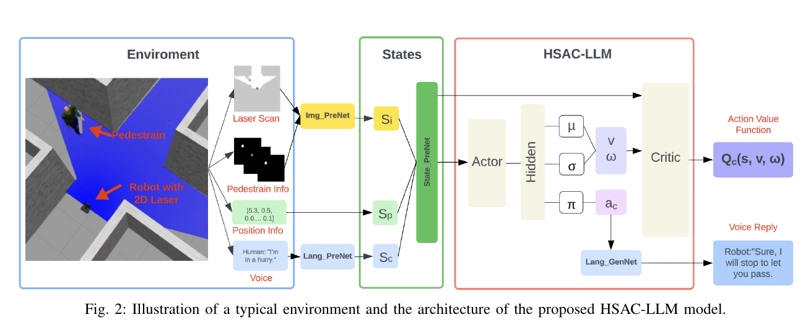
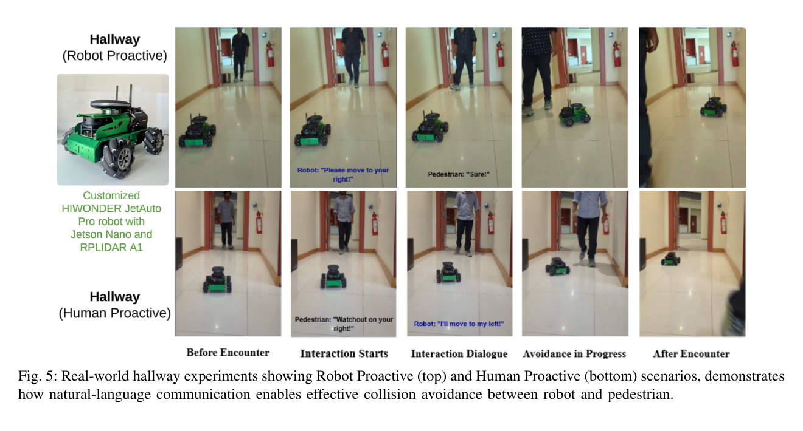

좁은 복도에서 로봇과 사람이 마주치면 경로만 바꾸는 것보다 누가 먼저 지나갈지 대화로 정하는 편이 자연스러울 수 있어요. HSAC-LLM은 선속도·각속도 같은 연속 행동과 “멈춤·왼쪽·오른쪽·대화 없음” 같은 이산 상호작용을 하나의 정책에서 고르고, 언어 모델이 이산 코드를 사람에게 들리는 문장으로 바꿔요. 사람의 응답은 다시 정책 상태로 들어가 통행 우선순위를 조정해요.

## 주행과 대화를 하이브리드 행동으로 표현해요

표준 <abbr title="좋은 보상과 행동 탐색을 함께 고려해 연속 제어 정책을 배우는 강화학습 방법">SAC</abbr>는 연속 행동을 다루는 데 적합하지만 대화 선택은 이산적이에요. <abbr title="속도 같은 연속값과 대화 선택 같은 불연속값을 함께 학습하는 강화학습 방법">HSAC</abbr>는 한 상태에서 연속 속도 분포와 이산 행동 확률을 함께 내요. 행동 선택망은 선속도 (v), 각속도 (ω)의 평균·분산과 이산 행동 분포를 만들고, 가치 평가망은 상태와 연속 행동을 받아 각 이산 선택의 Q값을 평가해요.

이산 행동은 대화 없음, 정지 요청, 왼쪽 요청, 오른쪽 요청에 해당하는 4차원 코드예요. 대화가 필요 없으면 대화 없음을 고르고, 충돌 위험에서 상대에게 멈춤이나 통과 방향을 요청하거나 사람의 요청을 받아 로봇 행동을 바꿔요. 2차원 구성 요소 제거 실험은 대화 없음과 정지 요청만 사용해 방향 협상을 표현하지 못해요.

<abbr title="연속 제어값과 불연속 선택을 한 정책에서 함께 결정하는 행동 표현">하이브리드 행동 공간</abbr>은 대화와 운동을 연결하지만 책임 경계가 복잡해요. 정책이 오른쪽 요청을 고른 뒤 실제 문장이 “오른쪽으로 가세요”인지 “제가 오른쪽으로 갈게요”인지에 따라 행동 주체가 달라져요. 코드, 생성 문장, 해석된 사람 응답, 최종 로봇 속도를 같은 로그에 남겨야 해요.

<figure class="fig"><figcaption>공간 상태와 언어 상태를 결합해 연속 속도와 이산 상호작용을 함께 고르고, Lang GenNet이 행동 코드를 문장으로 바꿔요. (출처: Wen et al., HSAC-LLM, Fig. 2)</figcaption></figure>

## 센서와 언어는 별도 전처리 뒤 상태가 돼요

공간 입력에는 180도 2D 레이저 거리 센서 거리 관측 격자, 사람의 위치와 속도를 나타내는 3채널 보행자 격자, 목표 상대 위치와 방향을 담은 9차원 벡터가 있어요. 세 전처리망이 이 값을 특징으로 바꿔 공간 상태를 만들어요. 원시 카메라 영상에서 사람을 찾는 구조가 아니며, 사람 격자가 이미 제공된다는 가정이 있어요.

잠재 충돌이 감지되면 Lang PreNet이 대화 상태를 만들어요. 사람이 먼저 말하거나 로봇이 대화를 시작할 수 있고, 문장의 의미를 정책 조건으로 넣어요. 충돌 위험이 없을 때 매 스텝 언어 모델을 호출하지 않고 필요한 시점에 상호작용한다는 의도예요.

Lang GenNet은 GPT-4를 사용해 이산 코드를 자연스러운 문장으로 바꿔요. 논문은 GPT-4 호출 지연, 네트워크 단절, 비용, 응답 기한 초과의 분포를 상세히 실측하지 않아요. Jetson Nano가 로봇에 탑재됐다는 사실을 GPT-4까지 온보드에서 실행했다는 의미로 읽으면 안 돼요. 어떤 모듈이 로컬이고 어떤 모듈이 외부 서비스인지 재현 시 확인해야 해요.

설명용으로 레이저 거리 센서 10Hz, 정책 10Hz인데 대화 왕복이 1.5초 걸린다고 가정하면 그 사이 15번의 공간 제어 갱신이 있어요. 대화 대기 중 로봇이 멈추는지, 기존 정책으로 움직이는지에 따라 안전 여유가 달라져요. 숫자는 논문 지연 측정치가 아니라 비동기 상태 기계를 검증하기 위한 가정이에요.

## 보상은 도달·진행·시간·상호작용을 함께 계산해요

보상에는 목표 도달과 충돌, 목표 방향 진행, 스텝 비용, 적절한 상호작용이 들어가요. 목표에 도착했더라도 주행 중 사람과의 최소 거리가 안전 임계값 아래로 내려갔다면 도달 보상을 깎아요. 성공 여부만 보지 않고 경로 중 사회적 여유를 반영하려는 구성이에요.

상호작용 보상은 로봇이 요청을 시작했는지, 사람이 응답했는지, 그 뒤 어떤 이산 행동을 골랐는지를 반영해요. 대화를 자주 하면 항상 보상이 커지는 식이면 불필요한 말을 반복할 수 있으므로 상황과 응답의 일치가 중요해요. 보상이 실제 사람의 편안함을 완전히 대표하는 것은 아니고 시뮬레이터 규칙에 맞춘 대리값이에요.

설명용으로 짧은 우회가 8초이고 대화 후 양보가 12초지만 최소 거리를 0.2m 늘린다고 해볼게요. 시간 비용과 거리 위반 비용의 비율에 따라 정책 선택이 바뀌어요. 논문 계수를 재현한 값은 아니며, 사회적 행동이 보상 스케일에 의존한다는 예예요.

사람이 로봇 요청에 따르는 시뮬레이션 규칙도 보상과 맞물려요. 2D 시뮬레이터의 보행자는 <abbr title="서로의 예상 움직임을 고려해 충돌을 피하도록 만든 사람 이동 모형">IRVO</abbr>로 움직이며 정지·통과 여유 요청에 반응해요. 사람이 항상 올바르게 듣고 합의한 방향으로 움직이는 환경이라면 대화의 효과가 현실보다 크게 보일 수 있어요. 거절·오해·무응답·동시 방향 변경을 별도 시험해야 해요.

## 2D 시뮬레이션은 한 명과의 협상을 반복해요

훈련은 2D 시뮬레이터에서 12만8천 스텝 동안 진행되고 <abbr title="프로그램의 일반 계산을 맡는 중앙 처리 장치">CPU</abbr>와 NVIDIA RTX 2070 <abbr title="영상 처리 등에 쓰는 병렬 연산 장치">GPU</abbr>를 사용해요. Square, Hallway, Crosswalk 세 장면에서 사람 한 명과 상호작용해요. 각 장면은 500회 시험하고 사람과 로봇의 시작·목표를 바꿔요.

행동 범위는 선속도 0–0.6m/s, 각속도 -0.9–0.9rad/s예요. Square에서 성공률 0.91, 충돌률 0.08, 최소 사람 거리 0.31, 사람 주변 여유 공간 준수율 0.85를 보고해요. Hallway는 성공 0.93·충돌 0.07, Crosswalk는 성공 0.91·충돌 0.09예요. 이 수치는 IRVO 사람이 요청에 반응하는 단일 보행자 환경의 결과예요.

4차원 이산 행동은 2차원 대화 없음·정지 요청보다 세 장면에서 소폭 높은 성공과 낮은 충돌을 보여요. Crosswalk 성공은 0.87에서 0.91, 충돌은 0.13에서 0.09로 바뀌어요. 방향 선택을 넣은 효과가 있지만, 동시에 행동 선택지가 늘어 훈련 시간이 증가해요. 표의 훈련 시간 단위와 전체 실제 경과 시간 조건을 확인하지 않고 절대 시간으로 비교해서는 안 돼요.

대규모 언어 모델을 제거한 HSAC와의 비교에서도 충돌이 줄어들어요. Square에서는 0.14에서 0.08, Crosswalk에서는 0.13에서 0.09로 보고돼요. HSAC는 경고만 하고 사람의 말로 전한 응답을 처리하지 못해요. 하지만 비교는 시뮬레이션 대화 규칙과 보상 안에서 이뤄지므로 자연스러운 실물 대화의 인과 효과로 확대하지 않아야 해요.

설명용으로 충돌률 0.14가 500회에서 70건, 0.08이 40건에 해당한다고 보면 30건 차이예요. 실제 표는 여러 초기값의 평균·표준편차를 제공하므로 단순 정수 변환과 정확히 같지 않아요. 반복 수가 커 보여도 사람 행동 다양성이 한 명·세 장면 규칙에 제한된다는 점을 함께 봐야 해요.

## Gazebo에서는 사람이 실제로 조작해요

Gazebo 실험은 Hallway와 Crosswalk에서 로봇이 먼저 말을 거는 경우와 사람이 먼저 말을 거는 상황을 보여줘요. 시뮬레이션 사람은 실제 참여자가 속도와 방향을 조작하고 음성 입력과 로봇 응답을 주고받아요. “먼저 지나가게 해달라”는 명시적 요청과 “급하다”는 간접 표현에 로봇이 양보하는 사례를 제시해요.

이 사례는 고정 IRVO 규칙보다 풍부하지만 정량 반복표보다 연속 장면의 질적 시연 성격이 커요. 사람이 로봇 연구를 이해하고 협조적으로 조작하면 일반 보행자보다 대화가 잘 맞을 수 있어요. 음성 억양, 잡음, 언어 다양성, 거절 행동을 체계적으로 바꾼 통계는 별도 과제예요.

대화 단계는 마주침 전, 대화 시작, 대화, 회피 진행, 마주침 후로 나뉘어요. 시스템 구현에서도 이를 상태 기계로 명시해야 해요. 대화 중 새 사람이 들어오거나 기존 사람이 사라지면 어느 상태로 전환할지, 응답 기한 초과 뒤 재질문할지 멈출지를 정해야 해요.

## 실물은 두 복도 대화 장면을 보여줘요

실물 플랫폼은 개조한 Hiwonder JetAuto Pro예요. Jetson Nano, RPLIDAR A1을 사용하고 카메라 없이 2D 레이저 거리 센서로 주변을 인식해요. 논문은 RPLIDAR A1의 5–10Hz, 최대 12m, 각 해상도 1도를 적어요. 로봇 선속도와 각속도 정책, 대화로 방향을 맞추는 복도 시연을 보여줘요.

<figure class="fig"><figcaption>실물은 로봇이 먼저 말을 거는 경우와 사람이 먼저 말을 거는 두 복도 사례를 다섯 단계로 보여줘요. 대규모 사람 평가나 지연 분포는 보고하지 않아요. (출처: Wen et al., HSAC-LLM, Fig. 5)</figcaption></figure>

첫 장면에서 로봇은 사람에게 오른쪽으로 이동해 달라고 말하고 사람이 따라요. 둘째 장면에서는 사람이 오른쪽을 조심하라고 말하고 로봇이 왼쪽으로 이동한다고 답해요. 자연어가 회피 방향 합의에 쓰이는 가능성을 보여주지만 반복 횟수, 참가자 수, 실패율, 언어 모델 응답 시간은 제시되지 않아요.

Jetson Nano의 사양을 적었다고 전체 HSAC-LLM이 온보드 실시간이라는 증거는 부족해요. 공간 정책과 센서 처리, 음성, GPT-4 외부 기능 호출의 실행 위치·주기·네트워크를 분리한 자원·시간 측정이 필요해요. 특히 GPT-4는 외부 모델이므로 인터넷 연결이 끊긴 상황의 동작을 확인해야 해요.

5Hz 레이저 거리 센서라면 거리 관측 간격은 0.2초예요. 설명용으로 두 행위자의 상대 접근 속도가 1.2m/s면 거리 관측 사이 거리가 0.24m 줄어요. 대화 시작 판단과 음성 왕복이 추가되므로 충돌 감시는 언어 고리와 독립적으로 빨라야 해요. 이 계산은 논문 측정치가 아니라 센서 주기와 접근 위험의 관계를 보여줘요.

대화에 참여하지 않는 사람도 시험 조건에 포함해야 해요. 말을 듣지 못하거나, 사용 언어를 모르거나, 로봇과 대화하고 싶지 않은 사람에게 응답을 전제로 접근하면 안전 여유를 잃을 수 있어요. 방향을 요청할 때도 로봇 기준 오른쪽과 사람 기준 오른쪽이 반대일 수 있어요. 응답 여부와 방향 기준을 확인하지 못하면 속도를 낮추고 통행 공간을 남기는 대체 동작이 필요해요. 이는 논문이 입증한 결과가 아니라 실제 적용에서 추가로 검증할 조건이에요.

## 대화는 안전 명령이 아니라 불확실한 관측이에요

사람이 “오른쪽으로 갈게요”라고 말해도 실제로 오른쪽으로 간다는 보장은 없어요. 말을 잘못 들었거나, 기준 방향이 서로 다르거나, 제3자를 피하려고 움직임을 바꿀 수 있어요. 정책은 언어 응답을 강한 조건으로 쓰더라도 레이저 거리 센서에서 확인되는 실제 움직임을 계속 따라야 해요.

왼쪽·오른쪽 기준도 화자 중심인지 로봇 중심인지 명시해야 해요. 마주 보는 두 사람의 오른쪽은 화면에서 반대가 될 수 있어요. 문장을 생성할 때 “당신 기준 오른쪽” 또는 공간 표식을 사용하고, 사람 응답을 정책의 행동 코드로 바꿀 때도 같은 기준을 써야 해요.

설명용으로 음성 인식 정확도가 95%, 방향 의미 분류가 95%, 사람이 약속대로 움직일 확률이 90%라고 독립 가정하면 세 단계가 모두 맞을 확률은 약 81%예요. 실제 값과 독립성은 다르지만 여러 높은 정확도가 연결될 때 전체 신뢰가 낮아지는 점을 보여줘요. 최종 행동은 센서 확인과 안전 정지로 보호해야 해요.

대화 실패 상태는 대화 없음과 달라야 해요. 대화 없음은 대화가 필요 없거나 정책이 선택하지 않은 상태이고, 응답 기한 초과·외부 호출 오류·음성 인식 실패는 대화를 시도했지만 결과가 없는 상태예요. 모두 같은 빈 벡터로 처리하면 정책이 위험을 모른 채 움직일 수 있어요.

## 다중 보행자에서는 대화 대상 선택이 새 문제가 돼요

주요 2D 정량 실험은 한 명과의 상호작용이에요. 군중에서는 누구에게 말하는지, 다른 사람이 명령을 자신에게 한 것으로 오해하는지, 여러 응답이 겹치는지를 처리해야 해요. 2D 레이저 거리 센서만으로 목소리와 추적 식별자를 연결하기도 어려워요.

대상 선택은 가장 가까운 사람만 고르는 것으로 충분하지 않을 수 있어요. 옆의 가까운 사람보다 경로 앞의 먼 사람이 실제 충돌 상대일 수 있어요. 예상 충돌까지 남은 시간, 경로 교차, 시선·음원 방향을 함께 봐야 해요. 논문 구조에 이 모든 연결이 검증된 것은 아니에요.

다중 시험은 사람 2·4·8명, 동시에 말하는 사람 0·1·2명, 가림과 식별자 교환을 조합해요. 대화 대상 정확도, 잘못된 사람 반응 횟수, 충돌, 최소 거리, 목표 시간, 발화 수를 측정해요. 불필요한 대화가 많아도 성공률은 높을 수 있으므로 발화 부담을 별도 지표로 둬야 해요.

## 재현은 모듈별 지연과 인과를 분리해요

첫 대조는 HSAC 공간 정책만, 둘째는 고정 경고, 셋째는 미리 정한 규칙의 대화, 넷째는 GPT-4 대화예요. 같은 사람 궤적과 응답 스크립트에서 비교하면 자연어 생성의 기여와 이산 행동 선택의 기여를 나눌 수 있어요. 사람 행동이 방법마다 달라지는 폐루프 시험은 그 다음에 수행해요.

필수 로그는 레이저 거리 센서 시각 표기, 보행자 격자, 목표 벡터, 충돌 위험을 감지한 시작 조건, 불연속 행동 코드, 생성한 발화, 인식된 응답, 연속 행동, 안전 제한기예요. 발화만 영상으로 남기면 정책이 어떤 행동 코드를 의도했는지 복구하기 어려워요.

지연은 센서 관측부터 위험 판정, 위험 판정부터 발화, 발화부터 응답, 응답부터 정책 반영, 정책 출력부터 본체 적용으로 나눠요. 평균과 <abbr title="전체 관측의 95퍼센트가 이 값 이하에 들어오는 지연 기준">P95</abbr>, 응답 기한 초과 비율을 기록하고 대화 중 최소 거리를 함께 봐야 해요. 실물 “실시간” 표현을 하드웨어 배치와 수치 없이 반복하지 않는 것이 중요해요.

음량과 주변 소음도 독립 변수예요. 조용한 복도에서 통과한 문장이 공항·식당에서는 누락될 수 있고, 로봇 발화가 멀리 있는 다른 사람에게 전달될 수도 있어요. 신호와 잡음의 비율 구간별 음성 인식 성공, 대상별 응답, 재질문 횟수를 기록해야 해요.

개인정보와 기록 범위도 시스템 설계에 들어가요. 외부 언어 서비스를 쓴다면 음성이나 전사 문장이 어디로 전송되는지, 얼마나 보존되는지 정해야 해요. 이 논문은 개인정보 보호 평가를 중심으로 하지 않으므로, 실제 서비스 배포에서는 기능 성능과 별도로 검토해야 해요.

[[2026-10-17_socialnav_revind|ReViND가 오프라인 보상과 위상 그래프로 장거리 주행한 방법]]은 고정된 실물 주행 자료의 보상 재표기와 장거리 연결 구조 이동 계획을 다루고, HSAC-LLM은 현재 사람과 대화하며 연속·이산 행동을 고르는 문제를 다뤄요. 둘 다 사용자 선호를 반영하지만 하나는 경로 효용, 다른 하나는 통행 협상에 가까워요.

HSAC-LLM의 기여는 GPT-4가 속도를 생성하는 데 있지 않아요. 공간 상태를 처리하는 혼합 SAC가 연속 속도와 이산 대화 행동을 함께 고르고, 언어 모듈이 그 코드를 문장과 응답 상태로 연결한 구조에 있어요. 정량 근거는 IRVO 단일 보행자 시뮬레이션이 중심이고, 실물은 두 복도 사례예요. 다중 사람, 대화 실패, 모델 실행 위치, 입력부터 출력까지 함께 다루는 지연을 측정해야 실물 적용 범위를 넓힐 수 있어요.

---
<!-- src-block -->
출처 — https://arxiv.org/abs/2409.04965
