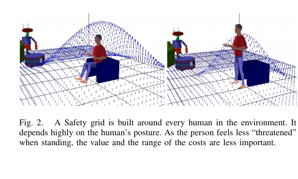
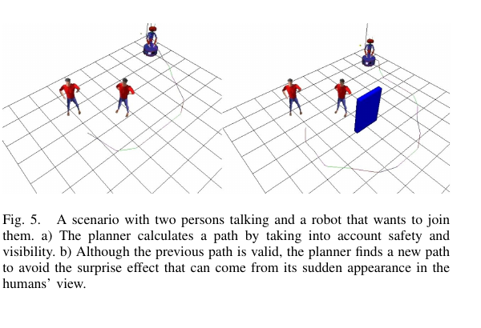

장애물만 피하는 최단 경로는 사람 곁에서 어색할 수 있습니다. 두 사람이 이야기하는 사이를 가르고, 앉은 사람의 등 뒤로 바짝 지나가며, 칸막이 뒤에서 갑자기 나타나도 충돌만 없으면 성공으로 판정하기 때문이에요. Emrah Akin Sisbot, Luis F. Marin-Urias, Rachid Alami, Thierry Siméon의 2007년 논문 [「A Human Aware Mobile Robot Motion Planner」](https://homepages.laas.fr/nic/Papers/07ITRO_hri.pdf)는 이런 실패를 경로 비용에 넣었습니다.

이 플래너의 특징은 사회적 행동을 하나의 규칙으로 선언하지 않은 데 있습니다. <abbr title="사람의 위치·자세·바라보는 방향과 주변 가림을 경로 비용으로 계산하는 이동 계획 방법">사람을 고려한 이동 계획</abbr>을 안전 거리, 가시성, 가림 구역이라는 기준으로 나누고, 각 기준을 격자 비용으로 계산한 뒤 경로 탐색과 연결했어요. 지금의 사람 중심 비용 지도와 비교해도 구조가 또렷합니다.

## 안전 비용은 사람의 상태에 따라 모양이 달라져요

안전 격자는 사람에게 가까울수록 비용이 커지는 분포입니다. 논문은 사람이 앉아 있는지 서 있는지에 따라 비용의 높이와 범위를 다르게 둘 수 있다고 설명해요. 앉은 사람은 이동 가능성이 낮고 로봇을 피하기 어려우므로 더 넓거나 높은 비용을 줄 수 있습니다. 서 있는 사람에게는 상대적으로 작은 범위를 허용합니다. 이 설계는 [[2026-10-17_socialnav_hall-proxemics|근접학은 개인공간을 고정 반경으로 만들지 않는다]]와도 이어집니다.

<figure class="fig"><figcaption>논문 그림 2의 안전 격자입니다. 사람 자세가 바뀌면 같은 거리라도 경로 비용이 달라지도록 설계했습니다. (출처: Sisbot et al., <a href="https://homepages.laas.fr/nic/Papers/07ITRO_hri.pdf">A Human Aware Mobile Robot Motion Planner</a>, Fig. 2; 원 논문 그림 인용, 별도 CC 라이선스 미확인)</figcaption></figure>

가까운 모든 위치를 금지하지는 않습니다. 과업이 물건 전달처럼 접근을 요구하거나 공간이 좁으면 로봇이 비용을 감수하고 가까이 갈 수 있어요. 아주 가까운 영역만 충돌 방지를 위해 금지하고, 그 바깥은 연속 비용으로 둡니다. 이 차이는 좁은 환경에서 영구 정지를 피하는 데 중요합니다.

비용이 사람마다 계산될 때 겹치는 영역을 어떻게 합칠지도 선택해야 합니다. 논문은 여러 사람의 기준 격자에서 셀 비용을 결합하고, 안전과 가시성 기준은 가중합 또는 최댓값으로 합치는 방법을 설명합니다. 가중합은 작은 비용이 누적될 수 있고, 최댓값은 가장 강한 기준 하나를 보존해요. 어느 방식이 맞는지는 과업과 기준의 의미에 달려 있습니다.

## 보이는 위치와 보이지 않는 위치를 다르게 봐요

가시성 격자는 로봇을 보기 위해 사람이 얼마나 몸을 돌려야 하는지를 비용으로 표현합니다. 눈만 움직여 볼 수 있는 앞쪽은 낮고, 머리나 몸을 돌려야 하는 뒤쪽은 높아요. 사람의 머리나 몸 방향이 바뀌면 격자도 함께 돌아갑니다. 원형 개인공간으로는 표현할 수 없는 방향성이 들어갑니다.

장애물이 있으면 가시성만으로 부족합니다. 로봇과 사람 사이를 벽이 막으면 거리와 방향만으로는 로봇이 보인다고 계산할 수 있어요. 논문은 가림 구역 기준을 따로 두어 칸막이 뒤를 지나는 경로와 가까운 곳에서 갑자기 시야에 나타나는 경로에 비용을 줍니다. 저자 구현에서는 놀람 효과의 범위를 약 3미터로 두었다고 적습니다. 이 값은 당시 시스템과 장면의 설정이며 보편 규격이 아닙니다.

가림 구역 비용은 다른 격자와 그대로 더하지 않습니다. 사람이 장애물 때문에 로봇을 볼 수 없는 위치에서는 안전·가시성 비용을 가림 구역 비용으로 대체하는 조건문을 씁니다. 보이는 장면의 기준과 보이지 않는 장면의 기준이 의미상 다르기 때문이에요. 모든 비용을 같은 숫자표로 더하는 설계보다 해석하기 쉽습니다.

## 비용 격자는 경로 탐색 안에서 계산돼요

안전, 가시성, 가림 비용을 합친 뒤 플래너는 충돌하지 않으면서 누적 비용이 작은 경로를 찾습니다. 논문 구현은 <abbr title="현재까지의 이동 비용과 목표까지의 예상 비용을 합쳐 탐색 순서를 정하는 경로 탐색 알고리즘">A*</abbr> 탐색을 사용했어요. 세 격자를 모두 미리 만들지 않고 탐색하는 셀의 값만 계산합니다. 사람이 움직이거나 방향이 바뀌었을 때 새 경로를 다시 계산하기 위한 선택입니다.

대화 중인 두 사람에게 접근하는 시뮬레이션이 이 구조를 잘 보여 줍니다. 장애물 회피만 생각하면 두 사람 사이로 가는 짧은 길이 나옵니다. 사람을 고려한 이동 계획기는 가까운 거리와 보이지 않는 접근의 비용을 반영해 바깥으로 돌아 정면에서 대화에 합류하는 경로를 고릅니다.

<figure class="fig"><figcaption>벽이 없을 때도 두 사람 사이를 가르지 않고 정면으로 접근합니다. 벽을 놓으면 가까운 곳에서 갑자기 나타나는 경로를 피해 시야에 완만하게 들어옵니다. (출처: Sisbot et al., <a href="https://homepages.laas.fr/nic/Papers/07ITRO_hri.pdf">A Human Aware Mobile Robot Motion Planner</a>, Fig. 5; 원 논문 그림 인용, 별도 CC 라이선스 미확인)</figcaption></figure>

복도 교차 시뮬레이션에서는 로봇이 사람을 지난 직후 원래 차선으로 급히 돌아가지 않고 등 뒤와 거리를 유지합니다. 앉은 사람과 벽이 있는 장면에서는 벽 뒤를 따라가다 충분히 먼 곳에서 사람 시야에 들어와요. 경로 길이만 보면 손해지만 놀람과 후방 접근을 줄이는 선택입니다.

## 설명용 계산으로 합성 비용을 읽기

다음은 논문 결과가 아니라 비용 결합을 설명하는 가정입니다. 첫째 후보 셀의 안전 비용이 0.8, 가시성 비용이 0.2이고 둘째 후보는 각각 0.4, 0.5라고 해볼게요. 안전 가중치 0.7, 가시성 가중치 0.3을 쓰면 첫째는 `0.7×0.8 + 0.3×0.2 = 0.62`, 둘째는 `0.7×0.4 + 0.3×0.5 = 0.43`입니다. 이 설정에서는 둘째가 선택됩니다.

최댓값 결합을 쓰면 첫째는 0.8, 둘째는 0.5가 되어 역시 둘째가 낮습니다. 그러나 셋째 후보의 안전 비용이 0.55, 가시성 비용이 0.55라면 가중합은 0.55이고 최댓값도 0.55예요. 가중합에서는 한 기준의 큰 비용을 다른 기준의 작은 비용이 희석할 수 있지만 최댓값에서는 가장 나쁜 기준이 그대로 남습니다.

가림 상태가 참인 넷째 후보에서는 합성 방식이 달라집니다. 안전 0.3, 가시성 0.1이라도 가림 구역 비용이 0.9라면 최종 비용을 0.9로 대체할 수 있어요. 벽 뒤에서 사람에게 보이지 않는 상황에 일반 가시성 점수를 적용하지 않는 예입니다. 조건 판단이 틀리면 비용 결합보다 앞단에서 큰 오류가 생깁니다.

격자 해상도도 계산과 경로 모양을 바꿉니다. 논문 표는 0.2, 0.1, 0.05미터 해상도에서 몇 가지 경로의 처리 시간을 보고합니다. 더 촘촘한 격자는 비용 경계를 정밀하게 표현하지만 탐색 셀이 늘어요. 현대 하드웨어에서도 사람 수와 재계획 주기가 늘면 같은 교환 관계가 남습니다.

## 실물 Rackham은 무엇을 관측했나

논문은 시뮬레이션만 제시하지 않았습니다. LAAS의 이동로봇 Rackham에 플래너를 넣고 사람 검출·추적 모듈과 연결했어요. 로봇에는 전방 레이저 스캐너, 회전 가능한 카메라, 적외선 근접 센서, 소나가 있었고 세 대의 Pentium III 프로세서를 사용했습니다. 이 하드웨어 설명은 결과가 어떤 감지 체인 위에서 나왔는지 알려 줍니다.

사람 위치 모듈은 레이저에서 다리 모양을 찾고 카메라 얼굴 검출 결과와 맞춘 뒤 사람 식별자, 위치, 방향, 신뢰도를 플래너에 보냈습니다. 정지한 사람의 방향을 정확히 알기 어려워 이전 방향을 유지하거나 로봇을 보는 것으로 두는 규칙을 사용했어요. 움직이는 사람은 이동 방향과 몸 방향이 같다는 가정도 뒀습니다.

이 가정은 논문의 중요한 한계입니다. 사람이 옆걸음하거나 고개만 돌리고, 정지한 채 다른 사람을 바라보면 방향이 틀릴 수 있어요. 방향이 틀리면 가시성 격자 전체가 잘못 회전합니다. 비용 함수가 정교해도 입력 방향이 부정확하면 앞쪽 접근과 뒤쪽 접근이 뒤바뀝니다.

실행 중 사람 위치가 0.2미터, 방향이 0.3라디안보다 크게 바뀌면 재계획하도록 설정했습니다. 작은 검출 흔들림마다 경로를 새로 만드는 것을 막기 위한 문턱이에요. 문턱이 너무 작으면 경로가 계속 바뀌고, 너무 크면 실제 사람 움직임을 늦게 반영합니다. 센서 잡음과 로봇 속도에 맞춰 다시 측정해야 하는 값입니다.

실물 예시에서는 로봇이 처음에는 사람을 보지 못해 일자 경로를 계획하고, 움직이는 동안 사람을 검출하면 경로를 바꿉니다. 사람 앞 공간이 열려 있으면 시야 안으로 지나가고, 앞이 막히면 뒤로 지나가되 더 큰 간격을 둬요. 칸막이 뒤에 사람이 있으면 가까운 곳에서 튀어나오지 않도록 벽과 거리를 벌립니다.

저자들은 자세에 따른 비용 차이를 실물 실험에서는 시험하지 못했다고 명시합니다. 당시 인지 시스템이 사람 자세를 제공하지 못했기 때문이에요. 그림 2의 앉기·서기 비용은 플래너가 표현할 수 있는 기능이고, 실물 센서 체인이 검증한 기능과 같지 않습니다. 기능 시연과 종단 검증을 구분해야 하는 사례입니다.

## 정적 사람 모델과 온라인 재계획 사이의 간극

플래너 안에서 사람은 각 계획 순간에 정적인 대상으로 취급됩니다. 처리 시간이 짧아 새 관측이 오면 다시 계획하는 방식으로 움직임에 대응해요. 사람 미래 궤적을 예측해 시간 축에서 함께 최적화한 것은 아닙니다. 천천히 움직이는 장면에서는 작동할 수 있지만 빠른 교차에서는 재계획 지연이 중요해집니다.

사람이 로봇 경로를 보고 양보하는 반응도 모델 안에 없습니다. 로봇이 크게 우회하면 사람이 원래 길을 유지할 수 있지만, 로봇이 정면으로 다가오면 사람도 방향을 바꿀 수 있어요. 정적인 비용 지도를 빠르게 갱신하는 것과 서로의 미래 행동을 공동으로 예측하는 것은 다른 문제입니다.

속도와 가속도도 본문 결론에서 향후 과제로 남습니다. 공간 경로가 사람 앞을 완만하게 지나도 로봇이 급가속하면 편안하지 않아요. 반대로 지나치게 느리면 사람이 로봇 의도를 읽기 어렵거나 길을 오래 막습니다. 위치 비용과 시간에 따른 운동 프로파일을 따로 검증해야 합니다.

## 오늘날 비용 지도에 옮길 때 생기는 함정

첫 번째는 사람 검출을 곧바로 장애물 층과 사회 층에 중복 등록하는 것입니다. 물리 충돌 반경과 편안함 비용이 겹치면 어떤 층이 경로를 막았는지 알기 어려워요. 충돌 하한, 사회적 연속 비용, 가림 감속을 서로 다른 출력과 지표로 남겨야 합니다.

두 번째는 방향 신뢰도를 버리는 것입니다. 방향 추정이 불확실한데도 날카로운 앞·뒤 비용을 쓰면 오검출 한 번에 경로가 크게 튑니다. 방향 공분산이나 신뢰도가 낮으면 타원을 원에 가깝게 완화하고, 관측이 쌓이면 방향성을 키우는 방식이 낫습니다.

세 번째는 사람 수가 늘 때 최댓값만 쓰는 것입니다. 가장 큰 비용만 보존하면 두 사람 사이에서 중간 정도 비용이 겹치는 장면을 놓칠 수 있어요. 반대로 합을 쓰면 멀리 있는 사람들의 작은 꼬리가 쌓여 통로 전체를 막을 수 있습니다. 결합 방식은 사람 수와 비용 함수의 꼬리 길이에 맞춰 시험해야 해요.

네 번째는 가림 판정을 이진값으로 두는 것입니다. 카메라 시야는 조명과 자세에 따라 달라지고, 사람도 고개를 돌릴 수 있어요. 지도상 선분이 장애물과 교차한다고 반드시 사람이 로봇을 모르는 것은 아닙니다. 가림 확률과 로봇의 소리·빛 신호를 함께 다루면 갑작스러운 출현 위험을 더 현실적으로 평가할 수 있습니다.

다섯 번째는 사회적 비용으로 안전을 대신하는 것입니다. 비용은 다른 경로가 너무 비싸면 침범될 수 있어요. 물리 충돌 영역과 제동 한계는 금지 조건으로 유지하고, 사회적 선호는 그 바깥 후보의 순위를 정해야 합니다. 경로 플래너가 실패하거나 비용층이 늦게 갱신돼도 마지막 감속·정지는 남아 있어야 해요.

## 재현은 네 단계로 나눠야 해요

먼저 비용 함수만 고정된 장면에서 검사합니다. 한 사람의 위치, 방향, 자세를 바꾸며 등고선이 의도대로 회전하고 넓어지는지 봐요. 벽을 하나 추가했을 때 가림 구역이 사람 반대편이 아니라 올바른 쪽에 생기는지도 확인합니다.

그다음 경로 탐색을 검사합니다. 같은 시작·목표에서 안전, 가시성, 가림 기준을 하나씩 켜고 경로가 어떻게 바뀌는지 비교해요. 모든 층을 한꺼번에 켜면 어느 기준이 결과를 만들었는지 알 수 없습니다. 가중합과 최댓값도 같은 장면에서 대조합니다.

세 번째는 인지 오류를 넣습니다. 위치 지연, 방향 뒤집힘, 사람 누락, 식별자 변경을 주입하고 경로 전환 횟수와 최소거리를 측정해요. 재계획 문턱이 노이즈를 얼마나 막고 실제 움직임을 얼마나 늦게 반영하는지 분리할 수 있습니다.

마지막에 실물과 사람 평가를 합니다. 추적 지연과 제동이 먼저 기준을 통과해야 해요. 그 뒤 고전 장애물 플래너와 사람을 고려한 이동 계획기를 비교하고, 최소거리와 성공률에 사람의 놀람, 로봇 의도 이해, 우회량을 더합니다. 논문의 시뮬레이션 그림만 재현하는 것과 종단 상호작용을 검증하는 것은 다른 완료 조건입니다.

## 관측 모듈과 플래너 사이의 계약이 필요해요

사람 메시지에는 위치만 넣기 쉽지만 이 플래너가 요구하는 정보는 더 많습니다. 기준 시각, 좌표계, 위치 불확실성, 몸 방향과 그 신뢰도, 추적 식별자, 마지막 관측 시각이 있어야 해요. 값이 없는 경우를 0으로 채우면 "모름"이 "지도 원점"이나 "정면"으로 바뀌어 잘못된 비용을 만듭니다.

오래된 트랙을 언제 버릴지도 계약에 포함해야 합니다. 한 프레임 누락만으로 사람을 지우면 비용이 깜박이고, 너무 오래 유지하면 이미 떠난 사람 때문에 통로가 막혀요. 트랙 나이에 따라 사회적 비용을 완만하게 줄일 수 있지만, 마지막으로 관측한 사람이 로봇 가까이에 있었다면 물리 안전 층은 더 보수적으로 남겨야 합니다. 사회 비용 소멸과 충돌 위험 소멸의 시간 상수는 같지 않을 수 있어요.

좌표 변환 실패도 값의 부재로 전달해야 합니다. 카메라 좌표의 사람을 지도 좌표로 바꾸지 못했는데 이전 변환을 재사용하면 비용 중심이 뒤에 남습니다. 플래너는 새 관측처럼 보이는 오래된 위치를 따라 우회해요. 메시지 생성 시각과 변환 시각을 함께 검사하고 허용 지연을 넘으면 감속 상태로 전환하는 편이 안전합니다.

사람 방향은 원형 각도이므로 평균 계산에도 주의해야 합니다. 179도와 -179도의 산술 평균은 0도가 되지만 실제 방향은 둘 다 거의 뒤쪽입니다. 각도 차이를 원 위에서 계산하지 않으면 재계획 문턱 0.3라디안 판정도 틀려요. 단위 테스트에서 경계각을 넘나드는 입력을 포함해야 합니다.

플래너 출력에도 근거를 남길 수 있습니다. 선택 경로의 총비용만 기록하면 안전, 가시성, 가림 가운데 무엇이 우회를 만들었는지 알기 어려워요. 경로를 따라 각 비용의 누적값과 최댓값, 금지 셀 근접도를 따로 남기면 현장 실패를 설명할 수 있습니다. 사람에게서 멀어진 이유와 벽에서 멀어진 이유가 로그에서 구분되어야 가중치를 고칠 수 있어요.

이 계약을 지키면 인지 개선과 계획 개선을 따로 비교할 수 있습니다. 같은 기록 트랙으로 비용 함수만 바꾸고, 같은 비용 함수에 방향 추정기만 바꿔 결과를 대조해요. 센서와 플래너를 한꺼번에 교체한 뒤 경로가 좋아졌다고 하면 어느 변화가 기여했는지 알 수 없습니다.

이 논문이 남긴 설계는 사람 주변 비용을 하나의 원으로 끝내지 않는 방식입니다. 거리, 시야, 가림은 서로 다른 실패를 설명하고 다른 관측을 요구해요. 실물 Rackham 사례는 비용 지도와 인지 체인을 연결했다는 강점이 있는 동시에, 자세와 방향 관측의 한계를 선명하게 드러냅니다. 오늘날 재사용할 때도 비용 함수보다 입력 신뢰도와 계층별 실패 처리를 함께 설계해야 합니다.

---

<!-- src-block -->
출처 — https://citeseerx.ist.psu.edu/document?doi=94afec1acb0db7967bad55398c2bb8be8aafbc24&repid=rep1&type=pdf
