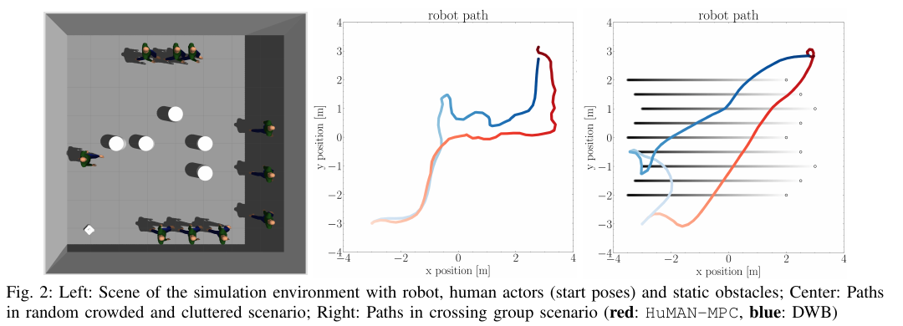
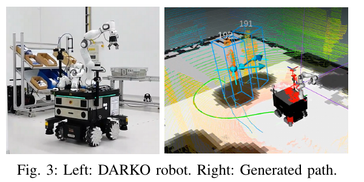

사람을 피하는 로봇은 현재 거리만 볼 수 없어요. 로봇과 사람이 몇 초 뒤 어디에 있을지, 그동안 로봇이 실제로 낼 수 있는 속도와 회전율이 무엇인지 함께 계산해야 해요. HuMAN-MPC는 이 문제를 사람 예측 궤적이 들어간 <abbr title="미래의 여러 제어 입력을 최적화하고 첫 입력만 적용한 뒤 다시 푸는 제어 방법">모델 예측 제어</abbr>로 만들고, 제한 시간 안에 실행 가능한 해를 찾지 못하면 보호 정지로 넘겨요.

## 목표·조작량·장애물·사람을 하나의 예측 문제로 묶어요

최적화 문제의 상태에는 로봇 자세와 운동 상태가, 결정 변수에는 예측 구간의 제어 입력이 들어가요. 비용함수는 목표까지의 오차, 제어 입력의 크기와 변화, 장애물과 사람에 대한 접근을 함께 계산해요. 정적 장애물의 최근접 거리는 부드러운 비용으로 다루고, 사람과의 거리는 더 강한 제약으로 둬요. 목표 추종과 사회적 여유가 같은 시간축에서 경쟁하게 돼요.

사람 입력은 센서 원본이 아니라 미래 궤적이에요. 논문 실험에서는 등속도 예측기를 사용해 현재 위치와 속도에서 미래 위치를 외삽해요. 계획기는 이 예측이 이미 제공된다는 가정 아래 작동해요. 사람 검출, 추적, 속도 추정, 궤적 예측이 틀리면 최적화가 수학적으로 잘 풀려도 현실의 사람과 거리가 달라질 수 있어요.

<figure class="fig"><figcaption>예측 구간의 사람 위치와 정적 장애물을 함께 두고 로봇의 상태·제어열을 최적화해요. (출처: Hielscher et al., LHMP Workshop at ICRA 2024, Fig. 2 · CC BY 4.0)</figcaption></figure>

논문의 사람 인지 비용은 두 번 미분할 수 있고 헤시안이 양의 준정부호가 되도록 설계돼요. 이는 사회적 선호의 철학보다 수치 최적화의 안정성과 관련이 커요. 급격한 절댓값이나 불연속 조건은 반복 최적화가 방향을 찾기 어렵게 만들 수 있어요. 부드러운 비용은 해를 빠르게 갱신하는 데 유리하지만, 사람의 선호가 실제로 매끄럽다는 뜻은 아니에요.

정적 장애물과 사람을 다르게 취급한 점도 중요해요. 정적 장애물 거리 (d_s)는 소프트 비용이라 상황에 따라 가까워지는 해가 남을 수 있고, 사람 거리 (d_h)는 하드 제약으로 표현돼요. 논문 설정은 둘 다 0.5m 기준을 사용하지만 최적화에서의 역할은 같지 않아요. 하드 제약은 실행 가능한 해의 경계를 만들고, 소프트 비용은 여러 해 사이의 선호를 바꿔요.

## SQP-RTI는 매 제어 주기에 한 번의 빠른 갱신을 노려요

HuMAN-MPC는 acados와 HPIPM을 사용하고, 부분 축약을 포함한 <abbr title="비선형 문제를 매 주기 국소 이차 문제로 근사해 한 번 빠르게 갱신하는 기법">SQP-RTI</abbr>로 문제를 풀어요. 긴 비선형 최적화를 매번 완전히 수렴시키기보다, 이전 해를 시작점으로 삼아 현재 관측에 맞춘 실시간 반복을 수행해요. 이동 로봇의 짧은 제어 주기에 맞추려는 선택이에요.

논문 설정의 예측 지평은 5초이고 노드는 50개예요. 노드 간격을 균등하다고 보면 약 0.1초마다 상태를 확인하는 셈이에요. 설명용으로 로봇이 0.8m/s로 움직인다면 한 노드 사이에 0.08m를 이동해요. 그러나 실제 충돌 제약은 노드 시점 사이의 연속 궤적까지 자동 보장하지 않아요. 빠른 회전이나 상대 접근에서는 중간 시각의 최소 거리를 별도로 확인해야 해요.

사람 수 5·10·20·30명에서 보고된 평균 반복 시간은 각각 2.47·3.08·3.92·4.75ms예요. 이 수치는 Intel Core i7-10850H, 32GB 메모리, Quadro RTX 3000을 갖춘 PC에서 얻었어요. 사람 수가 여섯 배가 되어도 평균 시간이 두 배 미만으로 늘어난 결과는 계산 구조가 잘 확장됨을 보여주지만, 저전력 보드나 로봇 온보드 컴퓨터의 지연을 대신 측정하지는 않아요.

평균 시간만으로 제어 주기 충족을 판단할 수도 없어요. 20Hz 제어라면 한 주기 예산은 50ms지만, 센서 처리·추적·TF·예측·최적화·명령 전달이 모두 그 안에 들어가야 해요. 최적화 평균 4.75ms가 짧아도 간헐적 최댓값이 50ms를 넘거나 앞단이 밀리면 오래된 상태로 제어해요. P95·P99·최대 시간과 입력 데이터의 나이를 함께 기록해야 해요.

## 실행 가능성 감시는 수치 실패를 멈춤으로 바꿔요

논문 시스템은 최적화가 제한 시간 안에 해를 내지 못하거나 실행 불가능 상태를 반환하는 경우를 감시해요. 안전한 해를 찾지 못하면 보호 정지를 요청해요. 이는 해가 없는 상황에서 이전 속도 명령을 계속 보내는 실패를 막는 중요한 시스템 경계예요. 계획기 성공과 실패를 명시적인 상태로 만든다는 점에서 의미가 있어요.

하지만 보호 정지가 곧 물리 안전 보장은 아니에요. 로봇이 이미 움직이고 있다면 정지 명령이 적용되기까지 지연과 제동 거리가 필요해요. 센서가 사람을 놓치면 최적화 문제에는 충돌 제약 자체가 없을 수 있고, 그 경우 계산기는 정상 해를 반환해요. 실행 가능성 감시는 “주어진 모형과 관측에서 해를 계산했는가”를 보며, 관측 밖의 사람과 실제 제동 한계를 증명하지 않아요.

설명용으로 로봇 속도가 1.0m/s, 전체 실패 감지와 명령 적용 지연이 0.15초, 최대 감속도가 1.5m/s²라고 가정해요. 반응 거리는 0.15m, 일정 감속 제동 거리는 (1^2/(2×1.5)), 약 0.33m라 합계는 약 0.48m예요. 사람 거리 제약 0.5m와 거의 같아요. 이는 논문 로봇의 측정값이 아니라 제약 거리와 실제 정지 성능을 함께 실측해야 한다는 설명용 계산이에요.

보호 정지 검증에는 적어도 네 가지 고장 주입이 필요해요. 계산 시간을 일부러 지연시키는 경우, 사람 제약을 서로 모순되게 만드는 경우, 초기 상태를 장애물 안에 두는 경우, 예측 메시지를 오래된 상태로 멈추는 경우예요. 각 경우에 계획 상태가 실패로 바뀌는 시간, 마지막 정상 속도 명령, 정지 명령, 실제 속도 0 도달 시간을 기록해요. 실패를 감지했다는 로그만으로는 로봇이 멈췄다고 말할 수 없어요.

## 사람 예측 오차는 지평을 따라 커져요

등속도 예측은 사람이 같은 방향과 속도로 걷는 짧은 구간에서는 단순하고 빠른 기준이 돼요. 사람이 멈추거나 방향을 바꾸거나 로봇에 반응하면 오차가 커져요. 5초 지평 끝의 예측을 현재 측정만큼 신뢰하면, 멀리 있는 잘못된 궤적 때문에 불필요하게 우회하거나 실제 전환을 늦게 볼 수 있어요.

설명용으로 속도 추정의 방향 오차가 10도이고 보행 속도가 1.2m/s라고 두면 3초 뒤 횡방향 차이는 (1.2×3×\sin 10°), 약 0.63m예요. 사람 거리 기준 0.5m보다 커요. 이 값은 논문 데이터의 오차가 아니라 작은 각도 오차가 긴 지평에서 어떻게 확대되는지 보여줘요. 예측 시각별 공분산이나 오차 경계를 비용과 제약에 반영할 이유예요.

관측에서 사람 속도를 만드는 창 길이도 영향을 줘요. 짧은 창은 방향 전환을 빨리 따라가지만 위치 노이즈에 민감하고, 긴 창은 매끄럽지만 급정지를 늦게 반영해요. 0.2·0.5·1.0초 창을 비교하면서 예측 오차와 최적화 해의 변화량을 함께 측정하면 어느 지연이 위험한지 볼 수 있어요. 단일 평균 위치 오차보다 충돌 시나리오에서의 최소 거리 하위값이 더 중요한 지표예요.

예측기를 바꾸어도 계획기 비교가 공정하려면 출력 계약을 맞춰야 해요. 모든 예측기가 같은 좌표계, 같은 타임스탬프, 같은 50개 시각, 같은 사람 ID를 제공해야 해요. 누락된 사람을 0으로 채우거나 마지막 위치로 유지하는 차이가 있으면 MPC의 성능 차이가 예측 알고리즘보다 인터페이스 처리에서 생길 수 있어요.

## 시뮬레이션 행동과 실물 기능 확인의 무게가 달라요

행동 평가는 주로 Gazebo의 TurtleBot3에서 이뤄져요. 여러 사람과 교차하거나 마주 오는 장면에서 경로가 사람을 피하고 목표로 이어지는지를 보여줘요. 실제 DARKO 로봇에서도 기능을 확인하고 충돌 없이 매끄럽게 움직였다고 보고하지만, 대규모 반복 통계나 자원·지연 분포를 제시한 실물 성능 연구는 아니에요. 2024년 워크숍 논문이라는 범위도 함께 봐야 해요.

<figure class="fig"><figcaption>DARKO 플랫폼의 실물 시험은 통합 가능성을 보여주지만, 다양한 사람 행동과 지연에 대한 반복 안전 통계는 별도 과제로 남아요. (출처: Hielscher et al., LHMP Workshop at ICRA 2024, Fig. 3 · CC BY 4.0)</figcaption></figure>

실물 재현은 낮은 속도에서 예측과 제어 로그를 먼저 맞추는 편이 좋아요. 사람의 실제 사후 궤적과 당시 예측 궤적을 같은 시각축에 그리고, MPC가 선택한 로봇 예측 궤적과 실제 주행 궤적을 겹쳐요. 예측이 맞았는데 로봇이 벗어났다면 제어·동역학 문제이고, 로봇이 계획을 따라갔는데 사람이 제약 안으로 들어왔다면 예측·상호작용 문제예요.

논문은 ROS 2 제어기 플러그인과 ROS move_base용 플러그인 통합을 제시해요. 이식할 때는 두 프레임워크의 속도 명령 주기, 취소 의미, 목표 갱신, 장애물 표현이 같은지 확인해야 해요. 계획기가 정지 상태를 반환했는데 상위 계층이 이전 명령을 유지하는 인터페이스 오류가 있으면 내부 감시가 무력해져요. 마지막 명령 만료 시간을 명시하고 감시 타이머로 확인해야 해요.

## 하드 제약도 입력과 모형 안에서만 단단해요

사람 거리 하드 제약은 최적화된 예측 상태가 (d_h) 밖에 있도록 요구해요. 실제 로봇의 위치 오차, 사람 위치 오차, 추종 오차가 있으면 현실의 간격은 더 작을 수 있어요. 세 오차를 모두 0으로 보는 대신 안전 여유를 오차 예산으로 나누는 검증이 필요해요.

설명용으로 사람 위치 오차 0.15m, 로봇 위치 오차 0.10m, 경로 추종 오차 0.12m의 최대 범위을 단순 합산하면 0.37m예요. 0.5m 제약 중 확실히 남는 기하 여유는 0.13m뿐이에요. 오차가 항상 같은 방향으로 더해지는 보수 계산이라 실제 분포와 다르지만, 제약 숫자만 보고 0.5m가 현실에서도 보장된다고 말할 수 없는 이유를 보여줘요.

정적 장애물 비용이 소프트하다는 점도 로그에서 드러내야 해요. 좁은 길에서 목표·사람 제약을 만족하려고 벽 비용을 감수하는 해가 나올 수 있어요. 정적 충돌을 별도 충돌 검사기가 막는다면 그 개입을 기록하고, 없다면 비용 가중치 변화에 따른 최소 장애물 거리를 시험해야 해요. 사람 안전을 위해 벽과 충돌하는 해는 유효한 사회적 주행이 아니에요.

해가 존재해도 국소 최적화는 다른 경로 계열을 찾지 못할 수 있어요. 사람 무리의 왼쪽과 오른쪽 중 이전 해가 왼쪽에 머물면, 오른쪽이 열려도 같은 쪽에서 정체될 수 있어요. 서로 다른 초기 경로를 여러 개 넣는 시험, 목표가 반대편으로 바뀌는 시험, 좁은 통로에서 사람이 멈추는 시험으로 국소해 의존성을 볼 수 있어요. 계산 시간과 경로 품질 사이의 선택도 이 지점에서 나타나요.

## 비교 실험은 예측기와 최적화기를 분리해요

HuMAN-MPC의 효과를 확인하려면 네 조합이 유용해요. 등속도 예측과 사람 제약을 모두 쓰는 조건, 같은 예측을 쓰되 사람 비용만 제거한 조건, 완벽한 사후 궤적을 예측처럼 제공하는 이상적 조건, 의도적으로 지연된 예측을 쓰는 조건이에요. 같은 초기 장면에서 비교하면 계획 구조의 이득과 예측 오차의 손실을 나눌 수 있어요.

평가 지표에는 성공률과 충돌률 외에 최소 사람 거리, 정적 장애물 최소 거리, 제어 입력 변화량, 보호 정지 횟수, 최적화 실패율, 입력 나이, 반복 시간 분포가 필요해요. 사람에게 길을 양보하느라 멈춘 것과 계산 실패로 멈춘 것을 같은 정지로 세면 안 돼요. 상태 코드와 원인을 함께 저장해야 해요.

## 상대가 로봇에 반응할 때 예측 고리가 달라져요

등속도 예측은 사람의 미래가 로봇 행동과 무관하다고 놓아요. 실제 복도에서는 사람이 로봇의 진행 방향을 보고 속도를 줄이거나 같은 쪽으로 피할 수 있어요. MPC가 오른쪽으로 피한 뒤 사람이 같은 오른쪽으로 움직이면 다음 주기 계획이 다시 왼쪽으로 바뀌고, 서로 같은 방향을 반복해 고르는 진동이 생길 수 있어요. 독립 예측에서 좋은 궤적이 상호작용하는 폐루프에서도 좋은지는 별도 질문이에요.

이를 확인하려면 녹화 궤적 재생과 반응형 사람 모형을 나눠 시험해요. 녹화 궤적은 모든 계획기가 같은 사람 움직임을 보므로 경로 비용 비교에 유리해요. 반응형 모형은 로봇 행동에 따라 사람의 다음 상태가 달라져 실제 상호작용을 더 잘 드러내지만, 방법별 입력 자체가 달라져 단순 평균 비교가 어려워져요. 두 결과를 한 표에 섞지 않고 고정 궤적 성능과 폐루프 안정성으로 구분해야 해요.

설명용으로 사람과 로봇이 마주 오며 둘 다 매 0.5초마다 상대의 반대쪽을 선택한다고 해볼게요. 통신은 없지만 관측과 재계획이 같은 주기를 가지면 좌우 선택이 번갈아 나타날 수 있어요. 로봇 제어 입력의 횡방향 부호 변화 횟수와 사람 궤적의 같은 값을 함께 세면 이런 상호 진동을 찾을 수 있어요. 최소 거리만 보면 충돌하지 않은 진동을 놓칠 수 있어요.

사람의 반응을 모형에 넣지 않더라도 계획 변화에 관성을 줄 수 있어요. 이전 경로와의 차이에 비용을 주거나, 명백한 위험이 없을 때 통과 방향을 잠시 유지하는 방법이 있어요. 다만 유지가 너무 강하면 사람이 실제로 방향을 바꿨을 때 늦게 반응해요. 방향 유지 시간과 예측 오차를 함께 바꾸는 격자 시험으로 안정성과 민첩성 사이의 경계를 찾아야 해요.

## 시간 정렬 오류를 위치 오차와 구분해요

사람 위치와 로봇 위치가 같은 좌표계여도 측정 시각이 다르면 상대 위치가 틀려요. 예를 들어 사람 추적 결과는 200ms 전인데 로봇 자세는 현재 값이면, 움직이는 사람만 과거에 남아 있는 합성 장면이 돼요. TF 변환이 성공했다는 사실은 두 데이터가 같은 시각이라는 뜻이 아니에요.

설명용으로 사람이 횡방향 1.5m/s로 걷고 추적 메시지가 200ms 오래됐다면 횡방향 위치는 0.30m 뒤처져요. 검출기의 공간 오차가 0.10m여도 시간 오차가 세 배 더 클 수 있어요. 모든 입력에 센서 시각을 보존하고, 계획 기준 시각으로 외삽하거나 오래된 입력을 거절해야 해요. 논문 수치가 아니라 시간 정렬 시험의 크기를 정하기 위한 계산이에요.

재생 시험에서 위치에 인위적 가우시안 노이즈를 넣는 조건과 타임스탬프만 늦추는 조건을 분리하면 두 실패의 모양이 달라져요. 위치 노이즈는 경로를 잘게 흔들고, 일정 지연은 회피 시작을 체계적으로 늦출 가능성이 커요. 최소 거리, 회피 시작 시각, 제어 변화량을 함께 보면 어느 오차가 지배적인지 알 수 있어요. 실제 시스템 최적화는 가장 큰 오차 원인을 먼저 줄이는 순서로 진행해야 해요.

[[2026-10-17_socialnav_constrained-social-optimization|적응형 제약이 사람 예측 불확실성을 다루는 방식]]은 예측 공분산과 완화 변수를 이용해 제약의 강도를 조절하는 방향을 더 넓게 비교해요. HuMAN-MPC는 빠른 반복 최적화와 실행 가능성 감시를 선명하게 보여주지만, 등속도 예측의 불확실성을 조건부 안전 보장으로 바꾸지는 않아요. 두 접근을 비교하면 빠른 해법, 예측 오차 표현, 제약 완화가 서로 다른 설계 축임이 보여요.

HuMAN-MPC의 핵심은 사람 인지 비용 하나보다 전체 실행 고리에 있어요. 예측 궤적을 받고, 5초 구간의 로봇 행동을 빠르게 최적화하며, 해가 없거나 늦으면 보호 정지로 전환해요. 실제 안전성은 이 고리 앞의 검출·추적·예측과 뒤의 명령 적용·제동까지 포함해 확인해야 해요. 워크숍 논문의 실물 결과는 통합 가능성을 보여주는 출발점이고, 지연과 실패 주입을 포함한 반복 검증이 다음 단계예요.

---
<!-- src-block -->
출처 — https://arxiv.org/abs/2405.12616
