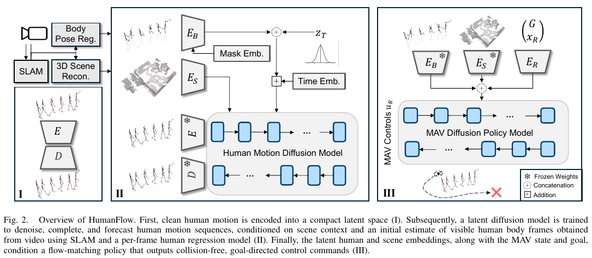
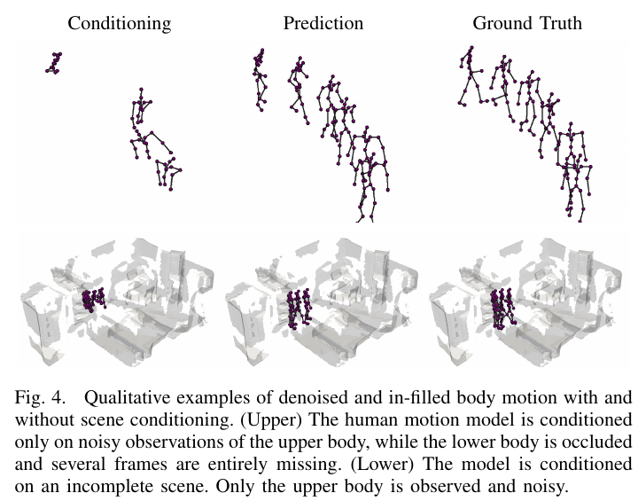

사람의 다리가 가구 뒤에 가려졌을 때 로봇은 보이는 어깨만으로 몸 전체의 위치와 다음 움직임을 추정해야 할 수 있어요. 사람 중심점 하나를 현재 위치에 표시하는 것보다 많은 정보가 필요한 문제입니다. Schaefer 등의 2026년 연구 <abbr title="주변 삼차원 장면을 함께 보며 가려진 사람의 전신 동작을 복원하고 미래 동작과 비행 제어를 연결하는 학습 방법">HumanFlow</abbr>는 이런 부분 관측에서 사람 동작과 제어를 함께 다뤄요.

## 사람 동작을 압축한 표현으로 제어와 연결해요

<figure class="fig"><figcaption>사람 동작을 표현하는 부분과 그 표현을 사용하는 비행 정책을 연결한 원문 전체 구조예요. (출처: Schaefer·Näf·Leutenegger, HumanFlow, Fig. 2; 원문 부분 인용, 공개 CC 재사용 허가 미확인)</figcaption></figure>

HumanFlow는 사람 동작을 압축한 <abbr title="긴 관측과 동작 정보를 모델이 사용하기 쉬운 작은 수치 묶음으로 바꾼 내부 표현">잠재 표현</abbr>에서 확산 모델로 복원과 예측을 수행합니다. 장면의 점유·빈 공간·미관측 영역을 구분해 조건으로 사용하고, 이 표현을 <abbr title="작은 무작위 비행 명령 묶음을 원하는 명령 분포 쪽으로 옮기는 변화를 학습하는 생성 방식">흐름 정합</abbr> 기반 비행 정책에 연결해요. 한 번 예측한 관절 좌표만 넘기는 구성과 다른 연결입니다. 논문의 제어 대상은 <abbr title="작은 크기의 비행 로봇을 뜻하는 약어">MAV</abbr>이며, 지상 로봇의 평면 속도 정책으로 바로 바꿔 읽을 수는 없습니다.

잠재 표현을 쓴다는 것은 모든 정보를 그대로 보존한다는 뜻이 아닙니다. 학습 목적에 필요한 구조를 작은 수치 묶음으로 압축하는 선택이에요. 사람이 잠시 멈췄다가 돌아서는 차이처럼 제어에 중요한 정보가 잘 담기는지 결과로 확인해야 합니다. 크기가 작아졌다는 설정값만으로 불확실성이 적절히 표현됐다고 판단하기는 어려워요.

## 전신 동작은 중심점보다 넓은 공간을 차지해요

사람을 하나의 원으로 나타내면 이동 방향과 거리 계산은 간단해집니다. 그러나 팔을 뻗거나 앉고 일어나는 동작은 중심점이 거의 같아도 몸이 차지하는 공간을 바꿔요. 비행 로봇은 그 위아래를 움직일 수 있어서 높이 변화도 중요합니다. 전신 관절을 다루는 연구가 묻는 질문은 평면 보행 궤적 예측보다 넓어요.

설명용으로 사람 중심이 멈춘 채 팔만 옆으로 0.4미터 뻗는 장면을 가정하겠습니다. 중심점 이동량은 거의 없지만 로봇과 가까운 관절은 크게 움직일 수 있어요. 반대로 중심이 이동해도 팔을 몸 쪽으로 당기면 특정 높이에서의 여유는 커질 수 있습니다. 이 수치는 실제 사람 동작의 측정값이 아니라 중심점 표현의 한계를 설명하는 입력입니다.

전신 표현을 사용하면 관절 사이의 관계도 필요해져요. 각 관절을 독립적으로 추정하면 뼈 길이가 프레임마다 바뀌거나 발이 바닥을 미끄러질 수 있습니다. 관절 위치 오차와 동작의 물리적 일관성을 함께 봐야 하는 이유예요. 좌표의 평균 오차가 작아도 부자연스러운 변화가 제어 명령을 흔들 수 있습니다.

## 가림 복원은 보이지 않은 새 사람의 발견과 달라요

몸 일부가 가려진 사람의 동작을 복원하려면 어떤 사람이 관측되고 있다는 전제가 있을 수 있습니다. 어깨와 팔에서 나머지 관절을 추정하는 일과, 카메라에 전혀 나타나지 않은 새 사람의 존재를 발견하는 일은 다른 문제예요. 누락된 관절을 잘 채웠다는 결과를 사람 검출 누락 전체의 해결로 확대하면 안 됩니다. 입력에서 무엇이 알려졌고 무엇이 가려졌는지 확인해야 해요.

설명용으로 같은 장면을 세 조건으로 나눌 수 있습니다. 첫 조건은 전신 관절이 조금씩 흔들리는 입력, 둘째는 하체 관절이 연속해서 빠지는 입력, 셋째는 사람 자체의 관측이 처음부터 없는 입력입니다. 셋은 모두 ‘잘 안 보인다’고 표현할 수 있지만 사용할 단서가 달라요. 조건을 섞어 한 정확도로 보고하면 모델이 복원한 정보의 범위를 알기 어렵습니다.

추적 대상이 이미 있더라도 오래 가려지면 여러 움직임이 가능해집니다. 멈췄는지, 돌아섰는지, 같은 속도로 계속 갔는지 보이지 않는 동안의 정답은 하나로 주어지지 않아요. 복원 모델이 매끄러운 동작을 만들었다는 사실과 실제 사람이 그 동작을 했다는 사실을 나눠야 합니다. 그 차이는 제어에 넘길 불확실성을 판단하는 근거입니다.

## 장면 정보는 가능한 동작의 범위를 바꿔요

벽과 가구가 있는 공간에서 사람은 물체를 통과할 수 없습니다. 과거 동작만 보면 가능해 보이는 다음 위치가 장면 기하와 충돌할 수 있어요. 반대로 빈 공간에 관한 단서가 있으면 여러 후보 중 그쪽 동작에 더 큰 비중을 둘 수 있습니다. 사람과 주변 공간을 함께 조건으로 사용하는 원리를 이렇게 이해할 수 있어요.

관측되지 않은 공간은 빈 공간과 같지 않습니다. 카메라 뒤쪽이나 가구 뒤가 측정되지 않았다고 해서 자유롭게 통과할 수 있다는 증거는 없어요. 세 종류를 구분한 장면 표현은 이런 혼동을 줄일 수 있는 설계입니다. 다만 그 표현을 만드는 삼차원 재구성 자체에 오차가 있으면 조건도 틀릴 수 있어요.

설명용 검증으로 같은 사람 동작에 벽의 위치만 바꾼 장면을 넣을 수 있습니다. 예측 동작이 새 벽을 통과하는지, 벽과 멀리 떨어진 관절까지 불필요하게 바뀌는지 비교해요. 이어 벽의 일부를 미관측으로 바꾸면 확정 점유와 정보 부족을 다르게 처리하는지 볼 수 있습니다. 장면을 입력으로 받았다는 사실보다 결과가 어떤 조건에 반응하는지를 확인하는 시험입니다.

## 원그림은 불완전 입력과 복원 결과를 함께 보여 줘요

<figure class="fig"><figcaption>위쪽은 장면 조건 없이 가려진 하체와 누락 프레임을 채운 예시, 아래쪽은 불완전한 삼차원 장면을 함께 준 예시예요. 보이는 입력과 모델이 만든 동작, 정답을 구분해 읽어야 합니다. (출처: Schaefer·Näf·Leutenegger, HumanFlow, Fig. 4; 원문 부분 인용)</figcaption></figure>

복원 그림을 볼 때는 오른쪽 결과만 보지 않고 왼쪽 입력의 범위를 먼저 확인하는 편이 좋아요. 어느 관절이 실제로 보였는지, 어떤 프레임이 빠졌는지에 따라 문제 난도가 달라집니다. 정답과 비슷한 한 장면만으로 모든 가림 조건에서 같은 정확도를 기대할 수는 없어요. 가림 길이와 관측 부위별 결과를 나눠야 합니다.

예측이 자연스러워 보여도 순간적인 오차가 클 수 있습니다. 긴 시간 평균에서는 작은 차이지만 특정 프레임에서 팔 위치가 갑자기 바뀌면 로봇의 회피 명령은 크게 달라질 수 있어요. 관절 평균 오차, 가속도 변화와 제어 결과를 연결하면 시각적 자연스러움과 동작 안정성 사이의 관계를 살펴볼 수 있습니다. 매끄러운 애니메이션은 판단의 출발점이지 전체 성능 지표가 아니에요.

## 추적과 예측을 한 표현에 담는 선택

추적은 이미 관측한 과거와 현재를 더 정확하게 추정하는 문제이고, 예측은 아직 일어나지 않은 미래를 추정하는 문제입니다. 같은 사람 동작의 시간적 구조를 사용하지만 정답을 확인할 수 있는 시점은 달라요. 둘을 같은 모델에서 다루면 연속성을 공유할 수 있는 반면, 어느 단계에서 오차가 줄었는지 평가를 나눠야 합니다.

설명용으로 과거 관절을 부드럽게 만드는 처리만으로 현재 추적 오차가 줄어든 경우를 생각할 수 있어요. 이 결과가 미래 방향 전환도 잘 예측한다는 뜻은 아닙니다. 반대로 미래 평균 위치가 맞아도 현재 관절이 흔들리면 즉시 제어에는 나쁜 입력이 될 수 있어요. 추적과 미래 시점별 오차를 별도로 보고하는 이유입니다.

가림 프레임을 복원한 값을 다음 예측의 입력으로 다시 쓰는 설계에서는 오류가 누적될 가능성도 확인할 수 있습니다. 한 번 잘못 채운 방향이 이후 동작의 문맥이 될 수 있기 때문입니다. 마지막 실제 관측과 모델이 채운 관측을 기록에서 구분하면 이런 연쇄를 찾기 쉬워요. 모델 출력이 다음 단계에서 새 센서 관측처럼 취급되는지 점검할 수 있습니다.

## 여러 미래를 하나의 평균으로 합치면 공간이 달라져요

사람이 의자를 왼쪽으로 돌거나 오른쪽으로 돌 수 있는 장면에서는 두 미래가 모두 가능할 수 있습니다. 두 경로의 평균이 의자 중앙을 가리키면 어느 실제 경로도 아닌 움직임이 생겨요. 예측 분포를 다루는 모델을 볼 때는 평균 오차만 작은지보다 가능한 여러 움직임이 남는지도 중요합니다. 제어기가 그 다양성을 어떻게 사용하는지가 다음 질문이에요.

설명용으로 두 미래에서 같은 시각의 사람 위치가 좌우로 각각 0.8미터 떨어져 있다고 가정하면 평균은 중앙입니다. 로봇이 중앙을 비어 있다고 보거나 반대로 중앙만 막았다고 보면 두 경우 모두 원래 분포의 정보를 놓칩니다. 이 숫자는 논문 실험이 아닌 다중 미래와 평균 경로의 차이를 설명하는 입력이에요. 예측 표본 수를 늘리는 것과 의미 있는 여러 행동을 얻는 것도 같지 않습니다.

제어 비교에서는 같은 관측에 단일 예측 좌표를 넣은 경우와 압축 표현을 넣은 경우를 나눌 수 있어요. 모델 크기나 입력량이 함께 달라지면 표현의 장점과 용량의 효과가 섞입니다. 비교 구조와 학습 데이터를 맞춘 대조가 필요해요. 내부 표현이 좋다는 해석은 제어 결과와 이런 대조 조건을 함께 볼 때 설득력이 생깁니다.

## 비행 명령을 배우는 단계와 동작 복원은 다른 출력이에요

사람 동작 모델의 출력은 사람이 어떻게 움직일지에 관한 정보입니다. 비행 정책의 출력은 로봇을 움직이는 명령이에요. 동작 복원이 좋아져도 비행 동역학이나 목표 조건을 잘못 사용하면 회피가 실패할 수 있습니다. 인지와 제어를 연결했다는 말이 두 단계를 같은 문제로 만드는 것은 아닙니다.

이 연구는 계산한 제어 자료를 학습하는 근사 <abbr title="현재 상태에서 여러 미래의 움직임을 계산해 제약을 지키며 목표로 가는 명령을 정하는 제어 방식">모델예측제어</abbr> 정책을 사용합니다. 학습된 생성 정책은 입력 상태와 목표에 맞는 명령 분포를 만드는 역할을 해요. 원래 최적화 문제에서 제약을 사용했다는 사실과 근사 정책이 모든 입력에서 제약을 만족한다는 주장은 구별해야 합니다. 학습 자료에 없는 입력에서도 같은 관계가 성립하는지는 결과로 확인할 문제예요.

설명용으로 목표가 가까운 상태만 많이 포함된 자료와 긴 이동을 포함한 자료를 비교할 수 있습니다. 같은 제어 구조여도 급한 방향 전환이나 가림의 길이가 달라지면 실패 양상이 바뀔 수 있어요. 동작 모델을 고정하고 정책 학습 조건만 바꾸면 어느 출력에서 차이가 났는지 분리하기 쉽습니다. 여러 단계를 함께 바꾸고 최종 점수만 비교하면 연결의 어느 부분이 기여했는지 알기 어렵습니다.

## 논문의 정량 결과는 시뮬레이션 조건에 묶여 있어요

정책 평가는 실제 사람 동작 자료 50개를 시뮬레이션에 재생하고, 0.1초 간격 20시점의 예측 구간을 사용합니다. 사람 관절에서 최소 0.5미터를 유지한 궤적 비율을 안전 지표로 삼고, 표의 최종 방법은 무잡음과 잡음 조건에서 100%를 보고해요. 실험은 RTX A4000 환경이며 실제 사람과 비행한 사용자 연구는 아닙니다. 이 값은 해당 재생·초기화·잡음 조건에서 관찰한 결과로 읽어야 합니다.

관절과의 거리는 사람 몸 전체 표면과의 거리와 같지 않을 수 있어요. 관절 사이의 팔이나 몸통 부피, 로봇의 외곽, 회전 중에 훑는 공간이 어떻게 표현됐는지에 따라 접촉의 의미가 달라집니다. 하나의 거리 지표를 다른 몸체의 실물 충돌 기준으로 옮기려면 기하 조건을 다시 맞춰야 해요. 높은 비율이 나왔다는 사실만으로 새 플랫폼의 물리적 여유가 정해지지는 않습니다.

사람 궤적을 재생하면 같은 움직임에서 정책들을 비교하기 쉽습니다. 그러나 로봇이 다른 행동을 골랐을 때 사람이 놀라거나 양보하는 반응이 새로 생기지는 않아요. 기록된 실제 사람 움직임을 사용한 시뮬레이션과 실제 사람과 닫힌 고리로 상호작용한 실험은 다릅니다. 논문의 제한점도 사람 움직임이 비행 로봇에 의해 바뀌지 않는 가정을 언급합니다.

## 예측 구간과 처리 지연을 같은 시간축에 놓아요

논문의 20시점과 0.1초 간격을 곱하면 명목 예측 구간은 2초입니다. 그러나 관측이 늦게 도착하면 그 2초가 현재보다 과거에서 출발할 수 있어요. 입력의 기준 시각과 로봇의 현재 상태를 맞추지 않으면 긴 예측을 계산해도 가까운 미래에 필요한 정보가 어긋납니다. 예측 길이와 끝에서 끝 지연은 다른 측정값입니다.

설명용으로 사람의 접근 속도를 초당 1.5미터, 전체 입력 지연을 0.3초라고 가정하면 지연 동안 이동은 0.45미터입니다. 처리 모델이 매끄러운 관절을 내더라도 기준 시각을 새 시각으로 덮어쓰면 이 차이가 숨습니다. 이 계산은 해당 연구의 처리 지연 보고가 아니에요. 관측 나이와 예측 구간을 함께 기록할 필요를 설명하는 입력입니다.

여러 장치를 연결할 때는 사람 관측과 장면 재구성, 로봇 자세가 같은 시점을 가리키는지도 확인할 수 있습니다. 오래된 장면과 새 몸체 자세를 섞으면 벽과 사람의 상대 위치가 바뀐 것처럼 보일 수 있어요. 개별 모델 정확도를 높이는 일과 정보 시각을 정렬하는 일은 각각 필요합니다. 하나의 모델 성능표가 이 연결 품질까지 보장하지 않습니다.

## 계산 단계 수는 품질과 함께 비교해야 해요

생성 모델의 반복 정제 단계를 줄이면 계산량을 줄일 수 있습니다. 하지만 모든 단계가 동일하게 불필요한 것은 아니에요. 특정 입력에서는 적은 단계로도 충분하고, 관측이 가려지거나 잡음이 크면 다른 결과가 나올 수 있습니다. 평균 처리량만 비교하면 가장 어려운 입력에서의 품질 손실을 놓칠 수 있어요.

설명용으로 같은 관측 묶음을 적은 반복과 많은 반복에서 각각 계산할 수 있습니다. 동작 오차, 관절 흔들림과 최종 제어의 최소거리를 함께 비교해요. 빠른 복원 결과가 제어에서 더 많은 정지를 만들면 인지 모델만의 속도 향상과 전체 이동 효율이 다릅니다. 반대로 품질 차이가 작다면 반복 수를 줄일 근거를 얻을 수 있어요.

학습에 사용한 그래픽 처리 장치의 이름만으로 소형 컴퓨터에서의 성능을 추정하면 안 됩니다. 입력을 만드는 전처리와 장면 저장, 동작 복원과 명령 생성이 모두 계산 경로에 들어갑니다. 각 단계의 시간과 메모리를 나눠 측정해야 어디를 줄일지 결정할 수 있어요. 이 자료 조사에서는 그런 장치별 실행이나 실제 비행을 수행한 것으로 주장하지 않습니다.

## 지상 로봇에 옮길 수 있는 것은 검증 질문이에요

지상 로봇은 비행 로봇과 다른 운동 제약과 외곽을 갖습니다. 위아래 이동으로 피하는 선택이 없을 수 있고, 바퀴가 낼 수 있는 횡속도도 다를 수 있어요. 비행 명령 정책을 평면 속도로 바꾸는 문제는 별도의 학습과 검증을 요구합니다. 사람 동작 정보를 잘 표현했다는 기여와 제어기의 플랫폼 적합성을 분리해야 해요.

반면 부분 관측을 구별하는 질문은 재사용할 수 있습니다. 관절 누락과 사람 검출 실패, 장면의 빈 공간과 미관측 공간, 단일 미래와 여러 가능한 미래를 나누는 방식이에요. 지상 로봇에서도 어떤 정보를 추정했고 어떤 정보를 관측했는지 기록하면 실패 원인을 좁히기 쉽습니다. 이 구분은 모델의 이름과 관계없이 입력 계약을 시험하는 근거가 됩니다.

HumanFlow는 가려진 전신 동작과 주변 장면을 압축 표현으로 연결하고, 이를 제어 정책의 조건으로 사용하는 연구입니다. 확인된 주행 성과는 실제 사람 동작을 재생한 비행 시뮬레이션의 범위에 있어요. 새로운 플랫폼에서는 관측 생성, 가림 복원, 미래 표현과 명령 실행을 나눠 시험해야 합니다. 사람과 로봇이 서로 반응하는 조건까지 확장할 때도 어느 단계의 근거가 추가됐는지 분명하게 남길 수 있습니다.

공간의 시간 정보를 다루는 다른 층위는 [[2026-10-17_socialnav_stvl|시공간 복셀 계층 STVL이 오래된 장애물을 지우는 방식]]에서 볼 수 있어요. 관측을 얼마나 오래 기억할지 정하는 일과 사람의 다음 동작을 예측하는 일은 다른 시간 방향의 문제입니다.

---

<!-- src-block -->

출처 — https://arxiv.org/abs/2605.25685
