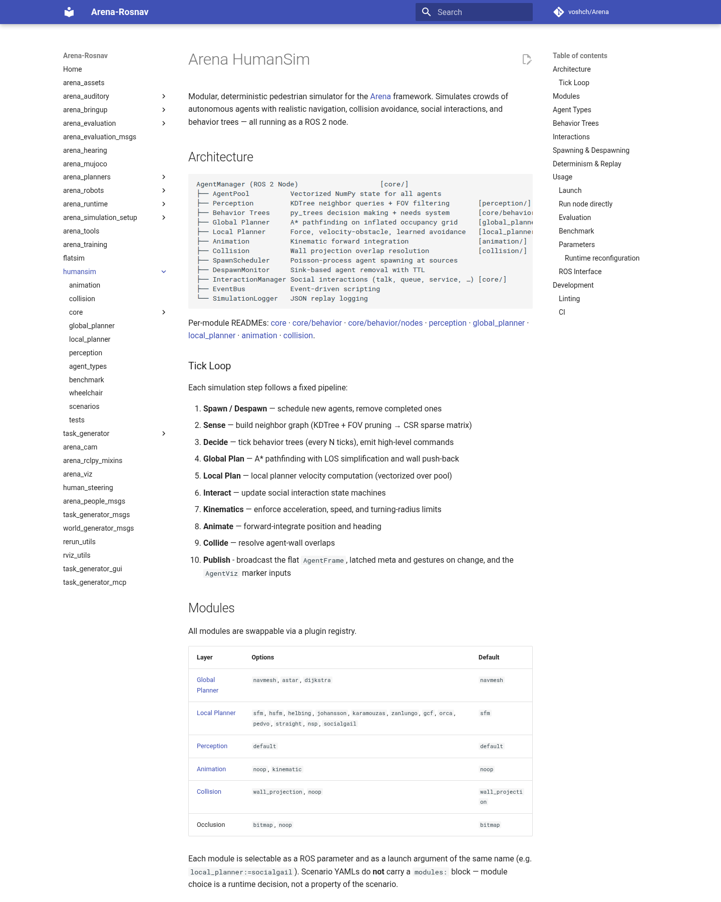

군중 시뮬레이터가 같은 시드에서도 실행할 때마다 다른 사람을 만들면 정책 차이와 입력 차이를 구분하기 어려워요. 반대로 모든 사람이 같은 직선과 속도로 걸으면 대화, 줄서기, 동행처럼 사회적 내비게이션이 어려워지는 장면을 만들 수 없어요. HumanSim은 이 두 요구를 함께 다루려는 ROS 2 사람 시뮬레이션 구성 요소예요.

공식 문서는 HumanSim을 모듈식이며 결정론적인 보행자 시뮬레이터로 설명해요. 사람 상태 묶음, 근처 사람 탐색, 행동 트리, 전역·지역 경로 계획, 상호작용, 충돌 해소, 유입·퇴장, 기록 재생을 한 노드 안에서 일정한 순서로 실행해요. 다만 이 자료는 구현 문서예요. 실제 보행자 연구에서 모든 사람 행동 모형의 현실성을 검증했다는 동료평가 논문으로 읽으면 안 돼요.

<figure class="fig"><figcaption>사람 상태 묶음부터 기록기까지의 구성과 매 시점의 열 단계 처리 순서, 선택 가능한 경로 계획기가 한 페이지에 정리돼 있어요. (출처: voshch/Arena HumanSim 공식 문서 · MIT License)</figcaption></figure>

## 열 단계 순서를 고정해 같은 인과를 만들어요

한 시뮬레이션 시점은 유입·퇴장, 인지, 결정, 전역 경로, 지역 경로, 상호작용, 동역학, 위치 갱신, 충돌 해소, 발행 순서로 진행돼요. 사람을 먼저 추가하고 주변을 찾은 뒤 행동을 고르며, 마지막에 벽 겹침을 바로잡고 상태를 내보내요. 순서를 고정하면 같은 입력에서 어느 단계가 다음 상태에 영향을 주었는지 추적하기 쉬워요.

순서는 결과 자체에도 영향을 줘요. 충돌 해소를 지역 경로 계산보다 앞에 두면 계획기가 보게 되는 위치가 달라지고, 상호작용을 위치 갱신 뒤에 두면 대화 시작 시점이 한 주기 늦어질 수 있어요. 다른 시뮬레이터와 결과를 비교할 때 이름이 같은 사회력 모형만 맞추고 처리 순서를 무시하면 궤적이 달라져요.

기본 시간 간격은 0.05초이고 행동 트리는 다섯 시점마다 갱신돼요. 기본값 그대로면 위치·속도는 초당 20회 계산하고 고수준 행동 결정은 초당 4회 이뤄져요. 이 계산은 문서 기본값에서 나온 값이에요. 실행 중 시간 배율이나 외부 시계를 바꾸면 벽시계 기준 처리율은 달라질 수 있어요.

행동 결정을 매 시점 수행하지 않는 것은 계산량을 줄이고 고수준 행동이 지나치게 흔들리는 것을 막을 수 있어요. 그러나 0.25초 사이에 새 장애물이 나타나면 현재 행동 트리는 다음 갱신까지 이전 결정을 유지할 수 있어요. 지역 경로 계획과 충돌 회피는 더 자주 실행되므로 고수준 반응 지연과 저수준 회피를 따로 측정해야 해요.

## 인지는 시뮬레이터 정답 상태에서 만들어져요

인지 단계는 <abbr title="가까운 점을 빠르게 찾는 공간 검색 자료구조">KDTree</abbr>로 이웃 후보를 찾고, 시야 범위와 시야각으로 거른 뒤 희소 이웃 행렬을 만들어요. 많은 사람 쌍을 모두 비교하지 않고 가까운 후보만 다루려는 구조예요. 사람마다 시야 거리와 각도를 분포에서 뽑을 수 있어 같은 장면에서도 누가 누구를 보는지가 달라져요.

이 인지는 카메라 검출기가 아니에요. 시뮬레이터가 가진 정확한 사람 위치에서 시야 규칙을 적용해요. 가구에 가린 사람을 처리하는 가림 모듈은 있어도 영상 흐림, 낮은 조도, 검출 점수, 추적 식별자 교환이 자동으로 생기지는 않아요. 로봇 정책에 이웃 상태를 넘길 때 정답 기반인지 센서 추정 기반인지 명시해야 해요.

설명용으로 사람 200명을 모두 쌍으로 비교하면 방향을 제외해도 서로 다른 쌍은 19,900개예요. 공간 검색으로 반경 안 평균 이웃이 12명이라면 후보 관계는 방향을 포함해 약 2400개 수준이에요. 실제 계산량은 구현과 밀도에 따라 달라지며, 이 수치는 공간 검색의 목적을 보이는 가정이에요.

시야 필터는 “보이지 않으면 반응하지 않는다”는 모형 가정을 만들어요. 실제 사람은 소리, 기억, 다른 사람의 반응으로 뒤쪽 접근을 알아챌 수 있어요. 시야각만 바꾼 절제 시험과 가림 모듈을 끈 시험을 두면 정책이 완전 상태에 의존하는 정도를 확인할 수 있어요.

## 전역 경로와 지역 회피를 독립적으로 바꿔요

전역 경로는 내비게이션 메시, A*, 다익스트라 방식에서 고를 수 있고 기본은 내비게이션 메시예요. 지역 경로는 사회력 계열, 속도 장애물 계열, 직선 이동, 학습형 방식 등 여러 구현을 선택할 수 있으며 기본은 사회력 모형이에요. 장면 파일이 경로 계획기를 고정하지 않고 실행 인자로 선택한다는 점이 실험 비교에 유용해요.

전역 경로 설정에는 격자 해상도 0.2m, 벽 팽창 반경 0.38m, 내비게이션 메시의 선호 벽 여유 0.6m가 기본값으로 제시돼요. 좁은 통로에서는 선호 여유를 완화할 수 있어요. 경로가 만들어졌다고 실제 사람 몸체가 지나갈 수 있다는 뜻은 아니므로 사람 반경과 벽 여유를 함께 봐야 해요.

설명용으로 폭 1.0m 복도 양쪽에 0.38m씩 팽창을 적용하면 중심선에 남는 폭은 0.24m예요. 반경 0.25m 사람의 지름은 0.5m이므로 단순 격자 팽창 해석에서는 통과가 막힐 수 있어요. 실제 내비게이션 메시의 완화 규칙과 충돌 형상은 더 복잡하며, 이 계산은 매개변수 상호작용을 확인하는 가정이에요.

지역 경로 계획기를 바꿀 때 사람 유형의 반발 세기, 완화 시간과 계획기 전용 매개변수가 어떻게 적용되는지 확인해야 해요. 실행 중 기본 계획기를 바꾸면 기본값을 따르던 사람은 새 계획기로 옮겨 가지만, 생성 요청이나 사람 유형에서 계획기를 명시한 사람은 유지돼요. 한 장면에 여러 계획기가 섞일 수 있으므로 발행된 정책 색인도 기록해야 해요.

## 사람 유형은 하나의 값보다 분포로 정의해요

사람 유형 파일은 희망 속도, 반경, 시야, 지역 경로 매개변수, 욕구의 초기값과 감소율을 분포로 적어요. 기본 문서 예시의 성인은 희망 속도 평균 1.1m/s, 표준편차 0.12m/s, 0.5~1.5m/s 범위를 써요. 반경은 평균 0.25m, 표준편차 0.02m예요. 포함된 기본 유형으로 성인과 노인이 제시돼요.

분포 표본은 같은 유형 안의 이질성을 만들어요. 모든 사람이 정확히 1.1m/s로 걷는 장면보다 추월과 군집 간격이 다양해질 수 있어요. 그러나 분포 이름이 실제 연령 집단을 대표한다는 보장은 없어요. 평균과 범위의 출처, 단위, 문화권과 공간 조건을 따로 검증해야 해요.

유형은 다른 유형을 상속할 수 있어 공통 매개변수를 재사용해요. 상속은 편하지만 부모 유형을 바꾸면 여러 장면의 행동이 함께 달라질 수 있어요. 결과를 재현하려면 장면 파일뿐 아니라 최종 병합된 유형 값과 저장소 판본을 보존해야 해요.

설명용으로 희망 속도 1.1m/s인 사람과 0.7m/s인 사람이 10m 복도를 걷는다면 장애물이 없을 때 각각 약 9.1초와 14.3초가 걸려 5.2초 차이가 나요. 줄서기나 동행은 더 느린 사람에게 맞춰질 수 있어 개인 분포가 집단 통과 시간으로 이어져요. 이는 문서 매개변수를 이용한 단순 계산이며 실행 측정값은 아니에요.

## 행동 트리는 욕구와 사건을 연결해요

사람은 미리 정한 경유점을 따르거나 행동 트리로 움직일 수 있어요. 행동 트리는 욕구, 인지, 사건에 따라 순서와 행동을 골라요. 예를 들어 배고픔 수치가 임계값 아래로 내려가면 먹을 곳을 찾는 행동으로 전환하도록 만들 수 있어요. 욕구가 시간에 따라 감소하므로 같은 공간에서도 머무른 시간이 행동을 바꿔요.

고수준 행동과 지역 경로는 분리돼요. “대화 상대를 찾는다”는 결정은 행동 트리가 내리고, 상대에게 다가가는 속도와 충돌 회피는 지역 계획기가 계산해요. 행동 전환이 잘못됐는지, 이동 궤적이 잘못됐는지 두 층을 나눠 검사할 수 있어요.

행동 트리에는 대기, 탐색, 취소와 전환 규칙이 있어요. 상대를 못 찾았을 때 무한히 탐색하거나 이미 끝난 상호작용을 붙드는 오류를 막으려면 종료 이유를 기록해야 해요. 욕구 임계값 근처에서 행동이 빠르게 오가는지도 살펴야 해요.

설명용으로 욕구가 100에서 시작해 초당 0.5씩 줄고 30 미만에서 행동을 시작한다면 전환까지 140초가 걸려요. 시뮬레이션이 60초라면 그 행동은 한 번도 나타나지 않아요. 장면 길이와 욕구 감소율을 함께 설계해야 한다는 뜻이며 실제 기본 행동 발생 시간을 주장하는 계산은 아니에요.

## 대화·동행·줄서기를 상태 기계로 다뤄요

상호작용 종류에는 두 사람 대화, 집단 대화, 집단 보행, 손 인사, 앉기·눕기, 물체 사용, 공동 자원 줄서기, 다른 사람 막기, 제공자와 이용자 연결이 있어요. 집단 보행은 공간에 따라 나란히, V자, 한 줄 형태를 고르고 선두가 멈추면 둘러서는 설정도 제공해요.

줄서기와 물체 사용은 선입선출 순서를 쓸 수 있어요. 제공자-이용자 연결은 안내나 따라가기처럼 비대칭 역할을 표현해요. 한 사람은 여러 상호작용의 구성원이 될 수 있으므로 대화하면서 줄에 서는 상태처럼 겹치는 상황도 가능해요. 이때 이동 명령과 자세 명령의 우선순위를 확인해야 해요.

상호작용은 탐색 명령, 짝 찾기, 생성 또는 참여, 명시적 취소나 시간 만료라는 흐름을 따라요. 진행 중인 사람은 상호작용이 끝날 때까지 퇴장을 미뤄요. 이 규칙은 대화 중인 사람이 갑자기 사라지는 현상을 막지만, 종료 조건이 고장 나면 퇴장하지 않는 사람이 쌓일 수 있어요.

상호작용 이름이 있다고 행동의 사회적 타당성이 검증된 것은 아니에요. 대화 거리, 줄 간격, 집단 형태는 공간과 문화에 따라 달라요. 실제 궤적 자료와 비교하거나 전문가·참가자 평가를 추가해야 현실성 주장을 할 수 있어요.

## 유입 방식이 군중 밀도와 반복성을 바꿔요

사람 유입원은 포아송 방식과 최대 인원 유지 방식 두 가지예요. 포아송 방식은 시간대별 유입률에 따라 사람을 내보내되 동시 최대 인원 제한에 걸린 도착은 잃을 수 있어요. 최대 유지 방식은 누군가 퇴장하면 허용된 최대 인원까지 다시 채우며 유입률을 쓰지 않아요. 두 방식 모두 전체 생성 인원의 최대값을 둘 수 있어요.

퇴장점에 도달한 사람은 흡수 반경 안에서 제거되고, 유입원과 퇴장점은 가중치로 연결할 수 있어요. 제한 시간 제거는 목적지에 도달하지 못한 사람을 정리하는 마지막 장치예요. 퇴장점 흡수 반경이 너무 크면 목표 근처의 행동이 사라지고, 너무 작으면 사람 수가 계속 늘 수 있어요.

같은 시드의 포아송 실행도 동시 최대 인원 제한 때문에 실제 방출 수가 달라질 수 있다고 문서는 명시해요. 두 실행이 공통으로 방출한 사람은 같은 속성을 가지지만, 처리 지연이나 퇴장 시점으로 인원 제한에 걸리면 총인원은 달라질 수 있어요. 최대 유지 방식에서는 이런 방출 수 차이가 생기지 않는다고 설명해요.

## 시드는 하위 난수 흐름을 이름으로 분리해요

HumanSim은 시드와 구성 요소 이름을 해시해 각 사람과 모듈의 난수 흐름을 만들어요. 부모 난수 흐름에서 순서대로 숫자를 뽑지 않으므로 새 구성 요소 하나를 추가해도 기존 사람의 표본이 연쇄적으로 바뀌지 않게 설계했어요. 유입 사람은 시드, 유입원, 방출 순번으로 식별자·위치·속도·퇴장점을 뽑아요.

이 구조는 절제 시험에 유용해요. 가림 모듈만 바꾸었는데 사람 초기 속도까지 모두 바뀌면 두 조건을 비교하기 어려워요. 이름 기반 하위 흐름은 공통 사람의 표본을 유지해 모듈 차이에 집중하게 해요.

매 시점 상태는 JSON으로 기록하고 재생기는 1e-12 부동소수점 허용 오차 안에서 상태를 확인해요. 매우 엄격한 수치 비교는 같은 구현과 환경에서 회귀를 찾는 데 좋지만, 다른 처리기·수학 라이브러리·병렬 순서에서도 같은 오차를 보장한다는 뜻은 아니에요. 궤적 품질 비교에는 위치·속도·상호작용 사건의 의미 있는 허용 범위를 별도로 둘 수 있어요.

## 평가 도구는 구현 일치와 사람 현실성을 나눠요

평가 명령은 장면, 이동 방식, 로봇 정책과 시드를 병렬로 훑고 실행 무결성을 확인해요. 궤적 사이의 하우스도르프 거리, 동작학, 로봇 지표와 실패 원인을 분석하며, 이동 방식 분류에 따른 차이도 계산해요. 공개 참조 구현과 ORCA·사회력·직선 이동 결과를 대응시키는 검사도 제공해요.

ETH 보행자 자료와는 속도, 여유 거리, 회전율 분포를 0.4초 격자에서 비교할 수 있어요. 이는 합성 궤적의 일부 통계가 실제 기록과 얼마나 가까운지 보는 방법이에요. 분포가 비슷해도 같은 상황에서 같은 의사결정을 한다는 뜻은 아니며, 집단 형성·대화·줄서기 현실성은 별도 검증이 필요해요.

공개 참조 구현과의 일치는 코드가 알려진 방정식을 옮겼는지 확인하는 근거예요. 그러나 참조 구현 자체가 실제 사람을 완벽히 설명하지는 않아요. “구현 충실도”, “궤적 통계 유사성”, “사람이 느끼는 자연스러움”을 서로 다른 평가 축으로 유지해야 해요.

## ROS 2 연결은 외부 로봇과 시간을 합쳐요

주 노드는 사람 위치·속도·반경·종류·동작 상태·정책 색인을 배열 형태로 발행해요. 사람 메타정보, 몸짓, 상호작용 사건은 바뀔 때 발행하고 시각화 입력도 별도로 제공해요. 시각화 구독자가 없으면 매 시점 표시 자료를 만들지 않아 불필요한 부하를 줄이는 조건이 있어요.

외부에서 움직이는 로봇과 사람이 들어오는 `world_state`를 구독해 내부 군중과 합칠 수 있어요. 속도가 없으면 최근 두 위치와 시각으로 계산하되, 시각 차이가 0.2초보다 크거나 진행하지 않거나 순간 속도가 10m/s를 넘으면 0으로 둬요. 마지막 메시지 뒤 0.2초 동안 속도를 유지하고, 장면에 선언된 로봇은 외부 입력이 끊긴 뒤 2초가 지나면 내부 정책으로 돌아가요.

이 시간 규칙은 오래된 추적 입력이 군중 반응을 계속 움직이는 것을 막지만 경계에서 갑작스러운 속도 0이나 제어권 전환을 만들 수 있어요. 메시지 나이, 전환 시점, 내부 정책 재개 여부를 로그에 남겨야 해요. 외부 추적기가 위치를 순간 이동시키면 10m/s 차단이 작동하는지도 시험할 수 있어요.

주 모드는 벽시계 타이머를 따라가며 `/clock`을 소유하고, 하위 체계 모드는 외부 `/clock` 메시지가 포함한 시뮬레이션 시간만큼 시점을 실행해요. 정지한 시계가 엔진을 굶기지 않도록 처리한다는 문서 설명이 있지만, 여러 시점을 한꺼번에 따라잡을 때 계산 부하와 발행 지연은 목표 장치에서 측정해야 해요.

## 실행 중 변경은 다음 재설정에서 적용돼요

전역·지역 계획기와 일부 매개변수는 실행 중 저장할 수 있지만 즉시 모든 사람에게 적용되지 않고 다음 재설정에서 반영돼요. 부드러운 재설정은 사람·세계·시계·난수 상태를 유지하면서 위치를 다시 놓고 계획기를 정리해요. 일반 재설정은 시뮬레이션 상태를 지운 뒤 같은 절차를 수행해요.

원자적 매개변수 변경은 이름순으로 처리하고 하나라도 잘못되면 묶음 전체를 거절해요. 도착 진입 반경 0.15m는 이탈 반경 0.30m보다 작아야 하는 것처럼 관계 제약도 검사해요. 설정 요청 성공 여부와 실제 적용된 재설정 시점을 함께 기록해야 “바꿨다”고 판단할 수 있어요.

설명용으로 다섯 조건을 같은 시드에서 비교하면서 일반 재설정을 쓰면 매번 군중 표본이 처음부터 재생돼요. 부드러운 재설정을 쓰면 현재 사람을 유지하므로 앞 조건의 위치가 뒤 조건에 남아요. 둘은 서로 다른 실험 질문이며, 재설정 종류를 결과 파일에 포함해야 해요.

## 실제 적용 전에 세 겹으로 검증해요

첫째는 결정론 검사예요. 같은 저장소 판본, 시드, 장면, 모듈과 장치에서 두 실행의 사람 식별자·위치·속도·상호작용 사건이 허용 오차 안에서 맞는지 봐요. 둘째는 모형 검사로 공개 참조 구현과 고정된 작은 장면을 비교해 방정식과 매개변수 전달을 확인해요. 셋째는 현실성 검사로 실제 보행 자료와 속도·회전·여유 거리 분포, 집단 행동을 비교해요.

이 세 검사를 통과해도 실제 로봇 안전을 대신하지 않아요. 시뮬레이터는 벽 겹침을 마지막에 투영해 해소할 수 있지만 실물은 충돌 뒤 위치를 되돌릴 수 없어요. 로봇의 충돌 감시와 정지 계층은 사람 모형이나 학습 정책과 독립적으로 검증해야 해요.

[[2026-10-17_socialnav_arena-rosnav|Arena-Rosnav 4.0이 사회적 세계를 만드는 방법]]은 생성 세계와 의미 구역을 만들어 HumanSim에 사람 배치를 넘기는 상위 흐름을 설명해요. HumanSim은 그 안에서 매 시점의 사람 상태와 행동을 계산하는 구성 요소예요. 세계 생성의 다양성과 사람 행동의 현실성을 한 지표로 합치지 않고 각각 검증해야 해요.

HumanSim의 핵심은 사람 수를 많이 그리는 기능보다 실행 순서, 모듈 교체, 이름 기반 난수 흐름, 사건 기록을 명시해 원인을 되짚을 수 있게 한 구조예요. 강점은 재현 가능한 절제 시험과 여러 사람 행동을 같은 ROS 2 연결에서 비교하는 데 있어요. 남은 검증은 문서에 정의된 모형이 실제 군중과 얼마나 닮았는지, 외부 센서·추적 지연에서 어떻게 무너지는지, 목표 장치에서 시간 주기를 지키는지를 측정하는 일이에요.

---
<!-- src-block -->
출처 — https://arena-dev.readthedocs.io/en/latest/humansim/
