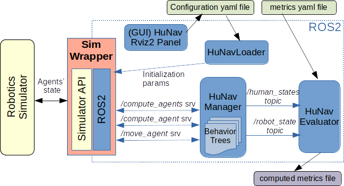

사람이 로봇을 정적 장애물처럼 무시하는 시뮬레이터에서는 양보를 기대하는 경로 계획기와 방어적인 경로 계획기의 차이가 잘 드러나지 않아요. HuNavSim은 사람이 서로와 장애물에 반응하는 <abbr title="목표로 가는 힘과 다른 사람·장애물에서 멀어지는 힘으로 보행을 계산하는 모형">Social Force Model</abbr> 위에, 로봇을 보고 멈추거나 다가오거나 멀어지거나 길을 막는 반응을 더해요. ROS 2 서비스로 사람의 다음 상태를 계산해 Gazebo·Isaac Sim·Webots 같은 물리 시뮬레이터와 분리해 사용할 수 있어요.

## 핵심은 3차원 렌더러가 아니라 사람 상태 제어기예요

HuNavSim 핵심 모듈은 사람의 위치·속도와 로봇 상태를 받아 다음 사람 상태를 계산해요. 3차원 모델을 그리거나 물리 계산을 적분하는 시뮬레이터와는 연결 모듈로 연결돼요. 연결 모듈이 매 시뮬레이션 단계마다 사람과 로봇의 현재 상태를 모아 HuNavSim에 보내고, 반환된 사람 상태를 기반 시뮬레이터에 적용해요.

이 구조 덕분에 같은 사람 반응을 Gazebo Classic 11, Gazebo Fortress, Isaac Sim, Webots에서 사용할 수 있어요. 그러나 연결 모듈마다 시간 간격, 충돌 형상, 순간 위치 변경 방식, 접촉 계산이 달라요. 핵심 모듈이 같다는 이유만으로 모든 시뮬레이터의 궤적과 평가 지표가 같다고 볼 수 없어요.

주요 ROS 2 연결 규격은 `/compute_agents`, `/compute_agent`, `/move_agent` 서비스예요. 전체 사람과 로봇 상태를 한 번에 계산하거나 특정 ID만 계산할 수 있어요. `/hunav_loader`는 `agents.yaml`의 초기 상태와 행동 매개변수를 읽어요. `/people` 주제로 people_msgs를 발행하는 선택도 있어요.

<figure class="fig"><figcaption>HuNavSim 핵심 모듈이 사람의 다음 상태를 계산하고 시뮬레이터 연결 모듈이 3차원 사람 모델에 적용해요. (출처: robotics-upo/hunav_sim README · MIT License)</figcaption></figure>

서비스 입력은 카메라나 라이다 관측이 아니라 시뮬레이터의 사람·로봇 정답 상태예요. 경로 계획기가 `/people`을 구독하면 완전한 위치·속도·ID를 받을 수 있어요. 실제 검출기·추적기의 누락, 지연, 식별자 전환을 포함한 센서 처리 흐름을 검증한 결과가 아니에요. 정답값 평가와 인지 계층을 포함한 평가를 구분해야 해요.

설명용으로 시뮬레이터 사람 위치는 매 20ms마다 정확하지만 실제 추적기는 100ms 주기와 150ms 지연을 가진다고 가정해요. 사람이 1.2m/s로 움직이면 제어기가 보는 위치는 약 0.18m 오래될 수 있어요. HuNavSim 정답 상태 정책의 성공이 이 지연에서도 유지되는지는 새 시험이에요.

## Social Force Model에 집단과 로봇 반응을 얹어요

기본 이동은 목표 인력, 장애물 반발력, 다른 사람과의 사회적 반발력을 합치는 Social Force Model을 사용해요. 사람은 지정된 목표 목록을 향해 걷고, 목표 반경 안에 들면 다음 목표로 이동해요. 순환 목표를 켜면 목록을 반복해요.

사람마다 `max_vel`, 반경, 초기 자세, 목표, 힘 계수를 설정해요. `group_id`가 같은 사람은 보행 집단으로 묶여 집단 확장 모형을 사용해요. 집단이 유지되는 장면, 서로 마주치는 장면, 좁은 통로를 구성할 수 있어요.

힘 계수는 행동의 결과를 크게 바꿔요. 목표 힘이 크면 사람은 로봇 회피보다 목표 진행을 우선할 수 있고, 장애물 힘이 크면 벽에서 넓게 떨어져 통로 중앙을 차지할 수 있어요. 사회적 힘이 크면 군중이 퍼져 로봇 경로를 막을 수 있어요. 시뮬레이터 이름만 기록하고 이 계수를 숨기면 실험을 재현하기 어려워요.

설명용으로 목표 방향 힘 크기가 2, 장애물 반대 방향이 1.5, 사람 반대 방향이 1이라고 단순 가정하면 벡터 방향에 따라 합이 크게 달라져요. 세 힘이 같은 직선에 놓이면 순힘은 0.5가 될 수 있지만 직각이면 크기가 달라져요. 논문 식을 재현한 수치가 아니라 계수 조합이 궤적을 결정한다는 예예요.

Social Force Model은 실제 사람의 의사결정 전체를 표현하지 않아요. 사람이 눈을 마주치고 양보를 협상하거나 목적을 바꾸는 현상을 힘만으로 만들기 어려워요. HuNavSim은 이 한계를 로봇 반응 유형과 행동 트리로 확장해요.

## 여섯 반응은 로봇을 보는 방식이 달라요

공식 `regular`인 일반형 사람은 로봇을 다른 사람처럼 취급해요. `impassive`인 비협조형은 로봇을 정적 장애물처럼 다뤄 로봇 행동에 사회적으로 협조하지 않아요. `surprised`인 놀람형은 로봇을 보면 멈추고 바라봐요. `curious`인 호기심형은 원래 목표를 잠시 버리고 로봇 쪽으로 천천히 접근해요.

`scared`인 회피형은 로봇에서 멀어지며, `threatening`인 방해형은 로봇 앞을 걸어 경로를 막으려고 해요. 이 이름은 실제 사람 성격 진단이 아니라 시뮬레이터 반응 정책의 공식 이름이에요. 방해형 행위자로 성공했다고 공격적인 실제 사람을 검증한 것은 아니에요.

반응에는 지속 시간, 한 번만 실행할지 여부, 속도, 반응 거리, 추가 로봇 반발력 같은 매개변수가 있어요. 호기심형은 로봇에 어느 거리까지 다가갈지, 회피형은 어느 속도로 멀어질지 설정할 수 있어요. 기본, 사용자 지정, 정규분포 무작위, 균등분포 무작위 설정 방식으로 행위자 다양성을 만들어요.

설명용으로 회피형 속도를 0.6m/s, 지속 시간을 40초로 두면 이동 거리는 다른 제약을 빼고 계산해도 최대 24m예요. 실제로는 목표·벽·다른 사람 힘이 있어 직선으로 24m 움직이지 않아요. 긴 반응 시간이 장면 크기에 비해 과도하면 실행 전체가 한 반응 모드에 머물 수 있다는 점을 보여줘요.

각 행위자의 반응을 섞으면 경로 계획기의 가정이 흔들려요. 일반형에게 잘 작동한 상호 회피 정책이 비협조형이나 방해형에서 충돌할 수 있고, 호기심형이 로봇을 따라오면 목표 근처에서 계속 근접 상태가 생길 수 있어요. 평균 성공률만 쓰지 말고 행동별 결과를 분리해야 해요.

## 행동 트리는 반응의 순서와 조건을 만들어요

HuNavSim 2.0은 행위자별 설정 가능한 행동 트리를 제공해요. 특정 거리에서 반응 시작, 일정 시간 수행, 목표 복귀 같은 상태 전이를 노드로 구성할 수 있어요. RViz2 화면에서 행위자를 고르고 Groot2 실행기로 트리를 편집할 수 있어요.

행동 트리는 힘 매개변수 하나보다 복합 상황을 만들기 좋아요. 예를 들어 로봇이 3m 안에 들어오면 놀람형으로 멈추고, 2초 뒤 회피형으로 이동한 다음 원래 목표로 복귀하는 순서를 만들 수 있어요. 단, 어떤 노드가 성공·실패를 반환하는지와 갱신 주기를 고정해야 같은 장면이 재현돼요.

무작위 매개변수와 행동 트리를 함께 쓰면 시드 관리가 중요해요. 행위자 생성, 목표 선택, 반응 매개변수, 트리 실행 시점, 기반 시뮬레이터 물리 계산이 서로 다른 난수원을 가질 수 있어요. 하나의 시드만 기록해도 모든 난수원이 고정되지 않을 수 있어요. 각 패키지의 시드와 장면 YAML, 트리 XML, 시뮬레이터 버전을 함께 보존해야 해요.

결정론적 재생은 README에서 검증됐다고 명시되지 않아요. 같은 설정을 두 번 실행해 궤적 해시나 위치 허용 오차를 비교해야 해요. 다중 스레드와 서비스 응답 순서가 달라지면 사람 간 힘 계산 순서도 달라질 가능성이 있어요.

설명용으로 50명 행위자 위치를 10Hz, 60초 기록하면 3만 행위자-시간 표본이 생겨요. 두 재생의 각 표본 위치 차이 최대값과 목표 전환 시각을 비교하면 결정론 수준을 수치화할 수 있어요. 표본 수는 시험 설계 가정이에요.

## 시뮬레이터 연결 모듈은 시간 계약을 지켜야 해요

연결 모듈은 현재 상태를 보내고 다음 상태를 받은 뒤 행위자 상태를 갱신해요. 서비스 호출이 물리 계산 단계보다 늦으면 시뮬레이터가 멈추거나 오래된 사람 상태를 적용할 수 있어요. 사람 수가 늘어날 때 `/compute_agents` 지연 시간과 실시간 배율을 함께 재야 해요.

전체 행위자를 한 번에 계산하는 것과 `/compute_agent`를 여러 번 호출하는 것은 동일하지 않을 수 있어요. 한 행위자씩 순서대로 갱신하면 뒤 행위자가 앞 행위자의 새 상태를 보고 비대칭이 생길 수 있어요. 평가에서는 동기식 상태 묶음을 기준으로 전체 다음 상태를 계산하는 계약이 더 명확해요.

설명용으로 물리 계산 50Hz는 20ms 시간 한도예요. HuNavSim 호출이 P95 25ms라면 평균이 15ms여도 일부 단계에서 마감 시간을 놓쳐요. 실시간 배율을 낮춰 정확히 계산하는 방법과 프레임을 건너뛰는 방법은 사람 궤적에 다른 영향을 줘요. 실제 지연 시간은 행위자 수·CPU·연결 모듈에 따라 측정해야 해요.

좌표와 방위각 부호화도 주의해야 해요. `/people` 호환을 위해 2차원 행위자 방위각을 `position.z`, 각속도를 `velocity.z`에 넣는 README 설명이 있어요. 일반 3차원 위치로 해석하는 수신 프로그램은 높이로 오인할 수 있어요. 메시지 계약을 확인하고 변환 노드에서 의미를 명시해야 해요.

## 평가 지표는 로봇 궤적과 사람 반응을 함께 봐야 해요

`hunav_평가기`는 문헌의 사회적 내비게이션 평가 지표와 확장 가능한 평가기를 제공해요. 성공·충돌·시간만 보면 로봇이 사람을 놀라게 하거나 집단을 가르는 행동이 숨을 수 있어요. 최소 거리, 개인 공간, 사람 경로 변화, 로봇 속도·가속도 같은 지표를 함께 구성해야 해요.

평가 지표 계산이 정답 상태를 쓰는지 경로 계획기 센서 관측을 쓰는지도 구분해요. 평가는 시뮬레이터 정답값로 충돌과 거리를 계산하는 편이 정확하지만, 정책은 제한된 센서만 받아야 공정해요. 정책에 정답값를 주고 평가기도 정답값을 쓰면 인지 난도가 사라져요.

행동별 평가 지표 분포가 필요해요. 방해형 행위자와 최소 거리가 작아도 로봇이 잘못한 것인지 행위자가 의도적으로 다가온 것인지 해석이 달라요. 로봇 책임 평가 지표와 장면 난도 평가 지표를 나눠야 해요. 집단을 통과한 경우 집단 분리나 사람 간 거리 변화도 기록할 수 있어요.

설명용으로 100 실행 평균 최소 거리가 0.8m여도 방해형 10회가 모두 0.2m, 일반형 90회가 0.87m라면 평균만으로 위험 조건이 가려져요. 행동별 하위 5백분위와 충돌을 공개해야 해요. 숫자는 분리 집계의 필요성을 보이는 가정이에요.

## ROS 2 Humble 검증과 Jazzy 호환은 다른 주장입니다

현재 v2.0 README는 ROS 2 Humble에서 시험됐다고 적고 개발·개선 중이라고 밝혀요. 과거 master 가지 문서에는 Foxy가 적혀 있을 수 있어 가지와 버전을 함께 확인해야 해요. Humble에서 실행된다는 사실만으로 Jazzy 바이너리·API·BehaviorTree.CPP 호환이 검증되지는 않아요.

의존성에는 lightsfm, people_msgs ROS 2 가지, BehaviorTree.CPP와 BehaviorTree.ROS2가 있어요. APT에서 바로 제공되지 않는 패키지를 작업 공간에 넣어야 할 수 있어요. 컨테이너를 권장하지만 호스트 GPU·화면 출력·시뮬레이터 연결 모듈까지 자동 검증하는 것은 아니에요.

Jazzy 이식은 메시지 컴파일, 서비스 왕복 호출, 연결 모듈 갱신, RViz 화면, 평가기 순서로 확인해요. 작은 무화면 장면에서 사람 두 명의 다음 상태를 고정 입력으로 반복해 기준 출력과 비교한 뒤 3차원 시뮬레이터를 붙이는 편이 좋아요. GUI가 뜬다는 사실은 사람 반응과 평가 지표가 맞는다는 뜻이 아니에요.

실제 사람의 움직임을 재현한다는 주장도 제한해야 해요. 여섯 반응은 설계한 행동이고, 대규모 실제 사람 궤적과 매개변수 분포을 맞춘 검증이 README에 모두 제시되지는 않아요. 시뮬레이터는 경로 계획기 한계 시험를 위한 조절 가능한 모형이지 실제 사람의 심리 예측기라고 볼 수 없어요.

## 실험 설계는 사람 모형·관측·물리 계산을 분리해요

첫 층은 HuNavSim 정답 상태를 정책에 제공해 경로 계획기만 비교해요. 둘째 층은 정답값에서 라이다·카메라 관측을 합성하고 검출기·추적기를 붙여 인지 오차를 포함해요. 셋째 층은 연결 모듈와 접촉 계산를 켜 로봇 동역학를 포함해요. 단계별 성능 차이가 어느 경계에서 생겼는지 알 수 있어요.

사람 모형 시험은 일반형 여럿만 쓰지 않고 여섯 행동, 집단 크기, 힘 계수, 반응 지속 시간을 요인별로 바꿔요. 모든 조합이 너무 많으면 위험도가 높은 조건을 먼저 고르고 시드를 충분히 반복해요. 장면 YAML과 트리 XML을 결과와 함께 저장해요.

재생 검증에서는 동일 시드 10회, CPU 부하 변화, 행위자 수 5·20·50, 서비스 방식 전체·개별을 비교해요. 궤적 최대 편차, 목표 전환 시각, 평가 지표 차이, 실시간 배율을 기록해요. 결정론이 깨지면 통계 반복 수와 허용 오차를 먼저 정해야 경로 계획기 차이를 해석할 수 있어요.

서비스 경계에서는 한 시각의 상태가 한 묶음인지도 시험해야 해요. 로봇 자세는 10번째 갱신값인데 일부 사람은 9번째 값이라면, 계산기는 실제로 존재하지 않았던 장면을 받아요. 사람 수를 늘리며 요청 시각, 응답 시각, 적용 시각을 기록하고 모든 행위자가 같은 시각 표지를 갖는지 검사해야 해요. 설명용으로 20ms 간격에서 한 사람만 한 단계 늦으면 1.5m/s 보행자의 위치가 3cm 어긋나요. 작은 값처럼 보여도 가까운 통과에서는 최소 거리 순서를 바꿀 수 있어요.

사람 반응의 구성 비율도 결과와 함께 남겨야 해요. 일반형 90명과 방해형 10명인 시험은 각 유형을 같은 수로 둔 시험과 평균 난도가 달라요. 전체 성공률 외에 반응 유형별 성공률, 충돌률, 최소 거리, 정체 시간을 분리하고 각 유형의 표본 수도 적어야 해요. 특정 반응 하나가 전체 실패를 지배하는지 확인할 수 있어요.

집단 시험에서는 구성원 개인의 최소 거리만으로 부족해요. 로봇이 두 사람 사이를 지나 집단을 갈랐지만 누구와도 충돌하지 않을 수 있기 때문이에요. 집단 중심 간 거리, 구성원 사이 간격의 변화, 갈라진 뒤 다시 모이는 시간까지 기록하면 단순 장애물 회피와 집단 보존을 구분할 수 있어요. 이 항목은 HuNavSim이 제공하는 집단 설정을 활용한 추가 검증 설계이며 논문에서 측정된 결과로 쓰지 않아요.

[[2026-10-17_socialnav_socnavgym|SocNavGym이 부분 관측과 사회 관계를 상태로 만든 방식]]은 Gymnasium 내부에서 사람·가구·상호작용의 상태와 보상을 바로 제공하는 학습 환경이에요. HuNavSim은 ROS 2 서비스로 사람 다음 상태를 계산해 여러 물리 시뮬레이터와 연결해요. 하나는 강화학습 환경 API, 다른 하나는 사람 행동 제어기라는 차이가 있어요.

HuNavSim의 핵심은 사람 모형 하나를 제공하는 데 있지 않아요. 시뮬레이터와 분리된 ROS 2 핵심 모듈, 집단 사회적 힘, 여섯 로봇 반응, 행위자별 행동 트리, 평가기를 한 처리 흐름으로 묶어요. 대신 정책이 받는 상태가 센서 정답값인지, 연결 모듈 시간 계약이 맞는지, 무작위 시드가 재현되는지, Humble 밖 배포가 검증됐는지를 따로 확인해야 해요.

---
<!-- src-block -->
출처 — https://github.com/robotics-upo/hunav_sim
