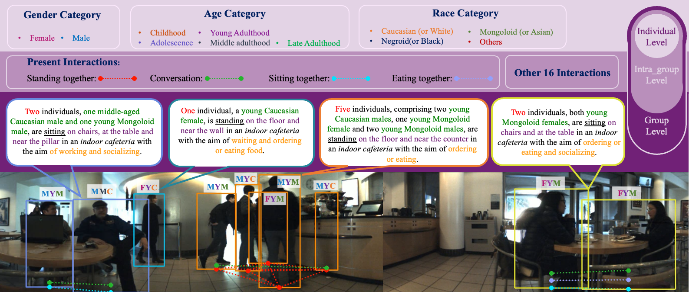

사람 위치만 알아서는 왜 여러 명이 통로를 막고 서 있는지 알기 어렵습니다. 기다리는 줄인지, 대화 집단인지, 곧 흩어질 사람인지에 따라 로봇의 행동이 달라져요. <abbr title="JRDB 영상에 개인 속성·집단 내 상호작용·집단 문맥을 세 층으로 추가한 데이터셋">JRDB-Social</abbr>은 이동로봇 시점의 군중을 이런 사회 문맥으로 주석한 확장 자료입니다.

공식 페이지와 논문은 주석을 세 수준으로 나눕니다. 개인 수준에는 나이대·성별·외형상 인종 범주 같은 속성이 있고, 집단 내 수준에는 같은 집단의 두 사람 사이 상호작용이 프레임별 다중 라벨로 붙어요. 집단 수준에는 몸 위치와 주변 내용의 관계, 가까운 두드러진 사물, 장소 유형, 집단의 목적을 설명하는 문맥이 있습니다.

<figure class="fig"><figcaption>같은 카페 영상에 개인, 두 사람 관계, 집단 전체 문맥이 겹쳐 있습니다. 이 세 층은 서로 연결되지만 각각 다른 질문과 오류를 갖기 때문에 한 정답으로 합쳐 읽으면 안 됩니다. (출처: JRDB 연구팀, <a href="https://jrdb.erc.monash.edu/dataset/social">JRDB-Social</a>, 공식 소개 그림·원 논문 Fig. 1)</figcaption></figure>

## 세 층은 크기만 다른 같은 라벨이 아니에요

개인 수준은 한 사람의 외형에서 추정한 속성을 다룹니다. 집단 내 수준은 사람 쌍이 함께 서기, 대화하기, 같이 앉기, 함께 먹기 같은 상호작용을 하는지 묻습니다. 집단 수준은 여러 사람과 주변 공간을 함께 보고 “어디서 무엇을 위해 모였는가”를 설명해요.

개인 속성을 정확히 맞혔다고 집단 목적을 알 수는 없습니다. 두 사람이 마주 본다는 사실도 대화인지 주문 대기인지 주변 장면 없이 확정하기 어려워요. 반대로 카페라는 장소를 안다고 모든 집단이 식사 중인 것은 아닙니다. 세 수준은 서로 힌트를 주지만 하나가 다른 하나의 정답은 아닙니다.

로봇 주행에는 층마다 다른 쓰임이 있습니다. 개인 수준의 민감 속성은 주행에 필요하지 않은 경우가 많고 차별 위험이 큽니다. 집단 내 상호작용은 두 사람 사이를 가로지르면 안 되는지 판단하는 데 도움이 될 수 있어요. 집단 수준의 몸 배치와 주변 물체는 어느 쪽으로 우회할지 알려 줄 수 있습니다.

[[2026-10-17_socialnav_jrdb|JRDB가 이동로봇 시점의 사람 지각을 벤치마크로 만든 방식]]이 사람 상자와 추적을 제공한다면, JRDB-Social은 그 사람들을 어떤 관계와 문맥으로 읽을지 추가합니다. 위치 정답과 사회 문맥 정답을 같은 과제로 부르면 각각의 실패가 가려져요.

## 개인 속성은 관측 사실보다 추정 라벨에 가까워요

영상에서 보이는 나이대·성별·인종 범주는 본인의 자기정체성이나 확인된 기록이 아닙니다. 주석 작업자가 외형을 보고 추정한 값이에요. 조명, 가림, 카메라 거리, 문화적 고정관념이 라벨에 들어갈 수 있습니다. 데이터 스키마에 신뢰도 필드가 있어도 민감 속성의 근본적 불확실성이 사라지지는 않습니다.

특히 논문의 인종 범주에는 오늘날 부적절하고 과학적으로 문제가 큰 역사적 용어가 포함돼 있습니다. 모델이 그 범주를 잘 맞힌다는 목표 자체가 사회적 주행에 필요한지 먼저 물어야 해요. 사람을 피하고 양보하는 행동은 외형상 인종에 따라 달라져서는 안 됩니다.

공정성 검사는 단순한 범주별 정확도보다 사용 경로를 봐야 합니다. 민감 속성이 계획기 입력으로 들어가면 같은 위치와 움직임에서도 로봇 거리가 달라질 수 있어요. 가장 안전한 기본 설계는 불필요한 민감 속성을 주행 정책에서 제외하고, 집단 구조와 공간 문맥만 쓰는 것입니다.

설명용으로 계획 점수가 `충돌위험 0.6 + 집단통과비용 0.3 + 속성비용 0.1`의 가중합이라고 하겠습니다. 속성 분류가 20% 틀리면 전체 점수 변화가 작아 보여도 임계값 근처에서 경로를 바꿀 수 있어요. 그 0.1 항이 업무상 필요하지 않다면 제거하는 편이 더 명확합니다.

## 집단 안의 상호작용은 사람 쌍과 시간 구간을 가져요

논문은 같은 사회 집단 안의 각 사람 쌍에 프레임 수준의 다중 상호작용 라벨을 붙입니다. 한 쌍이 서 있으면서 대화하고 물체를 함께 볼 수 있으므로 하나의 클래스만 고르는 문제가 아니에요. 상호작용 시작과 끝도 시간에 따라 달라집니다.

사람이 세 명인 집단에는 쌍이 세 개, 다섯 명이면 열 개입니다. 일반식은 `n(n-1)/2`예요. 집단 크기가 커질수록 주석과 예측 후보가 제곱에 가깝게 늘어납니다. 사람 검출 하나를 놓치면 그 사람과 연결된 여러 쌍이 동시에 사라져요.

설명용으로 여섯 명 집단이면 `6×5/2=15쌍`입니다. 한 사람을 놓치면 그 사람과의 다섯 쌍을 평가할 수 없어 전체 쌍의 3분의 1이 영향을 받아요. 개인 검출 누락률과 상호작용 재현율을 독립으로 해석하면 안 됩니다.

다중 라벨은 클래스 불균형도 키웁니다. 함께 서기와 대화는 흔하지만 드문 물체 교환이나 특수 행동은 표본이 적을 수 있어요. 모든 음성 쌍이 많으므로 정확도만 보면 아무 상호작용도 없다고 예측한 모델이 높게 나올 수 있습니다. 클래스별 정밀도·재현율과 F1, 쌍 수를 함께 봐야 해요.

## 집단 경계가 틀리면 상호작용 후보부터 달라져요

JRDB 계열에는 사회 집단 주석이 있지만 실제 배포 모델은 영상과 점군에서 집단을 찾아야 합니다. 가까이 있는 사람을 같은 집단으로 묶는 규칙은 줄 서기와 혼잡 통과에서 쉽게 틀려요. 집단 경계 오류는 상호작용 분류 앞의 구조 오류입니다.

설명용으로 정답 집단이 `A,B,C`와 `D,E`인데 모델이 가까운 C와 D를 한 집단으로 합쳤다고 하겠습니다. 원래 후보 쌍은 3+1=4개입니다. 다섯 명을 모두 묶으면 10개가 되어 여섯 개의 거짓 후보가 생겨요. 상호작용 분류기가 완벽해도 입력 그래프가 잘못됐습니다.

반대로 하나의 집단을 둘로 쪼개면 사람 사이를 지나도 된다고 잘못 판단할 수 있습니다. 대화 원의 중심이나 몸 방향을 보지 않고 거리만 쓰면 생기는 문제예요. 집단 검출, 쌍 상호작용, 집단 문맥을 단계별로 평가해야 합니다.

집단은 시간에 따라 합쳐지고 나뉩니다. 프레임마다 독립 군집화를 하면 경계가 깜빡이고 로봇 경로 비용도 흔들려요. 집단 ID의 시간 일관성과 변화 이벤트를 함께 모델링해야 합니다.

## 집단 수준 문맥은 주변 사물과 목적을 연결해요

공식 스키마는 집단의 몸 위치가 주변 내용과 어떤 관계인지, 가까운 두드러진 장면 내용이 무엇인지, 장소와 목적이 무엇인지 기록합니다. 예를 들어 카운터 근처에 서 있는 집단, 카페에서 주문을 기다리는 집단처럼 사람과 공간을 한 문장으로 연결해요.

이 정보는 경로 선택에 유용할 수 있습니다. 카운터 앞 줄은 중간을 가로지르기보다 뒤로 돌아야 하고, 엘리베이터 앞 집단은 문이 열릴 때 움직일 가능성이 큽니다. 단, 라벨이 곧 미래 행동 규칙은 아니에요. 같은 장소·목적에서도 사람은 다르게 움직입니다.

목적 라벨은 관측자가 장면을 보고 해석한 값입니다. 사람에게 물어 확인한 의도와 같지 않을 수 있어요. “사회화”, “공부”, “기다림” 같은 범주는 동시에 성립하거나 시간에 따라 바뀔 수 있습니다. 모델 출력은 단정 대신 후보와 신뢰도를 남겨야 합니다.

설명용으로 집단 목적이 기다림 0.5, 주문 0.3, 대화 0.2의 확률이라고 하겠습니다. 계획기가 가장 큰 기다림만 택하면 카운터로 접근할 가능성 0.3을 무시해요. 각 목적이 만드는 점유 영역과 움직임을 확률 가중해 경로 위험을 계산하는 편이 낫습니다.

## 텍스트 설명은 분류 라벨과 다른 평가가 필요해요

집단 수준 설명은 장소·주변 사물·몸 배치·목적을 문장 구조에 넣습니다. 모델이 자유로운 문장을 생성하면 같은 뜻을 여러 표현으로 쓸 수 있어요. 단어가 조금 달라도 의미는 맞을 수 있고, 문장은 유창하지만 핵심 항목이 틀릴 수도 있습니다.

논문은 BLEU, ROUGE, METEOR 같은 텍스트 겹침 지표의 한계를 논의하고, 상호작용 라벨에는 정확도와 F1을 사용합니다. 정해진 문장 틀이 강하면 n-그램 겹침이 내용 이해보다 템플릿 복사를 측정할 수 있어요.

설명용으로 정답이 “카운터 옆에서 주문을 기다린다”이고 예측이 “주문대 가까이에서 차례를 기다린다”라고 하겠습니다. 단어 겹침은 낮을 수 있지만 장소와 목적은 맞습니다. 반대로 “카운터 옆에서 대화한다”는 단어가 많이 겹쳐도 목적이 틀려요. 문장을 구조화된 필드로 다시 파싱해 항목별 정확도를 보는 검사가 필요합니다.

대형 시각언어모델 평가는 학습 자료 누수도 살펴야 합니다. 공개된 JRDB 이미지와 캡션이 사전학습에 들어갔다면 새 장면 이해보다 기억을 측정할 수 있어요. 이미지 변형, 보류 장소, 새 시간대, 사람 상자 없이 전체 프레임을 주는 조건으로 강건성을 확인합니다.

## 자르기 방식이 모델이 보는 문맥을 바꿔요

개인 수준에서는 사람 상자만 잘라 입력할 수 있습니다. 집단 내 수준은 두 사람과 그 사이를, 집단 수준은 주변 장소까지 보여 줘야 해요. 너무 좁게 자르면 카운터나 문을 잃고, 너무 넓게 보면 다른 집단의 정보가 섞입니다.

논문은 프레임 수준, 고정 검은 마스크, 마스크 없는 고정 영역 등 다양한 크롭 조건을 비교합니다. 이는 모델 구조만큼 입력 범위가 중요하다는 뜻이에요. 집단 문맥을 평가하면서 정답 상자로 정확한 영역을 잘라 주면 실제 자동 파이프라인보다 쉬워집니다.

설명용으로 사람 상자 주변을 폭의 1.5배로 늘렸을 때 카운터가 들어오고, 1.2배에서는 빠진다고 하겠습니다. 크롭 크기 차이만으로 목적 분류가 바뀔 수 있어요. 여러 배율과 전체 프레임 조건에서 결과를 보고해야 합니다.

검은 마스크는 관심 밖 사람을 지우지만 실제 배포 영상에는 그런 깨끗한 분리가 없습니다. 마스크 경계 자체가 정답 집단의 모양을 알려 주는 힌트가 될 수도 있어요. 자동 분할 마스크의 누락·합침을 넣어 성능 변화를 봐야 합니다.

## 시간 분할과 원 프레임 누수를 조심해야 해요

JRDB-Social은 JRDB의 같은 영상 위에 새 주석을 얹습니다. 프레임을 무작위로 나누면 같은 사람과 집단이 몇 순간 차이로 훈련과 시험에 들어가요. 집단 목적과 장소는 짧은 시간 동안 거의 변하지 않으므로 모델이 장면을 기억하기 쉽습니다.

분할은 원 시퀀스와 장소 단위로 해야 합니다. JRDB 기본 검출, JRDB-Act 행동, JRDB-Social 문맥을 함께 쓸 때 각 확장의 분할이 같은 원 프레임을 어떻게 다루는지 대조해야 해요. 한 과제의 시험 프레임을 다른 과제 학습에서 본다면 공동 모델 평가가 오염될 수 있습니다.

텍스트 템플릿도 분할 대상입니다. 모든 목적과 장소 조합을 훈련에서 본 뒤 같은 문장 틀만 시험하면 새로운 사회 조합을 이해하는지 알기 어려워요. 장소-목적 조합 보류, 드문 상호작용 보류, 새 시퀀스 보류를 나눠야 합니다.

설명용으로 한 집단이 15헤르츠 영상에서 40초 보인다면 약 600프레임이 같은 목적·장소 라벨을 공유할 수 있습니다. 600개를 독립 사례로 세면 데이터 양과 신뢰도를 크게 부풀려요. 집단 에피소드 단위로 표본 수와 신뢰구간을 계산해야 합니다.

## 사회 문맥 인식과 사회적 주행은 연결 실험이 필요해요

집단 문맥을 잘 맞힌 모델이 곧 좋은 주행 정책은 아닙니다. 계획기가 라벨을 어떻게 비용으로 바꾸는지, 잘못된 라벨에서 어떤 안전 장치가 작동하는지 검증해야 해요. “대화 집단”이라는 출력만으로 어느 쪽을 지나야 하는지 결정할 수 없습니다.

몸 방향과 사람 사이의 열린 공간, 벽과 가구, 로봇 폭과 목표를 함께 봐야 합니다. 집단 목적은 미래 움직임의 가능성을 조정하는 정보이지 절대 규칙이 아니에요. 불확실한 문맥에서는 더 느리게 접근하고 새 관측을 기다리는 전략이 필요합니다.

설명용으로 두 경로의 기본 길이가 8미터와 10미터이고, 짧은 경로가 대화 집단 사이를 지난다고 하겠습니다. 집단 통과 비용을 4미터 상당으로 두면 총비용은 12와 10이 되어 우회로를 고릅니다. 문맥 오검출로 비용이 빠지면 짧은 경로가 선택돼요. 라벨 신뢰도에 따라 비용을 연속적으로 바꾸고 최소거리 제한을 별도로 둬야 합니다.

실물 평가는 사람 집단에게 로봇 행동을 실제로 제시해야 합니다. 통과 방향, 멈춤 위치, 속도를 바꾸며 사람의 추가 이동, 대화 중단, 불편, 예측 가능성을 측정해요. JRDB-Social 원자료는 문맥 인식 벤치마크이며 이 정책 비교 자체를 제공하는 자료는 아닙니다.

## 민감 라벨과 장소 문맥에는 별도 윤리가 필요해요

공개 장소 영상의 사람은 데이터 수집 목적과 후속 시각언어모델 실험을 다르게 받아들일 수 있습니다. 얼굴이 작아도 이동 경로, 일행 관계, 장소와 목적 추정이 결합되면 민감성이 커져요. 필요한 연구 질문에 맞춰 접근과 출력을 줄여야 합니다.

민감 속성은 성능 개선 여부와 별개로 삭제 실험을 해야 합니다. 개인 속성을 제거해도 집단 상호작용과 주행 판단이 유지된다면 배포 입력에서 제외하는 근거가 됩니다. 반대로 필요하다고 주장하려면 어떤 안전 목적에 필요한지와 차별 위험을 구체적으로 증명해야 해요.

장소와 목적 라벨도 감시 용도로 확장될 수 있습니다. 로봇 주행에는 “문 앞 점유”, “줄”, “대화 원”처럼 공간 행동에 필요한 최소 표현이 더 적절할 수 있어요. 사람의 정체성보다 통과 가능성과 상호작용 구조를 모델링합니다.

데이터 카드에는 주석 작업자 지침, 합의, 신뢰도, 드문 범주, 알려진 편향, 허용 용도를 기록해야 합니다. 모델 카드에는 어떤 주석 층을 사용했고 민감 속성을 계획기에 전달하는지 명시해요.

## 공식 스키마와 평가 코드를 읽는 순서

첫째, 개인·집단 내·집단 수준 JSON을 따로 파싱하고 ID 연결을 확인합니다. 사람 ID, 집단 ID, 상호작용 쌍, 프레임 범위가 원 JRDB 상자와 맞는지 시각화해요. 누락과 중복, 시간 역행을 검사합니다.

둘째, 집단 크기별 후보 쌍과 클래스 빈도를 셉니다. 프레임 수뿐 아니라 집단 에피소드와 시퀀스 수를 보고, 드문 상호작용의 실제 독립 사례를 확인해요. 클래스별 신뢰구간을 집단 단위로 계산합니다.

셋째, 입력 범위를 단계적으로 바꿉니다. 정답 사람·집단 크롭, 자동 검출 크롭, 전체 프레임을 비교하고 마스크 오류를 주입해요. 텍스트는 단어 겹침과 구조화된 필드 정확도, 사실 일관성을 함께 봅니다.

넷째, 분할 누수를 감사합니다. 원 시퀀스·장소·집단이 훈련과 시험에 겹치지 않는지, 다른 JRDB 확장으로 사전학습한 모델이 시험 프레임을 봤는지 확인해요. 템플릿과 장소-목적 조합 보류 결과도 냅니다.

다섯째, 주행 연결은 별도 안전 평가로 둡니다. 민감 속성 없는 조건을 기본으로 하고, 집단 구조와 공간 문맥의 신뢰도를 비용에 넣어요. 닫힌 고리 시뮬레이션과 실물 집단 평가에서 최소거리, 통과 성공, 대화 방해, 사람 우회량, 불필요한 정지를 측정합니다.

JRDB-Social의 고유한 가치는 사람 상자 위에 “개인-사람 쌍-집단과 장소”라는 세 층을 연결한 데 있습니다. 프레임별 다중 상호작용과 집단의 주변 사물·장소·목적을 함께 보므로 위치만으로는 설명하기 어려운 사회 장면을 연구할 수 있어요.

그만큼 주의할 점도 큽니다. 외형에서 추정한 민감 속성은 자기정체성과 다르고, 집단 목적은 주석 작업자의 해석이며, 크롭과 텍스트 템플릿이 정답을 새어 줄 수 있습니다. 세 층을 따로 평가하고 원 시퀀스 누수를 막으며, 주행에는 필요한 공간 문맥만 최소한으로 연결해야 해요. 그 경계를 지키면 JRDB-Social은 사람을 분류하는 도구가 아니라 로봇이 집단의 공간 관계를 덜 방해하도록 연구하는 자료가 됩니다.

---

<!-- src-block -->
출처 — https://github.com/JRDB-dataset/JRDB-Social
