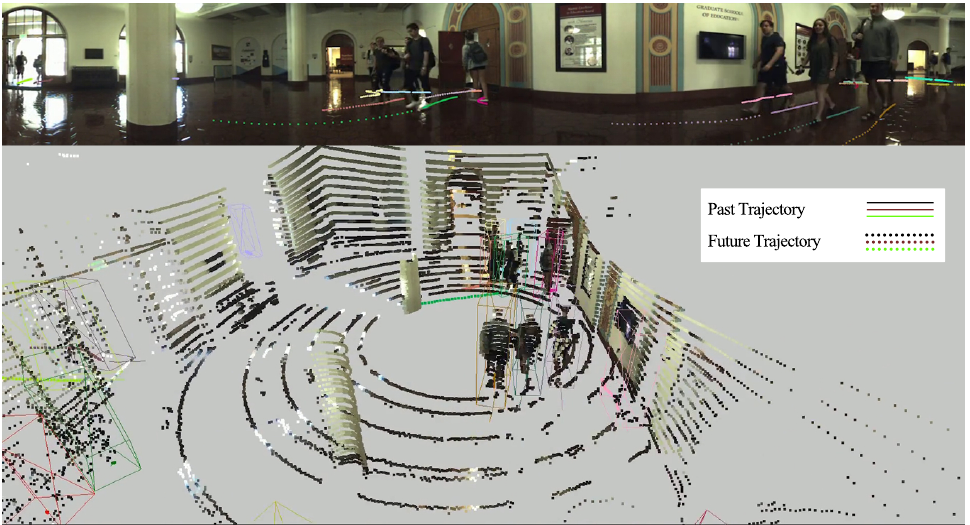

보행자 미래 예측 논문은 흔히 과거 정답 좌표를 입력으로 받습니다. 실제 로봇은 먼저 센서에서 사람을 찾고, 프레임 사이의 동일 인물을 연결한 뒤에야 미래를 예측해요. 앞단에서 사람을 놓치거나 잘못 연결하면 예측기에는 짧고 흔들리는 궤적이 들어갑니다. <abbr title="JRDB 원시 센서와 불완전한 검출·추적을 포함해 미래 사람 궤적을 평가하는 확장 벤치마크">JRDB-Traj</abbr>는 이 연결된 문제를 평가하려는 자료입니다.

원 논문은 JRDB의 3차원 사람 상자에서 바닥 중심을 뽑아 궤적을 만들고, 로봇 시점의 이미지와 점군을 입력으로 모든 사람의 미래 위치를 로봇에 대한 상대 좌표로 예측하게 합니다. 핵심은 완벽한 과거 궤적을 가정하지 않는다는 점이에요. 검출과 추적 결과가 빠뜨린 사람, 잘못 만든 사람, 끊긴 ID까지 예측 평가에 들어옵니다.

<figure class="fig"><figcaption>위 영상과 아래 점군은 같은 로봇 시점에서 사람별 과거와 미래 궤적을 보여 줍니다. 입력 궤적이 검출·추적 결과이므로 미래 예측 오차에는 앞단 지각 실패가 함께 반영돼요. (출처: Saadatnejad et al., <a href="https://arxiv.org/abs/2311.02736">JRDB-Traj: A Dataset and Benchmark for Trajectory Forecasting in Crowds</a>, Fig. 1)</figcaption></figure>

## 정답 궤적 입력과 원시 센서 입력은 다른 문제예요

정답 과거 좌표를 입력하면 예측기는 “이 사람이 지금까지 이렇게 걸었다”는 깨끗한 조건을 받습니다. 원시 센서 입력에서는 사람이 가려져 두 프레임 빠질 수 있고, 상자 위치가 흔들리며, 다른 사람의 ID와 바뀔 수 있어요. 입력 사람 수조차 정답과 다릅니다.

JRDB-Traj 논문은 이런 앞단 오차를 포함한 종단간 궤적 예측을 목표로 설명합니다. 원시 이미지와 점군에서 사람을 검출하고 추적한 결과를 예측기에 넣어요. 논문의 기준 실험은 사전 학습된 PiFeNet 검출과 SimpleTrack 추적에서 관측 과거를 만들고, Zero-Velocity와 Social-LSTM을 비교합니다.

따라서 점수의 원인은 하나가 아닙니다. 검출기가 먼 사람을 놓쳤는지, 추적기가 ID를 바꿨는지, 예측기가 방향 전환을 못 맞혔는지 분해해야 해요. 종단간 점수만 낮추면 어떤 모듈을 고쳐야 할지 알기 어렵습니다.

[[2026-10-17_socialnav_jrdb|JRDB가 이동로봇 시점의 사람 지각을 벤치마크로 만든 방식]]이 2D·3D 사람 검출과 추적의 기반을 제공한다면, JRDB-Traj는 그 결과가 미래 구간에서 얼마나 유효한지 묻습니다. 같은 원 시퀀스를 쓰지만 과제와 평가 단위가 다릅니다.

## 바닥 중심은 궤적을 만들지만 몸 전체를 대표하지 않아요

논문은 3차원 사람 상자의 바닥 중심으로 궤적을 구성합니다. 이 점은 사람의 지면 위치를 간결하게 나타내고, 카메라 상자 중심보다 키와 원근의 영향을 덜 받아요. 로봇 평면 주행과 거리 계산에도 맞습니다.

하지만 3차원 상자의 위치가 흔들리면 바닥 중심도 흔들립니다. 사람이 몸을 숙이거나 점군이 한쪽만 보일 때 상자의 크기와 방향이 바뀔 수 있어요. 실제 발 위치가 거의 같아도 추정 상자 중심이 움직여 가짜 속도를 만듭니다.

설명용으로 연속 두 프레임의 바닥 중심이 좌우로 0.08미터씩 반대 방향으로 흔들리고 간격이 0.1초라면 겉보기 횡속도 차이는 `0.16/0.1=1.6미터/초`입니다. 정지한 사람도 빠르게 옆으로 움직인 것처럼 보여요. 상자 중심 평활과 불확실도 추정이 필요합니다.

사람의 발자국 크기와 몸 방향도 점 하나에서는 사라집니다. 계획기가 이 궤적을 쓸 때는 사람 반경이나 자세를 별도로 복원해야 해요. 점 중심끼리 0.8미터 떨어져도 두 사람의 몸과 짐이 차지하는 폭에 따라 실제 여유가 다릅니다.

## 분할은 54개 시퀀스의 장면을 통째로 나눠요

JRDB-Traj는 JRDB 공식 분할을 따라 54개 시퀀스를 훈련·검증·시험으로 나눕니다. 논문은 각 분할에 실내·야외와 정지·이동 로봇 장면이 비슷한 비율로 들어가며, 한 장면의 모든 프레임은 한 분할에만 속한다고 설명해요. 무작위 프레임 누수를 막는 중요한 조건입니다.

시험 시퀀스의 마지막 5초 영상과 점군은 숨깁니다. 참가 모델은 앞부분 센서와 관측 궤적을 바탕으로 보이지 않는 미래를 예측해야 해요. 미래 센서 프레임을 특징 추출에 쓰는 누수를 막습니다.

분할이 장면 단위라고 모든 누수가 사라지지는 않습니다. 같은 캠퍼스 위치가 다른 시퀀스 이름으로 반복되면 배경과 흐름이 양쪽에 들어갈 수 있어요. 사전 학습된 검출기와 추적기가 JRDB 시험 시퀀스를 본 적이 있는지도 확인해야 합니다.

설명용으로 15헤르츠 센서에서 숨긴 5초는 약 `15×5=75프레임`입니다. 그 구간의 영상을 실수로 캐시하거나 특징 통계에 포함하면 미래를 본 셈이에요. 전처리 캐시를 분할 뒤 생성하고 파일 접근 로그를 검사하는 편이 좋습니다.

## ADE와 FDE가 바로 적용되지 않는 이유

평균 변위 오차와 최종 변위 오차는 예측 궤적과 정답 궤적의 ID 대응이 이미 알려졌다고 가정합니다. 자동 검출·추적에서는 예측한 사람 수와 정답 사람 수가 다르고, ID도 일치하지 않을 수 있어요. 어느 예측을 어느 정답과 비교할지 먼저 정해야 합니다.

사람 A를 놓치고 없는 사람 B를 만들었다고 하겠습니다. 남은 궤적끼리만 ADE를 계산하면 놓친 사람과 오검출이 점수에서 사라집니다. 반대로 ID 번호가 다르다는 이유로 같은 사람을 전혀 매칭하지 않으면 위치가 정확한 예측도 실패로 처리돼요.

JRDB-Traj는 먼저 예측 궤적 집합과 정답 궤적 집합을 대응시킨 뒤 거리와 개수 차이를 함께 계산합니다. IDF1과 OSPA-2도 보고하고, 종단간 미래 예측을 위한 <abbr title="예측 궤적 집합과 정답 집합을 매칭해 위치와 개수 차이를 재는 종단간 예측 오차">EFE</abbr>를 제안해요. 위치 정확도, ID 연속성, 사람 수 오류를 서로 다른 관점에서 봅니다.

이 설계는 예측기를 실제 지각 파이프라인과 연결하는 데 필요합니다. 동시에 매칭 규칙과 거리 제한이 점수에 큰 영향을 주므로 수식과 예외를 읽어야 해요. 지표 이름만 옮겨 쓰면 어떤 실패를 벌주지 않는지 놓칩니다.

## EFE는 위치 오차와 사람 수 오차를 한 값에 넣어요

EFE는 예측과 정답 궤적의 쌍별 시간 평균 거리를 계산하고, 전체 매칭 비용이 작은 대응을 찾습니다. 대응되지 않은 궤적에는 개수 오차를 더해요. 논문은 거리 제한 `c=5미터`를 사용합니다.

설명용으로 정답 궤적 두 개와 예측 궤적 세 개가 있다고 하겠습니다. 가장 좋은 두 쌍의 평균 거리가 0.8미터와 1.2미터이고, 남은 오검출 하나에 5미터 벌점을 준다면 단순화한 평균은 `(0.8+1.2+5)/3≈2.33미터`입니다. 위치가 맞는 두 사람만 보면 1.0미터지만 사람 수 오류가 전체 점수를 높여요.

거리 제한은 아주 멀리 틀린 예측 하나가 점수를 무한히 지배하지 않게 합니다. 그러나 5미터와 50미터 오차가 모두 5미터로 잘릴 수 있어요. 심한 위치 실패의 크기를 비교하려면 잘린 비율이나 제한 전 거리도 보조 지표로 봐야 합니다.

사람 수가 많은 장면에서는 개수 오차의 분모 효과도 달라집니다. 한 명을 놓친 오류가 두 명 장면에서는 절반이지만 스무 명 장면에서는 5%예요. EFE와 함께 장면별 누락·오검출 수, 거리 구간별 결과를 보고해야 합니다.

## 조기 종료를 벌주지 않는 예외는 따로 봐야 해요

논문은 예측 궤적이 장면 밖으로 나가 일찍 끝나는 경우를 EFE가 벌주지 않는다고 설명합니다. 센서 시야에서 사라진 사람의 미래를 억지로 계속 만들지 않게 하는 합리적인 면이 있어요. 실제 존재하지 않는 구간을 정답처럼 비교하지 않습니다.

그러나 모델이 어려운 사람을 일찍 종료하면 오류를 피할 수 있는지 확인해야 합니다. 장면 밖으로 나간 것과 가림 때문에 추적을 포기한 것은 다릅니다. 종료 이유를 모르고 모두 면제하면 짧은 예측이 유리해질 수 있어요.

설명용으로 5초 미래 중 첫 1초만 정확히 예측하고 나머지 4초를 종료한 모델과, 5초 전체를 예측해 후반 평균 1미터 오차가 난 모델을 생각해 보겠습니다. 종료 구간이 벌점을 받지 않으면 첫 모델이 더 좋아 보일 수 있어요. 예측 생존 시간과 완주율을 따로 보고해야 합니다.

종료 조건을 장면 경계와 연결할 수 있습니다. 정답 사람의 위치가 센서 유효 영역 밖으로 나갔을 때만 면제하고, 영역 안에서 사라지면 누락으로 세는 방식이에요. 파노라마는 좌우 경계가 이어지므로 영상 x좌표만 보고 퇴장으로 판정해서는 안 됩니다.

## 기준선 수치는 종단간 조건에서 읽어야 해요

논문 표에서 Zero-Velocity는 EFE 2.981, OSPA-2 3.082, IDF1 49.431을 기록합니다. Social-LSTM은 각각 2.646, 2.76, 54.673이에요. Social-LSTM이 세 지표에서 더 낫지만 수치 차이를 정답 과거 궤적 벤치마크와 바로 비교하면 안 됩니다.

두 기준선 모두 PiFeNet 검출과 SimpleTrack 추적에서 얻은 관측 궤적을 사용합니다. 예측은 마지막 관측 두 점에 접근할 수 있는 사람에게 수행해요. 앞단이 놓친 사람이나 두 점을 만들지 못한 짧은 트랙은 예측 대상 구성부터 달라질 수 있습니다.

Zero-Velocity는 마지막 위치를 미래 전체에 반복합니다. 정지한 사람이나 짧은 관측에서 강한 기준선이 될 수 있지만 걷는 사람을 체계적으로 늦게 봐요. Social-LSTM은 주변 사람과 시간 패턴을 학습하지만 입력 ID 전환과 위치 흔들림을 정상 움직임으로 받아들일 수 있습니다.

기준선 비교는 같은 검출·추적 캐시, 같은 최소 관측 길이, 같은 종료 규칙을 써야 합니다. 예측 모델을 바꾸면서 앞단도 바꾸면 개선이 어디서 왔는지 알 수 없어요. 모듈 고정 비교와 종단간 최적화 비교를 분리하는 편이 좋습니다.

## 상대 좌표는 로봇 움직임 보정에 의존해요

과제는 사람 미래를 로봇에 대한 상대 위치로 다룹니다. 로봇이 정지해 있으면 사람 궤적과 상대 궤적이 비슷하지만, 로봇이 움직이면 정지한 사람도 상대 좌표에서 움직여요. 자기 위치와 자세를 정확히 보정해야 사람 운동을 분리할 수 있습니다.

설명용으로 사람이 세계 좌표에서 정지하고 로봇이 1미터/초로 앞으로 간다고 하겠습니다. 로봇 상대 좌표에서 사람은 1미터/초로 뒤로 움직입니다. 예측기가 이를 사람의 걷는 속도로 해석하면 로봇이 멈춘 뒤에도 뒤로 갈 것으로 예측할 수 있어요.

로봇 회전은 더 큰 효과를 만듭니다. 5미터 옆의 정지 사람이 로봇의 10도 회전에 따라 상대 좌표에서 약 `5×sin(10°)≈0.87미터` 옆으로 이동해 보일 수 있어요. 자세 타임스탬프와 센서 타임스탬프가 어긋나면 가짜 횡운동이 생깁니다.

세계 좌표 예측과 로봇 상대 좌표 예측을 둘 다 검사하면 오류를 분해할 수 있습니다. 상대 좌표만 나쁘면 자기 운동 보정 문제일 수 있고, 둘 다 나쁘면 사람 추적이나 예측 문제일 수 있어요. 계획기는 최종적으로 로봇 좌표가 필요하지만 진단용 표현은 여러 개가 유용합니다.

## 매칭 하나가 여러 사람의 점수를 바꿔요

두 사람이 가까이 교차하면 예측 궤적의 최적 매칭이 프레임마다 바뀔 수 있습니다. 궤적 전체를 한 쌍으로 매칭하면 ID 연속성을 보존하지만 교차 뒤 잘못 이어진 추적에 큰 비용이 생겨요. 프레임별 매칭은 위치는 잘 맞출 수 있지만 ID 전환을 숨깁니다.

EFE는 시간 범위를 가진 궤적 간 거리를 사용해 집합 대응을 구합니다. 이 선택은 위치와 존재 시간의 차이를 함께 반영합니다. OSPA-2와 IDF1을 같이 보는 이유도 매칭과 연속성의 다른 면을 확인하기 위해서예요.

설명용으로 두 사람의 예측이 교차 전까지 각각 0.2미터 오차이고 교차 뒤 ID만 서로 바뀌었다고 하겠습니다. 프레임별 위치 집합은 계속 정확할 수 있지만 사람별 미래는 틀렸습니다. 로봇이 특정 사람의 진행 방향을 따라 판단한다면 ID 전환은 중요한 실패예요.

반대로 사회적 충돌 회피만 본다면 그 순간 주변 사람 집합의 위치가 더 중요할 수 있습니다. 평가 목적에 따라 IDF1, 집합 거리, 충돌 위험의 우선순위가 달라져요. 하나의 종합 숫자로 모든 사용 사례를 대신하지 않는 편이 좋습니다.

## 예측 점수가 계획 안전을 보증하지 않아요

EFE가 낮아도 로봇과 가장 가까운 사람을 크게 틀릴 수 있습니다. 먼 사람 열 명의 위치를 잘 맞히고 정면 사람 한 명을 놓치면 평균 집합 오차는 작아질 수 있어요. 계획에는 위험 가중 평가가 추가로 필요합니다.

설명용으로 열 명 중 아홉 명의 오차가 0.2미터이고 한 명이 누락돼 5미터 벌점을 받는다면 평균은 `(9×0.2+5)/10=0.68미터`입니다. 전체 값만 보면 중간 수준이지만 정면의 한 명이 누락됐다면 충돌로 이어질 수 있어요. 거리와 충돌 시간으로 가중한 실패율을 따로 봐야 합니다.

미래 위치 중심점이 맞아도 불확실도가 너무 좁으면 위험합니다. 여러 가능한 회피 방향 중 하나만 예측하고 높은 확신을 주면 계획기가 사람의 다른 선택을 고려하지 않아요. JRDB-Traj의 기준 지표와 함께 확률 보정, 다중 후보 다양성, 최악 충돌 가능성을 평가할 수 있습니다.

기록 재생에서는 로봇의 선택이 사람 미래를 바꾸지 않습니다. 예측기를 계획기에 넣은 뒤에는 로봇이 감속하거나 방향을 바꿔 사람 반응이 달라져요. 닫힌 고리 시뮬레이션과 실물 사람 평가가 별도로 필요합니다.

## 누수 없이 종단간 실험을 만드는 순서

첫째, JRDB 공식 시퀀스 분할과 숨김 미래 구간을 그대로 보존합니다. 미래 영상·점군·정답 상자가 전처리 캐시, 정규화 통계, 사전 학습에 들어가지 않는지 검사해요. 같은 장소 반복 시퀀스도 별도 감사합니다.

둘째, 검출·추적·예측 출력을 단계별로 저장합니다. 각 사람의 검출 신뢰도, 누락, ID 전환, 관측 길이, 예측 종료 이유를 연결해요. 정답 과거 입력, 자동 과거 입력, 교란 입력의 세 조건을 나눕니다.

셋째, 지표 구현을 작은 손계산으로 검증합니다. 사람 수가 같은 경우, 오검출 하나, 누락 하나, 빈 집합, 5미터 제한, 조기 종료 예를 만들어 EFE·OSPA-2·IDF1이 의도대로 변하는지 봐요. 평가 코드 버전과 매칭 결과를 저장합니다.

넷째, 조건별 결과를 냅니다. 실내외, 이동·정지 로봇, 거리, 가림, 군중 밀도, 관측 길이, ID 전환 유무를 나눠요. 전체 평균과 함께 예측 생존 시간, 누락·오검출 수, 제한에 걸린 거리 비율을 보고합니다.

다섯째, 계획 연결은 위험 중심으로 다시 평가합니다. 로봇 가까운 사람의 최소거리와 충돌 시간, 비상 감속, 불필요한 정지, 목표 도달을 측정해요. 예측 정책 위에는 독립 충돌 감시를 두고 실물에서는 낮은 속도부터 시작합니다.

JRDB-Traj의 고유한 가치는 예측기를 깨끗한 좌표 표에서 꺼내 실제 로봇 지각 사슬 뒤에 놓은 데 있습니다. 검출 누락과 ID 전환 때문에 예측·정답 사람 수가 달라지는 조건을 받아들이고, EFE로 위치와 개수 오류를 함께 봅니다. 마지막 5초 센서를 숨긴 장면 분할도 미래 누수를 줄여요.

동시에 EFE의 5미터 제한과 조기 종료 예외, 상대 좌표의 자기 운동, 앞단 모델의 훈련 자료는 별도 검사가 필요합니다. EFE·OSPA-2·IDF1을 함께 보고 오류를 모듈별로 추적하며, 계획 위험과 사람 반응을 후속 평가해야 해요. 그러면 JRDB-Traj는 숫자 하나의 순위표보다 실제 로봇 예측 파이프라인이 어디서 사람을 잃는지 찾는 도구가 됩니다.

---

<!-- src-block -->
출처 — https://github.com/vita-epfl/JRDB-Traj
