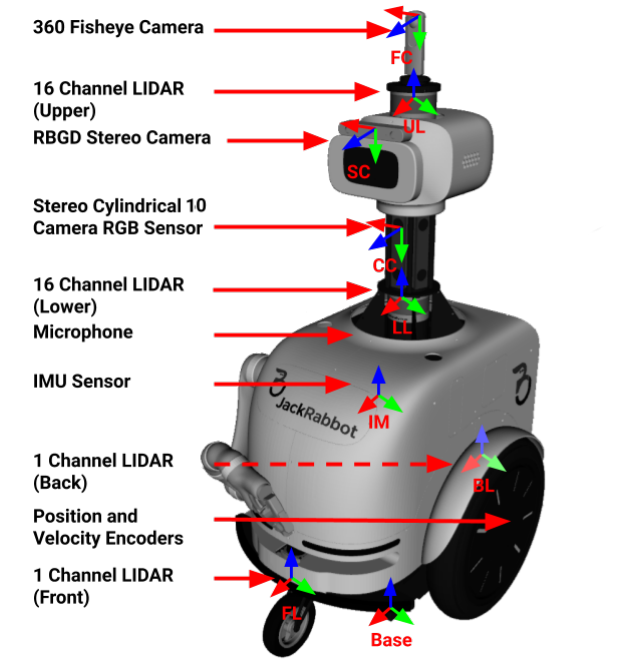
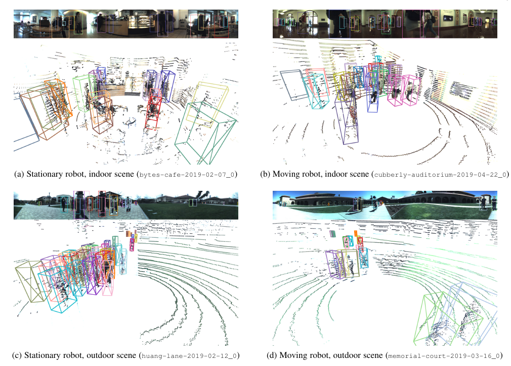

고정된 높은 카메라에서 사람을 보는 일과 사람 키에 가까운 이동로봇이 사람을 보는 일은 다릅니다. 가까운 한 사람이 뒤쪽 군중을 가리고, 로봇이 회전할 때 배경 전체가 움직이며, 실내 유리와 야외 햇빛이 센서마다 다른 오류를 만들어요. <abbr title="JackRabbot 이동로봇으로 사람 많은 실내외를 촬영한 다중 센서 데이터셋">JRDB</abbr>는 이 조건을 사람 검출과 추적 벤치마크로 만든 자료입니다.

공식 페이지는 54개 시퀀스, 60,000프레임 또는 64분의 360도 RGB와 LiDAR 자료를 안내합니다. 기본 JRDB 층에는 240만 개의 2차원 경계 상자와 180만 개의 3차원 경계 상자가 있어요. 후속 확장에는 행동, 집단 활동, 자세, 파노라마 분할 같은 다른 주석이 추가됐지만, 기본 JRDB 글에서는 사람 검출·추적용 2D/3D 주석과 센서 관측에 초점을 맞춰야 합니다.

<figure class="fig"><figcaption>JackRabbot은 높이와 방향이 다른 카메라·LiDAR를 한 몸체에 싣습니다. JRDB의 강점은 정답 상자만이 아니라 이 센서들이 실제 이동로봇 시점에서 만든 원자료를 함께 제공한다는 점입니다. (출처: Martín-Martín et al., <a href="https://arxiv.org/abs/1910.11792">JRDB: A Dataset and Benchmark of Egocentric Robot Visual Perception of Humans in Built Environments</a>, Fig. 1)</figcaption></figure>

## 센서 묶음이 사람 하나를 여러 방식으로 봐요

원 논문은 다섯 쌍의 스테레오 원통형 카메라가 15헤르츠로 360도 RGB 영상을 만들고, 위아래 두 대의 16채널 Velodyne LiDAR가 연속 3차원 점군을 기록한다고 설명합니다. 앞뒤의 SICK 평면 LiDAR, 30헤르츠 RGB-D, 어안 카메라, 오디오, 바퀴와 관절 인코더도 함께 있어요.

센서가 많다고 모든 프레임이 저절로 같은 순간을 뜻하지는 않습니다. 15헤르츠 카메라 간격은 약 0.0667초이고 30헤르츠 RGB-D 간격은 약 0.0333초예요. 가장 가까운 프레임을 붙여도 움직이는 사람과 로봇의 위치가 달라질 수 있습니다.

설명용으로 사람과 로봇의 상대 횡속도가 2미터/초이고 시간 차가 0.033초라면 위치 차이는 약 `2×0.033=0.066미터`입니다. 6.6센티미터는 멀리서 작아 보이지만 사람 경계와 좁은 통로의 최소거리에서는 무시하기 어려워요. 타임스탬프와 보간 규칙을 센서별로 기록해야 합니다.

좌표 변환도 필요합니다. 각 카메라와 LiDAR의 위치·방향을 로봇 기준 좌표로 옮기고, 로봇 움직임을 시간에 맞춰 보정해야 해요. 외부 보정이 1도 틀리면 10미터 거리의 횡방향 차이는 `10×sin(1°)≈0.175미터`입니다. 멀리 있는 사람일수록 각도 오차가 크게 번집니다.

## 360도 파노라마가 가림을 없애지는 않아요

주변을 한 바퀴 보는 영상은 뒤에서 다가오는 사람까지 기록합니다. 하지만 시야가 넓다는 것과 사람이 항상 보인다는 것은 다릅니다. 가까운 사람, 기둥, 가구, 문틀이 다른 사람을 가리고, 카메라 사이 경계에서 몸이 나뉠 수 있어요.

원통형 파노라마는 여러 카메라 영상을 이어 만듭니다. 경계 부근에서는 동일 인물이 두 영상에 걸치거나 상자 폭이 비정상적으로 길어질 수 있어요. 파노라마의 왼쪽 끝과 오른쪽 끝은 실제로 이웃하므로, 일반 평면 영상처럼 처리하면 한 사람을 멀리 떨어진 두 객체로 볼 수 있습니다.

2D 상자는 카메라 영상의 보이는 영역을 표시하고, 3D 상자는 점군 속 사람의 위치와 방향을 나타냅니다. 두 주석이 같은 ID로 이어진다는 점이 멀티모달 학습에 유용해요. 그러나 2D에서 잘 보이는 몸과 LiDAR가 맞은 점의 밀도는 거리와 가림에 따라 달라집니다.

설명용으로 파노라마 폭이 3,760픽셀이고 사람이 왼쪽 20픽셀과 오른쪽 25픽셀에 걸쳐 있다고 하겠습니다. 평면 상자 최소·최대만 잡으면 폭이 3,715픽셀인 거대한 객체가 됩니다. 원형 좌표를 인식하면 실제 폭은 `20+25=45픽셀`이에요. 경계 래핑을 지원하지 않는 증강과 손실 함수는 이런 사례를 망칩니다.

## 정지와 이동, 실내와 야외가 함께 있어요

논문은 30개 실내외 위치에서 54개 시퀀스를 모았고, 그중 33개가 실내, 21개가 야외라고 설명합니다. 32개는 로봇이 움직이며 촬영했고 22개는 정지 위치에서 촬영했어요. 같은 장소라도 이동 여부와 시점이 다르면 관측 난도가 달라집니다.

<figure class="fig"><figcaption>네 패널은 정지 실내, 이동 실내, 정지 야외, 이동 야외를 나란히 보여 줍니다. 같은 사람 지각 과제라도 점군 밀도·가림·배경 운동이 달라지므로 조건별 성능을 따로 봐야 해요. (출처: Martín-Martín et al., <a href="https://arxiv.org/abs/1910.11792">JRDB: A Dataset and Benchmark of Egocentric Robot Visual Perception of Humans in Built Environments</a>, Fig. 2)</figcaption></figure>

정지 로봇 장면은 배경이 안정적이어서 사람 운동을 분리하기 쉽습니다. 이동 로봇 장면에서는 정지한 기둥과 벽도 영상과 점군에서 움직이고, 자기 위치 추정 오차가 사람 속도에 섞여요. 둘을 합친 전체 점수만 보고 이동 중 성능을 판단하면 안 됩니다.

실내는 좁은 복도와 문, 반사 표면, 인공 조명이 있고 야외는 햇빛, 긴 거리, 넓은 공간이 있습니다. 3D LiDAR는 어두운 곳에서도 거리를 주지만 유리와 얇은 다리, 먼 사람에서 점이 적을 수 있어요. RGB는 색과 자세를 보지만 역광과 조명 변화에 약합니다.

분할할 때 같은 위치의 다른 시퀀스가 훈련과 시험에 나뉘면 배경과 통행 흐름을 기억할 수 있습니다. 위치, 날짜, 로봇 이동 상태를 함께 보류하는 평가가 필요해요. 무작위 프레임 분할은 인접 영상과 같은 사람을 양쪽에 넣는 가장 강한 누수입니다.

## 240만 상자는 240만 독립 사건이 아니에요

JRDB의 큰 주석 수는 밀집 장면과 연속 프레임에서 나옵니다. 같은 사람이 여러 카메라와 많은 프레임에 반복해서 나타나요. 240만 2D 상자를 독립 사람 사례 240만 개로 해석하면 데이터 다양성을 과장합니다.

원 논문은 3,500개가 넘는 시간 일관 궤적을 함께 언급합니다. 독립성은 상자보다 궤적과 시퀀스에 가까워요. 모델 신뢰구간을 계산할 때 프레임 상자를 무작위로 다시 뽑으면 같은 사람이 여러 번 들어가 불확실성이 지나치게 작아집니다.

설명용으로 한 사람 궤적이 15헤르츠에서 20초 이어지면 한 카메라에 약 `15×20=300개` 상자가 생깁니다. 다섯 카메라에 걸친 관측을 모두 세면 최대 1,500개 레코드가 될 수 있어요. 하지만 행동과 옷차림, 장소는 한 사건에서 강하게 연결돼 있습니다.

프레임 수, 상자 수, 궤적 수, 위치 수를 함께 보고해야 합니다. 드문 가림이나 먼 거리 사례의 수를 셀 때도 상자와 독립 시퀀스를 구분해요. 성능 차이의 통계 검정은 시퀀스나 궤적 단위로 하는 편이 타당합니다.

## 2D와 3D 정답은 서로 다른 실패를 보여 줘요

2D 검출은 영상 상자를 얼마나 잘 찾았는지 평가합니다. 3D 검출은 점군과 센서 좌표에서 사람의 위치·크기·방향을 맞혀야 해요. 영상 상자가 정확해도 깊이를 잘못 추정할 수 있고, 점군 상자가 맞아도 파노라마 경계의 2D 표현은 틀릴 수 있습니다.

3D 상자의 겹침 비율은 사람처럼 좁고 세로로 긴 객체에서 위치 오차에 민감합니다. 설명용으로 바닥에서 0.6미터×0.6미터인 두 상자가 x축으로 0.2미터 어긋나고 다른 축은 같다고 하겠습니다. 바닥 겹침은 `0.4×0.6=0.24제곱미터`, 합집합은 `0.36+0.36-0.24=0.48제곱미터`라 겹침 비율은 0.5입니다. 20센티미터 차이만으로 임계값 경계에 걸려요.

거리별 성능을 봐야 하는 이유도 같습니다. 멀리 있는 사람은 영상에서 작고 LiDAR 점이 적습니다. 전체 점수는 가까운 큰 상자가 지배할 수 있어요. 거리 구간, 가림 수준, 실내외, 이동 여부를 나눠야 센서 융합의 실제 이득을 알 수 있습니다.

정답 자체도 완전한 세계 상태는 아닙니다. 심하게 가려진 사람의 상자 범위와 방향에는 주석 불확실성이 있고, 센서 범위 밖 사람은 기록되지 않아요. 정답을 절대 무오류로 보기보다 품질 표식과 난도별 결과를 함께 읽어야 합니다.

## 추적 ID는 위치 정확도와 다른 축이에요

검출기가 모든 사람 상자를 찾더라도 프레임 사이 ID를 자주 바꾸면 한 사람의 속도와 미래를 계산할 수 없습니다. 반대로 ID는 잘 이어도 상자 위치가 크게 흔들리면 최소거리와 궤적 예측이 나빠져요. 검출, 위치, 연속성을 분리해야 합니다.

가림 뒤 재등장은 어려운 사례입니다. 사람이 기둥 뒤로 2초 사라졌다가 나오면 15헤르츠 영상에서 약 30프레임의 관측 공백이 생깁니다. 옷차림과 예상 위치로 같은 사람을 찾아야 하지만 비슷한 사람이 많은 군중에서는 오연결 위험이 커요.

설명용으로 ID가 바뀌기 전 속도가 1.2미터/초이고 잘못 연결된 다른 사람이 반대쪽 1.0미터/초로 걷는다면 연결점의 속도 변화는 2.2미터/초 이상으로 보일 수 있습니다. 예측기는 이를 급회전이나 가속으로 오해해요. 위치 오차 평균만으로는 이런 오류를 찾기 어렵습니다.

추적 평가 뒤에 궤적 예측을 붙일 때는 정답 ID 입력과 자동 ID 입력을 나눠야 합니다. 정답 조건은 예측 모델을, 자동 조건은 전체 파이프라인을 봅니다. 두 결과 차이가 크면 예측 구조를 바꾸기 전에 추적 실패를 고치는 편이 낫습니다.

## 센서 융합은 누락을 줄이지만 공통 원인이 있어요

RGB와 LiDAR는 서로 보완적입니다. 색과 자세가 필요한 곳에서는 영상이 강하고, 거리와 어두운 환경에서는 LiDAR가 도움을 줍니다. 한 센서의 검출을 다른 센서로 확인하면 오검출을 줄일 수 있어요.

하지만 두 센서가 항상 독립적으로 실패하지는 않습니다. 사람이 기둥 뒤에 완전히 가려지면 영상과 LiDAR 모두 보지 못합니다. 시간 동기화가 틀리면 두 관측이 서로 다른 사람 위치를 가리켜 융합이 오히려 나빠져요. 외부 보정 오류도 장면 전체에 체계적으로 퍼집니다.

센서 제거 시험은 단순 성능 비교보다 실패 조건을 보여 줘야 합니다. RGB만, LiDAR만, 두 센서 융합을 거리·조명·가림별로 비교하고, 한 센서가 늦거나 끊긴 입력을 넣습니다. 융합 모델이 결측을 이상한 값으로 받아들이지 않고 신뢰도를 낮추는지 봐야 해요.

설명용으로 RGB 검출 누락률 10%, LiDAR 누락률 20%가 독립이라면 둘 다 놓칠 확률은 `0.1×0.2=2%`입니다. 그러나 완전 가림이라는 공통 원인이 8% 있다면 실제 동시 누락은 최소 8% 수준일 수 있어요. 독립성 가정은 융합 이득을 과장할 수 있습니다.

## 기본 JRDB는 사회적 행동 정책의 정답이 아니에요

기본 데이터의 핵심 정답은 사람의 2D·3D 상자와 추적입니다. 사람의 개인 공간 선호, 로봇이 지나가도 되는 쪽, 양보 의도, 불편 점수는 기본 주석에 없습니다. 후속 JRDB-Act와 JRDB-Social의 행동·집단 문맥도 기본 검출 글과 섞어 쓰면 안 돼요.

사람 위치를 잘 아는 것은 사회적 주행의 필요 조건이지만 충분 조건은 아닙니다. 계획기는 로봇의 폭과 제동, 사람의 미래, 장소 규칙, 목표를 함께 고려해야 해요. 검출 평균정밀도가 높다고 충돌률이나 사람의 불편이 자동으로 낮아지지 않습니다.

자료 수집 로봇이 움직였다는 사실도 정책 평가와 다릅니다. JackRabbot이 캠퍼스를 지나며 센서를 기록했지만, 여러 사회적 계획기의 행동을 사람에게 반복 제시해 비교한 사용자 연구는 기본 JRDB 벤치마크의 목적이 아니에요. 수집 플랫폼과 평가 대상 정책을 구분해야 합니다. [[2026-10-17_socialnav_scand|실물 원격조종 시연으로 사회적 주행을 배우는 데이터셋]]처럼 센서와 조종 명령을 함께 기록한 자료와 비교하면, JRDB 기본 층이 지각 정답에 집중한다는 차이가 더 분명해요.

로봇 주행에 쓰려면 검출·추적 결과를 예측과 계획에 연결하고, 닫힌 고리에서 로봇 행동이 사람 반응을 바꾸게 해야 합니다. 기록 재생은 같은 센서 입력을 반복 비교하기 좋지만 사람은 가상 로봇을 피해 주지 않아요.

## 데이터 분할은 장소와 사람 궤적을 보호해야 해요

연속 센서 자료에서 무작위 프레임 분할은 거의 같은 영상과 점군을 양쪽에 넣습니다. 같은 사람이 몇 프레임 차이로 훈련과 시험에 나타나고, 배경도 같습니다. 모델이 옷과 장소를 기억해도 일반화로 보일 수 있어요.

시퀀스 분할은 첫 방어선입니다. 더 엄격하게는 같은 장소의 반복 촬영을 한쪽에 모으고, 이동·정지 조건과 실내외 비율을 보고합니다. 사람 ID가 시퀀스 안에서만 유효하다면 전역 ID를 만들 때 파일명을 포함해야 해요.

후속 주석을 결합할 때 누수 경로가 더 늘어납니다. 같은 원 프레임의 자세나 행동 라벨을 다른 과제의 시험 분할에서 학습하면 기본 검출 시험을 간접으로 본 셈이 될 수 있어요. JRDB, JRDB-Traj, JRDB-Social의 분할과 원 시퀀스 대응을 표로 관리해야 합니다.

전처리 캐시도 분할 뒤 만들어야 합니다. 전체 자료로 학습한 검출기나 추적기가 시험 시퀀스의 사람을 이미 봤다면 그 출력을 궤적 예측의 입력으로 쓰는 순간 누수가 전파돼요. 각 단계의 훈련 자료 provenance를 연결해야 합니다.

## 라이선스와 접근 절차를 주석 층마다 확인해요

현재 공식 홈페이지는 JRDB 자료를 Creative Commons Attribution-NonCommercial-ShareAlike 3.0으로 안내합니다. 다운로드에는 로그인이 필요할 수 있어요. 출처 표시, 비상업 조건, 동일 조건 공유 요구를 확인하고 계정 접근을 우회하지 않아야 합니다.

후속 저장소의 코드 라이선스가 데이터 권리를 대신하지 않습니다. 기본 센서 데이터, JRDB-Social 주석, 평가 코드가 서로 다른 경로에 있으면 각각의 라이선스와 이용 조건을 확인해야 해요. 코드가 허용적이라고 영상과 사람 주석을 같은 조건으로 재배포할 수 있는 것은 아닙니다.

공개 글에 원 그림을 사용할 때도 논지에 필요한 범위만 골라야 합니다. 이 글은 센서 배치와 네 관측 조건을 설명하는 Fig. 1·2의 패널만 사용했고, 주변 논문 본문은 포함하지 않았어요. 공개 데이터 라이선스와 논문 그림의 권리 범위도 구분했습니다.

## 재현 가능한 지각 평가 순서

첫째, 센서 파일과 타임스탬프의 무결성을 확인합니다. 시퀀스별 프레임 수, 센서 주기, 누락 구간, 시간 역행, 로봇 자세 불연속을 기록해요. 15헤르츠와 30헤르츠 스트림을 어떤 기준 시각으로 맞췄는지 남깁니다.

둘째, 보정을 시각화합니다. 3D 상자를 각 카메라에 투영하고, LiDAR 사람 점과 영상 상자가 거리·방향별로 맞는지 봐요. 파노라마 경계의 래핑과 카메라 사이 중복을 따로 검사합니다.

셋째, 분할을 원 시퀀스와 장소 단위로 고정합니다. 프레임을 자르기 전에 훈련·검증·시험을 나누고, 이동·정지와 실내외 비율을 공개해요. 다른 JRDB 확장 주석을 쓸 때 원 프레임 겹침을 감사합니다.

넷째, 조건별 지표를 냅니다. 2D와 3D, 가까운 거리와 먼 거리, 가림 수준, 실내외, 이동 여부, 파노라마 경계를 나눠요. 추적은 위치 오차와 ID 연속성을 함께 보고, 시퀀스 단위 신뢰구간을 계산합니다.

다섯째, 사회적 주행 이전은 별도 실험으로 둡니다. 자동 검출·추적을 사람 미래 예측과 계획기에 연결하고, 센서 누락과 지연을 주입합니다. 닫힌 고리 시뮬레이션과 안전 장치가 있는 실물 평가에서 최소거리, 충돌 예상 시간, 목표 도달, 불필요한 정지, 사람 불편을 측정해요.

JRDB의 큰 기여는 사람 많은 환경을 이동로봇의 실제 높이와 센서 묶음으로 기록하고, 2D·3D 검출과 추적을 같은 시퀀스에서 비교하게 만든 데 있습니다. 정지·이동, 실내·야외, 가까운 사람·심한 가림이 함께 있어 고정 조감 데이터가 숨기는 지각 문제를 드러내요.

그렇다고 240만 상자와 180만 3D 상자가 사회적 주행 정책을 증명하지는 않습니다. 센서 시간과 보정, 파노라마 경계, 궤적 독립성, 장소 누수를 확인하고 기본 지각 주석과 후속 사회 문맥을 구분해야 해요. 그 위에서 예측·계획·사람 반응을 새로 평가할 때 JRDB는 사회적 로봇의 눈을 검증하는 강한 기반이 됩니다.

---

<!-- src-block -->
출처 — https://jrdb.erc.monash.edu/dataset/
