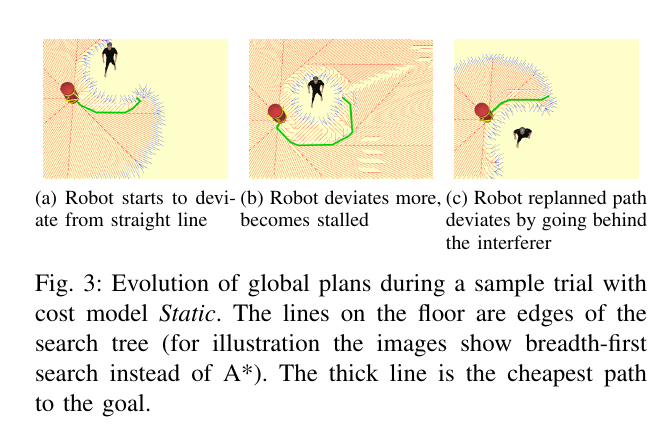
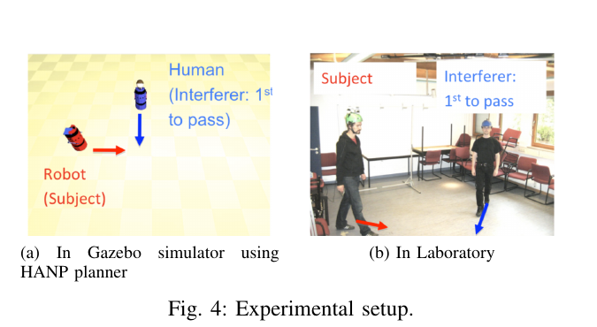

복도에서 사람과 로봇이 직각으로 마주칠 때 충돌하지 않는 경로는 여러 개입니다. 로봇이 먼저 지나가도 되고, 속도를 줄여 사람 뒤로 통과해도 돼요. 안전만 보면 두 선택 모두 가능하지만, 로봇이 앞쪽으로 움직이다가 멈추고 다시 사람 뒤로 돌아가면 관찰자는 다음 움직임을 읽기 어렵습니다. 이 논문이 다루는 문제는 경로의 최종 안전성보다 계획을 반복하는 동안 드러나는 의도의 일관성입니다.

Thibault Kruse와 동료들은 사람 주변에 고정된 비용을 놓는 기존 사람 인지 계획기가 동적 교차에서 이상한 행동을 만들 수 있다고 지적합니다. 사람이 움직일 때마다 최저 비용 경로가 바뀌어 로봇이 앞 통과와 뒤 통과 사이에서 결정을 늦게 뒤집기 때문이에요. 저자들은 사람-사람 교차 관측에서 경로 굴곡보다 속도 조절이 두드러진다는 점을 이용해, 같은 위치라도 진입 방향에 따라 비용을 낮추는 <abbr title="진입 방향과 사람의 진행 방향을 함께 보는 상황 의존 비용 모델">ContextCost</abbr>를 제안합니다.

여기서 ‘읽기 쉬움’은 모든 상황에 통하는 심리 척도가 아닙니다. 논문은 사람의 교차 행동과 질적으로 비슷한 로봇 움직임을 더 읽기 쉬운 것으로 다룹니다. 사람 참가자가 로봇의 목표를 얼마나 빨리 맞혔는지 측정한 연구가 아니며, 실제 로봇이 사람 사이를 주행한 사용자 평가도 아닙니다. 인간 보행 실험과 Gazebo 로봇 시뮬레이션을 분리해 읽어야 논문의 기여와 빈틈이 정확히 보입니다.

## 고정 비용은 움직이는 사람 앞에서 계획을 뒤집어요

사람 주변 비용 지도는 보통 위치마다 벌점을 붙입니다. 사람과 가까운 칸, 정면 시야를 가리는 칸, 뒤에서 갑자기 나타나는 칸에 높은 비용을 놓고 경로 길이와 합쳐 가장 싼 길을 찾는 방식이에요. 이 구조는 정지한 사람 주변을 돌아갈 때 직관적입니다. 같은 공간을 지나는 방향이 달라도 그 칸의 값은 그대로입니다.

움직이는 사람과의 교차에서는 위치만으로 의미를 정하기 어렵습니다. 사람과 나란히 같은 방향으로 이동하는 칸과 사람을 정면으로 가로지르는 칸이 물리적으로 같은 위치일 수 있어요. 고정 비용은 두 경우를 같은 벌점으로 처리합니다. 계획기는 사람이 한 걸음 움직일 때마다 새 비용 지도를 보고 최단 경로를 다시 고르지만, 이전 계획에서 이미 실행한 속도와 방향은 비용 계산에 남지 않습니다.

논문의 직각 교차 장면에서 초기 계획은 사람 앞쪽을 지나갑니다. 사람이 교차점으로 다가오면 앞쪽 여유가 줄어 더 큰 우회를 고르고, 어느 순간 사람 뒤쪽 경로가 더 싸집니다. 로봇은 앞 통과를 암시하는 방향으로 움직인 뒤 정체하고, 늦게 뒤 통과로 바꿔요. 최종 경로마다 충돌이 없어도 연속해서 보면 목표 지향성이 약하고 의도가 흐립니다.

<figure class="fig"><figcaption>사람 역할의 이동체가 전진하자 최저 비용 전역 경로가 앞 통과에서 뒤 통과로 늦게 바뀝니다. 굵은 선은 각 시점의 최저 비용 경로이며, 세 장면을 이어 보면 재계획의 결정을 읽기 어려운 이유가 드러납니다. (출처: Kruse et al., Legible Robot Navigation in the Proximity of Moving Humans, Fig. 3, https://hal.science/hal-01571940/document)</figcaption></figure>

이 실패를 센서 지연으로만 설명하면 핵심을 놓칩니다. 정확한 사람 위치를 즉시 받아도 고정 비용의 최적 경로 순위는 사람이 움직이면서 바뀔 수 있어요. 문제는 관측 오차 이전에 목적함수의 표현에 있습니다. 계획할 때 선택한 통과 방식과 실행 중 드러낸 의도를 보존하는 항이 없기 때문입니다.

[[2026-10-17_socialnav_human-aware-planner|사람을 고려한 이동 계획기가 거리·시야·가림을 비용으로 푸는 방식]]이 여러 사회적 요구를 공간 비용으로 합치는 구조를 보여 준다면, 이 논문은 그 비용을 위치에 고정했을 때 생기는 동적 모순을 한 장면으로 좁혀 보여 줍니다. 더 많은 비용층을 쌓는 것만으로는 방향에 따른 의미 차이가 생기지 않습니다.

## 사람은 길을 크게 휘기보다 속도로 양보했어요

저자들은 두 사람이 직각으로 교차하는 실험을 만들었습니다. 한 사람은 상대를 보지 않고 먼저 통과하려 했고, 참가자는 반대편 목표로 이동하며 충돌을 피했습니다. 참가자의 위치와 속도 변화를 기록해 경로를 얼마나 휘었는지, 언제 감속하고 다시 가속했는지 살폈어요.

관측에서는 참가자가 직선에 가까운 경로를 유지하면서 속도를 조절하는 경향이 나타났습니다. 교차점에 먼저 도달하려는 사람을 보내고 자신은 느려졌다가 다시 빨라지는 식입니다. 즉 이 장면의 양보는 옆으로 크게 휘는 기하 변화보다 진행 속도의 시간 변화에 더 많이 담겼습니다.

<figure class="fig"><figcaption>왼쪽은 계획기 비교에 쓴 Gazebo 장면이고 오른쪽은 사람-사람 교차를 기록한 실험실입니다. 같은 기하를 맞췄지만 사람 실험과 로봇 평가는 서로 다른 단계라는 점이 중요합니다. (출처: Kruse et al., Legible Robot Navigation in the Proximity of Moving Humans, Fig. 4, https://hal.science/hal-01571940/document)</figcaption></figure>

이 결과는 “사람은 항상 직선으로 가고 속도만 바꾼다”는 규칙이 아닙니다. 실험은 목표와 교차 각도, 역할을 통제한 작은 장면이에요. 좁은 문, 짐을 든 사람, 어린이, 휠체어, 여러 방향의 군중에서는 옆걸음이나 큰 우회가 더 자연스러울 수 있습니다. 관찰된 전략을 넓은 환경의 불변 법칙으로 바꾸면 안 됩니다.

논문이 말하는 읽기 쉬움도 이 관찰에 묶여 있습니다. 사람과 비슷하게 직선 경로를 유지하고 속도로 양보하면 관찰자가 로봇 목표를 더 쉽게 추론할 것이라는 가정이에요. 하지만 참가자에게 여러 로봇 경로를 보여 주고 목표 추론 정확도나 편안함을 묻지는 않았습니다. 사람 유사성은 읽기 쉬움의 근거 후보이지 사용자 평가의 대체값이 아닙니다.

## 위치 비용에 들어온 방향이 결정을 안정시켜요

ContextCost는 사람 주변의 기본 비용을 없애지 않습니다. 기본 비용에 방향 호환성을 나타내는 0에서 1 사이 계수를 곱합니다. 계획 중인 다음 칸과 이전 칸으로 로봇의 잠재 진행 방향을 구하고, 사람의 진행 방향 및 예상 경로와 비교해 같은 위치의 비용을 다르게 만들어요.

사람 예상 경로와 멀리 떨어진 칸은 충돌 가능성이 낮아 공간적으로 호환됩니다. 가까이 있더라도 사람과 같은 방향으로 흐르면 정면 충돌보다 호환성이 높을 수 있어요. 사람 경로 가까이에서 반대 방향으로 파고드는 경우에는 기본 사회 비용을 거의 유지합니다. 이 때문에 계획기는 같은 칸을 어느 방향으로 통과하는지까지 상태의 일부로 보게 됩니다.

비용식은 `상황 비용 = 고정 비용 × 비호환 계수`로 읽을 수 있습니다. 계수가 0이면 해당 방향에서는 사람 주변 벌점이 사라지고, 1이면 고정 비용을 그대로 받습니다. 중간값은 거리와 각도 구간에서 선형으로 이어집니다. 논문은 직각에 가까운 교차에서 사람 참가자가 경로를 휘지 않았다는 관측을 반영해 방향 임계값을 정합니다.

설명용 가정을 하나 두겠습니다. 어떤 칸의 고정 비용이 42이고 같은 흐름을 따르는 방향의 비호환 계수가 0.1이면 상황 비용은 `42×0.1=4.2`입니다. 반대로 사람 앞을 가로지르는 방향의 계수가 0.8이면 `42×0.8=33.6`이에요. 위치는 같아도 계획 방향이 달라지면 29.4의 차이가 생깁니다. 이 수치는 논문 성능 결과가 아니라 곱셈 구조를 설명하기 위한 자체 계산입니다.

이 구조는 방향성을 얻는 대신 탐색 상태를 더 복잡하게 만듭니다. 한 칸의 비용을 지도 생성 단계에서 한 번 계산해 둘 수 없고, 어떤 이전 칸에서 들어왔는지 알아야 합니다. 같은 좌표라도 진입 방향이 다르면 비용이 달라져요. 계획기의 폐집합 처리나 휴리스틱이 위치만 상태로 가정한다면 더 싼 방향 상태를 일찍 버릴 수 있습니다.

논문은 급격한 회전을 제한하도록 이웃 확장 규칙도 바꿉니다. 이 변경은 상황 비용과 함께 결과에 영향을 줍니다. 성능 차이를 비용식 하나의 효과로만 돌리려면 같은 이웃 규칙에서 고정 비용과 상황 비용을 비교하는 추가 소거 실험이 필요해요. 경로의 직진성이 좋아졌다면 방향 비용과 회전 제한 중 어느 쪽이 얼마나 기여했는지 분리해야 합니다.

## 논문의 로봇 결과는 Gazebo 시뮬레이션이에요

로봇 비교는 Gazebo 안의 두 차동구동 B21 모델로 수행됐습니다. 하나는 일정한 전략으로 움직이는 사람 역할의 이동체이고, 다른 하나는 HANP 계획기로 목표를 향합니다. 사람 실험과 교차 좌표를 맞추고 고정 비용과 ContextCost의 움직임을 비교했어요.

고정 비용에서는 로봇이 앞 통과를 시도하다가 멈추고 뒤쪽으로 바꾸는 경로가 나타났습니다. ContextCost에서는 짧은 경로를 유지하면서 속도 변화로 교차를 풀었습니다. 논문은 반복 시뮬레이션에서 이동 시간이 줄고 사람의 속도 조절과 질적으로 가까운 행동을 보였다고 보고합니다.

여기서 실물 근거를 과장하기 쉽습니다. 실제 사람 열 명의 교차 보행은 실험실에서 측정했지만, 그 관측으로 만든 비용 모델의 로봇 실행은 시뮬레이션입니다. 저자들은 실제 로봇에서 행동을 실행하는 일을 필요한 다음 단계로 남깁니다. 실물 사람 데이터가 있다는 사실을 실물 사람-로봇 사용자 실험으로 바꾸어 말하면 안 됩니다.

논문 조건의 최대 속도 0.2미터/초와 방해자가 없을 때의 17.5초를 곱하면 이동 거리는 `0.2×17.5=3.5미터`입니다. 이는 실험 축의 규모를 읽는 계산입니다. 상용 실내 로봇이 더 빠르게 움직이거나 제동 거리가 길면 같은 각도와 거리 임계값으로 같은 행동이 나오지 않습니다.

시간 차이도 물리 환경 전체의 처리량으로 해석할 수 없습니다. 한 대의 일정한 방해 이동체와 한 대의 로봇이 직각으로 만나는 장면에서 나온 값이에요. 사람이 속도를 바꾸거나 멈추고, 두 번째 사람이 들어오고, 로봇 위치 추정이 흔들리면 경로 전환 횟수와 도착 시간이 달라집니다.

## 읽기 쉬움과 예측 가능성은 관찰자에 따라 달라요

로봇이 목표를 향해 곧게 가면 목적지는 읽기 쉬울 수 있습니다. 그러나 바로 앞의 사람이 로봇이 감속할지 모르면 통과 순서는 읽기 어려울 수 있어요. 목표의 가시성과 양보 순서의 가시성은 다른 질문입니다. 이 논문은 경로 일관성을 통해 두 문제를 일부 연결하지만 별도 측정으로 분해하지는 않습니다.

관찰자 위치도 중요합니다. 로봇 정면의 사람은 속도 감소를 보지만 뒤쪽 사람은 바퀴 속도를 보기 어렵습니다. 사람의 진행 방향과 시야를 고려하지 않은 채 속도 프로파일만 부드럽게 만들면 의도가 전달되지 않을 수 있어요. 조명, 가림, 로봇 외형, 표시등이나 소리 같은 신호도 해석에 영향을 줍니다.

예측 가능성은 “현재 움직임을 보고 다음 움직임을 맞히기 쉬운가”에 가깝고, 목표 가독성은 “현재 움직임이 여러 목표 중 어느 목표를 드러내는가”에 가깝습니다. 안전성은 다시 별도입니다. 읽기 쉬운 빠른 통과가 제동 한계를 넘을 수 있고, 매우 안전한 정지가 목표를 숨길 수 있어요. 한 점수로 합치면 어느 축이 좋아지고 나빠졌는지 알기 어렵습니다.

배포 평가는 최소한 네 값을 따로 기록할 필요가 있습니다. 충돌과 최소거리 같은 물리 안전, 도착 시간과 정체 같은 효율, 통과 방향을 바꾼 횟수 같은 행동 일관성, 사람이 로봇의 목표와 양보 순서를 맞힌 비율 같은 해석 가능성입니다. 편안함과 신뢰는 설문으로 따로 물어야 해요.

## 사람 속도를 안다고 가정하면 현장에서 쉽게 깨져요

ContextCost는 사람 위치뿐 아니라 진행 방향을 요구합니다. 짧은 관측 구간에서 속도가 거의 0이면 방향이 불안정합니다. 서 있는 사람이 몸만 돌렸을 때 몸 방향을 진행 방향으로 쓰면 아직 시작하지 않은 움직임을 확정할 수 있어요. 반대로 위치 차분으로만 속도를 구하면 센서 잡음이 큰 각도 변화를 만듭니다.

설명용 가정으로 10헤르츠 추적에서 한 프레임 위치 오차가 좌우 3센티미터라고 해볼게요. 정지한 사람의 두 관측이 오차의 반대쪽에 찍히면 0.1초 동안 6센티미터 이동한 것처럼 보여 겉보기 속도는 `0.06/0.1=0.6미터/초`가 됩니다. 실제 보행이 없어도 방향 호환성이 크게 바뀔 수 있어요. 속도 추정에는 정지 상태, 신뢰 구간, 최소 관측 길이가 필요합니다.

사람의 예상 경로를 현재 방향으로 무한히 뻗는 것도 위험합니다. 코너를 돌거나 문 앞에서 멈추거나 일행에게 합류하면 직선 외삽이 틀려요. 예측 지평을 짧게 제한하고 여러 목표 후보를 유지하며, 신뢰도가 낮을 때는 방향 비용의 완화를 줄이는 방식이 필요합니다.

사람 목표는 로봇 목표처럼 주어진 값이 아닙니다. 로봇 계획기는 자신의 목적지를 알고 있지만 보행자 목적지는 관측에서 추정해야 해요. 사람 목표를 정답으로 넣은 시뮬레이션과 센서 기반 추정을 쓰는 배포 조건을 섞으면 계획기의 실제 난이도가 사라집니다.

여러 사람이 있을 때는 쌍별 호환성을 최댓값으로 합치는 방식도 검토해야 합니다. 한 사람과 같은 방향으로 흐르는 칸이 다른 사람의 정면을 가로지를 수 있어요. 각 사람에 대한 비용을 최댓값으로 잡으면 가장 위험한 한 명은 보존하지만 군중 전체의 작은 부담이 누적되지 않습니다. 합을 쓰면 밀집도에 따라 비용 크기가 폭증할 수 있습니다.

## 속도 계층이 따르지 않으면 전역 경로만 읽기 쉬워요

ContextCost는 전역 경로 검색의 비용을 바꿉니다. 실제 바퀴 명령은 지역 제어기가 만듭니다. 전역 계획이 직선을 유지하고 감속으로 양보하려 해도 지역 제어기가 동적 장애물을 피해 옆으로 크게 틀면 관찰되는 행동은 달라져요. 경로의 의도와 속도 실행이 같은 통과 결정을 공유해야 합니다.

전역 계획 주기가 느리면 사람 방향 변화가 늦게 반영됩니다. 반대로 너무 자주 재계획하면 작은 추정 잡음에도 비용 순위가 바뀌어 경로가 떨릴 수 있어요. 이전 통과 결정에 약한 지속성 비용을 주고, 안전이 악화될 때만 결정을 바꾸는 히스테리시스가 도움이 될 수 있습니다. 다만 고집이 세면 실제 사람이 방향을 바꿨을 때 위험해집니다.

설명용 지연 계산을 해보겠습니다. 사람이 1.2미터/초로 걷고 감지·추적·계획·제어의 합산 지연이 0.25초라면 그 사이 `1.2×0.25=0.30미터`를 이동합니다. 15센티미터 격자를 쓴다면 두 칸 차이예요. 비용 함수가 정교해도 입력 시점이 두 칸 뒤라면 계획 순위가 틀릴 수 있습니다. 이 수치는 배포 지연의 영향을 보여 주는 자체 가정입니다.

제동도 함께 봐야 합니다. 로봇이 0.8미터/초이고 편안한 감속도를 0.8미터/초²로 가정하면 정지 시간은 1초, 이상적인 제동 거리는 `0.8²/(2×0.8)=0.4미터`입니다. 인지 지연 0.25초 동안 0.2미터를 더 가므로 총 0.6미터가 필요해요. 논문의 느린 시뮬레이션에서 자연스러운 속도 양보가 더 빠른 플랫폼에서도 안전하다고 바로 옮길 수 없는 이유입니다.

## 재현은 비용식보다 결정 전환을 먼저 측정해야 해요

첫 단계에서는 논문의 직각 교차를 닫힌 고리 시뮬레이션으로 만듭니다. 사람 역할 행위자의 속도와 시작 시점을 조금씩 바꾸고 고정 비용과 ContextCost를 같은 지역 제어기, 같은 이웃 규칙으로 비교해요. 도착 시간만 보지 말고 앞·뒤 통과 결정 전환 횟수, 경로 곡률, 정지 시간, 최소거리를 함께 기록합니다.

둘째 단계에서는 방향 비용과 회전 제한을 분리합니다. 고정 비용과 상황 비용 각각에 기존 이웃 규칙과 제한된 이웃 규칙을 조합해 네 조건을 만듭니다. 그래야 직선성이 비용 모델에서 왔는지 탐색 제약에서 왔는지 알 수 있어요. 모든 조건에서 같은 센서 지연과 속도 한계를 써야 합니다.

셋째 단계에서는 관측 오차를 넣습니다. 정지한 사람, 천천히 출발하는 사람, 교차 직전에 방향을 바꾸는 사람, 추적 식별자가 바뀌는 사람을 나눠 테스트해요. 사람 방향 신뢰도가 낮을 때 비용이 고정 비용 쪽으로 안전하게 돌아가는지 확인합니다.

넷째 단계가 실물 로봇과 사람 평가입니다. 참가자에게 로봇의 목표와 먼저 지나갈 행위자를 여러 시점에서 고르게 하면 의도 해석 시간을 측정할 수 있어요. 동시에 최소거리, 사람의 감속 시작점, 로봇을 위해 비킨 거리, 편안함을 기록합니다. 목표를 빨리 맞혔어도 사람이 과하게 양보했다면 좋은 사회적 주행으로 보기 어렵습니다.

실험 보고서에는 사람 속도 추정법과 지연, 격자 크기, 전역·지역 계획 주기, 통과 결정 유지 규칙을 남겨야 합니다. “ContextCost 사용”만 적으면 같은 행동을 재현할 수 없습니다. 비용 계수와 각도 임계값은 센서와 플랫폼 동역학에 묶여 있어요.

## 이 논문의 핵심은 비용 지도의 차원을 하나 늘린 데 있어요

사람 주변 비용을 높이는 것만으로는 사회적 행동이 만들어지지 않습니다. 움직이는 사람과의 관계는 어디에 있는지뿐 아니라 어느 방향으로 지나가는지에 달려 있어요. ContextCost는 이전 경로 칸을 비용 계산에 넣어 위치 비용을 진입 방향의 함수로 바꿨습니다. 이 작은 변화가 앞 통과와 뒤 통과 사이의 늦은 번복을 줄이는 근거가 됩니다.

동시에 증거의 범위는 좁습니다. 사람 열 명의 통제된 직각 교차에서 속도 조절 경향을 관찰했고, 그 아이디어를 두 B21 모델의 Gazebo 시뮬레이션에서 비교했습니다. 실제 사람이 로봇의 의도를 더 잘 읽었는지, 밀집 군중이나 다양한 플랫폼에서도 같은 설정이 통하는지는 이 논문만으로 답할 수 없습니다.

배포에서는 방향 추정의 신뢰도, 지역 제어기의 속도 실행, 제동 거리, 여러 사람의 상충 관계를 함께 다뤄야 합니다. 그리고 경로 유사성, 물리 안전, 사람이 느낀 편안함, 목표 해석 정확도를 나눠 평가해야 해요. 그래야 “사람처럼 보인다”는 정성 판단이 실제로 읽기 쉽고 부담을 덜 주는 주행으로 이어졌는지 확인할 수 있습니다.

---

<!-- src-block -->
출처 — https://www.researchgate.net/publication/254037213_Legible_robot_navigation_in_the_proximity_of_moving_humans
