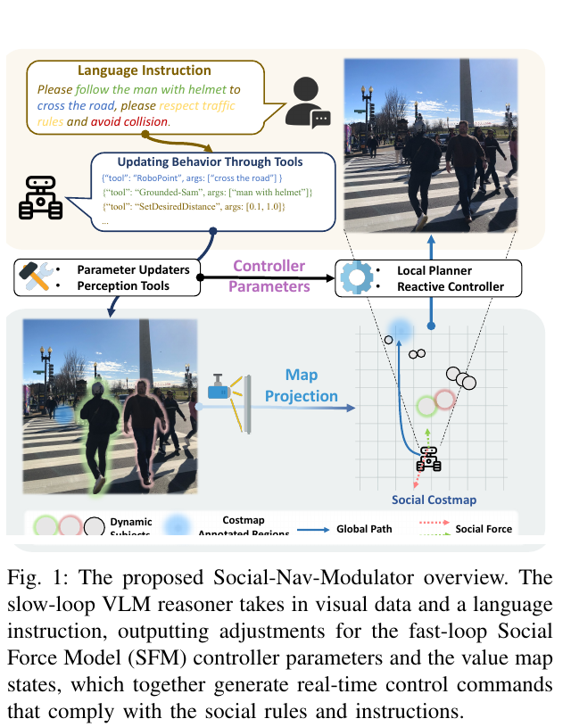
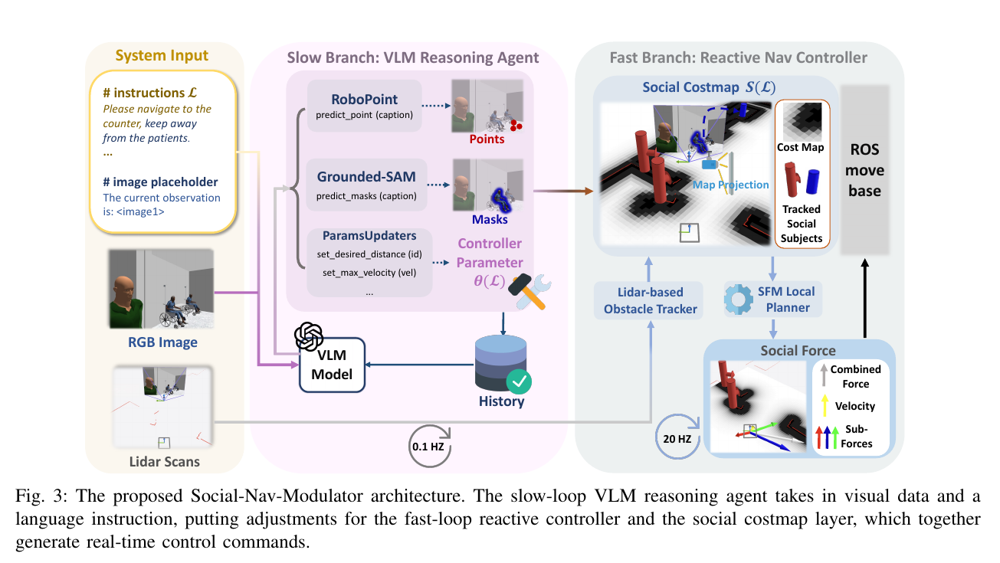

“사람을 따라가되 잔디에는 들어가지 마세요” 같은 지시는 목표 좌표만으로 표현하기 어려워요. 장면 속 대상과 금지 영역을 이해해야 하고, 사람과 장애물이 움직이면 짧은 주기로 회피해야 해요. LISN은 이 두 시간 규모를 하나의 거대 시각언어 모델에 맡기지 않고, 느린 의미 판단이 비용지도와 제어기 매개변수를 조절하고 빠른 제어기가 실제 속도를 내는 계층으로 나눠요.

## LISN-Bench는 언어 지시까지 주행 조건으로 넣어요

LISN-Bench는 Rosnav-Arena 3.0을 바탕으로 만든 시뮬레이션 평가 환경이에요. 기존 사회적 주행이 목표 도달과 충돌 회피를 주로 묻는 데서 나아가, 사용자 지시 준수와 장면 이해를 함께 평가해요. 특정 사람 따라가기, 지시로 금지된 영역 피하기, 군중 속에서 대상과 관계를 유지하기 같은 과제가 들어가요.

장면은 카메라와 레이저 거리 센서 관측, 목표, 언어 지시를 제공하고 사회적 규범·경로 효율·충돌·지시 준수를 평가해요. 지시는 단순한 왼쪽·오른쪽 명령이 아니라 장면 의미를 참조해요. 모델은 “어느 사람이 대상인지”, “어느 영역이 금지됐는지”, “현재 회피 규칙을 어떻게 바꿀지”를 연결해야 해요.

시뮬레이션 평가 환경이라는 범위를 고정해야 해요. 2025년 12월 10일 제출 논문이고 공개 코드는 ROS Noetic 기반이에요. ROS 2 Jazzy에서 실물 사람과 주행한 근거로 확대할 수 없어요. Gazebo나 실제 센서 사진이 있더라도 평가 환경의 핵심 결과는 Rosnav-Arena 시뮬레이션 조건에서 나온 값이에요.

## 느린 의미 판단 고리는 의미를 읽고 빠른 반응 제어 고리는 반응해요

Social-Nav-Modulator의 느린 의미 판단 고리에는 <abbr title="영상과 문장을 함께 받아 장면과 지시를 해석하는 모델">시각언어 모델</abbr> 판단 주체가 있어요. 카메라 장면과 지시를 받아 도구를 호출하고, Grounded-SAM 계열 분할과 공간 점 기반 위치 추정으로 대상·영역을 찾은 뒤 비용지도와 제어기 조정값을 만들어요. 시각언어 모델이 매 제어 주기마다 선속도와 각속도를 생성하지 않아요.

빠른 반응 제어 고리는 사회적 비용지도와 사회력 모델 제어기를 사용해 동적 사람과 정적 장애물에 반응해요. 느린 의미 판단 고리가 금지 영역을 비용지도에 넣거나 사회력 계수를 바꾸면, 빠른 반응 제어 고리는 그 설정 아래에서 짧은 주기로 속도를 계산해요. 언어 이해가 느려도 충돌 회피 주기를 시각언어 모델 추론 속도에 묶지 않는 설계예요.

<figure class="fig"><figcaption>느린 의미 판단 고리 시각언어 모델은 의미와 지시를 해석해 매개변수를 만들고, 빠른 반응 제어 고리 제어기가 사람과 장애물에 반응해요. (출처: Chen et al., LISN, Fig. 1)</figcaption></figure>

이 분리는 지연을 없애지 않고 위치를 바꿔요. 시각언어 모델 판단이 늦으면 새로운 금지 영역이나 따라갈 대상을 늦게 반영하지만, 이미 설정된 비용지도 아래의 회피는 계속 돌아가요. 반대로 빠른 반응 제어 고리가 빠르더라도 느린 의미 판단 고리가 다른 사람을 대상으로 고르면 잘못된 관계를 빠르게 유지해요. 의미 갱신 지연과 반응 제어 지연을 별도로 측정해야 해요.

설명용으로 느린 의미 판단 고리가 0.8Hz, 빠른 반응 제어 고리가 10Hz라고 가정하면 한 의미 판단 동안 약 12번의 제어 갱신이 일어나요. 대상 사람이 방향을 바꾼 직후에도 제어기는 오래된 대상·영역 설정으로 1초 이상 움직일 수 있어요. 실제 논문 구현의 정확한 주기가 아니라 빠른 제어와 느린 판단 사이 계약에 만료 시간이 필요한 이유를 보이는 계산이에요.

## 도구 출력은 제어기가 쓸 수 있는 값으로 번역돼요

언어 지시 “빨간 옷 사람을 따라가세요”는 문자열 그대로 제어기에 들어갈 수 없어요. 시각언어 모델은 대상을 찾는 대상과 영역을 인식하는 도구를 선택하고, 검출·분할 결과를 지도 좌표나 비용지도 계층으로 투영해요. “도로를 건너라” 또는 “이 영역은 피하라” 같은 지시는 값 지도와 제어기 매개변수로 바뀌어요.

이 번역에는 여러 좌표계가 있어요. 영상 화소의 대상 영역, 카메라 좌표계의 공간 점, 지도 좌표계의 금지 영역, 로봇 본체 좌표계의 속도가 맞아야 해요. 카메라 외부 보정이나 로봇 위치·방향이 틀리면 화면에서 올바르게 고른 영역이 지도에서는 옆으로 밀려요. 의미 인식 정확도와 투영 정확도를 같은 성공률로 묶으면 실패 원인을 찾기 어려워요.

설명용으로 5m 앞 대상의 방위 오차가 3도라면 횡방향 위치 차이는 (5 × tan(3°)), 약 0.26m예요. 좁은 보행 구역의 경계를 넘기기에 충분할 수 있어요. 이는 논문 실측이 아니라 각도·거리 오차가 비용지도로 확대되는 관계를 보이는 예예요.

제어기 매개변수도 허용 범위가 필요해요. 시각언어 모델이 사회력 이득이나 속도 한계를 지나치게 높거나 낮게 내면 진동, 정체, 급회전이 생길 수 있어요. 매개변수마다 최소·최대·변화율을 두고, 범위를 벗어난 출력은 거절해야 해요. 언어 모델 출력이 문법적으로 맞다는 사실은 제어 입력이 안정적이라는 뜻이 아니에요.

<figure class="fig"><figcaption>시각언어 모델 도구 호출 결과가 대상 영역·공간 점·매개변수·지도 조절을 거쳐 즉각 반응하는 제어기로 전달돼요. (출처: Chen et al., LISN, Fig. 3)</figcaption></figure>

## 91.3% 성공률은 언어 과제 묶음의 평균이에요

논문은 평균 성공률 91.3%를 보고하고 가장 강한 비교 방법보다 63% 넘게 높다고 설명해요. 이득은 특히 군중 속 사람 따라가기와 지시로 금지된 영역을 엄격히 피하는 어려운 과제에서 나타나요. 시각언어 모델이 의미 조건을 읽고 기존 제어기의 비용 구조를 바꾼 효과를 보여줘요.

“63% 높다”는 표현은 퍼센트포인트와 상대 비율을 구분해야 해요. 기준 성공률이 56%라면 91.3%는 35.3%포인트 차이지만 상대 개선은 약 63%예요. 이 숫자는 설명용 역산이며 정확한 비교 기준은 논문 표를 따라야 해요. 공개 글에서는 63%포인트라고 바꾸지 않는 편이 안전해요.

평균 성공률만으로 모든 지시를 잘 따른다고 말할 수 없어요. 쉬운 목표 도달 문제가 많으면 어려운 대상 추종 실패가 가려져요. 과제별 성공, 충돌, 지시 위반, 목표 시간, 대상 유지 시간을 따로 봐야 해요. 금지 영역을 피하려고 목표를 포기한 경우도 충돌 없음과 성공 실패를 동시에 기록해야 해요.

시뮬레이션 사람 행동과 언어 응답도 실제 사람의 다양성을 대신하지 않아요. 대상 사람이 빠르게 가려지거나 서로 비슷한 옷을 입고 교차할 때 식별자가 바뀔 수 있어요. 지시가 모호하거나 상충하면 평가 환경의 정답 행동과 사람의 기대가 다를 수 있어요. 명확한 문장 성능과 모호성 처리 능력을 나눠야 해요.

## 빠른 반응 제어 고리가 있어도 오래된 장면 해석은 남아요

사람 검출이 갱신돼도 시각언어 모델이 만든 사회적 지도가 오래 유지되면 이미 떠난 사람 주위의 비용이 남을 수 있어요. 반대로 금지 영역을 한 번만 만들고 로봇 위치·방향이 이동하면 지도 고정 영역과 로봇 기준 영역을 혼동할 수 있어요. 출력마다 생성 시각, 좌표계, 대상 식별자, 만료 시간을 붙이는 계약이 필요해요.

설명용으로 금지 대상 영역이 2초 유지되고 로봇이 0.5m/s로 움직이면 갱신 전 1m를 이동해요. 카메라 기준 대상 영역을 지도에 잘못 고정하면 실제 금지 대상과 비용 영역이 크게 분리될 수 있어요. 실제 설정값이 아니라 만료 정책을 검증하기 위한 수치예요.

느린 의미 판단 고리 실패 시 대체 동작도 정해야 해요. 마지막 유효 설정 유지, 기본 사회적 제어기 복귀, 감속·정지 중 하나를 상황별로 선택할 수 있어요. 대상과 영역을 인식하는 도구가 실패했는데 빈 대상 영역을 정상으로 받아들이면 금지 영역이 갑자기 사라져요. 실패 상태와 “아무 대상 없음”을 다른 값으로 표현해야 해요.

매개변수 전환은 부드러워야 해요. 사회력 이득이 한 주기에서 크게 바뀌면 목표 경로가 반대로 튈 수 있어요. 이전 값에서 새 값까지 몇 제어 주기에 걸쳐 보간하는 경우와 즉시 바꾸는 경우를 비교하고, 최소 거리와 각속도 변화량을 기록해야 해요. 다만 위험이 즉시 나타난 경우에는 느린 보간이 대응을 늦출 수 있으므로 안전 관련 최대 허용값은 즉시 적용하는 규칙이 필요해요.

## 공개 코드는 Noetic 계약부터 확인해야 해요

자료 목록이 가리키는 tvss_nav 코드는 ROS Noetic 환경을 기준으로 해요. 자료 통로 이름과 통신 메시지만 맞추어 ROS 2 Jazzy에서 실행된다고 가정할 수 없어요. 노드 내부 실행·확장 모듈·실행 중 매개변수 변경 방식, <abbr title="센서와 지도 등 서로 다른 좌표계 사이의 위치 관계를 관리하는 라이브러리"><code>tf/tf2</code></abbr>, 비용지도 확장 모듈의 호출 규약, 장기 작업 요청을 처리하는 서버, <abbr title="통신 자료의 전달 신뢰도와 보관 방식 등을 정하는 설정">QoS</abbr>의 차이를 확인해야 해요.

Jazzy 이식 검증은 실물 사람 시험보다 먼저 기록 재생으로 할 수 있어요. 동일 센서 기록 파일의 레이저 거리·영상·이동 추정값을 Noetic 원본과 Jazzy 이식본에 재생하고 생성 비용지도, 제어기 매개변수, <abbr title="로봇에 선속도와 각속도 목표를 전달하는 메시지 통로"><code>cmd_vel</code></abbr>을 비교해요. 차이가 생기면 의미 모델보다 좌표·시간·통신 실행 계층 계약을 먼저 고쳐야 해요.

시뮬레이션 평가 환경을 통과했다고 실물 센서가 준비된 것도 아니에요. 카메라 노출, 레이저 거리 센서 가림, 지도 위치 오차 누적, 음성 인식 오류, <abbr title="영상 처리 등에 쓰는 병렬 연산 장치">GPU</abbr> 지연이 추가돼요. 특히 언어 지시는 음성 입력부터 문장 변환까지의 오류가 시각언어 모델 앞에 있어요. 논문 지시 문자열 성능과 마이크 환경의 대화 성능은 다른 평가예요.

## 실패 주입은 두 고리를 따로 흔들어요

느린 의미 판단 고리 시험에서는 틀린 대상 명사, 모호한 지시, 가림, 영역 분할 누락, 시각언어 모델 지연, 도구 호출 실패를 넣어요. 결과로 대상 식별자, 대상 영역 겹침, 지도 투영 오차, 매개변수 범위, 갱신 시간을 기록해요. 빠른 반응 제어 고리 입력은 고정해 의미 계층만 비교해요.

빠른 반응 제어 고리 시험에서는 올바른 사회적 지도를 고정한 채 사람 속도와 밀도, 제어기 주기, 이동량 추정 지연, 정적 장애물 폭을 바꿔요. 충돌, 최소 거리, 가속도 변화율, 목표 시간, 정체를 측정해요. 시각언어 모델이 없는 조건에서도 제어기 한계를 볼 수 있어요.

마지막에 두 실패를 결합해요. 예를 들어 대상 사람이 가려진 동시에 레이저 거리 센서 주기가 느려지는 조건에서 실패 시 대체 동작이 작동하는지 봐요. 처음부터 모든 오류를 섞으면 91.3% 성공률과 다른 결과가 나와도 어느 계층 때문인지 알 수 없어요.

## 언어 지시의 우선순위와 취소 규칙이 필요해요

사용자 지시는 기존 목표와 충돌할 수 있어요. “빨간 옷 사람을 따라가라”는 지시와 전역 목표가 반대 방향일 수 있고, “잔디를 피하라”는 조건 때문에 유일한 통로가 사라질 수 있어요. 이때 목표를 포기할지, 지시를 완화할지, 사용자에게 실패를 알릴지는 시각언어 모델의 자유 문장보다 시스템 정책으로 정해야 해요.

새 지시가 들어왔을 때 이전 비용지도 계층과 매개변수가 남는지도 확인해야 해요. 금지 영역 A를 피하라는 지시 뒤에 대상 B를 따라가라는 지시가 오면 A의 계층을 유지할지 제거할지 명시해야 해요. 오래된 계층이 누적되면 유효 경로가 사라지고, 모두 지우면 여전히 유효한 안전 조건까지 없어져요. 각 변경에는 소유한 지시 식별자와 수명을 붙이는 편이 좋아요.

설명용으로 세 개 지시가 각각 두 개의 비용지도 계층을 만들고 취소가 누락되면 여섯 계층이 동시에 남아요. 각 계층의 장애물 팽창이 0.4m라면 좁은 통로에서 겹침이 빠르게 커져요. 실제 구현 수치가 아니라 상태 정리 누락이 주행 불가로 이어지는 구조를 보이는 예예요.

모호한 지시는 행동 전에 질문하는 선택지도 있어요. “저 사람을 따라가라”는데 후보가 둘이면 임의 식별자를 고르는 것보다 대상 확인을 요청하는 편이 안전해요. 다만 평가 환경이 대상 확인 질문 대화를 평가하지 않는다면 성공률에는 이런 능력이 반영되지 않아요. 명령 수행, 거절, 질문, 응답 기한 초과를 별도 결과 상태로 정의해야 해요.

긴 지시가 서로 다른 시간 조건을 포함할 수도 있어요. “사람을 따라가다가 문 앞에서는 멈추고, 사람이 지나간 뒤 오른쪽으로 가라”는 순차 상태를 단일 매개변수 묶음으로 표현하기 어려워요. 상태 기계나 과제 연결 구조가 필요하며, LISN의 현재 비용지도 조절 근거를 넘어서는 확장이에요. 지시 복잡도를 늘릴 때 출력 표현이 감당하는 범위를 먼저 정해야 해요.

## 비용지도와 사회력의 중복 효과를 측정해요

사람 주변 비용지도 비용과 사회력 모델의 반발력이 같은 방향으로 로봇을 밀면 회피가 과해질 수 있어요. 반대로 한쪽은 대상을 따라가도록 당기고 다른 쪽은 사람으로부터 밀면 제어기가 두 비용 사이에서 진동할 수 있어요. 모듈을 하나씩 켠 조건과 둘을 함께 켠 조건을 같은 장면에서 비교해야 해요.

설명용으로 비용지도의 변화 기울기가 왼쪽으로 0.6, 사회력 항이 오른쪽으로 0.5의 정규화된 효과를 낸다면 합은 왼쪽 0.1로 작아져요. 센서 노이즈로 어느 한쪽이 0.2만 바뀌어도 방향이 뒤집힐 수 있어요. 값은 실제 제어기 계수가 아니라 상충하는 비용 항이 경로 불안정을 만드는 방식을 보여줘요.

각 비용 항의 원시값, 정규화값, 최종 속도 기여를 로그로 남기면 원인을 찾을 수 있어요. 최종 cmd_vel만 보면 로봇이 왜 멈췄는지 알기 어려워요. 사람 거리 비용, 금지 영역 비용, 목표 인력, 속도 제한 중 활성 항을 시각화하면 시각언어 모델 조절의 효과도 검증할 수 있어요.

금지 영역 경계에서는 작은 위치·방향 변화가 셀 비용을 크게 바꿀 수 있어요. 비용지도 해상도가 0.05m라면 한 셀 이동이 분할 대상 영역의 경계와 겹쳐 경로 후보를 바꿀 수 있어요. 지도 해상도, 장애물 주변 확장 반경, 제어기 후보 추출 간격을 함께 바꾸고 경로의 연속성과 계산 시간을 측정해야 해요.

## 실제 사람 평가에는 편안함과 이해 가능성이 더해져요

시뮬레이션 성공은 지시를 만족하고 충돌 없이 목표에 도달했다는 결과예요. 실제 사람은 로봇이 자신을 따라오는 이유, 멈추는 이유, 말한 지시를 이해했는지까지 판단해요. 대상 추종 거리가 일정해도 뒤에서 너무 가깝거나 옆으로 반복 이동하면 불편할 수 있어요.

실물 시험을 설계한다면 먼저 명확한 지시와 한 명의 참여자, 낮은 속도에서 시작해요. 성공·충돌뿐 아니라 대상 유지 거리, 잘못 따라간 식별자, 대상 확인 질문 횟수, 지시 취소 반응 시간, 참여자 평가를 기록해요. 음성 대화가 들어가면 인식 원문과 시각언어 모델에 전달된 문장도 함께 보존해야 해요.

사람이 지시를 바꾸는 순간부터 새 행동이 나타날 때까지를 전체 처리 지연으로 재요. 음성 인식, 시각언어 모델, 대상과 영역을 인식하는 도구, 지도 투영, 제어기 적용을 구간별로 나누면 병목을 찾을 수 있어요. 평균뿐 아니라 가장 느린 5%와 실패 시 대체 동작 시간을 봐야 해요.

실물 증거가 아직 없다는 사실은 구조가 쓸모없다는 뜻이 아니에요. 현재 논문이 입증한 범위와 다음 검증을 구분한다는 뜻이에요. Noetic 시뮬레이션 결과를 기준선으로 고정하고 Jazzy 기록 재생, 정적 마네킹, 통제된 사람, 복잡한 군중 순으로 넓히면 어떤 단계에서 가정이 깨지는지 남길 수 있어요.

[[2026-10-17_socialnav_socialnav-foundation|SocialNav가 사회 규범 추론과 저수준 주행을 나눈 방식]]은 3B 의미 판단 모듈과 학습된 확률적 행동 생성 모듈을 결합하고 클라우드 A10의 실물 Go2를 평가해요. LISN은 시각언어 모델이 기존 비용지도·사회력 모델 제어기를 조절하는 시뮬레이션 중심 접근이에요. 전자는 입력부터 출력까지 함께 다루는 학습 규모가 크고, 후자는 제어기 매개변수라는 해석 가능한 중간 계약이 있어요.

LISN의 의미는 시각언어 모델을 빠른 제어기로 포장한 데 있지 않아요. 언어·장면 의미를 읽는 느린 고리와 사람 회피를 수행하는 빠른 고리의 출력 계약을 비용지도와 매개변수 조절로 만든 데 있어요. 현재 근거는 2025년 12월의 시뮬레이션 평가 환경과 Noetic 코드에 한정돼요. Jazzy 실물 사람 주행을 주장하려면 좌표·시간·만료·실패 시 대체 동작을 검증하고 센서·음성·계산 지연을 새로 측정해야 해요.

---
<!-- src-block -->
출처 — https://arxiv.org/abs/2512.09920
