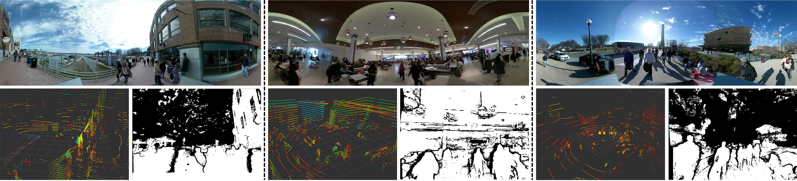

MuSoHu는 사람이 공공장소를 걸을 때 로봇과 비슷한 센서를 몸에 달아 사회적 주행 시연을 모은 자료예요. 3차원 라이다, ZED2 스테레오·깊이 카메라와 관성 센서, 360도 카메라, 마이크 배열이 같은 보행을 서로 다른 방식으로 기록해요. 로봇을 수백 번 원격 조종하는 대신 사람이 자연스럽게 고른 통로와 양보 움직임을 넓은 장소에서 얻으려는 설계예요.

이 자료를 사용할 때 먼저 해결할 문제는 규모가 아니라 버전이에요. 저자 프로젝트 페이지와 DOI가 가리키는 Dataverse 배포판의 숫자가 다르기 때문이에요. 다음 문제는 센서 동기화이고, 그 뒤에 사람의 머리·몸통 궤적을 바퀴 로봇이 실행할 수 있는 경로로 바꾸는 일이 와요. 세 단계를 섞으면 풍부한 영상과 긴 이동 거리가 있어도 어떤 입력으로 어떤 로봇 행동을 배웠는지 설명하기 어려워져요.

## 100km 공개 소개와 50km 배포판은 다른 범위예요

저자 프로젝트 페이지는 약 100km, 20시간, 300회 수집, 13명을 소개해요. Dataverse 버전 6 레코드는 약 50km, 10시간, 150회, 7명을 설명해요. 100km와 50km를 더해 150km라고 쓰면 같은 계보의 범위를 중복 합산할 수 있어요. 논문이나 실험 보고에는 실제 내려받은 버전, 파일 수, 수집 회차 수, 참여자 수를 함께 적어야 해요.

<figure class="fig"><figcaption>공식 Data Examples는 한 보행에서 얻은 영상·깊이·라이다와 처리 결과를 한 장에 배열해요. 원본은 8,566×1,957px, 약 16.8MB라서 세부 패널은 이미지를 눌러 공식 페이지와 함께 보는 편이 읽기 쉬워요. (출처: Xiao 외, <a href="https://people.cs.gmu.edu/~xxiao2/Research/MuSoHu/">Multi-Modal Social Human Navigation Dataset</a>, Data Examples, 공개 CC 라이선스 미확인)</figcaption></figure>

버전 차이는 숫자 표기만의 문제가 아니에요. 13명 전체에 있는 장소와 행동이 7명 배포판에도 같은 비율로 들어 있다고 가정할 수 없어요. 확장 소개에서 본 군중 밀도나 경로 길이를 작은 배포판 실험의 근거로 가져오면 입력 범위를 부풀리게 돼요. 반대로 버전 6의 결과를 100km 전체의 대표 성능으로 말하는 것도 근거가 부족해요.

배포 확인표에는 DOI, 버전 번호, 내려받은 날짜, 파일 목록과 크기, 각 수집 회차의 시작·끝 시각을 남기는 편이 좋아요. DOI가 같아도 새 버전이 추가될 수 있고, 프로젝트 페이지의 소개 문구는 최신 전체 규모를 가리킬 수 있어요. 파일 자체의 식별값을 보관하면 나중에 같은 이름의 자료가 바뀌었는지 확인할 수 있어요.

## 한 수집 회차는 동기화된 센서 묶음이에요

MuSoHu의 기본 단위는 카메라 한 장이나 라이다 한 스윕이 아니라 사람이 한 번 이동하며 만든 여러 센서 흐름이에요. 각 센서는 갱신률과 지연이 달라요. 카메라 프레임을 기준으로 라이다, 관성 센서, 위치 추정을 최근접 시각에 붙이면 간단하지만, 빠르게 회전하거나 사람을 스쳐 지날 때는 서로 다른 장면을 같은 순간으로 묶을 수 있어요.

설명용으로 카메라가 30Hz이고 라이다가 10Hz라면 라이다 한 번 사이에 영상이 약 세 장 들어와요. 카메라 시각마다 가장 가까운 라이다를 복제하면 같은 거리 관측이 세 영상에 반복돼요. 학습기는 그 반복을 새 관측 세 번으로 오해할 수 있어요. 어느 센서를 기준 시계로 삼았는지, 복제·보간한 값에 표시를 남겼는지 기록해야 해요.

시간 오차는 공간 오차로 바뀌어요. 사람이 1.3m/s로 걸을 때 센서끼리 0.05초 어긋나면 위치 차이는 1.3×0.05=0.065m, 즉 6.5cm예요. 넓은 광장에서는 작아 보여도 문틀이나 맞은편 보행자 사이에서는 경로 여유를 바꿀 수 있어요. 이 값은 원자료 실측이 아니라 동기화 허용오차를 정하기 위한 계산 예예요.

시각값 검사에서는 중복, 역행, 긴 공백을 따로 세야 해요. 시작 시각만 맞추고 끝 시각이 서서히 벌어지는 시계 표류도 볼 필요가 있어요. 회차 앞뒤 한 번씩 맞는다고 중간이 맞는 것은 아니므로 일정 간격의 공통 사건을 비교해야 해요. 센서 하나가 끊긴 구간을 모두 버리면 밝고 한산한 쉬운 구간만 남을 수 있어 결측 비율 자체도 자료 특성이 돼요.

## 머리 높이의 관측은 로봇 센서 관측과 다르게 보여요

착용자는 머리 높이에서 주변을 보고, 고개를 돌려 진행 방향과 다른 곳을 볼 수 있어요. 이동 로봇의 카메라와 라이다는 대개 더 낮고 센서 기둥이나 몸체에 가려져요. 사람 영상의 화면 중심을 진행 방향으로 쓰면 관심 대상과 실제 이동을 혼동할 수 있어요. 머리 자세, 몸통 진행, 세계 좌표 이동을 분리해야 해요.

3차원 라이다도 장착 높이가 바뀌면 가림 순서가 달라져요. 사람 머리에서는 테이블 너머의 상체를 볼 수 있지만 낮은 로봇에서는 테이블판이 시야를 막을 수 있어요. 반대로 낮은 센서는 의자 다리와 발 주변 장애물을 더 많이 봐요. MuSoHu로 사전학습한 지각 표현을 로봇에 옮길 때는 높이별 가림과 수직 시야 차이를 별도 평가해야 해요.

360도 카메라는 뒤쪽 보행자까지 담지만 실제 로봇이 같은 센서를 갖지 않으면 학습 입력을 그대로 사용할 수 없어요. 훈련에서는 전방 카메라가 볼 수 없는 사람을 360도 영상으로 알려 주고, 평가에서는 전방만 넣으면 숨은 정보에 의존한 모델이 돼요. 공통 시야로 자르거나, 넓은 시야 센서를 교사 정보로만 썼음을 분명히 해야 해요.

마이크 배열은 대화와 접근 소리를 담을 수 있지만 개인정보와 장소별 소음에 민감해요. 음성을 주행 단서로 쓸 경우 원시 음성의 재배포 조건, 비식별 처리, 음성 없이도 동작하는 대체 경로를 함께 설계해야 해요. 음성 누락 회차를 제거하는 방식은 조용한 장소에 편향된 자료를 만들 수 있어요.

## 사람 경로를 바퀴 로봇의 구성공간으로 옮겨야 해요

사람은 몸을 비틀고 옆걸음하며 좁은 틈을 지날 수 있어요. 차동구동 로봇은 옆으로 움직이지 못하고, 몸체 폭과 회전 반지름, 가속·제동 한계가 있어요. 사람 중심점의 궤적을 그대로 로봇 중심 경로로 쓰면 사람에게는 가능하지만 로봇에는 불가능한 곡선이 생겨요. 장애물 지도를 로봇 외곽만큼 넓힌 뒤 실행 가능한 속도와 곡률로 다시 최적화해야 해요.

센서 원점과 로봇 회전 중심의 차이도 남아요. 설명용으로 착용 센서가 몸통 진행축보다 0.25m 앞에 있고 회전 반지름이 1.0m라고 두면, 센서가 그린 원과 몸 중심이 그린 원의 곡률이 달라요. 위치만 평행 이동하면 회전 중 오차를 없앨 수 없어요. 매 시각 자세로 강체 변환한 뒤 로봇 기준 경로를 만들어야 해요.

사람이 1초에 1.2m 이동하며 30도 회전한 예를 생각해 볼 수 있어요. 0.1초 제어 주기에서는 열 개 명령으로 나뉘지만, 열 점을 잇는 것만으로 안전한 명령이 되지는 않아요. 폭 0.65m 로봇이 같은 곡선을 지날 수 있는지, 각속도와 감속 거리가 제한 안에 있는지 확인해야 해요. 이 수치는 변환 절차를 설명하기 위한 가정이에요.

경로 투영 뒤에는 원래 사람 시연과 달라진 정도를 기록해야 해요. 경로 길이 차이, 최대 횡방향 이동, 곡률 제한으로 생긴 우회, 장애물 최소 거리를 비교하면 어떤 사회 행동이 보존됐는지 알 수 있어요. 변환이 큰 회차는 정책 학습에서 낮은 비중을 주거나 실행 가능성 학습과 사회 선호 학습을 분리할 수 있어요.

사람의 발자국을 로봇 중심 경로로 바꾸는 과정에는 주변 사람의 상대 위치도 함께 변환해야 해요. 착용자 좌표만 옮기고 다른 보행자의 궤적을 원래 센서 좌표에 두면 서로의 거리가 틀어져요. 모든 동적 대상과 정적 지도를 같은 세계 좌표에 놓고, 그 뒤 로봇 기준으로 다시 표현해야 해요. 좌표 변환 전후에 착용자와 주변 사람 사이의 거리가 보존되는지 몇 시점에서 검산하면 축 방향이나 단위 오류를 빨리 찾을 수 있어요.

경로를 속도 명령으로 바꿀 때는 시연의 정지와 센서 정지를 구분해야 해요. 사람이 상대에게 길을 양보하려고 멈춘 장면은 배울 가치가 있지만, 위치 추정이 끊겨 좌표가 잠시 고정된 구간은 센서 결함이에요. 영상의 광류, 관성 센서, 발걸음 변화와 함께 보면 두 경우를 가를 수 있어요. 결함 정지를 양보로 학습하면 로봇이 이유 없이 멈추고, 양보 정지를 결함으로 지우면 자료의 사회 행동이 사라져요.

## 자연스러운 시연과 사회적으로 좋은 로봇 행동은 같지 않아요

사람의 보행에는 상대가 사람일 것이라는 기대가 들어 있어요. 눈맞춤, 어깨 방향, 작은 몸짓으로 양보 의사를 전달하고 상대가 즉시 반응한다고 가정해요. 로봇은 같은 신호를 보내지 못하거나 보행자가 다르게 해석할 수 있어요. 사람 경로와 가까운 정책이 곧 편안한 로봇 정책이라는 결론은 별도 사용자 평가 없이 나오지 않아요.

학습 평가는 세 층으로 나누는 편이 명확해요. 첫째, 기록된 경로를 얼마나 잘 예측하는지 봐요. 둘째, 로봇 제약을 적용했을 때 충돌과 급가감속 없이 실행 가능한지 봐요. 셋째, 보행자가 로봇의 양보와 통과를 어떻게 받아들이는지 실물 상호작용에서 확인해요. 첫 층의 오차가 낮아도 나머지 두 층을 통과했다는 뜻은 아니에요.

자료 분할도 장소와 사람을 기준으로 해야 해요. 같은 회차의 연속 프레임을 무작위로 나누면 벽, 가게, 조명과 참여자 걸음이 학습과 평가에 함께 들어가요. 참여자를 분리한 결과는 새 사람에 대한 일반화를, 장소를 분리한 결과는 새 배경에 대한 일반화를 답해요. 둘을 함께 분리하면 더 어렵지만 실제 이전에 가까운 질문이 돼요.

평가 장면도 상호작용 종류로 나눌 수 있어요. 마주 오는 사람과 비켜 가기, 같은 방향 사람을 추월하기, 교차 흐름 통과하기, 문과 모서리처럼 시야가 가린 곳에 접근하기는 필요한 예측이 달라요. 전체 경로 오차 하나만 내면 긴 직선 보행이 점수를 지배해요. 최소 사람 간 거리, 감속 시작 시점, 경로 굴곡, 멈춤 횟수를 장면별로 보면 자연스러운 모방과 안전한 실행을 구분할 수 있어요.

사람 시연에는 성공한 통과만 남을 가능성도 있어요. 착용자가 위험하다고 판단해 경로를 바꾼 이유나 시야 밖 사람 때문에 멈춘 이유는 센서만으로 완전히 설명되지 않을 수 있어요. 모델이 관측으로 설명할 수 없는 행동을 평균내면 머뭇거림이 생겨요. 한 가지 정답 경로 대신 가능한 경로의 분포를 예측하고, 관측되지 않은 요인을 불확실성으로 남기는 평가가 어울려요.

설명용으로 100km 전체를 70km, 20km, 10km로 나누는 수치만 적어서는 누출을 막지 못해요. 같은 장소에서 이어진 수집을 거리 기준으로 자르면 경계 양쪽의 장면이 거의 같을 수 있어요. 먼저 회차와 장소를 묶고 그 묶음을 학습·검증·평가에 배정한 뒤 실제 거리를 보고하는 순서가 맞아요. 이 비율은 원자료 구성 주장이 아니라 분할 설계 예예요.

## 센서가 빠졌을 때도 정책이 무너지지 않아야 해요

여러 감각을 합치는 모델은 정보가 많지만 한 센서 고장에 취약할 수 있어요. 훈련 중 항상 360도 영상과 깊이가 있으면 실제 로봇에서 한 흐름이 멈췄을 때 출력이 크게 흔들릴 수 있어요. 센서별 단독 기준선, 특정 센서를 가린 평가, 지연을 일부러 늘린 평가를 두면 어떤 흐름에 의존하는지 확인할 수 있어요.

결측을 0으로 채우면 실제 거리 0이나 검은 영상과 구분되지 않을 수 있어요. 값과 함께 유효 여부, 마지막 관측 뒤 지난 시간을 입력하고, 빠진 센서가 많아질수록 정책의 불확실성을 키우는 편이 좋아요. 불확실성이 기준을 넘으면 사회적 최적화보다 감속과 정지를 우선해야 해요.

카메라·라이다·관성 센서의 표현을 한 벡터로 합치기 전에 각 흐름의 좌표와 시계를 검증해야 해요. 잘못 맞춘 센서를 큰 모델이 보정해 줄 것이라고 기대하면 장소별 우연한 상관을 배울 수 있어요. 동기화 전후의 정렬 그림, 센서별 지연 분포, 누락률을 자료 보고서에 포함하면 모델 성능이 떨어졌을 때 입력과 학습을 구분하기 쉬워요.

센서 제거 시험은 가능한 배포 구성을 결정하는 데도 쓰여요. 360도 카메라를 뺐을 때 뒤쪽 접근 장면만 나빠지고 전방 통과는 유지된다면, 로봇에 후방 감지 장치를 추가할지 보수 속도로 대체할지 선택할 수 있어요. 마이크를 뺐을 때 변화가 작다면 개인정보 부담을 줄이는 구성이 나을 수 있어요. 이런 판단은 전체 평균보다 어떤 장면에서 어떤 센서가 필요한지를 보여주는 표에서 나와요.

센서 조합별 결과를 비교할 때는 사용 가능한 회차가 같은지도 맞춰야 해요. 음성이 없는 회차를 마이크 모델에서만 빼면 더 쉬운 일부 자료로 평가했을 수 있어요. 공통으로 완전한 회차만 쓴 비교와, 각 센서의 실제 결측을 포함한 비교를 나란히 두면 모델 구조와 자료 선택의 영향을 분리할 수 있어요. 장소별 결측률도 함께 적어야 실내·실외 차이가 센서 효과로 잘못 읽히지 않아요.

멀티모달 표현을 로봇에 옮긴 뒤에는 센서별 좌표 오차를 일부러 넣는 시험도 도움이 돼요. 작은 시간 이동이나 회전 오차에서 출력 경로가 얼마나 변하는지 보면 동기화 민감도를 알 수 있어요. 오차가 조금만 생겨도 급격히 흔들리는 정책은 평균 경로 점수가 좋아도 현장 보정 변화에 약해요. 반대로 한 센서가 늦을 때 불확실성을 키우고 감속하는 정책은 자료 범위를 벗어난 입력을 다루기 쉬워요.

## 재현 기록은 한 회차가 로봇 명령이 되는 과정을 남겨요

재현 가능한 처리 기록에는 원본 파일, 사용 센서, 시간 기준, 좌표 변환, 사람 궤적 추정, 로봇 외곽 적용, 속도 명령 생성이 순서대로 들어가야 해요. 중간 산출물마다 원본인지 보간값인지, 세계 좌표인지 센서 좌표인지 표시해요. 마지막 경로만 저장하면 어느 단계에서 6.5cm의 어긋남이나 불가능한 회전이 생겼는지 찾기 어려워요.

원시 영상과 음성을 공개하지 못하더라도 처리 조건을 숨길 이유는 없어요. 어떤 흐름을 제외했고, 얼마의 결측이 있었고, 어느 버전의 몇 회차를 썼는지 적을 수 있어요. MuSoHu의 가치는 모든 감각을 무조건 쓰는 데 있지 않고, 같은 사람 이동을 여러 관측으로 비교할 수 있다는 데 있어요.

[[2026-10-17_socialnav_scand|실물 원격조종 시연으로 사회적 주행을 배우는 데이터셋]]과 비교하면 차이가 선명해져요. MuSoHu는 사람의 자연스러운 이동과 넓은 장소 범위를 얻는 대신 로봇 구성공간으로 옮기는 절차가 필요해요. 로봇에서 모은 시연은 실행 가능성이 높지만 플랫폼과 조종자 정책에 묶여요. 두 자료를 함께 쓰더라도 사람 시연과 로봇 시연의 출처 표식을 보존해야 해요.

MuSoHu로 말할 수 있는 범위는 사용한 공개판과 변환 절차가 정해진 뒤에야 고정돼요. 프로젝트 페이지의 100km·20시간·300회·13명과 Dataverse 버전 6의 50km·10시간·150회·7명을 분리하고, 센서 동기화와 로봇 기구학 투영을 검증해야 해요. 그 조건을 지키면 멀티모달 사람 시연은 사회적 주행의 선호를 배우는 재료가 되고, 충돌 회피와 실행 가능성은 로봇 쪽 검증으로 남길 수 있어요.

---

<!-- src-block -->
출처 — https://people.cs.gmu.edu/~xxiao2/Research/MuSoHu/
