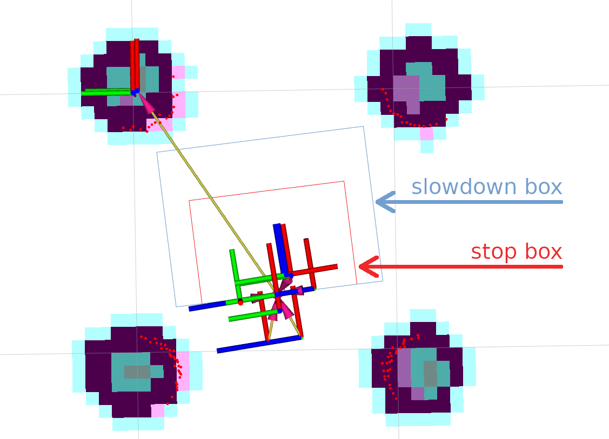
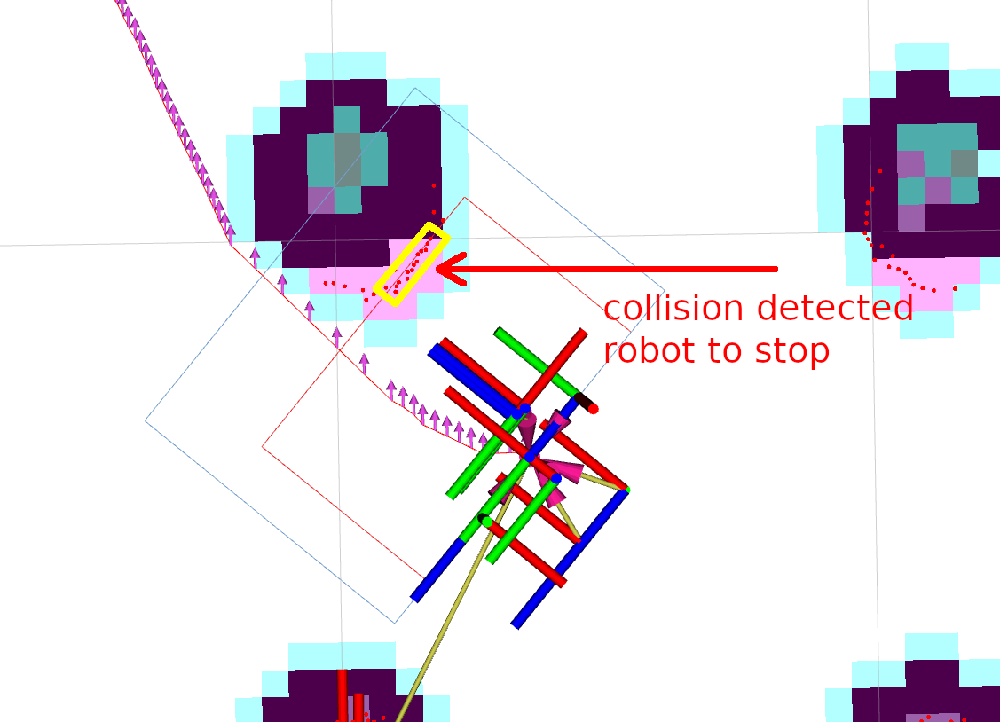

사람에게 길을 양보하는 경로를 잘 골라도, 제어 명령이 나가는 마지막 순간에 장애물이 나타날 수 있어요. <abbr title="로봇이 지도를 따라 목적지까지 이동하도록 계획과 제어 기능을 제공하는 소프트웨어 묶음">Nav2</abbr>의 <abbr title="센서가 본 장애물과 보호 영역을 비교해 이동 명령을 정지 또는 감속 명령으로 바꾸는 기능">Collision Monitor</abbr>는 이 순간의 속도 제한을 다루는 자료입니다. 사람의 의도를 이해하는 정책과 충돌 직전의 명령 감시는 서로 다른 질문에 답해요.

## 공식 시연은 두 보호 영역을 보여 줘요

<figure class="fig"><figcaption>작은 정지 영역과 더 큰 감속 영역을 분리한 공식 설정 예시예요. 두 사각형의 크기는 이 시연의 설정이며, 다른 로봇의 제동 성능을 보증하는 값은 아닙니다. (출처: Nav2, Using Collision Monitor, polygons.png; 문서 저장소 <a href="../assets/socialnav_nav2-collision-monitor_LICENSE.txt">Apache-2.0 원문</a>)</figcaption></figure>

공식 문서는 센서 점을 로봇 기준 보호 영역에 대조하고, 조건이 걸리면 정지·비율 감속·최대 허용 속도·접근 시간 기반 감속을 적용하는 기능을 설명해요. 센서 입력으로 레이저 스캔, 점군, 거리 측정을 받을 수 있습니다. 장애물 지도를 갱신하고 궤적을 다시 고르는 계산을 거치지 않는 별도 명령 계층이라는 점이 핵심이에요. 문서가 명시하듯 이 소프트웨어 자체에 안전 인증이나 강한 실시간 보장이 주어지는 것은 아닙니다.

그림의 두 사각형을 사람의 개인공간으로 읽으면 역할이 뒤섞여요. 보호 영역은 로봇이 현재 속도에서 장애물과 물리적으로 접촉할 위험을 줄이기 위한 공간입니다. 개인공간은 사람이 느끼는 불편, 접근 방향, 관계에 따라 달라져요. 사람을 일찍 배려하는 계획이 있어도 마지막 보호 영역은 필요하고, 보호 영역이 있어도 편안한 행동이 자동으로 만들어지지는 않습니다.

## 최종 명령을 누가 내보내는지 확인해야 해요

공식 튜토리얼은 충돌 감시를 속도 후처리 연결의 마지막에 두라고 안내합니다. 원하는 속도를 담는 <abbr title="로봇에게 앞으로 가는 속도와 회전 속도를 전달하는 메시지 통로의 관례적 이름"><code>cmd_vel</code></abbr>이 감시기를 거쳐 구동기에 도달해야 해요. 속도를 매끄럽게 만드는 장치가 있다면 그 출력도 감시기의 입력으로 연결합니다. 문서 예제의 토픽 이름보다 실제 발행자와 구독자가 이루는 연결이 중요해요.

명령 통로가 둘이면 정지 기능이 실행됐다는 로그와 로봇이 멈췄다는 결과가 달라질 수 있습니다. 설명용 구성으로 자율 주행기와 수동 조작기가 각각 구동기의 같은 입력에 속도를 보낸다고 가정해 볼 수 있어요. 감시기가 자율 주행 명령만 0으로 바꿔도 다른 발행자의 양수 명령이 뒤에 도착하면 구동기는 움직일 수 있습니다. 이 문제는 정지 사각형을 넓혀 해결할 수 없어요.

그래서 연결 검증의 단위는 노드 하나가 아니라 명령의 전체 경로입니다. 누가 명령 권한을 갖는지 고르는 단계, 가속도를 제한하는 단계, 장애물을 감시하는 단계, 구동기가 명령을 수신하는 단계를 순서대로 적어야 해요. 구동기에 들어가는 최종 통로에는 어떤 발행자들이 있는지, 시험용 명령이 우회하지 않는지도 확인합니다. 보호 동작의 성능을 계산하기 전에 명령이 그 동작을 통과한다는 증거가 필요해요.

## 정지 경계는 센서 원점과 몸체 경계를 구분해요

센서에서 장애물까지 0.5미터라는 값은 몸체 외곽에서 0.5미터가 남았다는 뜻이 아닙니다. 센서가 로봇 중심보다 앞에 있는지, 바퀴 덮개나 적재물이 센서보다 앞으로 나오는지에 따라 남은 간격이 달라져요. 보호 영역을 만드는 기준 좌표와 실제 충돌할 수 있는 몸체 외곽을 먼저 맞춰야 합니다. 로봇의 팔이나 적재물이 움직인다면 외곽도 고정값으로 볼 수 없어요.

설명용으로 센서가 몸체 맨 앞보다 0.15미터 뒤에 있고, 센서 측정 거리가 0.45미터라고 가정하면 몸체 앞 여유는 0.30미터입니다. 같은 센서를 0.10미터 앞으로 옮기면 같은 거리 측정이 뜻하는 몸체 간격도 바뀌어요. 여기의 숫자는 공식 시연이나 실물 측정값이 아니라 좌표 기준을 구별하기 위한 입력입니다. 거리 숫자를 설정 파일에 복사하는 것만으로 보호 경계가 같아지지 않아요.

회전할 때는 앞면 한 점의 여유만으로 부족합니다. 사각 몸체는 회전하면서 모서리가 더 넓은 영역을 지나고, 옆으로 이동하는 로봇은 전방보다 측면이 먼저 장애물에 닿을 수 있어요. 평행이동 방향과 회전 방향을 조합해 몸체 전체가 훑는 공간을 따져야 합니다. 전진 시험을 통과한 보호 영역을 후진과 제자리 회전에 그대로 인정할 근거는 없어요.

## 지연은 보호 영역 안에서 소비되는 거리예요

장애물을 본 시점과 구동기가 감속하기 시작한 시점 사이에는 여러 대기가 있습니다. 센서의 다음 프레임을 기다리는 시간, 메시지 전송, 좌표 변환, 명령 처리, 구동기 반응을 모두 지나야 해요. 평균 처리시간만 짧아도 드물게 긴 대기가 있으면 보호 영역의 여유를 크게 소모할 수 있습니다. 영역 크기는 계산 주기와 분리된 값이 아니에요.

단순한 일차원 설명 모델에서 정지에 필요한 거리를 ‘지연 중 이동한 거리 + 감속 중 이동한 거리’로 나눌 수 있어요. 속도를 초당 0.6미터, 전체 지연을 0.2초, 일정 감속도를 제곱초당 0.5미터로 가정하겠습니다. 지연 중 이동은 0.6×0.2=0.12미터이고, 감속 중 이동은 0.6²÷(2×0.5)=0.36미터여서 합은 0.48미터입니다. 이는 이상적인 계산 예시이며 실제 바닥 마찰, 구동기 제한, 측정 오차를 포함한 검증값은 아닙니다.

지연만 0.4초로 늘면 지연 거리는 0.24미터, 합은 0.60미터가 돼요. 보호 영역을 0.5미터로 잡았다고 가정하면 앞 조건에서는 계산상 0.02미터가 남지만 뒤 조건에서는 0.10미터가 부족합니다. 작은 평균 지연 차이처럼 보여도 정지 가능 여부가 달라져요. 계산값을 실제 제동거리로 발표하지 않고, 어느 지연 구간부터 측정해야 하는지 정하는 데 쓰는 편이 맞습니다.

## 감속 비율과 감속도는 다른 양이에요

속도에 일정 비율을 곱하면 목표 속도는 낮아집니다. 그러나 구동기가 그 목표까지 얼마나 빨리 내려가는지는 별도의 동특성에 달려 있어요. 초당 0.6미터 명령에 0.3을 곱하면 초당 0.18미터가 되지만, 이 계산에는 도달 시간이나 제동거리가 없습니다. 낮은 명령이 나왔다는 사실과 로봇이 낮은 속도에 도달했다는 사실을 나눠 기록해야 해요.

감속 영역을 넓게 만들면 사람에게 더 일찍 반응할 가능성이 생깁니다. 반면 좁은 복도 양옆 벽이 계속 영역 안에 들어가면 느린 상태가 상시 유지될 수도 있어요. 이때 영역을 줄이기 전에 감지한 점이 바닥인지, 옆 벽인지, 사람인지와 좌표가 맞는지 확인해야 합니다. 불필요한 감속을 없애려다가 필요한 보호 여유까지 줄일 수 있기 때문입니다.

사회적 주행 평가에서는 최종 속도뿐 아니라 감속의 시작 시점과 반복 횟수도 유용해요. 사람이 다가올 때 한 번 부드럽게 줄인 경우와 경계를 오가며 가속·감속을 반복한 경우는 평균 속도가 같을 수 있습니다. 후자의 행동은 사람이 로봇 의도를 알아보기 어렵게 만들어요. 보호 계층이 자주 개입한다면 사람을 늦게 피하는 상위 계획의 문제도 함께 찾아야 합니다.

## 장애물 점의 개수는 사람 수가 아니에요

영역 안에 들어온 점을 세는 조건에서는 한 사람이 여러 점으로 보일 수 있고, 같은 사람도 거리가 멀어지면 점이 줄 수 있어요. 표면 반사, 가림, 센서 각도, 점군 간격에 따라 수가 달라집니다. ‘점 네 개가 검출됐다’를 ‘사람 네 명이 있다’로 해석하면 안 돼요. 점 개수는 관측 기하의 결과이며 사회적 관계의 단위가 아닙니다.

설명용으로 가까운 벽에서 여덟 점, 멀리 있는 가는 물체에서 두 점이 들어온다고 가정해 볼 수 있습니다. 점 수 임계값을 세 개로 두면 벽은 동작을 유발하지만 가는 물체는 유발하지 않을 수 있어요. 이것이 특정 센서의 실험 결과라는 뜻은 아닙니다. 한 개의 임계값을 고를 때 거리·방향·물체 크기별 검출 분포를 봐야 하는 이유를 보여 주는 입력이에요.

노이즈를 줄이기 위한 점 삭제도 같은 검증을 요구합니다. 외딴 점을 없애는 처리는 거짓 경보를 줄일 수 있지만, 가는 다리나 멀리 있는 물체가 외딴 점으로만 나타날 수도 있어요. 필터 앞뒤에서 실제 보호 대상의 검출률과 동작 지연을 비교해야 합니다. 화면이 깨끗해졌다는 인상만으로 충돌 감시 입력이 좋아졌다고 판단하기 어렵습니다.

## 센서가 조용한 상태와 공간이 빈 상태를 나눠요

장애물 점이 없다는 메시지를 계속 받는 경우와 메시지 자체가 끊긴 경우는 다릅니다. 전자는 센서가 관측한 결과가 비어 있다는 뜻일 수 있고, 후자는 현재 관측을 모르겠다는 뜻이에요. 관측 가능한 영역 밖에 물체가 있어도 빈 결과가 나올 수 있습니다. 따라서 빈 배열, 센서 통신 중단, 시야 밖이라는 세 상태를 하나로 합치면 실패 분석이 막힙니다.

공식 설정의 <abbr title="새 센서 관측이 오지 않았을 때 기존 관측을 얼마 동안 유효하게 볼지 정하는 시간"><code>source_timeout</code></abbr>은 오래된 입력을 다루는 기준이에요. 시간 제한을 늘리면 잠깐의 통신 흔들림에 덜 멈출 수 있지만, 실제 센서 고장을 알아채는 시간도 길어집니다. 제한을 없애는 선택은 장애물이 사라졌다는 증거를 만드는 것이 아니에요. 통신 품질 문제와 장애물 부재를 서로 바꿔 설명할 수 없습니다.

검증은 기록 재생에서 한 종류의 공백씩 넣는 방식으로 설계할 수 있어요. 예를 들어 관측 발행 중단, 오래된 시각으로 발행, 일부 방향의 점 삭제를 따로 적용하고 최종 명령과 상태를 비교합니다. 기대하는 정지 시각과 실제 출력 시각 사이의 차이를 재면 통신 경로까지 포함한 실패를 볼 수 있어요. 이 절차는 이 자료를 읽고 구성할 수 있는 시험 설계이며, 수행한 실물 시험 결과를 뜻하지 않습니다.

## 좌표가 늦으면 같은 점도 다른 위치로 보여요

움직이는 로봇에서 센서 관측은 과거 자세에 묶여 있습니다. 로봇이 전진한 뒤 과거 점을 현재 로봇 원점에 그대로 붙이면 물체와의 거리를 잘못 계산할 수 있어요. 회전 중에는 점의 방향도 어긋납니다. 센서 메시지의 시각, 센서 장착 변환, 로봇 자세 이력을 함께 사용해야 관측 위치를 일관되게 읽을 수 있습니다.

설명용으로 로봇이 초당 0.5미터로 이동하고 관측이 0.2초 오래됐다면 이동량은 0.10미터입니다. 이 값이 항상 같은 방향의 거리 오차가 된다는 뜻은 아니지만, 무시할 수 없는 시각 차이임은 알 수 있어요. 동시에 회전했다면 물체 위치 변화는 단순한 전방 이동만으로 보정되지 않습니다. 좌표 오류를 보호 영역 크기 조정으로 덮으면 다른 속도에서 다시 문제가 나타날 수 있어요.

화면에서 센서 점과 로봇 외곽이 맞아 보이는 한 장의 이미지로는 시간 문제를 검증하기 어렵습니다. 같은 실행에서 관측 시각, 변환에 사용한 시각, 최종 명령 시각을 남겨야 해요. 정지한 장면에서는 맞고 회전할 때만 점이 밀리면 장착 위치보다 시각 정렬을 먼저 의심할 수 있습니다. 반대로 모든 자세에서 같은 방향으로 어긋나면 고정 변환을 확인할 근거가 생겨요.

## 시연 화면에서 확인할 수 있는 범위를 지켜요

<figure class="fig"><figcaption>공식 시연은 장애물 점이 작은 영역에 들어왔을 때 정지 판단이 나오는 장면을 보여 줍니다. 사람의 편안함이나 특정 실물 로봇의 제동거리를 측정한 화면은 아니에요. (출처: Nav2, Using Collision Monitor, collision.png; 문서 저장소 <a href="../assets/socialnav_nav2-collision-monitor_LICENSE.txt">Apache-2.0 원문</a>)</figcaption></figure>

이 화면에는 센서 점, 보호 영역, 로봇 모델과 정지 판단이 함께 있어요. 영역 안의 점이 동작을 유발하는 관계를 읽는 데 적합한 자료입니다. 그러나 한 장의 화면에는 감속 시작부터 완전 정지까지의 시간, 실제 바퀴 속도, 바닥 조건이 담겨 있지 않습니다. 시각화에 정지 문구가 보이는 것만으로 물리적 정지 성능을 확정할 수 없어요.

추가 검증에서는 원하는 속도, 감시 후 속도, 구동기 수신 속도, 측정된 몸체 속도를 같은 시간축에 놓을 수 있습니다. 첫 두 값의 차이는 보호 계층의 개입이고, 마지막 두 값의 차이는 구동기와 실제 운동의 응답을 보여 줘요. 정지 명령 후에도 속도가 남는다면 명령 경로와 제동 동작을 나눠 분석할 수 있습니다. 그래프를 만들더라도 그 입력이 실측인지 설명용인지 먼저 구별해야 해요.

## 낮은 레이저와 사람 인지는 서로 다른 검증을 받아요

낮게 설치된 <abbr title="레이저가 돌아오는 거리를 재어 한 높이의 주변 물체 윤곽을 관측하는 센서">LiDAR</abbr>를 주행과 충돌 감시에 쓰는 구성에서는, 그 한 평면이 모든 사람과 물체를 포착한다고 가정하면 안 됩니다. 몸의 어느 부분을 스치는지, 가구와 적재물이 어디를 가리는지에 따라 관측이 달라져요. 이 입력이 맡을 수 있는 보호 범위를 시험하고, 사람을 구별하는 기능과 평가 계약을 나눠야 합니다.

색상과 거리를 함께 보는 <abbr title="컬러 영상과 각 화소까지의 거리를 함께 제공하는 카메라 방식">RGB-D</abbr> 카메라로 사람을 검출하고 추적한다면, 그 결과는 누가 어느 쪽으로 움직이는지 판단하는 상위 계획의 재료가 됩니다. 카메라의 검출 신뢰도와 낮은 레이저의 장애물 점 수는 같은 수치가 아니에요. 한쪽 입력이 실패할 때 다른 쪽이 무엇을 관측할 수 있는지부터 따져야 합니다. 센서가 둘이라는 사실만으로 독립된 보호가 성립하지는 않아요.

높이별 가림을 시험할 때는 사람 모델뿐 아니라 센서 평면을 통과하지 않는 돌출부도 고려할 수 있어요. 관측되지 않는 공간을 보호한다고 주장하기보다, 어디까지 관측해 어떤 명령을 제한하는지 범위를 적는 편이 정확합니다. 더 넓은 인지 기능은 별도 자료와 시험으로 확인해야 해요. 공식 충돌 감시 자료는 사람 인지기가 제공할 수 없는 마지막 명령 제한의 역할을 설명하지만, 사람의 상태를 만들어 주는 자료는 아닙니다.

## 사회적 정책의 성능과 개입 빈도를 함께 읽어요

두 정책이 모두 충돌 없이 목적지에 도착했다고 가정해 보겠습니다. 한 정책은 사람과 일찍 간격을 맞춰 보호 계층이 한 번도 개입하지 않고, 다른 정책은 근접할 때마다 정지 명령에 의해 구해질 수 있어요. 두 실행의 성공률만 같다고 적으면 상위 정책의 품질 차이가 사라집니다. 보호 계층이 작동한 이유와 시점을 함께 남기면 그 차이를 드러낼 수 있어요.

개입 횟수도 단독 순위가 되지는 않습니다. 관측 범위가 넓어 더 많은 위험을 본 구성은 같은 정책에서도 개입이 늘 수 있고, 영역을 지나치게 작게 잡으면 개입 없이 위험하게 움직일 수 있어요. 같은 몸체, 같은 입력 범위, 같은 지연 조건에서 비교해야 합니다. 적은 개입과 충분한 간격이 함께 관찰돼야 상위 정책이 일찍 조정했다는 해석이 가능해요.

기록 재생 시험의 통과 조건도 출력만으로 정할 수 있어요. 장애물 진입 뒤 제한 명령이 나오는 최대 지연, 입력 공백에서 제한으로 전환하는 시각, 관측이 돌아온 뒤 재개 조건을 미리 적습니다. 실제 바퀴를 움직이지 않아도 메시지 처리와 판단 연결의 오류를 찾을 수 있는 단계예요. 다만 이 단계에서 몸체의 제동거리나 사람의 반응까지 검증했다고 확대하면 안 됩니다. 그 둘은 운동을 포함한 후속 시험의 다른 관측 대상입니다.

이 자료를 구현 근거로 쓸 때의 최소 기록은 보호 영역의 기준 좌표, 관측 유효 시간, 최종 명령 발행 경로, 개입 사유, 몸체 응답입니다. 여기에 사람의 회피량과 불편 평가를 더하면 물리적 보호와 사회적 행동 품질을 서로 다른 열에서 볼 수 있어요. 경로의 사회성을 설명하는 연구와 충돌 감시 자료를 함께 읽어야 하는 이유가 이 구분에 있습니다. 하나의 기능이 맡은 일을 선명하게 적을수록 아직 시험하지 않은 부분도 찾기 쉬워집니다.

이 보호 계층에 들어가는 주행 명령은 [[2026-10-17_socialnav_nav2-mppi|Nav2 MPPI 제어기가 후보 궤적의 비용으로 명령을 고르는 방식]]에서 설명한 후보 궤적과 비용 비교로 만들어질 수 있어요. 두 단계의 입력과 출력 명령을 함께 기록하면 계획의 선택과 보호 개입을 구분할 수 있습니다.

---

<!-- src-block -->

출처 — https://docs.nav2.org/jazzy/configuration_and_development/configuration_guide/core_servers/collision_monitor/configuring_collision_monitor_node/
