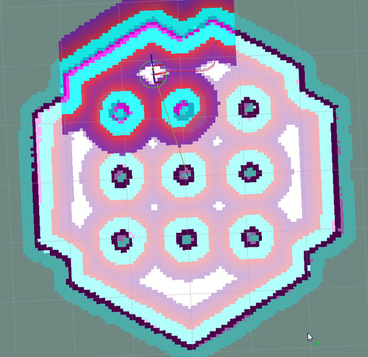

로봇이 목표 경로를 받았다고 해서 지금 어느 속도로 움직일지가 정해지는 것은 아닙니다. 주변 장애물과 몸체의 운동 제약을 함께 보며 짧은 미래를 반복 계산해야 해요. <abbr title="로봇이 지도와 경로를 사용해 목적지까지 이동하도록 계획과 제어 기능을 제공하는 소프트웨어 묶음">Nav2</abbr>의 <abbr title="여러 미래 이동 명령을 시험 계산하고 비용이 낮은 후보에 더 큰 비중을 주어 다음 명령을 정하는 예측 제어 방법">MPPI</abbr>는 이 국소 제어 문제를 다루는 자료입니다.

## 경로 추종과 미래 명령 최적화를 구분해요

공식 문서에서 MPPI는 이전 해를 출발점으로 명령에 무작위 변화를 더하고, 운동 모델로 후보 궤적을 계산한 뒤 비용 함수들로 평가합니다. 비용에 따른 가중치를 사용해 명령을 갱신하고 다음 제어 주기에서도 이 과정을 이어가요. 비용 함수를 플러그인으로 구성할 수 있고, 양쪽 바퀴 차동 구동·전방향 이동·자동차식 조향 모델을 지원합니다. 특정 경로의 한 점을 향하는 것보다 후보의 미래 움직임을 함께 비교하는 구조예요.

이 차이는 장애물 옆에서 드러납니다. 지금의 경로 오차가 가장 작아지는 명령이 잠시 뒤 몸체를 벽 쪽으로 돌릴 수 있고, 경로에서 조금 멀어지는 명령이 더 넓은 여유를 만들 수 있어요. 짧은 미래를 전개하면 이 둘을 다른 후보로 비교할 수 있습니다. 그러나 비교에 들어가는 운동과 장애물 정보가 틀리면 미래를 계산했다는 사실만으로 결과가 좋아지지는 않아요.

## 공식 시연은 무엇을 보여 주나요

<figure class="fig"><figcaption>공식 시연의 8초 지점이에요. 장애물 사이에서 후보 궤적을 평가하는 모습을 볼 수 있습니다. 이 정지 화면은 사람의 편안함이나 특정 컴퓨터의 처리량을 측정한 증거는 아닙니다. (출처: Nav2, Model Predictive Path Integral Controller, mppi_demo.gif; 문서 저장소 <a href="../assets/socialnav_nav2-mppi_LICENSE.txt">Apache-2.0 원문</a>)</figcaption></figure>

화면의 색칠된 장애물 주변 영역과 로봇의 후보 선은 서로 다른 정보입니다. 앞의 영역은 지나가기 어려운 공간에 관한 지도 표현이고, 후보 선은 명령을 적용했을 때의 예상 이동이에요. 같은 지도를 보더라도 운동 모델과 비용 가중치가 다르면 다른 선을 선호할 수 있습니다. 화면에 선이 많다는 사실은 사람이 많은 장면을 이해했다는 뜻이 아닙니다.

[공식 시연 원본](https://docs.nav2.org/jazzy/configuration_and_development/configuration_guide/controller_plugins/mppi_controller/assets/mppi_demo.gif)을 시간 순서대로 보면 제어 주기마다 후보와 위치가 바뀝니다. 정지 프레임에서 한 후보를 골라 최종 실행 경로라고 단정하면 안 돼요. 현재 주기의 제어 입력을 내보낸 다음 새 관측으로 다시 계산하기 때문입니다. 전체 미래를 한 번 계산해 끝까지 그대로 실행하는 방식과는 검증 대상이 달라요.

## 후보가 늘면 선택의 폭과 계산량이 함께 늘어요

후보 수는 서로 다른 명령열을 얼마나 시험할지 정하는 값입니다. 같은 시간 구간에서 후보를 더 많이 만들면 다양한 회피 방향을 살펴볼 가능성이 커져요. 대신 운동 전개와 비용 평가의 양도 늘어납니다. 후보가 적어 놓친 선택을 후보 수로 보완할 수는 있지만, 비용의 의미가 틀린 문제를 후보 수로 해결할 수는 없어요.

설명용으로 후보 1,000개를 40시점씩 계산하면 기본적인 후보 상태는 40,000개입니다. 후보를 2,000개로 바꾸면 80,000개가 돼요. 이를 초당 20번 수행한다고 가정하면 각각 초당 800,000개와 1,600,000개의 상태 평가 자리가 생깁니다. 이 숫자는 연산 명령 수나 실제 실행시간을 뜻하지 않으며, 설정 간 규모를 비교하기 위한 계산입니다.

사람 비용을 더할 때 사람마다 모든 후보 시점을 확인한다면 비교량에 사람 수라는 축이 추가될 수 있어요. 구현이 사람을 묶거나 범위를 제한하면 계산 구조가 달라집니다. 따라서 사람 수만 두 배가 됐을 때 실행시간도 반드시 두 배라는 결론은 낼 수 없어요. 후보 수, 시간 수, 비용 계산 방식과 함께 측정해야 병목을 해석할 수 있습니다.

## 예측 시간은 시점 수와 시간 간격의 곱이에요

미래를 얼마나 길게 보는지와 미래를 얼마나 촘촘히 보는지는 다른 선택입니다. 설명용으로 40시점을 0.05초 간격으로 전개하면 명목상 예측 길이는 2초입니다. 같은 40시점을 0.10초 간격으로 바꾸면 4초가 되지만 중간 움직임의 해상도는 거칠어져요. 시점 수를 80개로 늘려 0.05초 간격을 유지해도 4초가 되며, 그 경우 계산 자리 수는 늘어납니다.

긴 예측 구간은 앞의 굽은 통로나 교차 장면을 일찍 고려하는 데 도움이 될 수 있어요. 동시에 먼 미래의 사람 위치나 속도를 더 오래 믿게 됩니다. 사람이 갑자기 방향을 바꾸는 환경에서는 긴 구간의 오차도 커질 수 있어요. 예측 시간을 길게 했다는 설정 변화만으로 사람이 덜 놀라거나 충돌이 줄었다고 주장하기 어렵습니다.

짧은 구간에서는 목표 방향으로 잘 가다가 늦게 멈추는 정책이 나올 수 있고, 긴 구간에서는 불확실한 미래 때문에 계속 대기하는 정책이 나올 수 있습니다. 두 실패는 성공률 하나로 합치기보다 최초 감속 시점, 멈춤 시간, 최소 여유와 함께 봐야 해요. 구간 길이는 ‘크면 좋다’는 값보다 어느 미래 가정까지 신뢰할지 정하는 선택에 가깝습니다.

## 비용의 크기는 단위와 가중치가 함께 만들어요

목표까지 거리, 경로와의 편차, 장애물 근접, 급한 조향은 서로 다른 성질입니다. 이를 한 숫자로 합치면 각 항목의 원래 범위와 가중치가 순위를 결정해요. 단위가 미터인 값과 단위 없는 벌점을 같은 가중치로 더한다고 해서 동등하게 중요해지지는 않습니다. 한 비용의 값 범위를 바꾼 뒤 기존 가중치를 유지하면 정책의 선호도 함께 바뀔 수 있어요.

설명용으로 첫 후보의 경로 비용을 1, 근접 비용을 8로 두고, 둘째 후보는 각각 4와 2로 두겠습니다. 둘을 같은 비중으로 합치면 첫 후보는 9, 둘째는 6이라 둘째가 낮아요. 경로 비용에 4배 가중치를 주면 첫 후보는 12, 둘째는 18이 돼 순위가 바뀝니다. 이 계산은 특정 플러그인의 실제 비용 범위가 아니라 가중치가 선택을 바꾸는 원리를 보여 주는 예시예요.

가중치를 조정할 때는 최종 합계만 보지 않고 후보별 항목 값을 남길 수 있습니다. 사람이 가까워졌는데 근접 비용이 거의 변하지 않는다면 가중치보다 입력이나 비용 계산 범위를 먼저 확인해야 해요. 모든 후보가 비슷하게 큰 비용을 받으면 차이를 잃고, 한 항목만 압도하면 다른 설계 의도가 사라집니다. 비용을 더했다는 사실보다 어떤 후보를 왜 바꾸는지가 검증의 단위입니다.

## 낮은 비용의 후보만 복사하는 것과 가중 갱신은 달라요

비용을 평가한 뒤에는 후보 하나를 고르는 방법도 있고 여러 후보를 섞어 명령을 갱신하는 방법도 있습니다. 후자의 구조를 설명할 때는 가장 낮은 비용을 찾는 그림만으로 부족해요. 후보 사이 비용 차이가 얼마인지에 따라 반영 비율이 바뀔 수 있기 때문입니다. 문서의 <abbr title="비용이 낮은 후보에 얼마나 선택적으로 큰 비중을 줄지 정하는 조정값"><code>temperature</code></abbr>는 이런 선택성을 이해하는 손잡이입니다.

아래는 가중 갱신의 원리를 단순화한 설명용 계산입니다. 세 후보의 비용을 0, 1, 2로 두고 각 비용의 음수에 지수 함수를 적용한 뒤 합이 1이 되도록 나누면 약 0.665, 0.245, 0.090이 나와요. 세 후보의 전진 속도를 각각 초당 0.2, 0.4, 0.6미터로 가정하면 가중 평균은 약 초당 0.285미터입니다. 가장 좋은 후보의 0.2와 같지 않아요.

비용 차이를 완만하게 반영하면 다른 후보의 비중이 커져 속도가 단순 평균에 가까워질 수 있습니다. 반대로 차이를 강하게 반영하면 최저 비용 후보 쪽으로 모입니다. 실제 구현에는 명령열, 잡음과 제약 처리가 함께 있으므로 이 세 숫자 예시를 전체 알고리즘 재현으로 읽으면 안 돼요. 선택성을 바꿀 때 경로 다양성과 명령 흔들림을 함께 관찰해야 하는 이유를 설명하는 모델입니다.

## 운동 모델이 실제로 가능한 후보를 정해요

양쪽 바퀴 속도 차이로 도는 로봇과 옆으로 평행이동하는 로봇은 같은 명령 공간을 쓰지 않습니다. 자동차식 조향에는 최소 회전 반경 같은 제약도 있어요. 실제로 낼 수 없는 측면 속도를 후보에 포함하면 계산상으로는 좁은 틈을 쉽게 지나도 몸체가 그 경로를 따르지 못합니다. 최적화가 좋은 해를 찾았다는 결론은 가능한 운동을 전개했다는 전제 위에 있어요.

최대 속도와 가속도도 후보의 물리적 가능성에 영향을 줍니다. 목표 속도로 즉시 바뀐다고 가정한 후보와 구동기 지연을 포함한 실제 운동이 다르면 장애물 근처의 여유가 달라져요. 바닥에 따라 미끄러짐이 달라지거나 적재량으로 감속이 느려질 수 있습니다. 설정된 제약을 실제 몸체 응답과 비교해야 해요.

설명용으로 짧은 횡이동을 택한 전방향 후보를 바퀴 차동 로봇에 보낸다고 가정하면, 명령 변환 단계에서 측면 성분이 버려질 수 있습니다. 계획이 의도한 회피와 실행된 회피가 달라지는 상황이에요. 이런 연결 오류는 비용 가중치를 아무리 바꿔도 해결하기 어렵습니다. 먼저 운동 모델과 명령 수신 형식이 맞는지 검증해야 합니다.

## 현재 장애물 지도와 사람의 미래 점유는 달라요

한 시점의 장애물 지도는 사람이 현재 어디에 있는지 표현할 수 있습니다. 사람의 다음 위치를 시간별로 제공하는 것은 다른 정보예요. 사람이 이동한 뒤 남은 과거 점이 지도에 쌓이거나, 반대로 빠르게 지워지면 국소 제어기가 읽는 장면이 달라집니다. 미래 궤적을 계산하는 제어기와 미래 사람 궤적을 예측하는 인지기를 같은 기능으로 보면 안 돼요.

사회적 비용을 연결하려면 후보의 각 미래 시점과 사람 예측의 같은 시점을 비교하는 설계를 생각할 수 있습니다. 로봇의 1초 뒤 위치와 사람의 현재 위치만 계속 비교하면 교차를 놓칠 수 있어요. 반대로 사람 예측이 오래됐는데 새 시점으로 해석하면 이미 지나간 충돌을 피하려고 방향을 바꿀 수 있습니다. 이 연결은 기본 제어기 이름만으로 제공된다고 가정하지 않고 별도의 구현과 검증 근거를 요구해야 해요.

사람을 원형 장애물로만 넣는 구성과 몸 방향·집단 관계까지 넣는 구성도 다릅니다. 사람 인지 정보를 어디에 표현했는지에 따라 평가할 수 있는 사회적 행동이 달라져요. 비용 함수 확장이 가능하다는 공식 설명은 확장의 통로가 있다는 뜻입니다. 특정 사회 규범이 이미 학습되었거나 사람 편안함이 검증되었다는 결론으로 이어지지 않습니다.

## 비용에 사람을 넣어도 관측 실패는 남아요

검출기가 사람을 놓치면 사람 비용이 사용할 입력이 사라질 수 있습니다. 추적 번호가 바뀌면 서로 다른 사람의 과거를 연결해 잘못된 속도를 만들 수 있어요. 신뢰도가 낮은 입력을 버리면 거짓 경보는 줄지만 실제 사람 정보도 사라질 수 있습니다. 이 실패는 최적화의 후보 수와 구별해서 시험해야 해요.

설명용 재생 시험에서는 같은 장면에 위치 오차만 넣은 경우, 시각 지연만 넣은 경우, 사람 한 명을 일정 시간 누락한 경우를 따로 만들 수 있습니다. 비용 항목별 값과 최종 속도를 비교하면 어떤 오류가 어느 결정을 바꿨는지 볼 수 있어요. 여러 오류를 한꺼번에 넣고 실패했다고만 적으면 수정할 경계를 찾기 어렵습니다. 이러한 시험 설계는 실물 성능을 측정한 기록과 구분해 보고해야 합니다.

[[2026-10-17_socialnav_people-msgs|ROS 사람 메시지 people_msgs의 좌표와 신뢰도 계약]]에서 확인한 것처럼 상태를 전송하는 자료형도 정보의 뜻을 자동으로 보장하지 않습니다. 이 제어기와 사람 추적기를 연결할 때도 관측 기준 시각, 좌표, 속도 의미와 삭제 조건을 먼저 맞춰야 해요. 이후에 비용이 의도대로 반응하는지 확인하면 인지 오류와 비용 설계 오류를 나눠 볼 수 있습니다.

## 시각화는 진단 입력이면서 별도 부하예요

후보 선을 모두 발행하면 원인을 보기 쉽습니다. 그러나 선 하나가 여러 미래 점을 담고 후보가 많으면 표시할 정보도 빠르게 늘어요. 공식 문서도 궤적 시각화가 제어기를 느리게 할 수 있다고 주의합니다. 주행 계산의 성능과 디버그 화면을 켠 상태의 성능을 같은 조건으로 보고하면 차이를 놓칠 수 있어요.

설명용으로 1,000개 후보와 40개 미래 점을 매 주기 표시한다면 한 주기의 표시는 40,000점입니다. 초당 20번이면 초당 800,000개의 점 자리가 화면 경로로 넘어가는 셈이에요. 이는 전송 바이트나 실제 화면 속도가 아니라 표시 규모의 계산입니다. 일부 후보나 일부 미래 점만 그리는 선택이 무엇을 줄이는지 이해하는 데 쓸 수 있어요.

측정할 때는 제어만 실행한 조건, 기록을 추가한 조건, 후보 시각화까지 켠 조건을 나눌 수 있습니다. 평균 계산시간과 함께 긴 지연의 빈도, 명령 주기 누락, 관측 나이를 비교해요. 특정 데스크톱에서 빠르게 계산됐다는 문서 설명을 소형 컴퓨터에 옮겨 처리량으로 쓰면 안 됩니다. 실제 센서 구독과 다른 프로그램을 포함한 환경에서 측정해야 해요.

## 제어 주기 안에 끝나는지가 평균보다 중요해요

초당 20번 명령을 갱신한다는 가정에서는 한 주기의 간격이 50밀리초입니다. 평균 계산이 20밀리초여도 일부 실행이 80밀리초라면 다음 주기의 입력과 겹칠 수 있어요. 그동안 로봇과 사람은 움직이고 이전 명령은 더 오래 유지됩니다. 느린 계산의 빈도와 원인을 함께 기록해야 최적화 설정을 판단할 수 있습니다.

후보 수를 줄여 지연이 줄었다면 회피할 선택의 폭도 바뀌었는지 봐야 해요. 미래 시점 수를 줄였다면 같은 예측 길이를 유지했는지, 비용 계산을 줄였다면 어떤 판단을 포기했는지도 적습니다. 성능 개선을 시간 수치만으로 발표하면 행동 품질의 비용이 사라져요. 계산 자원과 주행 결과를 같은 설정표에 연결하는 것이 비교의 출발점입니다.

기록 재생에서 계산 주기를 검증한 뒤에는 몸체 응답과 사람 상호작용을 별도로 확인할 수 있습니다. 빠른 명령 계산은 제동 성능이나 사람이 로봇 의도를 이해했다는 증거가 아니에요. 반대로 부드럽게 보이는 짧은 시연도 긴 실행의 계산 안정성을 보장하지 않습니다. 각 검증이 답하는 질문을 분리하면 근거를 과장하지 않고 다음 시험을 정할 수 있어요.

## 기본 제어기와 사회적 행동의 완료 조건을 나눠요

이 자료로 확인할 수 있는 것은 후보 궤적 생성, 비용 확장과 명령 갱신을 구성하는 방법입니다. 사회적 주행으로 확장할 때는 사람 입력의 품질, 비용의 행동 의미, 계산 주기, 최종 보호 계층을 추가로 검증해야 해요. 사람에게 일찍 양보했는지, 사람의 우회를 줄였는지, 멈춤 의도가 읽혔는지는 별도의 관찰 대상입니다. 기본 주행 성공을 그 결과들과 같은 열에 쓰면 안 됩니다.

무작위 후보를 사용하는 비교에서는 한 번의 성공 화면만 고르면 결과가 우연에 묶일 수 있습니다. 같은 시작 상태를 여러 번 반복하고, 계산 지연과 선택 행동이 얼마나 달라지는지 함께 남길 수 있어요. 후보 생성 방식이 달라진 설정을 비교한다면 반복 조건도 같게 맞춥니다. 그때 실패한 실행을 제외하지 않고 기록해야 후보 다양성과 안정성의 관계를 읽을 수 있습니다.

후보별 비용과 최종 명령을 남기면 ‘어느 경로를 골랐는가’에서 ‘왜 그 후보가 유리했는가’로 분석을 넓힐 수 있습니다. 비용과 입력의 연결이 검증돼야 그 설명을 믿을 수 있어요. 후보 수·예측 시간·사람 비용을 바꾼 결과를 계산 부하와 행동 변화에 연결하면 조정의 근거가 생깁니다. 실행하지 않은 확장과 측정한 동작을 나누면 재현 가능한 비교가 가능해집니다.

---

<!-- src-block -->

출처 — https://docs.nav2.org/jazzy/configuration_and_development/configuration_guide/controller_plugins/mppi_controller/configuring_mppic/
