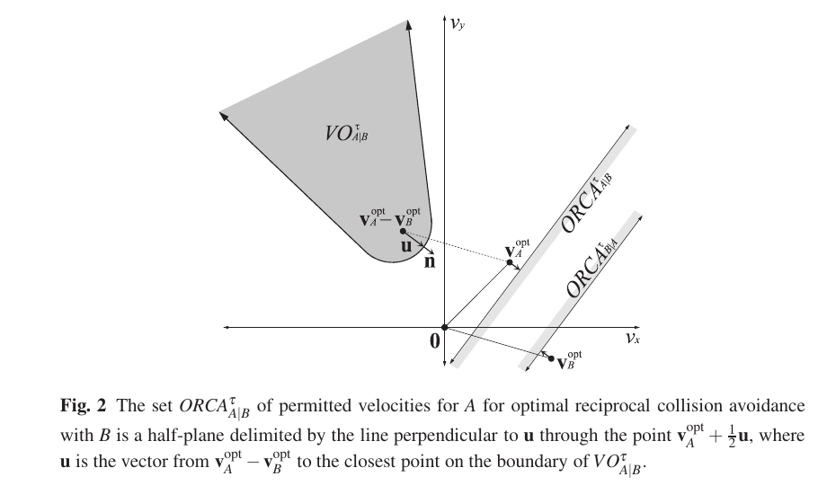
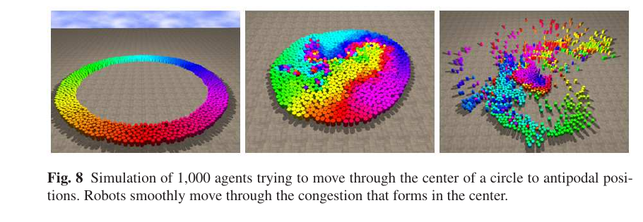

여러 이동체가 동시에 서로를 피해야 할 때 가능한 속도를 전부 샘플링하면 후보 수가 빠르게 늘어납니다. 이웃 한 명을 피한 속도가 다른 이웃과 충돌할 수 있고, 가장 안전한 후보를 찾는 동안 다음 센서 프레임이 도착할 수도 있어요. 충돌 회피 규칙이 좋아도 계산 시간이 제어 주기를 넘으면 로봇은 오래된 장면에 반응합니다.

Jur van den Berg, Stephen J. Guy, Ming Lin, Dinesh Manocha의 「Reciprocal n-Body Collision Avoidance」는 이 문제를 허용 속도의 반평면과 저차원 최적화로 바꿉니다. <abbr title="각 이동체가 회피 책임을 나눈다는 가정 아래 이웃별 허용 속도 반평면을 만들고 교집합에서 새 속도를 고르는 충돌 회피 방식">최적 상호 충돌 회피</abbr>, 곧 ORCA는 [[2026-10-17_socialnav_rvo|서로 피한다는 가정은 속도 장애물의 흔들림을 어떻게 줄였나]]에서 제시된 상호성을 계산하기 쉬운 볼록 제약으로 정리합니다.

## 금지 원뿔 대신 허용 반평면을 교차해요

두 원형 이동체 A와 B가 있다고 해볼게요. 현재 상대 속도를 유지할 때 정해진 시간 안에 부딪히는 속도는 속도 공간의 원뿔 모양 영역에 들어갑니다. 충돌을 피하려면 상대 속도를 그 영역의 경계 밖으로 밀어내야 해요. 경계까지의 가장 짧은 변화 벡터를 `u`라고 놓을 수 있습니다.

ORCA는 이 변화량을 두 이동체가 절반씩 맡는다고 봅니다. A의 기준 속도에서 `u/2`만큼 옮긴 점을 지나고 `u`에 수직인 직선을 그으면 한쪽이 허용 속도 반평면이 됩니다. B도 대칭인 반평면을 계산해요. 둘이 같은 규칙을 쓰고 입력이 일치하면 각자의 절반 변화가 합쳐져 상대 속도가 충돌 영역 밖으로 나갑니다.

<figure class="fig"><figcaption>회색 속도 장애물에서 벗어나기 위한 최소 상대 변화 `u`를 절반씩 나누고, A가 선택할 수 있는 속도를 직선 한쪽의 반평면으로 만듭니다. (출처: van den Berg, Guy, Lin & Manocha, Reciprocal n-Body Collision Avoidance, Fig. 2, <a href="https://ics-websites.science.uu.nl/docs/vakken/mcrws/papers_new/van%20den%20Berg%20et%20al%20-%202011%20-%20Reciprocal%20n-body%20collision%20avoidance.pdf">원문 PDF</a>)</figcaption></figure>

이웃이 여러 명이면 A는 각 이웃에 대해 반평면을 하나씩 만듭니다. 모든 이웃을 피하려면 이 반평면들의 교집합 안에서 속도를 골라야 해요. 반평면의 교집합은 볼록하므로 떨어진 여러 안전 구역을 일일이 탐색하는 문제보다 다루기 쉽습니다. 최대 속도 원과도 교차해 로봇이 낼 수 있는 속도 범위를 제한합니다.

마지막 선택 기준은 선호 속도와의 거리입니다. 선호 속도는 충돌하는 이웃이 없을 때 목표를 향해 가고 싶은 속도예요. 교집합 안에서 선호 속도에 가장 가까운 점을 찾으면 안전 제약을 만족하면서 목표 진행을 가능한 한 유지합니다. 논문은 제약을 차례로 넣는 무작위 선형계획 알고리즘으로 이 해를 계산합니다.

## 설명용 기하 계산으로 반평면을 읽어요

다음 수치는 논문 결과가 아니라 반평면의 의미를 풀기 위한 설명용 가정입니다. 로봇 A의 현재 속도를 `(1.0, 0.0)m/s`, 정면으로 오는 B의 속도를 `(-1.0, 0.0)m/s`라고 해볼게요. 충돌 영역 경계까지 상대 속도를 옆으로 `0.6m/s` 바꿔야 한다고 가정합니다.

두 이동체가 책임을 절반씩 나누면 A의 최소 옆방향 변화는 `0.3m/s`이고 B도 반대쪽으로 `0.3m/s`를 맡습니다. A의 허용 반평면 경계는 기준 속도에서 옆으로 0.3만큼 옮긴 점을 지나요. A가 경계보다 안전한 쪽에서 `(1.0, 0.35)m/s`를 고르고 B도 대칭 선택을 하면 상대 옆속도는 `0.7m/s`가 되어 가정한 최소 0.6을 넘습니다.

이웃 C가 다른 방향에서 접근해 A에게 `x` 성분을 0.8 이하로 낮추라는 반평면을 추가한다고 해볼게요. 첫 반평면은 `y ≥ 0.3`, 둘째는 `x ≤ 0.8`로 단순화할 수 있습니다. 선호 속도가 `(1.0, 0.0)`이면 두 제약의 교집합에서 가장 가까운 점은 `(0.8, 0.3)`입니다. 속도 후보를 수백 개 찍지 않아도 경계 교차점으로 해를 찾을 수 있어요.

최대 속도가 `0.75m/s`라면 `(0.8, 0.3)`은 실행 범위 밖입니다. 최대 속도 원과 두 반평면을 함께 교차해야 해요. 세 제약을 모두 만족하는 점이 없다면 기존 2차원 문제는 실행 불가능합니다. 이때 아무 속도나 고르거나 이전 명령을 유지하면 가장 밀집한 순간에 안전 제약을 버리게 됩니다.

이 계산은 ORCA의 수치를 재현한 것이 아닙니다. 반평면 교집합, 선호 속도 투영, 최대 속도 경계가 어떤 순서로 선택을 제한하는지 보여 주는 자체 사례예요. 실제 배포 값은 로봇 형상, 제동 한계, 제어 주기와 관측 지연을 측정해 정해야 합니다.

## 교집합이 비면 안전 보장이 아니라 최선의 위반을 찾아요

군중이 지나치게 조밀하면 모든 허용 반평면을 동시에 만족하는 속도가 없을 수 있습니다. 논문은 이 상태를 숨기지 않습니다. 현재 속도를 최적화 기준으로 쓰는 구성에서도 높은 밀도에서는 선형계획이 실행 불가능할 수 있다고 설명해요.

대체 문제는 각 반평면 경계를 같은 속도로 바깥쪽으로 밀어 어느 순간 하나의 속도가 허용되는지 찾는 방식으로 해석할 수 있습니다. 수학적으로는 각 제약 위반 거리의 최댓값을 최소화합니다. 속도 두 차원에 위반 거리 한 차원을 더한 3차원 선형계획으로 풀고, 항상 어떤 해를 반환하도록 구성해요.

여기서 반환된 속도는 충돌이 없다는 보장을 되살린 해가 아닙니다. 만족할 수 없는 제약을 가장 덜 위반하는 속도입니다. 논문도 이 경우 충돌 없는 속도를 보장할 수 없다고 구분합니다. 구현 로그에서 정상 교집합 해와 안전 제약 완화 해를 같은 성공 상태로 기록하면 위험한 장면을 놓칩니다.

정적 장애물 제약은 더 엄격하게 다룹니다. 벽은 로봇을 보고 비키지 않으므로 로봇이 회피 책임을 모두 져야 해요. 논문은 고밀도에서 이동체 제약을 완화하더라도 장애물 제약은 완화하지 않는 구성을 설명합니다. 사람을 벽과 똑같이 볼 수는 없지만, 협조 가능성과 물리 하한을 분리한다는 발상은 배포에서도 중요합니다.

## 선호 속도와 최적화 속도는 다른 역할이에요

선호 속도는 목표로 가고 싶은 속도이고, 최적화 속도는 상호 책임을 나눌 반평면을 어디에 놓을지 정하는 기준입니다. 둘을 항상 같게 두면 목표 진행은 강하지만 이웃의 선호 속도를 관측하기 어렵고 밀집 장면에서 교집합이 사라질 가능성이 커집니다.

최적화 속도를 0으로 두면 상대의 현재 운동을 거의 활용하지 않아 움직임이 부자연스러워질 수 있습니다. 밀집한 상태에서 모든 이동체의 속도가 0으로 수렴하는 교착도 생길 수 있어요. 논문은 현재 속도를 최적화 속도로 쓰는 선택을 두 극단 사이의 절충으로 설명합니다. 현재 속도는 관측할 수 있고, 밀집할수록 자연스럽게 작아지기 때문입니다.

사람 주행에서는 현재 속도 역시 정확한 값이 아닙니다. 카메라 추적의 두 프레임 차이로 계산하면 자세 흔들림과 식별자 전환이 속도에 섞여요. 사람의 실제 보행 의도가 아니라 추적기 출력이 반평면 위치를 정합니다. 속도 분산과 마지막 관측 시간을 제약 여유에 반영하지 않으면 계산은 정확해도 입력이 틀립니다.

로봇 목표와 사람 목표를 섞어서도 안 됩니다. 로봇의 선호 속도는 전역 경로에서 알 수 있지만 사람의 선호 속도는 숨은 상태입니다. 현재 사람 속도를 곧 목표 방향으로 간주하면 멈추거나 회전할 사람을 예측하지 못해요. 사람의 목표를 아는 시뮬레이션은 현장 센서 배포보다 유리한 입력 조건입니다.

## 원 논문의 검증은 대규모 시뮬레이션이에요

논문은 두 이동체의 위치 교환과 다섯 이동체의 원형 교차 같은 작은 행동 시뮬레이션을 먼저 제시합니다. 이어서 천 행위자가 원의 반대편 목표로 이동하는 장면과 천 가상 행위자의 사무실 대피 장면으로 규모를 늘립니다. 모두 가상 행위자 실험이며 사람 참여 평가나 실물 로봇 군중 주행은 아닙니다.

<figure class="fig"><figcaption>천 행위자가 중앙에서 뒤섞인 뒤 반대편으로 빠져나가는 시뮬레이션입니다. 빠른 다중 충돌 회피를 보여 주지만 사람의 편안함이나 사회 규범을 평가한 장면은 아닙니다. (출처: van den Berg, Guy, Lin & Manocha, Reciprocal n-Body Collision Avoidance, Fig. 8, <a href="https://ics-websites.science.uu.nl/docs/vakken/mcrws/papers_new/van%20den%20Berg%20et%20al%20-%202011%20-%20Reciprocal%20n-body%20collision%20avoidance.pdf">원문 PDF</a>)</figcaption></figure>

성능 측정은 여덟 개의 2.66기가헤르츠 Intel Xeon 코어에서 OpenMP로 병렬화했습니다. 오천 행위자의 원형 장면에서 모든 행위자의 충돌 회피 선형계획을 푸는 데 8밀리초, 사무실 대피 갱신에는 15.6밀리초를 보고합니다. 이 값은 해당 구현, 하드웨어, 가상 상태 입력에서 얻은 결과예요.

현대 소형 컴퓨터가 더 새롭다는 이유로 전체 주기가 자동으로 더 빠르다고 결론 내릴 수 없습니다. 실제 로봇에는 영상 디코딩, 사람 검출, 추적, 좌표 변환, 전역 경로, 속도 명령 전달이 더해집니다. 논문 성능은 ORCA 핵심 계산의 규모 확장을 보여 주며 센서부터 모터까지의 지연을 측정한 값은 아닙니다.

논문이 둔 로봇 모델도 확인해야 합니다. 각 이동체는 2차원에서 어느 방향으로든 바로 속도를 낼 수 있는 전방향 모델이고, 원 또는 볼록 다각형처럼 단순한 형상을 가집니다. 위치, 속도, 형상을 정확히 관측할 수 있다고 가정합니다. 기구학과 동역학은 본문 결론에서 향후 확장으로 남깁니다.

## 차동구동 로봇은 선택 속도를 곧바로 실행하지 못해요

ORCA가 고른 속도 벡터에는 옆방향 성분이 있을 수 있습니다. 차동구동 베이스는 옆으로 미끄러지지 못하므로 먼저 회전한 뒤 전진해야 해요. 속도 벡터를 선속도와 각속도로 단순 변환하면 계획한 순간의 궤적과 실제 곡선이 달라집니다.

설명용 예로 현재 정면 속도가 `(0.6, 0.0)m/s`인데 ORCA가 `(0.3, 0.4)m/s`를 골랐다고 해볼게요. 벡터 방향은 약 53도입니다. 전방향 이동체는 곧바로 그 방향으로 움직일 수 있지만 차동구동 로봇은 회전하는 동안 이전 진행 방향으로 남거나 감속해야 합니다. 시간 지평이 짧으면 실행 가능해지기 전에 예상 충돌 시점이 옵니다.

선택 속도를 기구학 범위로 자르는 후처리도 위험합니다. `(0.3, 0.4)`에서 옆성분을 버려 `(0.3, 0.0)`으로 만들면 원래 반평면 바깥으로 나갈 수 있어요. 논문 역시 사후 제한은 엄격한 충돌 회피 보장을 잃을 수 있다고 적습니다. 실행 가능한 곡률과 가속도를 후보 생성 안에 넣거나, 변환 뒤 다시 제약을 검사해야 합니다.

제동 능력도 최대 속도 원 하나로 표현되지 않습니다. 현재 1미터/초에서 한 주기 뒤 0이 될 수 없다면 정지 속도가 후보에 있어도 실행할 수 없어요. 현재 속도 주변의 도달 가능 집합과 ORCA 반평면을 교차해야 합니다. 이 교집합이 비면 더 일찍 감속하거나 전역 경로를 바꾸어야 합니다.

## 사람은 같은 회피 프로토콜을 쓰지 않을 수 있어요

ORCA의 충돌 회피 조건은 다른 이동체도 같은 책임 분배 규칙을 쓴다는 가정에 묶입니다. 여러 로봇이 같은 소프트웨어를 쓰면 맞추기 쉽지만 사람은 프로토콜 참가자가 아닙니다. 로봇이 멈출 것으로 기대해 직진하거나, 로봇을 보지 못하거나, 일행과 떨어지지 않으려 다른 방향을 고를 수 있어요.

책임을 정확히 절반씩 나누는 것도 사회 규범이 아닙니다. 병원 운반 로봇이 보행 보조기 사용자에게 절반의 회피를 요구하는 것은 적절하지 않을 수 있습니다. 로봇이 더 큰 책임을 지도록 반평면을 이동할 수 있지만, 비율을 정하려면 상대의 반응 신뢰도와 장소 정책이 필요해요.

원형 반경은 사람의 방향과 짐을 지웁니다. 유모차나 카트는 진행 방향에 따라 폭이 달라지고, 두 사람이 나란히 걷는 집단은 원 두 개의 합보다 사회적으로 큰 경계를 만들 수 있어요. 볼록 다각형을 쓰더라도 팔과 짐의 움직임, 집단 관계는 별도 모델이 필요합니다.

충돌하지 않는 속도 가운데 어느 쪽으로 지나갈지도 남습니다. ORCA는 선호 속도와 가까운 해를 고르지만 통행 방향, 줄, 대화 집단, 출입문 우선순위를 알지 못합니다. 사회 비용은 안전 교집합 안에서 후보를 순위화하거나 전역 선호 속도를 만드는 계층에 들어가야 해요.

## 시간 지평은 안전과 진행성을 함께 바꿔요

시간 지평이 길면 먼 미래 충돌까지 반평면에 들어와 일찍 양보합니다. 관측이 정확하고 상대가 등속으로 움직인다면 부드러운 경로를 만들 수 있어요. 그러나 사람 방향이 자주 바뀌면 긴 지평은 예측 오차를 키우고 허용 속도 교집합을 불필요하게 줄입니다.

짧은 지평은 가까운 위험에만 반응해 목표 진행을 유지하지만 빠른 정면 접근을 늦게 처리할 수 있습니다. 제어 지연과 제동 시간이 지평의 큰 부분을 차지하면 계산상 안전한 새 속도를 실행할 시간이 없어요. 지평은 단순한 조정 손잡이가 아니라 관측·제어 계약입니다.

설명용으로 카메라부터 명령 적용까지 0.18초, 최대 제동 시간이 0.7초라고 가정해볼게요. 1초 지평에서 실제 새 행동으로 쓸 수 있는 여유는 약 `1.0 - 0.18 = 0.82초`이고, 제동을 끝내고 남는 여유는 0.12초뿐입니다. 2초 지평은 더 많은 여유를 주지만 사람 속도 오차가 두 배 시간 동안 누적돼요. 논문 결과가 아니라 지평을 끝단 지연과 함께 정해야 한다는 계산 사례입니다.

이웃 반경도 시간 지평과 맞아야 합니다. 상대 속도 합이 2미터/초이고 지평이 3초라면 6미터 밖의 이웃도 곧 충돌할 수 없다는 단순한 최대 범위을 생각할 수 있어요. 탐색 반경을 3미터로 잘라 놓으면 수식의 3초 보장은 입력 목록에서 이미 깨집니다. 최대 상대 속도와 센서 범위, 이웃 선택을 함께 점검해야 합니다.

## 배포에서는 세 종류의 실패를 구분해야 해요

첫째는 관측 실패입니다. 사람이 검출되지 않거나 식별자가 바뀌면 필요한 반평면이 없거나 잘못된 속도에 놓입니다. 이때 선형계획은 정상 해를 반환할 수 있어 더 위험해요. 입력 사람 수, 트랙 나이, 속도 분산을 결과와 함께 기록해야 합니다.

둘째는 최적화 실패입니다. 반평면은 모두 올바르지만 교집합이 비어 3차원 완화 문제로 넘어갑니다. 이 상태는 충돌 없음 보장이 사라진 경고예요. 완화 최대 거리와 어떤 이웃 제약을 위반했는지 남기고, 독립 충돌 감시가 최대 허용 속도이나 정지를 결정해야 합니다.

셋째는 실행 실패입니다. 계산한 속도는 안전하지만 차동구동, 가속도, 통신 지연 때문에 실제 베이스가 따라가지 못합니다. 명령 속도와 측정 속도의 차이를 반평면에 다시 넣거나 다음 주기 여유를 늘려야 해요. 계획기 성공률만 보면 이 실패는 보이지 않습니다.

세 상태를 하나의 `planner failed`로 합치면 수정 방향을 찾기 어렵습니다. 관측 실패는 센서와 추적, 최적화 실패는 밀도와 시간 지평, 실행 실패는 제어와 기구 제약을 고쳐야 해요. 로그와 평가표도 이 경계를 유지해야 합니다.

## 작은 반례로 구현을 검증해요

첫 사례는 이웃이 없는 장면입니다. 반환 속도는 최대 속도 범위 안에서 선호 속도와 같아야 해요. 차이가 나면 기본 비용이나 좌표 변환에 숨은 제약이 있습니다.

둘째는 두 이동체의 완전 대칭 정면 조우입니다. 한쪽 통과를 정한 뒤 좌우가 매 주기 뒤집히지 않는지 봅니다. 목록 순서나 부동소수점 오차가 통과 방향을 바꾼다면 동률 해소 규칙과 히스테리시스가 필요합니다.

셋째는 세 반평면의 교집합이 한 점만 남는 경우입니다. 경계 포함 부등호가 일관되고, 제약 입력 순서를 바꿔도 같은 해가 나오는지 확인해요. 무작위 순서 알고리즘이라도 허용 오차 안에서 결과가 재현되어야 합니다.

넷째는 빈 교집합입니다. 2차원 해가 없을 때 3차원 완화가 실행되고 상태 플래그가 바뀌는지 봅니다. 반환 속도만 검사하면 정상 해와 완화 해를 구분하지 못해요. 최대 제약 위반 거리도 예상값과 비교합니다.

다섯째는 정적 벽과 이동체 제약의 충돌입니다. 사람 제약을 완화하더라도 벽 제약이 유지되는지 확인합니다. 벽을 뚫는 속도가 가장 작은 최대 위반을 만든다는 이유로 선택되면 제약 우선순위가 잘못된 것입니다.

여섯째는 비협조 사람입니다. 사람은 직진을 유지하고 로봇만 ORCA를 따르게 해 절반 책임 가정이 깨지는 장면을 만듭니다. 하위 안전 계층이 충돌 전에 감속하는지, 책임 비율을 로봇 쪽으로 옮겼을 때 진행성과 최소거리가 어떻게 바뀌는지 측정해요.

일곱째는 차동구동 실행입니다. 전방향 속도 해를 베이스 명령으로 바꾼 뒤 실제 궤적이 원래 반평면을 계속 만족하는지 재검사합니다. 원래 해만 안전하고 변환된 해가 위험하다면 ORCA 성능 문제가 아니라 실행 가능 집합의 누락입니다.

ORCA의 강점은 다중 충돌 회피를 복잡한 후보 열거 대신 반평면 교집합과 저차원 최적화로 만든 데 있습니다. 이 구조 덕분에 많은 가상 행위자의 속도를 빠르게 계산하고, 밀집해 교집합이 사라지는 상태도 별도 문제로 표현할 수 있어요.

사람 사이를 다니는 로봇에서는 그 효율을 안전 후보 생성에 활용하되 보장의 전제를 그대로 읽어야 합니다. 정확한 위치·속도·형상, 전방향 운동, 같은 회피 프로토콜이라는 조건이 깨지면 수학적 보장도 약해집니다. 관측 실패, 빈 교집합, 실행 불가능을 각각 드러내고 사람이 반응하지 않는 경우를 감당할 충돌 감시를 따로 두어야 ORCA의 빠른 계산이 실제 안전으로 이어집니다.

---

<!-- src-block -->
출처 — https://ics-websites.science.uu.nl/docs/vakken/mcrws/papers_new/van%20den%20Berg%20et%20al%20-%202011%20-%20Reciprocal%20n-body%20collision%20avoidance.pdf
