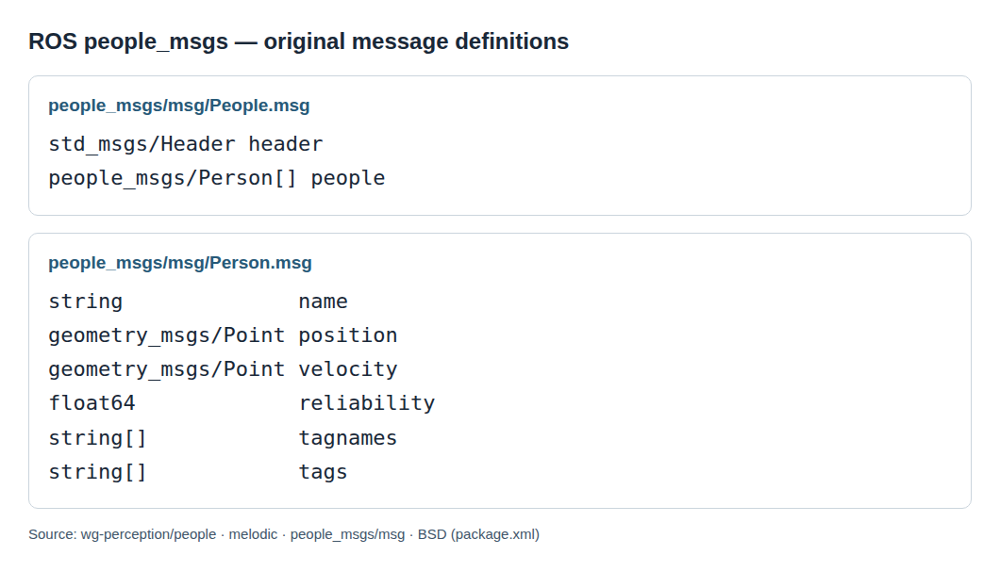

사람 검출기를 주행 계획기에 연결할 때는 좌표 배열을 보낼 수 있는지만 확인해서는 부족해요. 관측 시각과 기준 좌표가 다르면 정확한 검출도 잘못된 회피 명령으로 이어질 수 있기 때문입니다. 로봇의 기능 사이에서 데이터를 주고받는 <abbr title="센서와 제어 같은 로봇 프로그램들이 메시지로 정보를 주고받도록 돕는 소프트웨어 체계">ROS</abbr>의 <abbr title="사람의 위치와 속도, 신뢰도 등을 주고받기 위한 메시지 형식 묶음"><code>people_msgs</code></abbr>는 이 연결을 살펴볼 수 있는 작은 자료예요.

## 원래 메시지에 있는 필드부터 읽어요

원 저장소의 <abbr title="한 사람의 이름 표지, 위치, 속도, 신뢰도와 태그를 담는 메시지 형식"><code>Person</code></abbr>에는 이름, 위치, 속도, 신뢰도, 태그 이름 배열과 태그 값 배열이 있습니다. 여러 사람을 묶는 <abbr title="공통 헤더와 여러 사람의 상태 목록을 함께 담는 메시지 형식"><code>People</code></abbr>에는 공통 <abbr title="메시지의 기준 시각과 좌표계 이름 등을 담는 표준 머리 정보"><code>header</code></abbr>와 사람 목록이 있어요. 한 사람의 위치와 속도가 같은 점 자료형으로 선언돼 있다는 것도 원문에서 확인할 수 있습니다. 별도의 위치 측정 메시지에는 <abbr title="위치 오차가 각 방향으로 얼마나 퍼지고 서로 함께 변하는지 나타내는 수치 표">공분산</abbr> 필드가 있지만, 사람 상태 메시지에 그 필드가 자동으로 따라오는 것은 아닙니다.

<figure class="fig"><figcaption>원 저장소의 두 메시지 정의를 변경 없이 읽기 쉬운 크기로 표시한 화면이에요. 정의에 없는 관측 유효 시간이나 식별자 유지 규칙은 별도로 정해야 합니다. (출처: wg-perception/people, melodic의 people_msgs/msg/People.msg와 Person.msg; package.xml에 BSD 명시)</figcaption></figure>

이 형식은 사람 상태를 전송하는 그릇입니다. 사람을 검출하는 모델, 여러 프레임의 동일 인물을 연결하는 알고리즘, 사회적 거리를 계산하는 규칙을 제공하지는 않아요. 메시지가 도착했다는 사실과 그 값이 계획에 적합하다는 판단도 다릅니다. 형식이 맞는 데이터가 의미까지 맞는지는 송신자와 수신자 사이의 계약으로 검증해야 해요.

## 위치는 숫자 세 개보다 기준 좌표가 중요해요

앞으로 2미터, 왼쪽으로 1미터라는 위치는 기준이 있어야 뜻이 생깁니다. 카메라를 기준으로 한 좌표인지, 로봇 몸체를 기준으로 한 좌표인지, 지도에 고정된 좌표인지에 따라 같은 숫자가 가리키는 장소가 달라져요. 사람 검출 결과를 어느 좌표로 바꿔 보낼지, 계획기는 어떤 좌표를 기대하는지 함께 정해야 합니다. 기준 이름만 채우고 실제 숫자는 다른 좌표로 보내는 오류도 피해야 해요.

설명용으로 사람이 로봇 앞 2미터에 있고 로봇이 지도에서 오른쪽으로 이동했다고 가정해 볼 수 있습니다. 지도 좌표의 사람 위치는 그대로여도 몸체 기준 사람 위치는 달라질 수 있어요. 두 값을 같은 배열에 섞으면 사람이 갑자기 이동한 것처럼 보입니다. 검출기가 사람을 정확히 찾았더라도 잘못된 좌표 변환이 추적과 회피를 함께 망가뜨릴 수 있는 상황이에요.

좌표 변환 검증에는 정지한 표적을 관찰하며 로봇 자세만 바꾸는 기록이 유용합니다. 지도에 고정된 좌표로 바꾼 표적 위치가 로봇 움직임을 따라 흐른다면 변환의 방향, 축 순서, 사용 시각을 확인할 근거가 생겨요. 한 자세에서만 맞는지, 모든 자세에서 일정한 오차가 나는지도 구별합니다. 숫자 범위가 그럴듯하다는 확인은 좌표 계약 검증을 대신하지 못해요.

## 위치와 속도는 같은 방식으로 이동하지 않아요

위치는 좌표 원점이 이동하면 값이 바뀌고, 방향을 나타내는 속도는 축의 회전을 함께 고려해야 합니다. 여기에 로봇이 움직이는 관측계라면 사람의 상대속도와 지도에서의 사람 속도도 구별해야 해요. 점 자료형이라는 이유로 위치와 속도에 같은 변환 계산을 무조건 적용하면 안 됩니다. 전송 자료형은 계산의 물리적 의미를 보장하지 않아요.

설명용으로 지도에서 사람이 멈춰 있고 로봇이 그 사람 쪽으로 초당 0.4미터 전진한다고 가정하겠습니다. 카메라가 보는 거리는 줄어들지만 사람이 지도에서 걷기 시작한 것은 아닙니다. 거리 변화만 속도로 넘기면 계획기는 사람이 로봇 쪽으로 온다고 오해할 수 있어요. 상대속도를 사용할 계획인지 지도 속도를 사용할 계획인지 결정하고, 로봇 운동 보상 여부를 수신 측에도 알려야 합니다.

회전 중에는 문제를 더 쉽게 놓칠 수 있습니다. 정지한 사람이 영상 오른쪽으로 빠르게 움직여 보여도 일부는 로봇의 회전 때문에 생긴 영상 변화예요. 이 변화를 사람의 횡방향 보행 속도로 해석하면 잘못된 횡단 예측이 만들어집니다. 좌표의 축 회전과 관측계 운동을 어떤 단계에서 처리했는지를 기록해야 원인을 찾을 수 있어요.

## 시각은 수신 시간이 아니라 관측 시간을 가리켜야 해요

검출 결과가 만들어진 시각과 카메라가 장면을 관측한 시각은 다릅니다. 처리 대기와 추론에 시간이 걸리면 결과는 도착하자마자 이미 과거 상태예요. 수신 시각으로 덮어쓰면 계획기는 오래된 관측을 새 관측으로 읽습니다. 지연을 줄이는 작업과 관측 시각을 정확히 남기는 작업은 각각 필요해요.

설명용으로 사람이 초당 1미터로 이동하고 관측 처리에 0.3초가 걸렸다고 가정하면, 등속 모델에서 현재 위치와 관측 위치 차이는 0.3미터입니다. 늦게 도착한 결과에 지금 시각을 붙이면 이 차이가 보이지 않아요. 반대로 관측 시각을 보존하면 수신자가 위치를 짧게 예측하거나 오래된 입력으로 제외할 수 있습니다. 이 계산은 사람의 실제 움직임이나 검출기 성능을 측정한 결과가 아닌 지연 설명용 모델입니다.

시각을 보존해도 서로 다른 컴퓨터의 시계가 어긋나 있으면 관측 나이를 잘못 계산할 수 있어요. 수신 기준으로 음수 나이가 나오는지, 특정 장치의 결과만 일정하게 오래돼 보이는지 관찰할 수 있습니다. 시계 동기 문제를 추론 속도 저하와 구분해야 해요. 단일 컴퓨터에서 성공한 연결을 네트워크 분산 구성에 옮길 때 다시 점검할 이유입니다.

## 공통 헤더는 목록 전체의 시각 의미를 요구해요

사람 목록의 공통 시각은 목록 안의 상태들이 어떤 순간을 가리키는지 설명해야 합니다. 한 사람은 방금 관측했고 다른 사람은 0.5초 전에 사라졌는데 두 상태를 모두 현재 관측처럼 묶으면 정보의 질이 달라요. 사라진 사람을 추적으로 유지하는 일 자체가 틀린 것은 아닙니다. 유지한 상태가 관측값인지 예측값인지와 마지막 관측 나이를 구분할 수 있어야 해요.

가능한 설계는 여러 가지입니다. 모든 추적 상태를 공통 기준 시각까지 예측해 맞춘 뒤 전송할 수도 있고, 최근 관측된 사람만 목록에 넣을 수도 있어요. 어떤 설계를 택해도 예측 유지 시간과 삭제 조건을 기록해야 합니다. 하나의 메시지 정의가 이 선택을 대신해 주지 않아요.

설명용으로 두 사람 중 한 명만 가려지는 재생 장면을 만들 수 있습니다. 가림 직전, 유지 중, 삭제 순간, 재등장 순간에 수신 계획기가 받은 상태를 비교해요. 공통 헤더가 새로워졌다는 이유만으로 가려진 사람의 상태까지 새 관측으로 취급하는지 확인합니다. 위치 배열이 정상적으로 채워져 있어도 관측 나이 계약은 따로 실패할 수 있어요.

## 이름 표지는 안정된 추적 번호를 뜻하지 않아요

문자열 이름을 저장할 수 있다고 해서 동일한 사람의 번호가 유지되는 것은 아닙니다. 검출기 클래스 이름, 임시 추적 번호, 센서별 이름이 같은 필드에 들어갈 수 있어요. 수신자가 그 값을 어떤 목적으로 쓰는지에 맞춰 송신 규칙을 정해야 합니다. ‘person’이라는 공통 라벨과 ‘이전 프레임의 그 사람’이라는 식별은 다른 정보예요.

두 사람이 교차할 때 번호가 바뀌면 속도가 갑자기 튀고 목표 방향 예측도 바뀔 수 있습니다. 반대로 다른 사람이 같은 번호를 재사용하면 오래된 예측을 새 사람에게 이어 붙일 수 있어요. 계획기에 긴 과거 궤적을 주는 설계일수록 이 오류의 영향이 커집니다. 추적 번호가 끊기거나 바뀔 때 상태를 초기화하는 기준도 전송 계약에 포함해야 해요.

교차 장면을 평가할 때는 검출 성공률만으로 충분하지 않습니다. 프레임마다 사람 수가 맞아도 연결 관계는 바뀔 수 있어요. 번호 변경 사건, 변경 직후 속도 변화, 계획기의 회피 방향 변화를 함께 보면 정보가 어디서 왜곡됐는지 찾기 쉽습니다. 같은 메시지 형식을 쓴 두 추적기가 다른 주행 행동을 만들 수 있는 이유가 여기에 있어요.

## 신뢰도 숫자는 확률로 자동 해석되지 않아요

<abbr title="관측이나 추정값을 얼마나 믿을지 송신자가 나타내는 수치 필드"><code>reliability</code></abbr>에 소수가 들어 있다고 해서 그 값이 정확한 확률이라는 보장은 없습니다. 값의 범위, 높은 값의 의미, 검출과 추적 중 무엇의 확신인지가 필요해요. 서로 다른 검출기가 낸 0.8을 같은 품질로 합치려면 별도의 검증이 있어야 합니다. 숫자 형식이 같다는 이유로 신뢰도 척도까지 같아지지는 않아요.

설명용으로 한 검출기는 분류 점수를, 다른 추적기는 최근 관측 유지 정도를 신뢰도로 보낸다고 가정해 볼 수 있어요. 두 값이 모두 0.9여도 앞의 값은 사람일 가능성에 가깝고 뒤의 값은 궤적 유지 상태에 가깝습니다. 어느 쪽도 위치 오차가 작다는 보증은 아닙니다. 수신 측에서 하나의 임계값으로 둘을 처리하면 다른 종류의 불확실성을 섞게 돼요.

신뢰도를 의사결정에 쓰려면 값 구간별 실제 오류를 살펴볼 수 있습니다. 높은 점수 구간에서 위치 오차와 오검출이 줄어드는지, 가림과 거리 변화에도 같은 관계가 유지되는지 비교해요. 이런 평가가 없다면 점수는 해당 송신기 안에서 정한 순서 정도로 다루는 편이 조심스럽습니다. 낮은 점수를 버리는 방식도 보호 대상이 사라지는 결과를 만들 수 있으므로 검출 누락과 함께 평가해야 해요.

## 위치 오차의 방향은 신뢰도 한 값으로 표현하기 어려워요

깊이 카메라는 장면과 거리 조건에 따라 앞뒤 오차와 좌우 오차가 다르게 나타날 수 있습니다. 같은 평균 오차라도 사람이 움직이는 방향과 직각으로 퍼지는 경우와 진행 방향으로 퍼지는 경우의 회피 의미는 달라요. 신뢰도 한 숫자에는 이런 방향별 구조가 담기지 않습니다. 계획기가 무엇을 필요로 하는지에 따라 전송 정보를 확장하거나 별도 형식을 골라야 해요.

원 저장소의 [PositionMeasurement 정의](https://github.com/wg-perception/people/blob/melodic/people_msgs/msg/PositionMeasurement.msg)에는 3×3 형태로 해석할 수 있는 아홉 원소의 공분산 필드가 있습니다. 그러나 이것을 사람 상태 목록이 제공한다고 읽으면 형식을 혼동하게 돼요. 어떤 메시지가 오가는지부터 확인하고, 수신자가 그 필드를 실제로 사용하는지도 봐야 합니다. 필드가 존재하는 것과 유효한 불확실성 추정이 채워지는 것도 다릅니다.

정보가 부족한 인터페이스를 쓸 때는 그 한계를 계약에 남길 수 있어요. 예를 들어 별도 검증에서 확인한 위치 오차 범위를 고정 여유로 두되, 그 범위 밖의 입력은 사용하지 않는 방식이 가능합니다. 이 방식이 확률 모델과 동등하다는 뜻은 아닙니다. 정밀한 값이 없는데도 신뢰도 숫자를 정밀한 오차 표처럼 사용하는 것보다 무엇을 가정했는지 드러내기 쉬워요.

## 속도는 두 위치의 차이를 나누는 것부터 흔들려요

연속 위치 차이를 시간 차이로 나누면 단순 속도 추정이 됩니다. 하지만 위치의 작은 흔들림은 시간 간격이 짧을수록 큰 속도 오차로 바뀔 수 있어요. 시간 간격을 길게 잡아 평균을 내면 흔들림은 줄어도 급한 방향 전환을 늦게 따라갈 수 있습니다. 속도 필드에 숫자가 있다는 것만으로 두 문제가 해결되지는 않아요.

설명용으로 정지한 사람의 추정 위치가 한 방향으로 0.05미터 흔들리고, 두 관측 사이가 0.1초라고 가정하면 단순 차분은 초당 0.5미터의 속도를 만들 수 있습니다. 같은 위치 차이를 0.5초에 나누면 초당 0.1미터예요. 이 숫자는 특정 장치의 오차 보고가 아니라 차분의 민감도를 보여 주는 입력입니다. 평균 필터를 고를 때 지연과 반응성을 함께 봐야 하는 이유도 설명합니다.

추적 번호가 바뀌거나 관측이 오래 끊긴 뒤에는 시간 차분을 평상시처럼 적용하기 어렵습니다. 새 사람을 이전 사람 위치에 이어 붙이거나, 가림 중 예측값과 새 관측값을 차분하면 순간 속도가 과장될 수 있어요. 초기화 상태, 유효한 관측 간격, 속도 범위 검사 등을 별도로 정의할 수 있습니다. 값이 큰 경우 무조건 잘라내기보다 왜 커졌는지를 로그에서 구분해야 해요.

## 빈 목록과 오래된 목록은 서로 다른 입력이에요

빈 사람 목록은 ‘현재 관측된 사람이 없다’는 뜻으로 쓸 수 있습니다. 그러나 카메라 시야가 가려졌거나 검출기가 멈춘 경우에도 비슷한 결과가 나올 수 있어요. 목록이 비었다는 것과 관측이 정상이라는 상태는 별도로 전달하거나 감시해야 합니다. 그렇지 않으면 검출 실패가 사람 없는 공간으로 해석될 수 있어요.

목록이 오래 갱신되지 않을 때의 처리도 정해야 합니다. 마지막 사람 위치를 무기한 유지하면 유령 장애물이 생기고, 즉시 삭제하면 실제 사람이 가려진 순간 보호 정보가 사라질 수 있어요. 계획기의 목적과 다른 센서의 관측 범위를 고려해 제한 시간을 정해야 합니다. 시간이 지나 삭제됐다는 사건을 실제 사람이 떠났다는 관찰과 구분하면 실패 원인을 설명하기 쉬워요.

재생 시험에서는 빈 목록을 정상 주기로 보내는 경우, 목록 발행을 멈추는 경우, 과거 목록을 새로 수신하는 경우를 나눌 수 있습니다. 각 조건에서 계획기가 정지·감속·유지 중 무엇을 선택하는지 확인해요. 기대 동작은 로봇 전체의 보호 설계에 따라 정하고, 메시지 형식만으로 정답을 선언하지 않습니다. 데이터 수신 성공과 안전한 상태 해석을 별도로 검증하는 단계입니다.

## 포팅은 같은 이름의 패키지가 있다는 확인보다 넓어요

대표 원 저장소에서 확인한 메시지는 오래된 ROS 배포판의 브랜치에 있으며, 패키지 설정은 기존 빌드 체계를 사용합니다. 이 사실만으로 현재 사용하는 2세대 환경에서 설치와 실행이 검증됐다고 말할 수는 없어요. 다른 저장소의 포팅 버전을 고른다면 메시지 필드, 의존성, 생성된 자료형이 어떻게 대응하는지 다시 확인해야 합니다. 이름이 같아도 같은 배포 이력과 호환성을 뜻하지 않아요.

형식 변환기를 만들 때도 정보를 얼마나 보존하는지 따져야 해요. 위치와 이름만 옮기고 신뢰도와 관측 시각을 버리면 수신자는 이전보다 적은 근거로 움직임을 결정합니다. 반대로 없는 정보를 기본값으로 채워 보내면 원래 추정한 값처럼 보일 수 있어요. 변환 과정에서 유지·삭제·가정한 필드를 표로 남기는 것이 시험을 설계하는 출발점이 됩니다.

실제 적용 판단에는 선택한 포트의 커밋, 사용 환경, 메시지 교환 결과와 오류 입력 처리 결과가 필요합니다. 이 자료를 조사한 것만으로 특정 소형 컴퓨터에서의 처리량이나 주행 성공을 주장할 수 없어요. 메시지 정의를 읽는 단계는 계산 자원 측정보다 앞선 의미 검증입니다. 검출 모델을 바꾸더라도 유지해야 할 계약을 찾는 데 가치가 있어요.

## 계획기에 넘기기 전 확인할 것은 상태의 의미예요

추적 결과를 연결하는 최소 확인표에는 좌표 기준, 관측 시각, 속도의 기준, 번호 유지 규칙, 신뢰도 의미, 삭제 조건을 넣을 수 있습니다. 각 항목마다 정상 장면과 실패 장면을 한 쌍으로 준비해요. 정지한 사람을 보며 로봇만 이동하는 경우, 두 사람이 교차하는 경우, 한 사람이 가려지는 경우가 서로 다른 계약을 시험합니다. 모두 메시지가 수신되는 장면이어도 실패의 종류는 달라요.

원자료는 이 계약을 완성해 주는 문서가 아니라 어떤 값이 전송되는지 확인할 수 있는 근거입니다. 사람 상태를 더 잘 예측하는 모델과 연결할 때도 모호한 시각이나 좌표를 모델이 알아서 고친다고 기대할 수는 없어요. 필요한 정보가 형식 안에 있는지, 송신자가 그 뜻대로 채우는지, 수신자가 같은 뜻으로 사용하는지를 차례로 확인해야 합니다. 인터페이스 검증은 작은 필드 이름에서 시작하지만 최종 회피 행동의 해석까지 이어집니다.

공간에 관측을 기억하는 방식은 [시공간 복셀 계층 STVL이 오래된 장애물을 지우는 방식](https://github.com/SteveMacenski/spatio_temporal_voxel_layer/tree/ros2)에서 볼 수 있어요. 장애물 칸의 시간 이력과 사람별 추적 상태는 다른 정보이므로, 같은 센서를 사용하더라도 각 출력의 의미를 따로 정해야 합니다.

---

<!-- src-block -->

출처 — https://github.com/wg-perception/people
