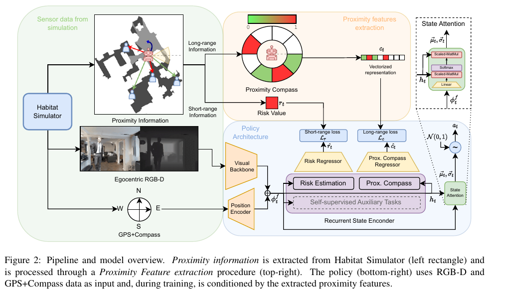
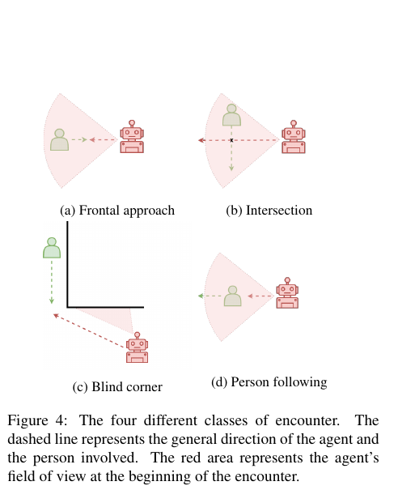

실내 주행 정책이 목표까지 잘 도착해도 사람을 만나는 순간의 행동은 평균 성공률에 묻힐 수 있어요. 빈 복도에서 빠르게 달린 수백 스텝이 모퉁이에서 사람을 본 직후의 감속 한 번보다 훨씬 많기 때문입니다. 사람과 부딪힌 에피소드를 실패로 처리하는 것만으로는 정책이 충돌 전에 위험을 알아차렸는지, 우연히 사람이 지나간 뒤 통과했는지 구분하기 어렵습니다.

<abbr title="가까운 사람의 현재·미래 위험을 보조 예측 문제로 학습시키는 방식">Proximity-Aware Tasks</abbr>는 거리 정보를 보상 하나에만 넣지 않고 정책 내부 표현이 풀어야 할 별도 문제로 둡니다. 하나는 가장 가까운 사람과의 단거리 위험을 예측하고, 다른 하나는 여러 방향에서 다가올 수 있는 사람을 나침반 모양 벡터로 예측해요. 두 정답은 시뮬레이터에서 얻지만 배포 단계의 행동 정책에는 정답 위치를 넣지 않습니다.

이 연구의 실험 무대는 Gibson4+와 HM3D를 사회적 주행용으로 바꾼 HM3D-S입니다. 모든 정량 결과가 시뮬레이션에서 나왔고 실물 로봇 시험이나 사람 대상 평가는 없습니다. 저자들도 인간 움직임과 애니메이션이 단순하다는 한계를 밝히고 이후 과제로 시뮬레이션-실물 전이를 제시했어요. 따라서 “RGB-D만으로 실물 사회 규칙을 배웠다”는 결론보다, 희소한 사람 상호작용을 학습과 평가에서 어떻게 확대했는지를 읽는 편이 정확합니다.

## 도착 보상만으로는 위험의 모양을 배우기 어려워요

강화학습 정책은 목표에 가까워진 정도, 매 스텝 비용, 충돌·후진 벌점, 성공 보상을 합쳐 학습합니다. 충돌이 에피소드 끝에 한 번만 나타나면 그 전에 본 사람의 위치와 몇 스텝 뒤 충돌 사이의 책임을 나누기가 어렵습니다. 우연히 충돌을 피한 경로와 일찍 감속해 피한 경로도 같은 성공으로 기록될 수 있어요.

설명용으로 한 에피소드가 400스텝이고 사람과 가까운 구간이 20스텝이라고 가정하겠습니다. 모든 스텝을 같은 비중으로 학습하면 가까운 구간은 `20/400=5%`입니다. 사람을 보지 않는 380스텝의 목표 추종 신호가 표현을 지배할 수 있어요. 가까운 정도를 매 스텝 예측하는 보조 손실은 위험 구간에 더 촘촘한 학습 신호를 줍니다.

보조 과제는 행동을 규칙으로 고정하지 않습니다. “사람과 0.8미터 이하면 정지” 같은 수동 제어기가 아니라, 위험을 예측할 수 있는 내부 상태를 만들고 최종 행동은 정책이 고릅니다. 그래서 목표가 급하면 가까운 통로를 선택할 수도 있고, 위험 표현을 잘못 해석하면 충돌할 수도 있어요. 보조 과제의 예측 정확도와 실제 행동 안전을 따로 측정해야 합니다.

## 단거리 위험은 가장 가까운 한 사람으로 압축돼요

첫 과제는 일정 반경 `Dᵣ` 안에서 가장 가까운 사람까지의 거리를 0과 1 사이 위험값으로 바꿉니다. 경계 바깥이면 0, 거리가 0에 가까워질수록 1에 가까워집니다. 여러 사람이 있어도 최솟값 하나로 줄여 가까운 충돌 가능성을 강조해요.

설명용으로 반경을 2미터라고 하겠습니다. 가장 가까운 사람이 1.5미터라면 위험값은 `1-1.5/2=0.25`, 0.4미터라면 `1-0.4/2=0.8`입니다. 2.5미터라면 범위 밖이므로 0으로 잘립니다. 이 계산은 식의 작동을 보이는 가정이며 논문의 실제 임계값을 대신하지 않습니다.

최솟값은 강한 장점과 손실을 함께 가집니다. 군중 열 명 가운데 한 사람이 매우 가까우면 평균 거리보다 위험을 놓치지 않습니다. 반대로 가장 가까운 사람이 바뀌는 순간 신호가 튈 수 있고, 한 사람 뒤에 있는 다음 위험은 사라져요. 가까운 사람이 옆에서 같은 속도로 나란히 걷는지, 정면에서 다가오는지도 스칼라 하나에는 담기지 않습니다.

센서 오차도 비선형적으로 반영됩니다. 설명용 반경 2미터에서 실제 0.6미터인 사람을 0.9미터로 추정하면 위험은 0.7에서 0.55로 내려갑니다. 30센티미터 위치 오차가 위험값 0.15 차이를 만든 셈입니다. 검출 누락으로 사람 목록에서 빠지면 값은 0까지 떨어질 수 있어요. 훈련 정답이 완벽한 시뮬레이터 위치라는 사실이 실물 전이에서 중요한 이유입니다.

## 근접 나침반은 방향별 위험을 남겨요

두 번째 과제는 로봇 주변을 여러 각도 구간으로 나누고 각 구간에서 가장 가까운 사람의 위험을 기록합니다. 북쪽은 로봇이 보는 방향이고, 벡터는 시계 방향으로 펼쳐집니다. 단거리 위험보다 큰 반경을 사용해 지금 부딪힐 사람뿐 아니라 어느 쪽에서 다가올 수 있는지도 표현하려는 설계예요.

예를 들어 여덟 구간을 쓰는 설명용 나침반에서 정면 오른쪽 구간 값이 0.8, 뒤쪽 값이 0.2라면 정책 표현은 “앞 오른쪽이 더 위험하다”는 방향 차이를 배울 수 있습니다. 가장 가까운 거리 하나만 보면 두 장면이 같은 값일 수 있지만 회전 방향은 달라야 해요.

각도 구간 수를 늘리면 방향 해상도는 좋아지지만 표본은 희소해집니다. 네 구간은 한 칸이 90도라서 정면과 측면을 섞을 수 있고, 열여섯 구간은 22.5도로 세밀하지만 검출 잡음에 따라 이웃 칸으로 자주 넘어갈 수 있어요. 로봇 회전 오차가 5도이고 사람이 구간 경계 근처에 있으면 위험 벡터의 위치가 불연속적으로 바뀝니다.

방향 벡터도 속도와 의도를 완전히 표현하지 않습니다. 2미터 앞에 서 있는 사람과 2미터 앞에서 초당 1.5미터로 다가오는 사람은 현재 나침반 값이 같을 수 있어요. 이 연구는 과거 관측을 누적하는 순환 상태와 다음 행동을 조건으로 미래 근접값을 예측해 시간 정보를 보완합니다. 그래도 시뮬레이터 사람이 반복 경로를 걷는다는 규칙이 실제 사람의 멈춤·몸짓·집단 행동을 대신하지는 못합니다.

## 미래 네 스텝을 맞히며 행동 결과를 연결해요

보조 회귀기는 현재 내부 상태와 앞으로 수행할 행동을 받아 현재부터 `k`스텝 뒤까지의 근접 특징을 예측합니다. 구현에서는 `k=4`를 사용했어요. 정책이 회전하거나 후진했을 때 사람과의 관계가 어떻게 변할지 표현에 연결하는 방식입니다.

<figure class="fig"><figcaption>훈련 때는 Habitat의 사람 상대 위치로 단거리 위험과 방향별 나침반 정답을 만들고, 정책은 RGB-D와 목표 방향에서 그 특징을 예측합니다. 평가 때 회귀기는 분리되므로 구조도 왼쪽의 완전한 사람 위치가 실행 입력으로 남는 것은 아닙니다. (출처: Cancelli et al., <a href="https://openaccess.thecvf.com/content/ICCV2023/papers/Cancelli_Exploiting_Proximity-Aware_Tasks_for_Embodied_Social_Navigation_ICCV_2023_paper.pdf">Exploiting Proximity-Aware Tasks for Embodied Social Navigation</a>, Fig. 2)</figcaption></figure>

미래 행동을 조건으로 넣지 않으면 같은 장면에서 좌회전과 우회전의 결과를 구분하기 어렵습니다. 사람이 정면에 있을 때 왼쪽으로 피하는 행동과 그대로 직진하는 행동은 미래 위험이 달라야 해요. 행동 시퀀스가 회귀기의 입력에 들어가면 내부 상태가 행동 결과를 예측하도록 압박받습니다.

다만 학습 때 미래 행동을 알고 예측하는 구조와 실행 때 미지의 행동을 고르는 구조를 혼동하면 안 됩니다. 보조 회귀기는 정책이 실제로 고른 행동 시퀀스와 시뮬레이터 정답으로 학습 신호를 만들고, 최종 정책은 현재 관측에서 행동을 샘플링합니다. 보조 예측 자체가 충돌 없는 궤적을 검색하는 계획기는 아니에요.

네 스텝의 물리 시간도 제어 주기에 따라 달라집니다. 10헤르츠라면 0.4초, 2헤르츠라면 2초입니다. 설명용으로 사람이 초당 1.2미터로 접근한다면 두 시간 범위의 이동량은 각각 0.48미터와 2.4미터예요. `k=4`를 다른 시스템에 옮길 때 스텝 수만 복사하면 예측 범위가 달라집니다.

## 실행 때 사라지는 정답이 표현에 남아야 해요

훈련 중 위험값과 나침반 정답은 시뮬레이터의 모든 사람 상대 위치에서 계산됩니다. 정책은 RGB-D와 목표의 거리·방향을 입력받아 이 정답을 예측하는 내부 표현을 만듭니다. 평가 때 보조 회귀기는 떼어내고 행동 정책만 사용해요. 학습 시에만 더 강한 감독을 쓰는 형태입니다.

이 구조의 성공 조건은 영상과 깊이에 위험을 추론할 단서가 있다는 것입니다. 사람이 벽 뒤에 완전히 가려져 있고 과거에도 보이지 않았다면 RGB-D만으로 위치를 알 수 없어요. 시뮬레이터 정답은 존재하지만 관측으로는 풀 수 없는 목표가 됩니다. 모델이 평균 위치나 장면 편향을 외우면 보조 손실은 낮아져도 실제 모퉁이 반응은 좋아지지 않을 수 있습니다.

설명용으로 어떤 복도에서 사람의 80%가 오른쪽 문에서 나온다고 하겠습니다. 영상 단서가 없어도 오른쪽 위험을 높게 예측하면 평균 손실을 줄일 수 있어요. 새 건물에서 왼쪽 문 사용이 많아지면 예측이 뒤집힙니다. 장면 분할이 같은 건물의 비슷한 구역을 훈련과 시험에 나누는지, 완전히 새 건물을 보류하는지 확인해야 합니다.

깊이 입력은 재질과 재구성 품질의 영향을 받습니다. 논문도 HM3D-S의 재구성 오류가 RGB를 쓰는 정책에 영향을 줄 수 있다고 분석합니다. 실제 센서는 유리, 햇빛, 검은 옷, 반사면에서 깊이가 빠질 수 있어요. 시뮬레이션의 깨끗한 깊이로 배운 위험 표현을 실물에 옮기려면 누락·노이즈·지연을 훈련과 시험에 넣어야 합니다.

## 평균 성공률을 만남 단위로 다시 쪼개요

이 논문의 또 다른 기여는 사람과 로봇의 짧은 상호작용을 <abbr title="사람 한 명이 일정 시간과 거리 안에서 로봇 진행에 영향을 주는 궤적 구간">encounter</abbr>로 잘라 보는 평가입니다. 일정 시간 이상 가깝고, 시작 구간에서 사람을 로봇 앞쪽에서 관측한 경우를 후보로 모은 뒤 궤적 방향과 시야, 경로 교차를 이용해 네 종류로 나눕니다.

<figure class="fig"><figcaption>네 만남 유형은 전체 에피소드 성공률이 숨기는 행동 차이를 찾기 위한 규칙 기반 분류입니다. 점선은 진행 방향, 붉은 부채꼴은 만남 시작 때 로봇 시야를 뜻합니다. (출처: Cancelli et al., <a href="https://openaccess.thecvf.com/content/ICCV2023/papers/Cancelli_Exploiting_Proximity-Aware_Tasks_for_Embodied_Social_Navigation_ICCV_2023_paper.pdf">Exploiting Proximity-Aware Tasks for Embodied Social Navigation</a>, Fig. 4)</figcaption></figure>

정면 접근은 서로 반대 방향의 거의 평행한 경로, 교차는 약 90도로 만나는 경로입니다. 사각 모서리는 시작 때 사람이 가려져 있고 지오데식 거리와 직선거리의 차이가 작은 특정 조건으로 찾습니다. 뒤따르기는 같은 방향으로 이동하는 사람을 로봇이 따라가는 장면이에요.

각 유형에서 사람과 부딪히지 않은 만남 비율인 ESR, 평균 선속도, 평균 사람 거리를 봅니다. ESR 90%라면 해당 분류의 만남 열 번 중 아홉 번은 사람 충돌 없이 끝났다는 뜻이에요. 전체 에피소드 성공률과 달리 목표에 도착하지 못했더라도 사람 충돌을 피한 만남은 생존으로 잡힐 수 있습니다.

만남 수 자체도 행동을 말합니다. 위험을 멀리 피하는 정책은 사람과 가까운 만남 후보가 적어질 수 있고, 좁은 사이를 자주 통과하는 정책은 만남 수가 많지만 높은 ESR을 낼 수 있어요. ESR만 높고 만남 수가 매우 적다면 안전하게 상호작용한 것인지 사람을 과도하게 피한 것인지 구분해야 합니다.

규칙 기반 분류에는 경계값 민감도가 있습니다. 진행 방향 차이가 89도면 교차, 91도면 다른 유형으로 갈 수 있고, 가림 판정이 한 프레임 늦으면 사각 모서리가 제외될 수 있어요. 같은 로그를 여러 임계값으로 다시 분류해 결과 순위가 유지되는지 보는 민감도 검사가 필요합니다.

## Gibson4+와 HM3D-S가 제공하는 증거

Gibson4+는 86개 장면 가운데 64개를 훈련, 8개를 검증, 14개를 시험에 사용했습니다. HM3D-S는 900개 장면을 800·30·70으로 나눴고, 훈련 800만 에피소드와 검증 450개, 시험 490개를 생성했습니다. 사람은 두 지점 사이를 초당 0.45–0.5미터의 무작위 속도로 왕복합니다.

이 규모는 다양한 실내 기하를 반복 시험하기 좋지만 사람 행동 다양성과 같은 뜻은 아닙니다. 800만 에피소드라도 모두 두 점 왕복 규칙이면 휴대전화를 보며 비틀거리기, 대화 집단이 공간을 점유하기, 문 앞에서 양보하기, 로봇을 보고 멈추기 같은 행동은 생기지 않아요. 환경 수와 사회 행동 종류를 별도로 세야 합니다.

Gibson4+에서 깊이 전용 기준 모델의 성공률은 72.65%, 사람 충돌률은 24.35%였습니다. 위험과 나침반, 일반 보조 과제를 모두 넣은 모델은 성공률 77.24%, 사람 충돌률 19.50%였어요. HM3D-S에서는 각각 62.76%·29.29%와 70.16%·22.09%였습니다. 다섯 번 실행의 평균과 표준편차로 비교했습니다.

차이는 개선을 보여 주지만 충돌 문제가 끝났다는 뜻은 아닙니다. HM3D-S의 22.09% 사람 충돌률은 다섯 에피소드 가운데 약 하나가 사람 충돌로 실패하는 수준입니다. 설명용으로 490개 시험 에피소드에 평균값을 그대로 적용하면 `490×0.2209≈108개`입니다. 이는 실제 사건 수가 아니라 비율의 크기를 이해하기 위한 환산이에요.

개인 공간 준수율 PSC는 대부분 90% 이상으로 모델 차이를 잘 드러내지 못했습니다. 0.5미터 밖에 있던 스텝 비율은 긴 빈 구간이 많으면 높아질 수 있어요. 만남 구간만 잘라 ESR·속도·거리를 본 이유가 여기에 있습니다.

## 사각 모서리에서 속도 곡선이 말하는 것

사각 모서리는 사람이 처음에 가려져 있으므로 현재 프레임 검출만으로 대응하기 어렵습니다. 정책은 열린 공간의 구조와 과거 관측, 이동 결과에서 위험을 추론해야 해요. 논문은 만남 진행률에 따른 평균 거리와 선속도를 비교해 기준 모델이 중간 구간에서 후진하는 반면 근접 과제 모델은 양의 속도를 더 유지했다고 분석합니다.

후진이 무조건 나쁜 것은 아닙니다. 좁은 문에서 사람이 갑자기 나타났다면 뒤로 물러나는 행동이 가장 안전할 수 있어요. 반대로 정책이 너무 늦게 위험을 알아차려 급제동과 후진을 반복했다면 불안정한 반응입니다. 평균 곡선만으로 두 원인을 가르기 어렵기 때문에 충돌까지 남은 시간과 최초 감속 시점을 함께 봐야 합니다.

설명용으로 사람이 보인 뒤 충돌 예상 시간이 1.2초이고 정책이 0.4초 뒤 감속을 시작했다고 하겠습니다. 반응 여유는 0.8초입니다. 다른 정책이 0.9초 뒤 감속하면 여유가 0.3초뿐이에요. 둘 다 충돌을 피했더라도 센서 지연 0.2초가 추가되면 뒤 정책은 훨씬 취약합니다.

평균 속도 곡선은 실패한 만남과 성공한 만남의 구성에도 민감합니다. 충돌 직전에 에피소드가 끝나면 후반 스텝이 사라지고, 긴 성공 장면은 더 많은 표본을 제공합니다. 만남별로 시간을 0–100%로 정규화한 뒤 평균하면 실제 초 단위 반응이 달라도 같은 위치에 겹칠 수 있어요. 원시 시간과 정규화 시간을 함께 보관하는 편이 좋습니다.

## 실물 로봇으로 옮길 때 새로 확인할 것

첫째, 완전한 사람 위치 없이 근접 정답을 만들 수 있는지 확인합니다. 실물에서는 검출 상자, 깊이, 추적 ID에서 상대 위치를 추정해야 합니다. 가림과 ID 교체가 많은 모퉁이 장면을 따로 수집하고 거리 오차를 구간별로 재야 해요.

둘째, 이동 플랫폼의 크기와 제동 거리를 위험값에 반영합니다. 점 에이전트의 거리와 폭 0.6미터 로봇의 외곽 거리는 다릅니다. 설명용으로 중심 거리가 0.8미터이고 사람 반경 0.25미터, 로봇 반폭 0.3미터라면 표면 간격은 `0.8-0.25-0.3=0.25미터`뿐입니다.

셋째, 제어 주기와 지연에 맞춰 미래 범위를 다시 정합니다. 카메라가 30헤르츠여도 정책 출력이 5헤르츠라면 네 스텝은 0.8초입니다. 온보드 추론이 느려 프레임을 건너뛰면 훈련 때의 시간 의미가 달라져요. 평균 프레임률뿐 아니라 최악 지연과 연속 누락을 측정해야 합니다.

넷째, 사회적 적합성을 사람 평가로 보완합니다. 충돌을 피하면서도 앞사람을 바짝 따라가거나 교차로를 먼저 밀고 들어갈 수 있어요. 실물 시험에서는 안전 감시를 독립적으로 두고, 사람의 진로 변화·불편·예측 가능성·로봇 양보 시점을 기록해야 합니다.

다섯째, 규칙 기반 encounter 분류기를 실물 궤적에 맞게 검증합니다. 위치 추정 오차가 경로 교차와 가림 조건을 뒤집을 수 있습니다. 사람이 수동으로 표시한 작은 검증 집합과 자동 분류를 비교해 정밀도와 재현율을 먼저 확인해야 해요.

이 연구의 가치가 큰 지점은 거리 임계값 하나를 보상에 더한 데 있지 않습니다. 가까운 위험과 방향별 미래 위험을 정책 표현의 학습 문제로 만들고, 전체 성공률을 정면·교차·사각 모서리·뒤따르기 만남으로 다시 분해했습니다. 학습 신호와 평가 단위를 함께 바꿨다는 점이 중요해요.

그 결과를 실물 사회 주행의 증명으로 넓히면 범위를 넘습니다. 훈련 정답은 시뮬레이터의 완전한 사람 위치이고, 사람은 짧은 속도 범위로 두 점을 왕복하며, 실물 센서·로봇·사용자 평가는 없습니다. 이 조건을 드러낸 채 센서 오차, 시간 지연, 몸체 크기, 자연스러운 사람 행동을 단계별로 추가하면 Proximity-Aware Tasks는 위험 표현과 만남 중심 평가를 설계하는 유용한 출발점이 됩니다.

시각 정보가 주행 판단에 연결되는 다른 구성은 [[2026-10-17_socialnav_vlm-social-nav|언어모델을 저속 행동 점수기로 둔 사회적 로봇 주행]]에서 볼 수 있어요. 두 연구는 입력과 평가 환경이 다르므로 시뮬레이션의 거리 지표와 실물 사람 평가를 같은 성능값으로 합치지 않고 비교해야 합니다.

---

<!-- src-block -->
출처 — https://openaccess.thecvf.com/content/ICCV2023/html/Cancelli_Exploiting_Proximity-Aware_Tasks_for_Embodied_Social_Navigation_ICCV_2023_paper.html
