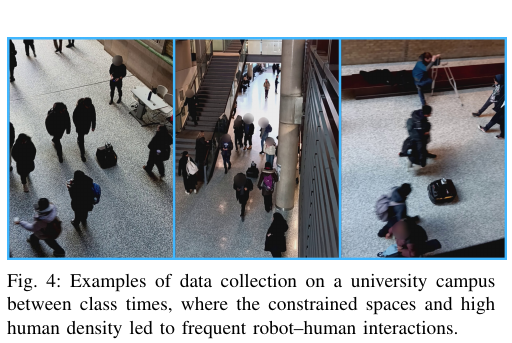
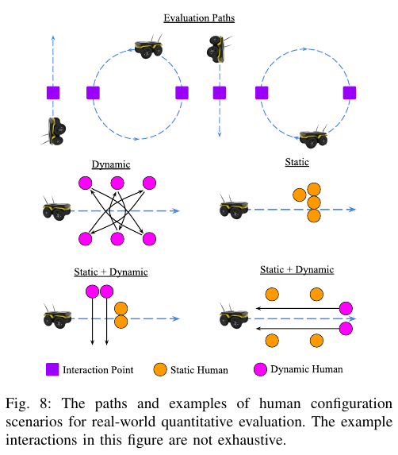

로봇을 사람이 안전하게 운전한 기록이 충분해도, 그 기록을 다음 속도 명령으로 베끼는 것만으로는 안정적인 정책이 나오지 않을 수 있어요. 훈련 표본에서는 오차가 작아 보여도 로봇이 한 번 옆으로 치우치면 다음 관측부터 시연에 없던 상태가 이어집니다. 사회적 주행에서는 사람을 피하는 일과 경로를 따라가는 일이 동시에 바뀌므로 이 누적 오차가 더 빨리 커집니다.

<abbr title="같은 시연 데이터에 여러 모방학습 설계 선택을 조합한 정책과 실험 묶음">Ratatouille</abbr>은 이 문제를 데이터 양보다 학습 조합의 문제로 다룹니다. 좌우 반전 증강, 여러 미래 행동 예측, 이산과 연속 출력을 섞은 행동 표현, 가중치 감쇠와 주기적 가중치 섞기를 한 파이프라인에 놓고 각각을 뺐을 때를 비교했어요. 이름이 요리에서 여러 재료를 조합하는 방식에 빗댄 이유입니다.

논문의 숫자는 평가 무대에 따라 뜻이 다릅니다. 실물 수집 데이터로 학습한 정책을 시뮬레이터에서 시험한 결과, 기본 행동복제 성공률은 27.8%, 모든 재료를 넣은 정책은 98.1%였습니다. 통제된 실물 시험 24회에서는 성공률이 0.38에서 0.79로, 미터당 충돌은 0.06에서 0.01로 바뀌었습니다. 점심시간 식당 주행은 여러 행동을 보여 준 정성 사례이며 같은 표의 정량 시험이 아니에요.

## 같은 기록인데 결과가 달라지는 이유

<abbr title="관측에서 다음 행동을 예측하도록 지도학습하는 모방학습 방식">행동복제</abbr>는 상태 `s`와 전문가 행동 `a`의 쌍을 모아 `π(a|s)`를 맞춥니다. 이 설명만 보면 일반적인 분류나 회귀와 비슷합니다. 그러나 로봇은 예측한 행동을 실행하고, 그 결과가 다음 입력을 만듭니다. 한 시점의 작은 오차가 다음 시점의 데이터 분포까지 바꾸는 닫힌 고리 문제예요.

설명용으로 로봇이 0.5초마다 각속도를 고른다고 가정하겠습니다. 전문가보다 매번 0.04라디안/초 크게 회전하면 한 번의 방향 오차는 `0.04×0.5=0.02라디안`, 약 1.15도입니다. 다섯 번 같은 방향으로 쌓이면 5.7도입니다. 3미터 앞에서 횡방향 차이는 `3×tan(5.7°)≈0.30미터`가 됩니다. 한 스텝 오차가 작다는 사실만으로 사람 옆 통과 간격이 안전하다고 말할 수 없는 이유예요.

사회적 주행 표본의 목표도 균일하지 않습니다. 사람이 없을 때는 기준 경로를 따라가는 행동이 대부분이고, 사람이 앞을 막을 때는 감속이나 우회가 필요합니다. 빈 장면이 많으면 평균 손실을 줄이기 쉬운 직진이 학습을 지배할 수 있어요. Ratatouille 데이터에서도 기준 경로 제어기를 그대로 따른 시연이 73%였습니다. 위험한 상호작용을 잘 처리하려면 표본 수뿐 아니라 어떤 상태가 손실을 지배하는지 봐야 합니다.

이 불균형을 숫자로 풀어 보겠습니다. 설명용 배치가 100개이고 비율이 같다면 73개는 일반 경로 추종, 27개는 사람 개입이 있었던 상태입니다. 두 부류의 평균 오차가 각각 0.02와 0.12라면 전체 평균은 `0.73×0.02+0.27×0.12=0.047`입니다. 일반 상태를 0.01 줄이면 전체 손실은 0.0073 줄지만 상호작용 상태를 0.01 줄이면 0.0027만 줄어요. 같은 개선 폭이라도 최적화가 흔한 상태를 먼저 고를 유인이 큽니다.

## 좌우 반전은 장면과 행동을 함께 바꿔야 해요

첫 재료는 로봇 좌표계의 좌우 반전입니다. 사람 위치, 로봇 과거 위치, 기준 경로의 `y` 좌표를 모두 부호 반전하고 각속도 부호도 뒤집습니다. 왼쪽으로 사람을 통과하면서 양의 각속도를 냈던 기록은 오른쪽으로 통과하면서 음의 각속도를 내는 표본이 됩니다. 영상만 거울처럼 뒤집고 행동을 그대로 두면 서로 모순되는 정답을 만들어요.

반전이 항상 보존 변환은 아닙니다. 우측통행·좌측통행 관습, 일방통행 복도, 한쪽 벽에만 있는 문, 비대칭 센서 시야, 로봇의 좌우 구동 편차가 있으면 거울 장면은 실제 분포와 다를 수 있어요. 따라서 반전은 “사람은 어느 쪽에도 나타날 수 있다”는 기하 대칭을 늘리는 방법이지, 장소 규칙까지 대칭이라고 증명하는 방법은 아닙니다.

설명용 검사를 하나 만들 수 있습니다. 원본 상태를 `T`로 반전하고 정책 출력을 다시 반전하는 연산을 `T⁻¹`이라고 하겠습니다. 원본 행동 `π(s)`와 복원 행동 `T⁻¹π(Ts)`의 차이를 측정하면 정책의 좌우 일관성을 볼 수 있어요. 선속도 차이는 미터/초, 각속도 차이는 라디안/초로 따로 기록해야 합니다. 두 값이 작아도 실제 좌우 통행 규범이 맞는지는 별도 장면 평가가 필요합니다.

[[2026-10-17_socialnav_scand|실물 원격조종 시연으로 사회적 주행을 배우는 데이터셋]]은 센서와 조종 명령을 풍부하게 남겼지만, 원시 기록 자체가 반대 방향 장면을 자동으로 보장하지는 않습니다. 증강은 수집되지 않은 기하를 보완할 수 있지만, 원래 장소와 시연자의 편향을 없애지는 못해요.

## 한 행동 대신 짧은 행동 묶음을 예측해요

두 번째 재료는 다음 명령 하나가 아니라 길이 `H`의 행동 묶음을 출력하는 방식입니다. 논문은 `H=3`을 사용했습니다. 현재 장면에서 잠깐 감속한 뒤 틀고 다시 전진하는 순서를 한꺼번에 예측하면, 개별 프레임마다 서로 다른 선택으로 흔들리는 현상을 줄일 여지가 있어요.

다만 미래 행동이 많을수록 가능한 조합도 늘어납니다. 각 시점에 25개 이산 행동이 있고 세 시점을 독립적으로 고른다는 설명용 가정에서는 가능한 묶음이 `25³=15,625개`입니다. 40만 스텝이 모든 묶음에 균등하게 분포해도 묶음당 평균 약 25.6개뿐입니다. 실제로는 직진 묶음이 몰리고 회피 순서는 드물기 때문에 희소성은 더 큽니다.

Ratatouille은 이 문제를 이산 모드와 연속 보정을 섞는 행동 표현으로 다뤘습니다. 큰 선택은 여러 구간 가운데 고르고, 구간 안에서는 미세한 연속값을 내는 방식이에요. 예를 들어 각속도 범위를 좌회전·거의 직진·우회전으로 나눈 뒤 선택된 범위 안의 값을 회귀할 수 있습니다. 이 예는 설명을 위한 구성이며 논문의 정확한 구간 수를 재현한 값은 아닙니다.

행동 묶음이 길수록 언제나 좋지는 않습니다. 사람이 갑자기 방향을 바꾸면 오래전에 예측한 세 번째 행동은 낡은 명령이 됩니다. 실행 때마다 묶음을 새로 예측해 첫 행동만 쓰는지, 여러 예측을 평균하는지, 묶음 전체를 열린 고리로 실행하는지에 따라 반응 지연도 달라져요. 논문의 제거 실험에서도 `H=3`의 이득은 있었지만 가장 큰 기여는 아니었습니다.

## 가중치 감쇠와 섞기가 바꾼 것은 무엇인가요

논문에서 큰 차이를 만든 재료는 AdamW를 통한 분리된 가중치 감쇠, 주기적인 가중치 섞기, 좌우 반전이었습니다. 가중치 섞기는 5만 훈련 스텝마다 무작위로 초기화한 네트워크를 만들고 현재 네트워크를 그쪽으로 조금 이동시킵니다. 저자들은 사람 회피와 경로 추종의 비중이 배치마다 변할 때 네트워크가 새 상태에 적응하는 능력을 잃는 현상과 연관 지어 해석합니다.

이 해석은 결과와 가설을 구분해야 합니다. 구성 요소를 뺐을 때 성능이 낮아졌다는 제거 실험은 관측된 결과입니다. 그 차이가 “가소성 보존” 때문에 생겼다는 설명은 가능한 원인 중 하나예요. 무작위 섞기가 정규화로 작동했는지, 특정 최적화 궤적을 피했는지, 여러 목표 사이의 과적합을 줄였는지는 같은 조건의 추가 진단이 필요합니다.

설명용으로 현재 가중치가 `w`, 새 무작위 가중치가 `r`, 섞는 비율이 0.01이라고 하겠습니다. 새 값은 `0.99w+0.01r`입니다. 한 좌표에서 `w=0.8`, `r=-0.2`이면 `0.99×0.8+0.01×(-0.2)=0.79`가 됩니다. 작은 변화지만 많은 좌표에 동시에 적용되고 반복되면 함수가 달라집니다. 배포 정책의 안전성을 확인하려면 최종 체크포인트 하나의 평균 성능 외에 여러 시드와 최악 장면을 봐야 해요.

가중치 감쇠도 학습률과 분리해서 봐야 합니다. 같은 계수라도 Adam의 손실 항에 넣는 방식과 AdamW처럼 파라미터 갱신에서 분리하는 방식은 적응형 스케일링과 상호작용이 다릅니다. 논문은 작은 학습률 `10⁻⁴`, 약 200만 훈련 스텝을 사용했고, 학습률을 키워 스텝 수를 줄이려 한 설정은 좋지 않았다고 보고합니다. 이 값은 해당 데이터·모델의 조건이지 다른 로봇에 그대로 옮길 기본값은 아니에요.

## 실물 데이터가 시뮬레이터로 들어갈 때 생기는 틈

연구팀은 대학 캠퍼스에서 2주 동안 11시간, 40만 환경 스텝을 모았습니다. 사람 흐름이 많은 수업 교대 시간에는 주변에 대략 5명에서 30명이 있었고, 0명에서 4명인 낮은 밀도도 포함했습니다. 기본적으로 기준 경로 제어기가 움직이고, 사람이 필요할 때 조작을 덮어쓰는 방식이었어요.

<figure class="fig"><figcaption>수업 교대 시간의 캠퍼스 수집 장면입니다. 공간 제약과 보행 밀도가 상호작용을 만들지만, 사진에 사람이 많다는 사실만으로 회피 개입의 균형이나 다양성이 보장되지는 않습니다. (출처: Han et al., <a href="https://arxiv.org/pdf/2509.17204">Ratatouille: Imitation Learning Ingredients for Real-world Social Robot Navigation</a>, Fig. 4, <a href="https://creativecommons.org/licenses/by/4.0/">CC BY 4.0</a>, 원문에서 그림 영역 발췌)</figcaption></figure>

정량 제거 실험 전체를 실물 사람과 반복하기는 어렵습니다. 같은 사람이 열한 정책을 만날 때마다 똑같이 걷도록 만들 수 없고, 나중 정책에서 피로와 학습 효과가 생깁니다. 연구팀은 실물 기록의 상태를 시뮬레이터 조건으로 옮겨 27개 장면에서 열한 모델을 비교했습니다. 여기서는 반복성이 좋아지지만 센서 잡음과 인간 반응이 사라집니다.

실물과 시뮬레이션의 사람 모델도 다릅니다. 시뮬레이션 사람은 ORCA 규칙으로 움직이고, 실제 사람은 로봇을 바라보거나 휴대전화를 보며 갑자기 멈출 수 있어요. 시뮬레이터에서 “공격적” 사람의 안전 여유를 줄였다고 해도 주의 분산, 집단 대화, 눈맞춤, 로봇에 대한 호기심을 그대로 만들지는 못합니다.

실물 기록에서 사람 위치를 뽑는 과정도 성능의 일부입니다. 플랫폼은 Ouster OS0-128 LiDAR의 반사도 영상을 YOLOX에 넣고 Norfair로 사람을 추적했습니다. 경로 재현과 위치 추정은 Teach-and-Repeat 계열을 사용했고, 경로 처리는 Jetson Orin NX, 사람 추적과 정책 추론은 ThinkPad P16 Gen 2가 맡았습니다. 이 구성은 한 대의 저전력 컴퓨터에서 같은 지연으로 동작했다는 증거가 아닙니다.

설명용 지연 계산을 해 보겠습니다. 추적과 정책이 합쳐 120밀리초 늦고 로봇이 0.8미터/초로 간다면 새 명령 전에 `0.8×0.12=0.096미터`를 더 이동합니다. 사람 추적 위치가 8센티미터 늦게 보인다면 상대 간격 판단에는 약 17.6센티미터의 보수 여유가 필요할 수 있어요. 이는 논문 측정값이 아니라 배포 예산을 설명하기 위한 가정입니다.

## 세 평가의 숫자를 한 줄로 합치면 안 돼요

첫 평가는 실물 데이터로 학습하고 시뮬레이터에서 실행한 실데이터-시뮬레이션 시험입니다. 27개 장면과 네 번 반복으로 108회가 되었고 기본 모델 27.8%, 전체 조합 98.1% 성공률을 보고했습니다. 구성 요소를 동일한 장면에서 반복 비교하기 좋지만, 실제 사람이 로봇을 보고 반응하는 폐루프는 아닙니다.

둘째는 통제된 실물 시험입니다. 직선과 원형 경로 네 종류에서 각 여섯 번, 모두 24회였고 네 명에서 여섯 명이 정적·동적·혼합 배치로 상호작용했습니다. 비교 대상은 기본 모델, Ratatouille, SCAND 기반 정책, 원 데이터를 수집한 전문가 조종이었어요. 이 시험에서는 Ratatouille 성공률 0.79, 미터당 충돌 0.01, 평균 주행시간 28.2를 보고했습니다.

<figure class="fig"><figcaption>통제된 실물 평가는 직선·원형 경로와 정적·동적·혼합 사람 배치를 조합했습니다. 그림은 가능한 상호작용 전부가 아니라 대표 배치이며, 식당 공개 공간의 정성 주행과는 별도 실험입니다. (출처: Han et al., <a href="https://arxiv.org/pdf/2509.17204">Ratatouille: Imitation Learning Ingredients for Real-world Social Robot Navigation</a>, Fig. 8, <a href="https://creativecommons.org/licenses/by/4.0/">CC BY 4.0</a>, 원문에서 그림 영역 발췌)</figcaption></figure>

미터당 충돌 0.01은 “충돌하지 않는다”는 뜻이 아닙니다. 설명용으로 총 1,000미터를 같은 분포에서 달렸다고 가정하면 기대 충돌 수는 `1,000×0.01=10회`입니다. 반대로 짧은 20미터 시험 한 번의 기대값은 0.2회라서, 충돌이 없었던 한 번만 보고 안전하다고 결론 내리기 어렵습니다. 거리 정규화 지표에는 총 거리와 사건 수, 신뢰구간을 함께 제시해야 해요.

기본 모델은 평균 주행시간이 더 짧았지만, 사람과 부딪히면 시험을 멈추고 사람이 비킨 뒤 재개했습니다. 실패 정책의 빠른 시간을 효율이라고 읽으면 안 됩니다. 멈춘 시간 포함 방식과 충돌 후 재개 규칙이 지표를 바꾸기 때문입니다. 성공률·충돌·시간을 함께 읽어야 합니다.

셋째는 점심시간 공공 식당의 정성 평가입니다. 정지한 사람을 돌아가고, 같은 방향 군중 사이에서 움직이며, 혼잡할 때 감속한 사례를 영상으로 보였습니다. 갑자기 뛰어든 사람이나 회전 중 접촉에서는 충돌도 있었습니다. 이 부분에는 통제된 반복 수나 사용자 평점이 제시되지 않았으므로 98.1% 성공률의 실물 식당 검증이라고 바꿔 말하면 안 돼요.

## 가까운 거리만으로 사회성을 판정할 수 없어요

논문은 통제된 실물 시험에서 성공률, 미터당 충돌, 주행시간을 사용하고 경로 거리나 사람과의 가까움을 핵심 순위 지표로 삼지 않았습니다. 사람과 나란히 걷는 장면에서는 가까워도 자연스러울 수 있고, 넓은 공간에서 한 사람을 크게 돌아가게 만들면 충돌은 없어도 불편할 수 있기 때문이에요.

배포 평가는 최소거리 하나에서 끝내지 않아야 합니다. 사람의 진로 변화량, 로봇의 정지 횟수, 추월 방향, 집단 사이 침범, 진행률, 안전 개입을 장면별로 나눌 수 있어요. 같은 0.7미터 통과도 사람이 이미 양보한 뒤인지, 로봇이 진로를 강제로 빼앗았는지에 따라 의미가 다릅니다.

설명용으로 두 정책을 비교하겠습니다. A는 100미터 동안 충돌 0회지만 보행자 열 명이 평균 0.8미터 옆으로 피했고, B는 충돌 0회에 평균 0.15미터만 피하게 했다고 하겠습니다. 충돌 지표는 같지만 사람 부담은 다릅니다. 반대로 사람 우회량만 줄이면 로봇이 지나치게 멀리 멈춰 통행을 막을 수 있어 진행률과 시간을 같이 봐야 합니다.

평가자에게 경로 영상만 보여 주면 속도감과 최소거리를 놓칠 수 있습니다. 로봇 시점, 천장 시점, 사람 시점의 짧은 영상을 무작위 순서로 보여 주고 안전감·예측 가능성·방해 정도를 따로 묻는 방식이 더 낫습니다. 평가자는 어떤 정책인지 몰라야 하며, 같은 사람이 여러 조건을 보면 순서 효과를 균형화해야 해요.

## 배포 전에 깨뜨려 볼 가정

첫째, 시연자가 본 것과 로봇이 본 것이 같다는 가정을 확인합니다. 사람이 조작을 덮어쓴 시점의 센서에는 위험 단서가 실제로 들어 있었는지, 가림 뒤 사람을 조종자가 먼저 보았는지 구분해야 해요. 입력에 없는 정보로 만든 정답은 모델이 일관되게 재현할 수 없습니다.

둘째, 검출기와 추적기가 사람 상태를 안정적으로 준다는 가정을 깨뜨립니다. 반사도 영상에서 어두운 옷, 나란히 걷는 집단, 유모차, 유리 반사, 부분 가림을 따로 시험해요. 추적 ID가 바뀌면 과거 궤적이 다른 사람에게 붙고, 정책은 갑작스러운 방향 전환처럼 해석할 수 있습니다.

셋째, 좌우 반전이 허용되는 장소를 분리합니다. 양방향 넓은 광장에서는 쓸 수 있어도 우측통행 복도와 에스컬레이터 진입부에는 제한할 수 있습니다. 지도 의미와 통행 규칙을 모르면 증강 범위를 장소별로 설정해야 해요.

넷째, 학습에 없던 밀도와 속도를 시험합니다. 주변 0–4명, 5–30명이라는 수집 설명이 있어도 독립 장면 수와 지속시간은 같지 않습니다. 한 군중을 10분 기록한 것과 서로 다른 군중 열 곳을 1분씩 기록한 것은 일반화 범위가 달라요.

다섯째, 계산 자원과 지연을 배포 플랫폼에서 측정합니다. 논문 시스템은 Jetson과 노트북으로 계산을 나눴습니다. 저전력 보드 한 대에서 추론 속도, 온도, 프레임 누락, 추적 지연이 어떻게 변하는지는 공개된 숫자만으로 정할 수 없습니다. 별도 안전 감시와 정지 경로는 정책 지연과 독립적으로 유지해야 해요.

Ratatouille의 좋은 질문은 “행동복제인가 강화학습인가”보다 “같은 시연을 어떤 표현과 최적화로 학습했는가”입니다. 같은 40만 스텝에서도 좌우 증강, 행동 묶음, 출력 구조, AdamW, 가중치 섞기를 바꾸자 반복 가능한 시험 결과가 크게 달라졌습니다. 데이터 수집량만 늘리기 전에 학습 재료별 제거 실험을 해야 한다는 근거가 됩니다.

동시에 98.1%, 0.79, 식당 영상은 서로 다른 증거입니다. 첫 값은 실데이터-시뮬레이션 108회, 둘째는 통제된 실물 24회, 마지막은 공개 공간의 정성 사례예요. 이 경계를 지키고 센서 지연·사람 반응·장소 규범·계산 자원을 새 배포 환경에서 다시 측정할 때, 이 연구는 만능 정책보다 재현 가능한 모방학습 설계표로 가장 유용합니다.

---

<!-- src-block -->
출처 — https://arxiv.org/abs/2509.17204
