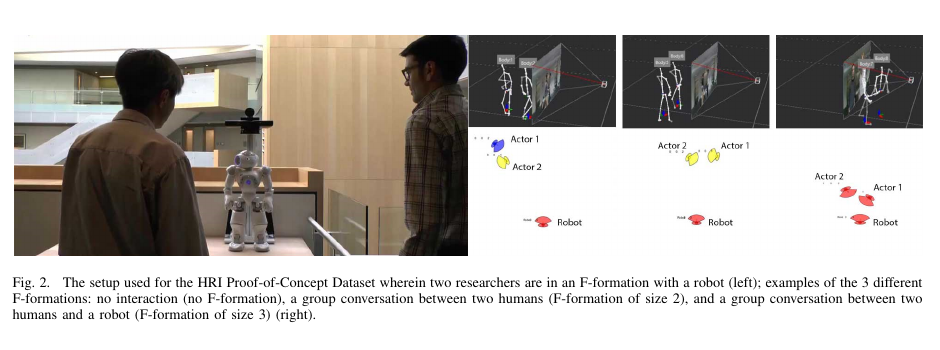
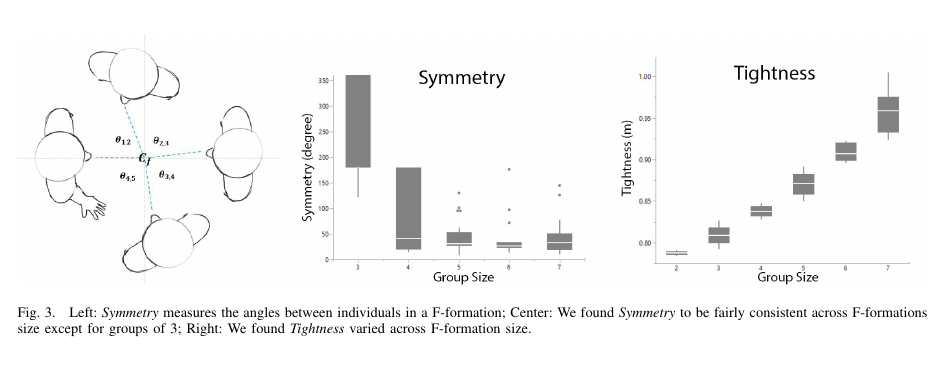

로봇이 대화 중인 사람 둘 사이의 빈 공간을 통로로 보면 물리적으로는 지나갈 수 있어도 대화를 끊습니다. 반대로 가까이 선 사람을 모두 한 집단으로 묶으면 엘리베이터 줄이나 스쳐 지나가는 보행자까지 대화 그룹으로 오인해 불필요하게 멀리 돌아요. 필요한 것은 사람 수만 세는 검출이 아니라 누가 누구와 같은 상호작용 공간을 공유하는지 알아내는 일입니다.

Hooman Hedayati와 동료들이 제안한 <abbr title="거리와 몸 방향으로 대화 집단을 인식하고 쌍 관계를 다시 묶는 학습 방법">REFORM</abbr>은 장면 전체를 한 번에 분류하지 않습니다. 먼저 한 프레임의 사람들을 가능한 모든 쌍으로 나누고, 두 사람 사이 거리와 서로를 마주보기 위해 필요한 몸 회전량을 특징으로 계산합니다. 각 쌍이 같은 F-formation에 속하는지 분류한 다음, 서로 모순될 수 있는 쌍별 결과를 탐욕적 투표로 다시 집단으로 묶어요.

이 구조는 작은 수의 주석 프레임에서 많은 훈련 쌍을 만들 수 있다는 장점이 있습니다. 동시에 같은 장면에서 나온 수많은 쌍이 서로 독립적인 새 관측은 아니라는 한계도 생겨요. 쌍 분류 성능이 좋아도 집단 구성의 일관성이 자동으로 보장되지 않아 재구성 단계가 필요합니다.

## F-formation은 사람 사이 빈 공간을 포함해요

F-formation은 둘 이상의 사람이 위치와 방향을 유지하며 공동 활동 공간을 만드는 배치입니다. 마주 선 두 사람, 작은 원을 만든 세 사람, 나란히 전시물을 보는 사람들이 예가 될 수 있어요. 중심의 비어 있는 공간은 대화와 시선이 모이는 영역이라 다른 사람이 함부로 가로지르면 상호작용을 방해합니다.

로봇 내비게이션에서는 이 공간을 장애물처럼 막는 것보다 의미 있는 사회 영역으로 다루는 편이 좋습니다. 집단 바깥을 돌아가야 할 수도 있고, 대화에 합류하려면 열린 자리에서 접근해야 할 수도 있어요. 같은 기하라도 로봇의 과업에 따라 회피와 진입이 달라집니다.

[[2026-10-17_socialnav_hall-proxemics|근접학은 개인공간을 고정 반경으로 만들지 않는다]]가 거리의 문화·상황 의존성을 강조한다면, F-formation은 여러 사람이 함께 만든 관계적 공간을 다룹니다. 개인마다 원을 하나씩 그려 합치는 방식으로는 대화 중심과 열린 합류 지점을 표현하기 어렵습니다.

고전 검출기는 사람이 향한 방향으로 가상의 상호작용 중심을 투표하고 가까운 중심을 묶곤 했습니다. 이 방법은 사람 간격이나 예상 중심까지의 보폭 같은 임계값에 민감합니다. 데이터셋마다 다른 값을 조정하면 같은 알고리즘이 장소에 따라 다른 규칙을 갖게 돼요.

REFORM은 고정된 중심 반경 하나 대신 라벨 데이터에서 쌍 관계를 학습합니다. 그렇다고 문맥 의존성이 사라지지는 않습니다. 훈련 데이터의 장소와 과업, 참가자 구성이 분류 경계를 정합니다. 손으로 고른 임계값을 학습된 경계로 바꾼 것이며, 새 문화와 환경에서 검증해야 한다는 책임은 남습니다.

## 프레임을 사람 쌍으로 풀면 데이터가 늘어나요

사람이 `n`명인 프레임에서 순서를 무시한 쌍은 `n(n-1)/2`개입니다. 18명이면 `18×17/2=153`쌍이에요. 논문은 SALSA 데이터의 약 400개 훈련 프레임을 이렇게 풀어 61,200개 쌍 데이터를 만들었습니다.

각 쌍에는 두 사람이 같은 F-formation에 속하는지 라벨을 붙입니다. 장면 전체의 집단 주석이 이미 있다면 쌍 라벨은 자동으로 만들 수 있어요. 예를 들어 `{1,2,3}`이 한 집단이면 1-2, 1-3, 2-3은 양성이고, 다른 사람과의 쌍은 음성입니다.

이 분해는 집단 크기가 달라도 같은 이진 분류기를 쓸 수 있게 합니다. 두 사람 그룹과 여섯 사람 그룹을 별도 클래스에 넣지 않고 모든 관계를 같은 쌍 문제로 바꿔요. 새 장면의 사람 수가 훈련 때와 달라도 쌍 특징은 계산할 수 있습니다.

그러나 61,200이라는 숫자를 독립 표본 수로 읽으면 안 됩니다. 같은 프레임의 153쌍은 같은 조명, 같은 참가자, 같은 집단 배치를 공유합니다. 한 사람은 17개 쌍에 반복 등장해요. 프레임을 무작위로 쪼개면 거의 같은 순간이나 같은 참가자 관계가 훈련과 시험에 함께 들어갈 수 있습니다.

설명용으로 18명 중 실제 대화 집단이 6명 한 개뿐이라고 가정하겠습니다. 전체 쌍 153개 중 집단 내부 양성은 `6×5/2=15`개이고 나머지 138개는 음성입니다. 모두 “같은 집단 아님”이라고 답해도 쌍 정확도는 `138/153≈90.2%`예요. 높은 정확도가 좋은 집단 검출을 뜻하지 않는 이유입니다. 정밀도, 재현율, F1과 장면 단위 집단 점수를 함께 봐야 합니다.

## 거리와 노력 각도가 쌍 관계를 설명해요

첫 특징은 두 사람 사이 유클리드 거리입니다. 대화하는 사람은 보통 어느 정도 가까이 서지만 거리 하나만으로는 줄 서기와 대화를 나누기 어렵습니다. 두 번째 특징인 노력 각도는 두 사람이 몸을 서로 향하게 하려면 합해서 얼마나 회전해야 하는지 나타냅니다.

정면으로 마주 선 두 사람은 회전 부담이 작습니다. 나란히 같은 방향만 보는 두 사람이 서로 대화하려면 몸을 크게 돌려야 해요. 거리와 노력 각도를 함께 쓰면 가까이 있지만 서로 무관한 사람과 조금 떨어져도 공동 중심을 향한 사람을 구분할 근거가 생깁니다.

노력 각도는 머리 시선과 몸 방향을 같다고 두지 않습니다. 사람은 발표자를 보려고 머리만 돌리거나 몸은 출구 쪽에 둔 채 대화할 수 있어요. 논문 데이터에는 머리와 몸 방향이 있지만 REFORM의 분류 특징은 거리와 노력 각도에 집중합니다. 어떤 방향 추정값을 사용했는지 센서 구현에서 명확히 해야 합니다.

논문은 가중 최근접 이웃, 배깅 트리, 로지스틱 회귀 세 분류기를 비교합니다. 분류기 종류보다 중요한 점은 입력과 출력이 같다는 것입니다. 각 쌍의 두 특징을 받아 같은 집단인지 아닌지를 예측하고, 그 결과로 대칭 관계 행렬을 만듭니다.

설명용 가정으로 거리 1.0미터, 노력 각도 40도인 쌍과 거리 0.7미터, 노력 각도 220도인 쌍을 생각해 보겠습니다. 거리만 쓰면 두 번째 쌍이 더 가까워 같은 집단처럼 보일 수 있어요. 방향 부담을 함께 쓰면 첫 쌍이 서로를 향하기 쉬워 대화 관계일 가능성이 높다고 구분할 수 있습니다. 이 수치는 학습 경계나 논문 결과가 아니라 두 특징의 역할을 보여 주는 예입니다.

## 쌍의 모순을 투표로 다시 집단으로 묶어요

쌍 분류는 쉽게 모순됩니다. 세 사람 A, B, C에서 A-B와 B-C는 같은 집단, A-C는 다른 집단이라고 나올 수 있어요. 집단 소속은 원래 추이적인 관계에 가깝지만 이진 분류기는 각 쌍을 따로 판단하기 때문입니다.

REFORM의 재구성 단계는 각 사람이 누구와 같은 집단이라고 예측됐는지 집합을 만들고, 집합의 교집합이 가장 큰 사람 쌍부터 묶습니다. 다수의 일치가 지지하는 큰 집단을 선택한 뒤 관련 행과 열을 제거하고 반복해요. 한 쌍 오류보다 여러 쌍의 일치를 신뢰하는 탐욕적 투표입니다.

설명용으로 `A:{A,B,C}`, `B:{A,B,C}`, `C:{A,C,D}`, `D:{C,D}`가 있다고 하겠습니다. A와 B는 세 원소가 일치하고, C와 D는 두 원소가 일치합니다. 탐욕적 절차는 먼저 `{A,B,C}`를 고를 가능성이 큽니다. 그 결과 C-D의 양성 관계는 큰 집단 결정에 밀릴 수 있어요.

이 특성은 오류 한두 개를 흡수하지만 전역 최적을 보장하지 않습니다. 먼저 고른 집단이 뒤의 더 좋은 분할을 막을 수 있어요. 특히 두 집단 사이를 오가는 사람이나 발표자처럼 여러 상호작용에 걸친 사람은 하나의 집단으로 강제되기 쉽습니다. 겹치는 집단을 허용하지 않는 출력 가정을 확인해야 합니다.

시간 정보도 재구성에는 들어가지 않습니다. 매 프레임 새로 검출하면 사람이 몸을 잠깐 돌린 순간 집단이 갈라지고 다시 합쳐질 수 있어요. 현장 로봇은 프레임 점수에 시간 지속성, 가입·이탈 히스테리시스, 추적 ID 신뢰도를 더해야 합니다. 오래된 집단을 무조건 유지하면 실제 해산을 늦게 감지하므로 변화 감지와 안정성 사이 기준이 필요합니다.

## 로봇 포함 데이터는 개념 검증 규모예요

논문은 사람 데이터만으로 끝내지 않고 안내 로봇과 연구자 두 명이 있는 장면을 따로 만들었습니다. 두 사람이 로봇과 함께 대화하는 조건, 두 사람끼리만 대화하고 로봇은 제외된 조건, 서로 지나가며 아무 집단도 만들지 않는 조건입니다.

<figure class="fig"><figcaption>로봇이 장면 안에 있다는 사실과 대화 집단에 포함됐다는 판단을 분리한 세 조건입니다. 왼쪽 사진은 두 연구자와 안내 로봇의 구성이고, 오른쪽은 상호작용 없음·사람 둘·사람 둘과 로봇의 집단 라벨입니다. (출처: Hedayati et al., REFORM: Recognizing F-formations for Social Robots, Fig. 2, https://export.arxiv.org/pdf/2008.07668)</figcaption></figure>

이 데이터는 약 5분의 각본 상호작용이고 등장하는 사람은 연구팀 두 명입니다. 센서는 로봇 위 Kinect와 광각 카메라였으며 3,091프레임을 기록한 뒤 100프레임을 표본으로 골라 두 명이 주석했습니다. 실제 방문객이 자유롭게 로봇에 합류하고 떠나는 현장 실험은 아닙니다.

세 분류기는 이 작은 로봇 포함 표본에서 같은 점수를 보였고 기존 그래프 컷 방식보다 높은 수치를 보고했습니다. 하지만 장면 종류가 세 개이고 사람과 로봇 구성이 고정돼 있어 일반화 근거는 제한적입니다. 저자들도 연기된 상호작용과 작은 사람 수를 한계로 적습니다.

이 점을 숨기고 “로봇이 실제 대화를 이해했다”고 말하면 과장입니다. 입력은 사람의 위치와 방향이며 발화 내용, 시선 대상, 대화 차례를 이해하지 않습니다. 로봇은 기하 배치를 분류했을 뿐 의미나 참여 의사를 추론하지 않았어요.

## SALSA에서 배우고 Babble로 옮긴 점이 중요해요

REFORM은 SALSA의 약 60%만 훈련에 쓰고 나머지 SALSA와 새 Babble 데이터, 로봇 포함 데이터에 같은 분류기를 적용했습니다. Babble에 맞춰 재학습하지 않고 다른 수집 조건으로 옮긴 점은 데이터셋 내 무작위 분할보다 강한 검사입니다.

Babble은 일곱 참가자가 단어 게임을 하며 집단을 바꾸는 장면입니다. 몸과 모자의 반사 표식, 여섯 대의 모션 캡처 카메라, 벽의 RGB 카메라로 자세를 기록했습니다. 두 주석자가 3,481프레임의 집단 소속을 표시했고 주석 일치도도 보고했어요.

게임 과업은 자연스러운 대화를 유도하지만 완전히 일상적인 모임은 아닙니다. 사회자와 경쟁자가 있고 탈락하면 원에서 빠집니다. 세 사람 집단의 대칭성이 다른 크기와 달랐던 현상도 게임 역할의 영향을 받았을 수 있다고 논문은 해석합니다. 수집 과업이 집단 모양을 만듭니다.

훈련 데이터의 18명 장면을 쌍으로 분해했기 때문에 참가자 수가 많은 조건을 보았다는 장점이 있습니다. 그러나 사람별 분리 여부가 불명확하면 같은 사람의 체형과 자세 습관이 시험에 남을 수 있어요. 새 장소뿐 아니라 새 참가자, 새 카메라, 새 활동을 동시에 바꾼 외부 검증이 필요합니다.

쌍 분류 점수와 집단 점수도 구분해야 합니다. 대부분의 쌍이 음성인 장면에서는 쌍 정확도가 높아도 작은 대화 집단 하나를 통째로 놓칠 수 있어요. 로봇 행동에는 “몇 쌍을 맞혔는가”보다 “보호해야 할 공동 공간을 놓쳤는가”가 더 중요할 수 있습니다.

## 대칭성과 조밀도는 집단 크기만으로 설명되지 않아요

논문은 검출 외에 F-formation의 모양을 설명하는 두 값을 제안합니다. 대칭성은 이상적인 균등 각도와 실제 이웃 각도의 차이를 합한 값이고, 조밀도는 각 구성원에서 집단 중심까지의 평균 거리입니다.

<figure class="fig"><figcaption>왼쪽은 이웃 각도로 대칭 오차를 만드는 법, 가운데와 오른쪽은 집단 크기에 따른 대칭성과 중심 거리 분포입니다. 세 사람 집단의 과업 특성과 큰 집단에서 넓어진 반경을 같은 값으로 뭉개지 말아야 함을 보여 줍니다. (출처: Hedayati et al., REFORM: Recognizing F-formations for Social Robots, Fig. 3, https://export.arxiv.org/pdf/2008.07668)</figcaption></figure>

설명용으로 네 사람이 완전한 원을 이루면 이상적인 이웃 각도는 `360/4=90도`입니다. 실제 각도가 80, 95, 100, 85도라면 절대 오차 합은 `10+5+10+5=30도`예요. 같은 네 사람이라도 40, 140, 40, 140도면 오차 합이 200도로 커집니다. 이 계산은 정의를 풀어 쓴 자체 예입니다.

조밀도는 개인 공간의 고정 반경과 다릅니다. 집단 크기가 커지면 모두가 공동 중심을 볼 수 있도록 원이 넓어질 수 있어요. 논문 데이터에서도 사람 수에 따라 중심 거리가 변했습니다. 한 반경을 모든 그룹에 쓰면 큰 집단을 여러 조각으로 나누거나 작은 집단 주변을 지나치게 넓게 막을 수 있습니다.

하지만 대칭성과 조밀도만으로 대화 의미를 알 수는 없습니다. 테이블, 벽, 발표 화면은 원을 찌그러뜨립니다. 친밀도와 소음, 성인과 어린이의 키 차이도 거리를 바꿔요. 낮은 대칭성이 잘못된 집단이라는 뜻이 아니라 환경 제약이 있다는 신호일 수 있습니다.

내비게이션 비용으로 옮길 때는 검출 확률과 공간 경계를 분리하는 편이 안전합니다. 집단 소속 확률이 0.6인 사람을 즉시 제외하거나 포함하면 경계가 튑니다. 여러 후보 집단의 확률을 유지하고, 공동 중심을 가로지르는 비용은 높이되 비상 통로에서는 낮추는 과업 문맥이 필요해요.

## 센서 오차는 거리보다 방향 특징을 먼저 흔들어요

사람 위치는 비교적 안정적으로 잡혀도 몸 방향은 가림과 자세에 민감합니다. 두 사람이 팔을 움직이거나 큰 옷을 입고 있으면 골격 방향이 흔들릴 수 있어요. 노력 각도는 두 사람의 방향 오차를 합하므로 작은 각도 오차가 쌍 경계를 넘길 수 있습니다.

설명용으로 두 사람 방향 추정에 각각 ±15도 오차가 있고 오차 방향이 반대라면 상대 노력 각도는 최대 30도 바뀔 수 있습니다. 학습 경계 근처의 쌍은 같은 자세에서도 프레임마다 라벨이 바뀔 수 있어요. 방향 신뢰도와 시간 필터를 분류 입력에 함께 넣는 이유입니다.

거리도 몸 중심 정의에 따라 달라집니다. 골반 중심, 발 중심, 검출 상자 중심은 사람이 몸을 기울일 때 다른 위치를 줍니다. 훈련 데이터는 정밀 모션 캡처였지만 배포는 깊이 카메라나 2차원 검출일 수 있어요. 센서 바이어스를 포함한 재학습이나 특징 보정이 필요합니다.

가림으로 한 사람이 잠깐 사라지면 남은 집단 중심이 이동합니다. 다시 나타났을 때 새 ID가 붙으면 이탈과 재가입으로 기록돼요. 로봇이 그 순간 공동 공간을 통로로 열면 대화를 가로지를 수 있습니다. 가림 지속시간 동안 집단 가설을 유지하되 위치 불확실성을 넓혀야 합니다.

로봇 자신의 집단 소속도 특별히 다뤄야 합니다. 로봇이 한 번 대화에 참여했다고 항상 공동 중심을 차지하는 것은 아니며, 안내를 끝내고 빠져나갈 수 있어요. 로봇의 과업 상태와 발화 차례를 기하 검출에 더하면 참여 여부를 더 안정적으로 판단할 수 있습니다.

## 재현은 쌍 점수와 행동 결과를 나눠야 해요

첫 검증은 정답 위치와 방향을 사용해 분류기와 재구성만 비교합니다. 사람별 분리, 세션별 분리, 데이터셋 간 전이로 나눠 쌍 정밀도·재현율과 장면 단위 집단 점수를 측정해요. 같은 참가자가 양쪽에 들어가는 무작위 프레임 분할은 보조 결과로만 둡니다.

둘째는 센서 강건성입니다. 방향에 5도씩 오차를 늘리고, 위치 잡음과 ID 단절, 한 사람 가림을 따로 넣습니다. 어느 오류에서 쌍 라벨보다 집단 재구성이 먼저 무너지는지 봐요. 탐욕적 투표와 전역 군집화, 시간 필터를 같은 입력에서 비교할 수 있습니다.

셋째는 내비게이션 평가입니다. 검출된 공동 공간을 비용 지도에 넣되, 정답 그룹과 예측 그룹 두 조건을 돌립니다. 통과 성공률과 최소거리뿐 아니라 공동 중심 침범 횟수, 대화 중단, 로봇 때문에 집단이 재배치된 거리도 기록해요. 검출 F1이 조금 낮아도 중요한 중심 침범을 막으면 행동 성능은 더 좋을 수 있습니다.

넷째는 자연스러운 사람-로봇 상호작용입니다. 연구팀의 세 각본만 반복하지 않고 방문객이 합류·이탈하고, 로봇이 대화를 시작·종료하며, 제3자가 지나가는 장면을 포함합니다. 참가자에게 누가 대화 구성원인지 물어 기하 주석과 사회적 인식의 차이를 확인해요.

실시간성 보고에는 사람 수에 따른 쌍 수와 지연을 함께 적어야 합니다. 10명은 45쌍, 20명은 190쌍, 40명은 780쌍입니다. 분류기 한 번이 빨라도 사람 수의 제곱으로 호출이 늘고, 재구성과 추적 비용이 더해져요. 프레임 속도 하나만 쓰면 어떤 군중 크기에서 측정했는지 알 수 없습니다.

REFORM의 기여는 F-formation 검출을 “중심점을 잘 찍는 기하 규칙”에서 “쌍 관계를 학습하고 모순을 집단으로 복원하는 문제”로 바꾼 데 있습니다. 작은 주석 프레임을 많은 쌍으로 활용했고, SALSA에서 학습한 분류기를 Babble과 로봇 포함 장면에 옮겨 비교했습니다. 대칭성과 조밀도는 집단 크기와 문맥이 공간 모양을 바꾼다는 분석 도구도 제공합니다.

배포에서는 쌍 데이터의 의존성, 탐욕 재구성의 순서 효과, 방향 센서 오차, 시간에 따른 가입과 이탈을 보완해야 합니다. 무엇보다 로봇 포함 결과는 연구자 두 명의 짧은 각본을 이용한 개념 검증입니다. 위치와 방향으로 대화 구조의 후보를 찾을 수 있다는 근거이며, 대화 내용과 참여 의사를 이해했다는 증거는 아닙니다. 이 경계를 지켜야 검출 점수가 실제로 사람들의 공동 공간을 존중하는 주행으로 이어집니다.

---

<!-- src-block -->
출처 — https://www.microsoft.com/en-us/research/publication/reform-recognizing-f-formations-for-social-robots/
