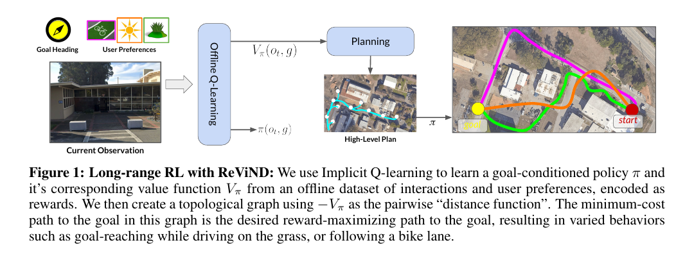
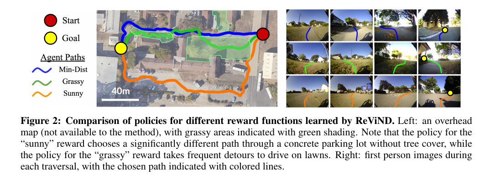

로봇에게 새로운 경로 선호를 가르칠 때마다 실물에서 다시 탐색하면 비용과 위험이 커져요. ReViND는 이미 모은 30시간의 주행 자료에 새로운 보상을 붙이고, 추가 실물 수집이나 미세조정 없이 선호에 맞는 정책을 학습해요. 짧은 구간의 시각 제어는 오프라인 강화학습이 맡고, 수백 m의 장거리 목표는 학습한 가치함수를 간선 비용으로 쓰는 위상 그래프가 맡아요.

이 연구의 실물 대상은 비포장·교외 시각 주행이에요. 햇빛이 드는 길, 잔디, 포장 구역처럼 사용자가 지정한 보상을 따르는지를 시험해요. 사람과의 사회적 거리, 양보, 대화, 군중 규범을 검증한 전용 사회적 주행 연구는 아니에요. 사회적 선호도 보상으로 표현할 수 있다는 인접 가능성과 실제로 사람을 검증했다는 주장은 구분해야 해요.

## 기존 30시간 자료에 새로운 보상을 다시 붙여요

훈련 자료는 이전에 공개된 로봇 궤적 30시간이에요. 무작위 데이터 수집 절차로 업무 시설 단지을 주행한 영상과 행동을 사용해요. 로봇은 자료를 모을 때 “햇빛을 선호하라”거나 “잔디를 따르라”는 목적을 수행하지 않았어요. 수집 뒤 영상과 상태에 원하는 보상을 계산해 같은 전이를 여러 목적에 재사용해요.

<abbr title="새로운 환경 상호작용 없이 고정된 과거 데이터만으로 정책을 학습하는 방법">오프라인 강화학습</abbr>은 온라인 시행착오를 피하지만, 자료에 없는 행동의 결과를 확인할 수 없어요. ReViND는 <abbr title="이미 모은 자료 안에서 좋은 행동의 가치를 배우는 강화학습 방법">IQL</abbr>을 사용해 데이터 분포 밖 행동의 과대평가를 줄이고, 자료 안에서 가치가 높은 행동을 정책에 반영해요. 보상 함수를 바꿀 때 로봇이 새 자료를 모으지 않아도 된다는 점이 핵심이에요.

보상은 목표 도달 비용과 사용자 선호를 합쳐요. 논문은 최단 경로, 햇빛이 드는 구역, 잔디 같은 보상을 예로 들어요. 영상 색이나 학습한 분류기로 각 상태에 보상 라벨을 붙일 수 있어요. 모든 전이에 원하는 보상 라벨이 필요하다는 한계도 있어요. 자동 라벨러가 그림자와 잔디를 혼동하면 정책은 잘못된 보상을 충실히 최적화할 수 있어요.

설명용으로 30시간 자료를 5Hz로 표본화하면 약 54만 상태가 생겨요. 연속 프레임은 강하게 겹치므로 54만 개가 독립 장면 54만 개라는 뜻은 아니에요. 실제 논문의 표본 주기는 다를 수 있으며, 이 계산은 시간 길이와 데이터 다양성을 구분해야 한다는 점을 보여줘요.

## IQL은 짧은 목표의 가치와 정책을 배워요

상태 관측은 전방 170도 <abbr title="빨강·초록·파랑 채널로 표현한 일반 컬러 영상">RGB</abbr> 영상과 2차원 <abbr title="위성 신호로 위치를 추정하는 장치">GPS</abbr> 좌표예요. 행동은 조향과 구동 입력의 2차원 명령이고, 목표는 로봇 기준 GPS 벡터로 주어져요. 지도 전체의 픽셀 위치를 입력하는 대신 현재 영상과 상대 목표를 보고 다음 행동을 선택해요.

IQL은 정적 데이터의 전이 ((s,a,r,s'))에서 Q함수와 가치함수, 정책을 학습해요. 목표 조건은 같은 궤적의 뒤쪽 상태를 사후 목표로 고르는 방식으로 만들어요. 데이터 수집 정책이 명시적인 목표를 향하지 않았어도, 실제로 이어진 두 상태 사이의 이동을 짧은 목표 학습에 사용할 수 있어요.

문제는 긴 목표예요. 논문은 IQL의 반응 정책만 사용하면 약 20m 또는 80스텝을 넘는 목표에서 실패한다고 보고해요. 현재 영상 하나는 교차로 뒤의 경로 구조를 모두 담지 못하고, 가치 오차가 긴 시간 동안 누적돼요. 장거리 계획 계층이 없는 정책은 목표 방향으로 곧장 가려다 장애물과 충돌하는 행동을 보일 수 있어요.

설명용으로 한 짧은 구간의 성공 확률을 0.97이라고 단순 가정해요. 서로 독립인 20개 구간을 모두 성공할 확률은 (0.97^{20}), 약 54%예요. 실제 오류는 독립이 아니고 그래프 재계획도 있으므로 논문 결과를 계산한 값은 아니에요. 작은 국소 오류가 장거리에서 크게 누적된다는 방향을 보여줘요.

## 가치함수를 위상 그래프의 간선 비용으로 써요

ReViND는 시험 환경을 미리 한 번 주행하며 영상과 GPS 관측으로 <abbr title="정밀 좌표 지도 대신 지나갈 수 있는 장소와 연결 관계를 저장한 그래프">위상 그래프</abbr>를 만들어요. 노드는 과거 관측이고, 두 노드 사이 간선 비용은 학습한 가치함수로 계산해요. 원하는 보상이 달라지면 같은 노드 그래프에서도 간선 비용이 바뀌어 다른 경로를 고를 수 있어요.

<figure class="fig"><figcaption>학습한 가치함수가 짧은 구간의 보상·도달 가능성을 평가하고, 위상 그래프가 그 값을 연결해 장거리 경로를 만들어요. (출처: Shah et al., CoRL 2022/PMLR 2023, Fig. 1)</figcaption></figure>

배포 때 현재 관측과 최종 목표를 그래프에 연결하고 다익스트라 최단경로 탐색으로 최소 비용 경로를 구해요. 정책은 최종 목표를 곧장 보지 않고 첫 번째 중간 노드로 주행해요. 도달하면 다음 노드를 고르는 방식으로 장거리 문제를 짧은 구간 연쇄로 바꿔요. 학습 정책과 기호적 연결 구조 탐색의 역할이 분명해요.

그래프를 만들기 위한 시험 환경 경험이 필요하다는 점은 중요해요. 완전히 처음 보는 장소에서 영상 한 장만으로 수백 m 목표를 푸는 구조가 아니에요. 훈련은 공개 오프라인 자료만 사용하지만, 새 환경의 위상 그래프는 로봇을 이동해 관측을 모아야 해요. “추가 학습 없음”과 “환경 사전 탐색 없음”은 다른 주장입니다.

그래프 연결 임계값이 너무 느슨하면 실제로 건널 수 없는 두 장소에 간선이 생기고, 너무 엄격하면 경로가 끊겨요. 가치함수가 시각적으로 비슷한 장소를 가깝게 평가하면 벽 반대편이나 반복되는 복도 패턴을 잘못 연결할 수 있어요. GPS는 연결 후보를 제한하지만 수목·건물 사이의 오차도 확인해야 해요.

설명용으로 노드가 2m 간격이고 GPS 오차가 3m라면 가까운 후보의 순서가 뒤바뀔 수 있어요. 시각 가치와 GPS를 함께 사용해도 둘의 오차가 같은 방향이면 잘못된 간선이 남아요. 숫자는 논문 센서 오차가 아니라 그래프 검증에 필요한 거리 규모를 설명하는 가정이에요.

## 보상을 바꾸면 같은 장소에서도 경로가 달라져요

논문의 시각 사례에서 맑은 날 보상은 나무 그늘을 피하고 콘크리트 주차장을 크게 돌아가며, 잔디가 있는 보상은 잔디 구역을 자주 지나도록 경로를 바꿔요. 위에서 내려다본 비용 지도는 설명용으로만 쓰이고 ReViND 입력에는 제공되지 않아요. 로봇은 전방 카메라와 GPS, 그래프 관측을 사용해요.

<figure class="fig"><figcaption>같은 오프라인 자료를 서로 다른 보상으로 재표기하면 최단·햇빛·잔디 선호에 따라 위상 경로가 달라져요. (출처: Shah et al., CoRL 2022/PMLR 2023, Fig. 2)</figcaption></figure>

다섯 교외 환경의 실험에서 ReViND는 보상별 행동을 만들고 비교 방법보다 장거리 목표를 더 안정적으로 달성해요. 표의 일부 조건은 각 5회처럼 반복 수가 작고, 환경은 훈련 자료와 시각적으로 비슷한 초지·숲·교외 영역이에요. 다양한 도시·실내·군중으로 일반화한 근거는 아니에요.

표의 ReViND 결과는 세 조건에서 성공 5/5, 4/5, 4/5처럼 보고돼요. IQL 단독은 장거리에서 0/5까지 떨어지고, 연결 구조가 없는 정책의 한계를 보여줘요. 그러나 5회 중 한 번 차이는 20%포인트라서 확률 추정의 불확실성이 커요. 성공 횟수와 경로 사례를 함께 읽고 대규모 안전 통계로 확대하지 않아야 해요.

보상값이 높다는 사실과 사람이 선호한다는 사실도 달라요. 잔디 보상 분류기가 녹색 픽셀을 잘 찾더라도 젖은 잔디나 보호 구역에 들어가는 행동은 원하지 않을 수 있어요. 보상은 사용자의 의도를 완전하게 표현하지 않고 관측 가능한 대리값을 제공해요. 배포 전에는 보상 오작동 사례를 별도로 모아야 해요.

## 사람 회피 보상으로 바꾸려면 관측 계약이 달라져요

ReViND의 입력은 전방 RGB와 GPS이고, 논문 목적은 지형 선호와 장거리 주행이에요. 사회적 보상을 붙이려면 사람의 위치·속도·의도 또는 영상에서 계산한 대리값이 필요해요. 기존 30시간 자료에 사람이 충분히 없거나 사람 행동이 편향되어 있으면 라벨만 추가해도 좋은 회피 정책을 배울 수 없어요.

오프라인 학습은 데이터가 다루지 않은 행동을 새로 시험하지 않아요. 자료에 항상 사람이 멀리 있었다면 “가까운 사람 앞에서 멈추기” 행동의 결과가 없어요. 정책이 그 상태를 만나면 가치 추정이 불안정할 수 있어요. 사람 수, 거리, 교차 방향, 가림 조건별 데이터 포괄 범위를 먼저 계산해야 해요.

설명용으로 전체 54만 상태 중 사람이 2m 안에 있는 상태가 0.5%라면 약 2,700개예요. 그중 정지·양보·우회가 고르게 들어 있지 않으면 특정 행동의 보상을 비교하기 어려워요. 54만과 0.5%는 앞선 표본화 가정에 기반한 예시이며 논문 자료의 사람 분포가 아니에요.

사람 선호는 지형 라벨보다 시간 의존성이 커요. 잔디는 프레임마다 같은 위치에 있지만 사람은 움직이고 로봇에 반응해요. 현재 영상 하나와 GPS만으로는 누가 어느 방향으로 가는지 충분히 알기 어려워요. 짧은 영상 이력, 추적, 상대 속도와 예측을 추가하면 원래 ReViND의 상태·학습 계약도 바뀌어요.

따라서 ReViND를 사회적 주행 방법이라고 부르기보다, 기존 실물 데이터를 새 보상으로 재사용하고 장거리 계획과 결합하는 인접 방법으로 보는 편이 정확해요. 사회적 데이터와 동적 관측을 새로 검증해야 그 방향으로 확장할 수 있어요.

## 보상 재표기의 오류를 정책 오류와 나눠요

햇빛 보상은 영상 밝기나 분류기로 만들 수 있지만 역광, 흰 벽, 그림자 경계에서 틀릴 수 있어요. 잔디 보상은 계절, 마른 풀, 인조 잔디, 녹색 물체를 혼동할 수 있어요. 라벨러 정확도를 먼저 평가하지 않으면 정책이 의도와 다른 경로를 택해도 강화학습 탓으로 오인해요.

검증은 같은 궤적의 보상 정답 표기를 사람이 표본 검사하는 데서 시작해요. 프레임별 정확도뿐 아니라 연속 오표기 길이를 봐야 해요. 1프레임 오류는 가치 평균에서 작을 수 있지만 5초 동안 이어진 오류는 그래프 간선 비용을 바꿀 수 있어요. 장소별·날씨별 혼동 행렬도 필요해요.

서로 다른 보상을 합칠 때 스케일도 맞춰야 해요. 설명용으로 목표 진행 비용이 스텝당 -1이고 잔디 보너스가 +0.1이면 20스텝 우회해 잔디 100스텝을 더 밟을 때 순이득은 -10이에요. 보너스가 +0.3이면 순이득이 +10으로 바뀌어요. 같은 의미 보상도 계수에 따라 큰 우회를 선택해요. 숫자는 논문 계수를 재현한 것이 아니라 상충 관계를 보이는 계산이에요.

보상 분류기, IQL, 연결 구조 탐색을 각각 고정한 대조가 유용해요. 정확한 사람 라벨과 학습 가치함수, 학습 라벨과 최단거리 연결 구조, 학습 라벨과 IQL 단독을 비교하면 어느 층이 행동 차이를 만드는지 볼 수 있어요. 최종 영상만 비교하면 라벨과 이동 계획기의 기여가 섞여요.

## 위상 그래프의 최신성과 복구를 시험해요

실외 환경은 공사, 주차 차량, 닫힌 문, 계절 변화로 바뀌어요. 과거 그래프 간선이 더는 통과 가능하지 않거나 영상 외관이 크게 달라질 수 있어요. 정책이 중간 노드에 반복 실패하면 간선을 일시 폐쇄하고 다른 경로를 찾는 규칙이 필요해요.

그래프 갱신이 없으면 같은 막힌 간선을 계속 선택할 수 있어요. 연속 실패 횟수, 실제 진행량, 가치 예측과 관측된 전이 차이를 사용해 간선 신뢰도를 낮출 수 있어요. 하지만 일시적인 사람 가림 때문에 간선을 영구 삭제하면 연결성이 불필요하게 줄어요. 임시 폐쇄와 구조 변경을 구분해야 해요.

위치 추정이 실패했을 때 현재 관측을 어느 노드에 연결하는지도 중요해요. 비슷한 나무길이 반복되면 잘못된 노드에서 연결 구조 탐색을 시작할 수 있어요. GPS를 가린 시험, 카메라에 계절 변화를 넣는 시험, 일부 간선을 차단하는 시험에서 재계획과 복구율을 기록해야 해요.

설명용으로 500m 경로가 25개의 20m 구간으로 구성되고 한 간선이 막혔다고 해볼게요. 대체 간선을 즉시 찾으면 한 번의 국소 실패로 끝나지만, 폐쇄 감지가 세 번의 재시도 뒤라면 로봇은 같은 위험 행동을 반복해요. 실패 후 연결 구조 갱신 지연은 장거리 성공률의 숨은 변수예요.

## 실물 검증은 정책·그래프·안전 계층을 함께 기록해요

Clearpath Jackal 지상 이동 로봇에는 6자유도 <abbr title="회전과 가속도 변화를 측정하는 관성 센서">IMU</abbr>, GPS, 170도 전방 RGB 카메라가 있어요. 논문 모형은 전방 카메라와 별도 선별하지 않은 GPS를 주 관측으로 사용해요. 야외 주행에서 장애물 회피와 목표 도달을 보여주지만, 별도 사람 추적이나 사회적 거리 제어기를 보고하지 않아요.

재현 로그에는 카메라 좌표계, GPS, 선택한 그래프 노드, 간선 비용, 정책이 고른 행동, 실제 조향·구동 입력, 안전 정지 요청을 같은 시각으로 남겨야 해요. 목표 실패가 연결 구조 연결 때문인지 국소 정책 때문인지 찾을 수 있어요. 정책이 장애물을 향했지만 안전 계층이 막았다면 최종 무충돌을 학습 정책 단독 성능으로 세면 안 돼요.

오프라인 방법의 장점은 실물 시행착오를 줄이는 것이지 배포 시험을 없애는 것이 아니에요. 보상 정답 표기 분포와 다른 환경에서는 가치가 틀릴 수 있어요. 낮은 속도·짧은 구간·명확한 지형에서 시작해 날씨와 거리, 동적 객체를 순서대로 넓혀야 해요.

정지·후진·급조향처럼 안전과 관련된 행동이 훈련 자료에 얼마나 있는지도 확인해야 해요. 무작위 수집이 전진 주행에 치우쳤다면 위험 장면에서 멈추는 행동의 Q값을 비교할 근거가 부족해요. 행동별 표본 수와 상태 조건을 함께 세고, 적은 행동은 배포 정책에서 제한하거나 별도 자료로 보완해야 해요.

설명용으로 전체 행동의 95%가 전진, 4%가 조향, 1%가 정지라고 가정하면 54만 상태 중 정지는 5,400개예요. 숫자만 보면 많아도 정지 이유가 목표 도달뿐이고 장애물 대응 정지가 없다면 안전 학습에는 부족해요. 이는 논문 분포가 아니라 포괄 범위 점검 방법을 보이는 가정이에요.

카메라가 오염되거나 야간이 되면 그래프 노드 연결과 국소 정책이 동시에 나빠질 수 있어요. 한 모듈만 실패한 경우와 둘 다 실패한 경우를 만들기 위해 그래프 노드의 영상은 깨끗한 영상을 유지하고 현재 카메라만 변형하는 시험, 반대로 그래프 영상만 계절 변환하는 시험을 나눠요. 이 분리는 재수집이 필요한지 시각 표현을 고쳐야 하는지 판단하게 해요.

[[2026-10-17_socialnav_hsac-llm|HSAC-LLM이 대화와 연속·이산 행동을 결합한 방식]]은 사람과 음성으로 통행 우선순위를 조정하는 사회적 주행을 목표로 해요. ReViND는 사용자 지정 보상을 실물 야외 시각 주행에 적용하지만 사람 대화나 사회적 상호작용을 평가하지 않아요. 둘 다 “사용자 선호”를 다루더라도 입력과 실험 근거가 달라요.

ReViND는 오프라인 학습과 장거리 경로 계획을 연결해요. 기존 30시간 자료를 목적별로 재표기해 짧은 구간의 정책과 가치를 배우고, 가치함수를 위상 그래프 간선 비용으로 사용해 반응 정책의 15–20m 한계를 넘은 시스템 구성이에요. 실제 사회적 주행에 쓰려면 사람 상태가 포함된 자료 포괄 범위, 시간 의존 보상, 보상 라벨 품질을 새로 검증해야 해요.

---
<!-- src-block -->
출처 — https://proceedings.mlr.press/v205/shah23a.html
