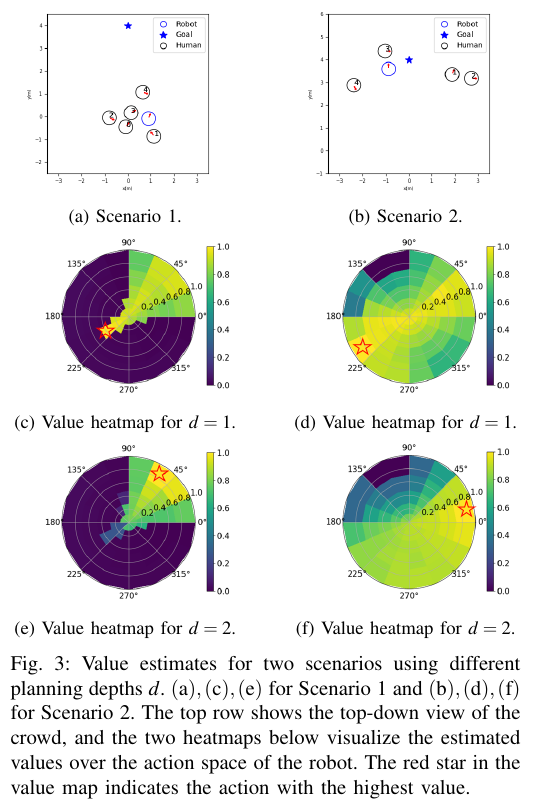
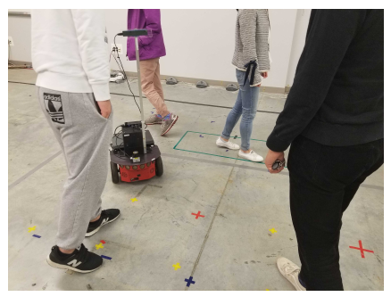

군중에서 사람 한 명씩만 따로 보면 놓치는 장면이 있어요. 두 사람이 나란히 같은 방향으로 걷고 있으면 한 명의 다음 움직임은 다른 한 명과 연결됩니다. 로봇 앞을 가로지르는 사람 뒤에 또 다른 사람이 붙어 있다면 첫 사람을 피한 행동이 두 번째 사람에게 가까워질 수 있어요. 관계를 보지 않는 정책은 각 사람의 위치와 속도를 모두 받아도 군중 구조를 충분히 읽지 못할 수 있습니다.

2020년 ICRA 논문 <abbr title="관계 그래프 학습으로 군중 주행 상태를 표현하는 방법">RGL</abbr>, *Relational Graph Learning for Crowd Navigation*은 로봇과 사람을 그래프의 노드로 놓고 누가 누구에게 영향을 주는지 학습했습니다. 사람-로봇 관계뿐 아니라 사람-사람 관계도 함께 추론하고, 이 표현으로 상태 가치와 다음 사람 상태를 예측해요. 한 단계 가치 선택에 여러 단계 앞보기까지 붙여 짧은 판단에서 생기는 충돌과 정지를 줄이려 했습니다.

이 연구는 [[2026-10-17_socialnav_sarl|SARL이 군중 속 중요한 사람을 골라 본 방법]]을 중요한 기준선으로 삼습니다. SARL은 사람별 로봇 상호작용을 가중합하고 지역 지도로 사람 흐름을 넣었어요. RGL은 관계 행렬 자체를 학습하고 그래프 전파로 고차 상호작용을 표현한다는 차이가 있습니다.

## 그래프의 노드와 입력은 무엇인가

그래프에는 로봇 한 노드와 사람마다 한 노드가 있습니다. 사람 관측 상태는 평면 위치, 평면 속도, 반경이에요. 각 에이전트는 목적지와 선호 속도 같은 내부 상태를 가질 수 있지만, 의사결정자는 다른 사람의 관측 가능한 상태만 받는다고 문제를 정의합니다. 사람의 비공개 목적지를 센서가 제공해야 하는 모델로 설명하면 안 돼요.

로봇과 사람 상태 차원이 다르므로 각각의 다층 신경망으로 같은 크기의 잠재 특징으로 바꿉니다. 그다음 모든 노드 쌍에서 관계 점수를 만들고, 점수를 행 방향으로 정규화해 영향 행렬을 구성해요. 이 행렬과 노드 특징을 곱하고 비선형 변환을 거치는 그래프 층을 반복하면 각 노드 특징에 여러 단계 관계가 섞입니다.

예를 들어 로봇→사람 A, 사람 A→사람 B 관계가 강하면 두 층 전파에서 사람 B의 정보가 A를 거쳐 로봇 표현에 닿을 수 있어요. 로봇과 B의 거리가 멀어도 집단 연결을 통해 영향을 반영할 수 있습니다. 관계는 고정된 완전 연결 그래프의 동일 가중치가 아니라 현재 잠재 특징에서 매 시점 추론됩니다.

그래프 점수가 우정이나 집단 소속을 의미하는 것은 아닙니다. 학습 보상과 다음 상태 예측에 도움이 되도록 생긴 수치예요. 두 사람이 같은 방향으로 움직여 높은 관계가 나왔더라도 실제 동행 관계라고 단정할 수 없습니다. 관계 시각화는 모델 내부 상호작용 강도이지 사회학적 주석이 아니에요.

## 가치 예측과 사람 움직임 예측을 나눠 학습해요

RGL은 그래프 표현을 두 용도로 씁니다. 가치망은 로봇 노드의 관계 특징에서 현재 상태 가치를 예측해요. 움직임 예측망은 각 사람 노드의 특징에서 다음 사람 상태를 예측합니다. 로봇 행동은 완벽하게 실행된다고 가정해 로봇 다음 상태를 계산하고, 사람 다음 상태는 학습 모델이 만듭니다.

두 그래프망은 안정성을 위해 매개변수를 따로 둡니다. 가치망은 강화학습, 사람 예측망은 관측된 다음 상태를 맞추는 지도학습으로 갱신해요. 보상은 이전 군중 주행 연구의 목적지·충돌·근접 구조를 따릅니다. 초기에는 ORCA 시연으로 모방학습을 해 희소 보상에서 학습이 시작되지 않는 문제를 줄여요.

이 구성은 모델 기반 강화학습입니다. 환경을 모두 물리식으로 아는 대신, 사람 움직임의 일부를 데이터에서 배운 모델로 앞으로 굴려 봅니다. 예측이 정확하면 여러 행동의 미래 결과를 비교할 수 있지만, 예측 오류도 앞보기 단계마다 누적됩니다. 모델이 먼 미래를 본다고 언제나 더 안전한 것은 아니에요.

## 한 단계보다 두 단계를 볼 때 달라지는 선택

논문은 단순화한 <abbr title="가능한 행동을 나무처럼 펼쳐 여러 단계 결과를 비교하는 탐색">몬테카를로 나무 탐색</abbr>을 결합합니다. 모든 80개 행동을 깊게 펼치면 계산량이 커지므로 한 단계 평가에서 상위 몇 개 행동만 남기고, 정한 깊이만큼 반복합니다. 탐색 깊이와 폭으로 계산시간과 계획 품질을 바꿀 수 있어요.

원문 그림 3의 첫 장면에서는 한 단계 정책이 30도와 210도 행동을 비슷하게 높게 봅니다. 현재 바로 앞에는 사람이 없기 때문이에요. 하지만 210도로 가면 두 단계 뒤 사람과 충돌합니다. 두 단계 앞보기는 이 결과를 예측해 30도를 선택해요. 둘째 장면에서는 사람이 목표 가까이에 있어 한 단계 정책이 돌아가려 하지만, 두 단계 정책은 한 번의 근접 벌점 뒤 목표 보상이 큼을 보고 목표 쪽 행동을 선택합니다.

<figure class="fig"><figcaption>원논문 그림 3은 같은 장면에서도 한 단계와 두 단계 탐색의 최고 행동이 달라지는 과정을 보여 줍니다. 별표가 선택된 방향이에요. Chen·Hu·Nikdel·Mori·Savva, 부분 인용. (출처: <a href="https://arxiv.org/abs/1909.13165">arXiv 1909.13165</a>, arXiv 비독점 배포 라이선스·별도 CC 재이용 허가는 확인되지 않음)</figcaption></figure>

설명용 가정으로 깊이 1에서 행동 A의 값이 0.62, B가 0.60이라고 합시다. A 다음 사람 예측에서 두 번째 단계 충돌 벌점 -0.25가 생기고 할인율이 0.9라면 단순 합은 `0.62 + 0.9×(-0.25)=0.395`가 됩니다. B는 첫 단계 0.60 뒤 다음 가치 0.10이라면 `0.60 + 0.9×0.10=0.69`예요. 지금 조금 낮은 B가 두 단계 결과에서는 더 좋아집니다. 이 숫자는 원문 실측이 아니라 앞보기 원리를 설명합니다.

깊이와 폭을 늘리면 항상 좋아지는 것도 아니에요. 예측 오차가 단계마다 0.1m씩 같은 방향으로 쌓인다는 설명용 가정에서는 세 단계 뒤 위치가 0.3m 틀릴 수 있습니다. 근접 벌점 문턱이 0.2m라면 안전·위험 분류가 뒤집힐 정도예요. 탐색 예산은 계산량뿐 아니라 예측을 얼마나 믿을지 정하는 값입니다.

## 공정 비교를 위해 사람 반응을 어렵게 만들었어요

시뮬레이션은 CrowdNav 환경의 원형 교차를 씁니다. 사람 다섯 명을 반경 4m 원 주변에 작은 위치 변동과 함께 놓고 반대편으로 보냅니다. 최고 속도는 1m/s, 로봇이 방해를 받지 않을 때 최소 도달 시간은 8초예요. 각 모델은 500개 시험에서 평가되고, 다섯 번의 독립 학습 씨앗으로 평균과 표준편차를 계산합니다.

중요한 조건은 로봇이 사람에게 보이지 않는다는 설정입니다. 사람은 사람끼리만 반응하고 로봇을 피하지 않아요. 상호 회피를 기대하는 ORCA의 가정을 깨고, 로봇 정책이 사람의 양보 없이도 관계와 미래를 읽어야 하는 압박 시험입니다. 현실의 모든 사람 행동을 흉내 낸다기보다 모델 차이를 분명하게 드러내는 장치예요.

RGL-Linear는 사람 다음 상태를 현재 속도의 선형 이동으로 예측하고, MP-RGL-Onestep은 학습 예측망을 한 단계 사용합니다. MP-RGL-Multistep은 깊이 2, 폭 2로 탐색해요. 표에서 ORCA 성공률은 0.43, 선형 LM-SARL은 0.90, RGL-Linear는 0.92, 한 단계 MP-RGL은 0.93, 여러 단계 MP-RGL은 0.96입니다. 충돌률은 각각 0.57, 0.09, 0.04, 0.03, 0.02로 보고돼요.

가장 좋은 모델도 충돌이 0은 아닙니다. 사람에게 로봇이 보이지 않고, 로봇이 포위된 채 여러 사람이 수렴하면 피할 행동이 없을 수 있어요. 논문은 이 한계를 명시합니다. 성공률 0.96을 안전 보증으로 읽지 않는 이유입니다.

평균 추가 시간은 여러 단계 모델 1.86초로 가장 짧았고 한 단계는 2.15초, RGL-Linear 2.35초였습니다. 탐색 깊이를 2, 폭을 2로 둔 간단한 추가 시험에서는 한 단계 모델 기반의 추가 시간이 2.15초에서 2.06초로 줄고 평균 반환이 0.551에서 0.572로 늘었어요. 계산 예산과 성능의 교환을 보여 주지만 더 큰 깊이의 포괄적 곡선을 제시한 것은 아닙니다.

## 실물 데모에서 센서와 그래프 사이

저자들은 Pioneer 로봇에 Intel RealSense ZR300과 Hokuyo 2차원 라이다를 달아 정책을 실행했습니다. 깊이 데이터에 YOLO를 적용해 사람의 2차원 위치를 얻고, 확장 칼만 필터로 사람을 추적하며 속도를 계산했어요. 논문 영상에서 실물 장면을 보여 주지만 시뮬레이션 표와 같은 규모의 실물 성공률이나 사람 평가를 보고하지는 않습니다.

<figure class="fig"><figcaption>원논문 그림 4의 Pioneer 실물 데모 장면입니다. 깊이 카메라 검출과 칼만 필터 추적이 그래프 입력 앞단을 맡았어요. (출처: Chen et al., <a href="https://arxiv.org/abs/1909.13165">arXiv 1909.13165</a>, arXiv 비독점 배포 라이선스·별도 CC 재이용 허가는 확인되지 않음)</figcaption></figure>

이 연결은 “그래프망이 영상에서 관계를 찾았다”는 설명과 다릅니다. 영상에서 사람 위치를 검출하고 추적 필터가 속도를 만든 뒤, 정돈된 사람 상태가 그래프에 들어갑니다. 사람 검출 누락이나 속도 지연은 그래프 학습 밖에서 생기지만 최종 행동을 바꿔요. 실물 평가에서는 지각과 관계 추론을 분리해야 합니다.

## 추적 오류가 그래프 전체로 퍼지는 방식

쌍별 모델에서는 사람 한 명의 위치가 틀리면 주로 그 사람과 로봇의 특징이 틀립니다. 그래프에서는 그 노드가 다른 모든 노드와 관계를 만들어요. 한 사람의 오차가 관계 행렬 한 행·한 열을 바꾸고, 그래프 층을 거치며 여러 노드 표현으로 퍼질 수 있습니다. 고차 관계를 얻는 힘과 오류 전파 위험이 같은 구조에서 나옵니다.

설명용으로 여섯 노드 완전 그래프를 생각해 볼게요. 사람 A의 속도가 잘못되면 A와 나머지 다섯 노드의 관계 점수가 바뀝니다. 두 층을 거치면 A와 연결된 노드의 바뀐 특징이 다시 로봇 특징으로 합쳐져요. 관계가 희소하지 않다면 한 입력 오류가 다수 경로로 전달됩니다. 단순히 A의 가중치만 낮추면 끝나지 않을 수 있어요.

사람 ID 교환은 더 까다롭습니다. RGL은 원문 결론에서 과거 궤적의 시간 동역학을 모델링하지 않는다고 밝혀요. 현재 상태의 관계는 추론하지만, 같은 두 사람이 오랫동안 함께 걸었다는 이력을 명시적으로 쓰지 않습니다. 두 사람의 ID가 바뀌어도 현재 위치·속도가 같으면 크게 영향이 없을 수 있지만, 속도 필터가 섞이면 관계와 다음 상태 예측이 함께 틀어집니다.

사람 수가 늘면 계산 행렬도 커져요. 저자들은 그래프 특징 추출이 행렬 곱이며 사람 수가 비교적 작을 때 계산 증가가 미미하다고 설명합니다. “임의 수 사람에서 일정 시간”이라는 뜻은 아니에요. 완전 관계 추론은 노드 쌍 수가 늘고, 여러 단계 탐색은 후보 행동마다 예측망을 반복합니다. 실제 제어 주기에서 사람 수·깊이·폭별 최악 지연을 측정해야 합니다.

## 원문의 모델 가정이 깨지는 네 장면

첫 장면은 가림 뒤 재등장입니다. 사람이 0.5초 사라졌다 다른 위치에서 잡히면 속도 필터가 큰 값을 만들 수 있어요. 그래프는 이를 강한 관계 변화로 해석하고 여러 단계 예측에서 더 멀리 퍼뜨릴 수 있습니다. 누락 동안 상태를 유지할지, 불확실성을 키울지, 입력에서 제거할지에 따라 행동이 달라져요.

둘째는 함께 걷는 집단이 갑자기 갈라지는 장면입니다. 현재 같은 방향과 간격으로 강한 관계를 보였더라도 출구에서 각자 다른 길로 갈 수 있어요. 과거 궤적과 목적지 가설이 없는 모델은 현재 운동을 중심으로 다음 한 단계를 예측합니다. 두 단계 탐색이 오히려 잘못된 집단 지속을 확신할 수 있어요.

셋째는 정지한 사람입니다. 속도 0인 사람은 다음 상태 예측에서 계속 정지하기 쉽지만, 문 앞 사람은 언제든 움직일 수 있습니다. 원형 반경과 현재 속도만으로 의도를 구분하기 어렵습니다. 정지 사람을 장애물처럼 우회하는 것은 충돌 회피에는 타당할 수 있어도 사회적 양보나 대화 집단 이해와는 다릅니다.

넷째는 로봇 실행 오차입니다. 모델은 로봇 행동이 완벽하게 실행된다고 가정해 다음 로봇 상태를 계산합니다. 차동구동의 회전 지연이나 바퀴 미끄러짐이 있으면 사람 예측은 맞아도 상대 위치가 달라져요. 앞보기 깊이가 깊을수록 로봇 상태 오차도 누적됩니다.

관계 행렬은 방향성이 있다는 점도 시험할 만해요. 사람 A가 B에게 미치는 영향과 B가 A에게 미치는 영향이 같을 필요는 없습니다. 추적 오차가 한쪽 속도에만 들어가면 두 방향 점수가 다르게 흔들릴 수 있어요. 대칭적으로 함께 걷는 장면과 한 사람이 앞장서는 장면을 나눠 관계 행렬의 방향 차이가 안정적으로 나타나는지 확인하면 내부 표현을 더 잘 해석할 수 있습니다.

그래프 층 수가 늘면 더 먼 관계를 섞을 수 있지만 과도하게 비슷한 노드 표현을 만들 수도 있어요. 모든 사람 특징이 비슷해지면 누가 로봇 진로를 막는지 구분하기 어렵습니다. 층별 로봇·사람 특징 거리와 관계 행렬 분포를 저장하고, 두 층 모델과 한 층 모델이 특정 군중 장면에서 어떤 행동 차이를 내는지 비교할 필요가 있어요.

## 재현은 그래프 성능과 예측 성능을 갈라야 해요

먼저 원문 조건을 고정해 RGL-Linear, 한 단계 MP-RGL, 여러 단계 MP-RGL을 비교합니다. 같은 500개 시험과 다섯 학습 씨앗을 사용하고 성공·충돌·추가 시간·평균 반환을 기록해요. 그래프 표현 효과는 LM-SARL-Linear와 RGL-Linear 비교에서, 예측망 효과는 RGL-Linear와 한 단계 비교에서, 탐색 효과는 한 단계와 여러 단계 비교에서 나눠 봅니다.

그다음 사람 다음 상태 예측 오차를 별도로 측정합니다. 0.5초와 1초 위치 오차, 속도 방향 오차, 가림 뒤 첫 관측 오차를 사람 수별로 기록해요. 정책 성공률만 보면 그래프가 좋은지 예측망이 좋은지 알기 어렵습니다. 관계 행렬의 안정성도 위치 잡음 전후 차이로 측정할 수 있어요.

추적 오류 시험에서는 한 사람 위치에 0.1m 잡음, 속도에 0.3m/s 잡음, 한 사람 누락, 두 사람 ID 교환을 각각 넣습니다. 관계 행렬 변화량, 선택 행동 각도, 두 단계 예측 위치, 최소 거리를 함께 기록해요. 입력 하나가 여러 관계로 퍼지는 정도를 보면 그래프 구조의 취약성을 찾을 수 있습니다.

마지막으로 계획 깊이와 처리시간을 함께 봅니다. 깊이 1·2·3, 폭 1·2·4를 사람 수별로 실행해 평균뿐 아니라 99백분위 지연을 기록해요. 제어 주기를 넘긴 프레임에서는 오래 계산한 더 좋은 행동보다 짧게 계산한 최신 행동이 안전할 수 있습니다. 예측 오차가 커지는 구간에서 깊이를 줄이는 적응 규칙도 시험할 수 있어요.

학습 정책 바깥에는 독립 충돌 감시를 유지합니다. 그래프가 낮은 관계로 본 장애물이나 검출하지 못한 사람도 거리 센서가 가까우면 감속해야 해요. 추적 신뢰도가 떨어질 때는 관계 추론을 계속 밀어붙이기보다 속도를 낮추고 재관측하는 상태가 필요합니다. 그래프는 사회적 상호작용을 더 잘 표현하기 위한 모델이지 마지막 제동 장치가 아닙니다.

RGL은 군중을 사람 목록에서 관계망으로 바꾼 중요한 단계예요. 사람-사람 관계를 학습하고, 다음 움직임 예측과 제한된 여러 단계 탐색을 결합해 보이지 않는 로봇 시험의 충돌과 정지를 줄였습니다. 동시에 완전 상태, 완벽한 로봇 행동, 짧은 미래 예측, 그래프를 통한 오류 전파라는 가정을 안고 있어요. 관계를 더 많이 모델링할수록 입력 품질과 계산 지연을 더 세밀하게 검증해야 한다는 점이 이 논문의 실용적인 교훈입니다.

---

<!-- src-block -->
출처 — https://arxiv.org/abs/1909.13165
