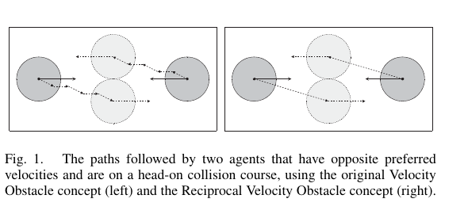
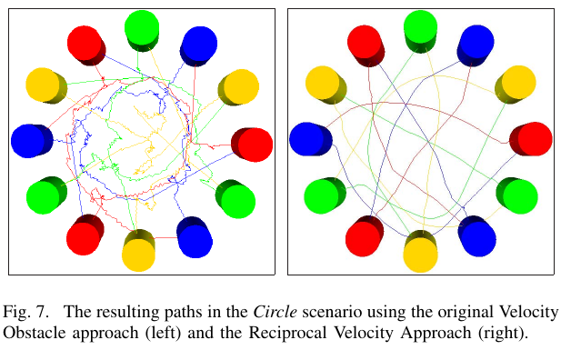

복도에서 두 사람이 정면으로 마주치면 둘 다 같은 방향으로 비켰다가, 다시 동시에 반대편으로 옮기는 순간이 있습니다. 로봇도 비슷해요. 상대가 지금 속도를 유지한다고 가정해 회피 속도를 골랐는데, 상대도 같은 계산으로 움직이면 다음 제어 주기의 입력이 뒤집힐 수 있습니다. 충돌하지 않는 후보는 매번 찾았지만 경로는 좌우로 흔들립니다.

Jur van den Berg, Ming Lin, Dinesh Manocha가 2008년 ICRA에서 발표한 「Reciprocal Velocity Obstacles for Real-Time Multi-Agent Navigation」는 이 문제를 상대도 회피한다는 가정으로 다룹니다. <abbr title="두 이동체가 서로의 회피를 예상하고 충돌 회피 책임을 나누도록 구성한 속도 공간의 금지 영역">상호 속도 장애물</abbr>, 곧 RVO는 고전 속도 장애물의 충돌 기하를 버리지 않습니다. 대신 지금 속도와 회피 가능한 속도 사이의 관계를 바꾸어 두 행위자가 같은 계산을 할 때 진동이 줄도록 만듭니다.

## 고전 속도 장애물에서 흔들림이 생기는 이유

[[2026-10-17_socialnav_velocity-obstacles|속도 장애물은 미래 충돌을 속도 공간에서 지운다]]은 상대 위치와 속도가 주어졌을 때 미래 충돌을 만드는 내 속도의 집합을 표시합니다. 로봇 A가 사람 B를 피한다면 B의 현재 속도를 중심으로 충돌 원뿔을 옮기고, A는 그 바깥에서 목표 속도에 가까운 후보를 고릅니다. B를 움직이는 장애물로 보는 동안에는 뜻이 명확해요.

문제는 B도 A를 보고 같은 순간에 속도를 바꿀 때입니다. A는 B가 기존 속도를 유지한다고 보고 왼쪽 후보를 고르고, B도 A가 기존 속도를 유지한다고 보고 자기 왼쪽 후보를 고를 수 있습니다. 다음 관측에서는 둘의 새 속도가 입력이 됩니다. 이제 각자 이전 선택을 과하게 보상하는 반대쪽 후보가 더 좋아 보일 수 있어요. 이 과정을 되풀이하면 매 순간의 속도는 충돌 회피 규칙을 따르면서도 전체 궤적은 지그재그가 됩니다.

<figure class="fig"><figcaption>원 논문의 첫 비교는 고전 속도 장애물이 정면 조우에서 진동할 수 있고 RVO가 한쪽 통과를 유지하는 차이를 보여 줍니다. 이는 시뮬레이션 도식이며 사람 평가 결과가 아닙니다. (출처: van den Berg, Lin & Manocha, Reciprocal Velocity Obstacles for Real-Time Multi-Agent Navigation, Fig. 1, https://gamma-web.iacs.umd.edu/RVO/index.html; 원 논문 그림 인용, 별도 CC 라이선스 미확인)</figcaption></figure>

흔들림은 센서 잡음만의 문제가 아닙니다. 위치와 속도를 완벽히 알아도 두 제어기가 상대의 반응을 수동 장애물처럼 취급하면 생길 수 있는 구조적 문제예요. 그래서 필터를 강하게 걸거나 회전 명령을 부드럽게 만드는 것만으로는 원인을 없애지 못합니다. 출력이 덜 흔들려 보여도 잘못된 상호작용 모델은 남아 있습니다.

## RVO는 회피 책임을 중간점으로 옮겨요

RVO의 핵심은 현재 상대 속도와 충돌을 피하는 상대 속도의 중간을 쓰는 데 있습니다. A와 B가 현재 각각 `vA`, `vB`로 움직인다고 해볼게요. 고전 속도 장애물은 B가 `vB`를 유지한다고 놓고 A가 혼자 원뿔 밖으로 나갈 만큼 변하라고 요구합니다. RVO는 둘이 같은 규칙으로 반응한다고 보고 필요한 상대 속도 변화의 절반가량을 A의 몫으로 둡니다.

기하적으로는 A의 현재 속도와, B의 속도를 기준으로 만든 속도 장애물 바깥의 한 속도 사이를 평균낸 위치에 금지 영역을 놓습니다. A가 그 영역 바깥을 고르고 B도 대칭적으로 계산하면 두 변화가 합쳐져 충돌 상대 속도가 원뿔 밖으로 이동합니다. 한쪽이 모든 회피를 떠안는 대신 둘이 변화를 나누는 셈이에요.

이때 상호성은 통신 프로토콜이 아닙니다. 두 행위자가 메시지로 좌우를 합의한다는 뜻이 아니라, 각자 상대도 비슷하게 회피할 것이라고 모델 안에서 가정합니다. 같은 위치와 속도 정보를 보고 비슷한 최적화 기준을 쓸수록 대칭이 잘 맞습니다. 한쪽이 멈춰 있거나 다른 규칙을 쓰면 책임 분배는 실제 움직임과 달라질 수 있어요.

논문은 여러 이웃의 RVO를 합쳐 피해야 할 속도 영역을 만들고, 목표로 향하는 선호 속도와 예상 충돌 시간에 따라 후보를 고릅니다. 최대 속도 같은 운동 제약도 후보 집합에 반영합니다. RVO 하나는 두 행위자의 관계이고, 군중에서는 이웃마다 만든 영역의 합집합을 다뤄야 해요. 이웃 수가 늘수록 안전한 속도가 좁아지고 목표 속도와의 타협이 커집니다.

## 설명용 계산으로 책임 분배를 읽어봐요

다음 수치는 논문 실험값이 아니라 원리를 풀기 위한 설명용 가정입니다. 로봇 A가 오른쪽으로 초당 1.0미터, 사람 B가 왼쪽으로 초당 1.0미터 움직이며 정면으로 접근한다고 해볼게요. 충돌 원뿔 밖으로 나가려면 두 속도의 옆방향 차이가 합쳐서 초당 0.6미터 필요하다고 가정합니다.

고전 속도 장애물에서 A가 B를 수동 장애물로 보면 A 혼자 옆방향 속도 0.6미터를 만들어야 합니다. 그런데 B도 똑같이 A를 수동 장애물로 보고 자기 기준의 같은 쪽으로 0.6미터를 바꾸면, 세계 좌표에서 둘의 선택이 기대와 다르게 겹치거나 다음 주기에 과한 보정이 생길 수 있어요.

대칭 RVO에서는 필요한 상대 변화 0.6미터를 절반씩 맡는다고 해석할 수 있습니다. A가 한쪽으로 0.3미터, B가 반대쪽으로 0.3미터의 옆방향 성분을 만들면 상대 옆속도 차이는 0.6미터가 됩니다. 각자의 변화량은 줄지만 두 변화가 합쳐져 같은 충돌 원뿔을 벗어납니다.

여기서 B가 전혀 피하지 않고 기존 속도를 유지하면 합계는 0.3미터뿐입니다. 모델이 기대한 0.6미터에 못 미쳐 충돌 여유가 사라질 수 있어요. 로봇이 사람에게 절반의 책임을 배정해도 된다는 안전 보장은 없습니다. 사람을 상대할 때는 상호성으로 매끄러운 후보를 만들더라도, 상대가 양보하지 않는 경우를 감당할 제동 거리와 독립 충돌 감시가 필요합니다.

책임 비율을 50 대 50이 아닌 80 대 20으로 바꾸는 설명용 변형도 생각할 수 있습니다. 로봇이 필요한 변화의 0.48미터를 맡고 사람에게 0.12미터만 기대하면 더 보수적입니다. 하지만 좁은 통로에서 로봇이 매번 대부분을 떠안으면 진행성이 떨어집니다. 비율은 친절함 숫자 하나가 아니라 상대 반응의 신뢰도, 로봇의 제동 능력, 통로 여유를 함께 반영해야 합니다.

## 원 논문의 검증은 다중 행위자 시뮬레이션이에요

논문은 원형 행위자들이 서로를 피하는 여러 시뮬레이션을 제시합니다. 정면 조우, 좁은 통로, 원 둘레에서 반대편으로 이동하는 집단, 움직이는 차량을 포함한 장면으로 진동과 계산 성능을 살펴봅니다. 열두 행위자가 원의 반대편 목표로 이동하는 장면과 더 큰 군중 예시가 있으며, 천 행위자 규모에서도 상호작용 속도를 보고합니다.

<figure class="fig"><figcaption>여러 행위자가 원의 반대편으로 동시에 이동하는 장면은 국소 상호 회피가 집단 궤적을 만드는 모습을 보여 줍니다. 실제 보행자 측정이나 사람-로봇 사용자 연구로 해석하면 안 됩니다. (출처: van den Berg, Lin & Manocha, Reciprocal Velocity Obstacles for Real-Time Multi-Agent Navigation, Fig. 7, https://gamma-web.iacs.umd.edu/RVO/index.html; 원 논문 그림 인용, 별도 CC 라이선스 미확인)</figcaption></figure>

저자들은 당시 1.66기가헤르츠 Intel Core 2 Duo와 1기가바이트 메모리 환경에서 계산 시간을 측정했습니다. 시뮬레이션의 한 시간 간격은 0.25초였고, 천 행위자에서도 초당 열 프레임을 넘는 결과를 제시합니다. 이 수치는 RVO 기하와 그 구현의 당시 조건을 설명합니다. 현대 ROS 2 시스템에서 카메라 추적, 좌표 변환, 비용 지도, 제어기까지 포함한 주기와 같지 않아요.

실물 로봇이 군중을 주행한 실험도, 사람이 로봇을 편안하다고 평가한 사용자 연구도 이 논문의 검증 범위에 없습니다. 입력에는 각 행위자의 위치, 속도, 정확한 모양과 선호 속도가 주어진다고 봅니다. 사람 검출 누락, 식별자 전환, 가림, 몸 방향 추정 실패를 포함한 인지 파이프라인은 실험 대상이 아니에요.

따라서 RVO가 수백 행위자에서 빠르게 동작했다는 사실과 저상 로봇이 카메라로 본 사람 사이를 안전하게 달릴 수 있다는 주장은 구분해야 합니다. 전자는 기하 알고리즘의 계산 가능성을 지지하고, 후자는 센서와 제어 지연, 사람 반응, 안전 계층을 포함한 별도 검증이 필요합니다.

## 사람이 같은 정책을 쓴다는 가정은 자주 깨져요

첫째, 사람은 로봇을 다른 보행자와 똑같이 피하지 않을 수 있습니다. 로봇이 멈출 것이라고 믿고 직진하거나, 로봇의 의도를 읽지 못해 늦게 반응할 수 있어요. 어린이, 보행 보조기 사용자, 시야가 가려진 사람에게 대칭 책임을 기대하는 것은 더 위험합니다.

둘째, 선호 속도를 알기 어렵습니다. RVO 시뮬레이션의 행위자는 목표가 있어 선호 속도를 계산할 수 있지만, 관측된 사람의 목표는 센서에 나타나지 않습니다. 현재 속도를 선호 속도로 대신하면 곧 멈추거나 회전할 사람을 놓칩니다. 사람의 목표를 로봇 목표처럼 확정값으로 취급하면 예측 오차가 회피 기하에 바로 들어갑니다.

셋째, 원형 몸체는 방향 의존성을 지웁니다. 유모차, 카트, 긴 짐은 회전할 때 점유 영역이 달라져요. 크게 감싼 원은 좁은 통로를 불필요하게 막고, 작게 잡은 원은 모서리 충돌을 놓칩니다. RVO의 매끄러운 궤적이 형상 오차를 보상하지는 않습니다.

넷째, 사회 규범은 충돌 기하 밖에 있습니다. 안전한 왼쪽 통과와 오른쪽 통과가 모두 가능해도 장소의 통행 방향, 줄, 대화 집단, 출입문 우선순위는 다릅니다. RVO는 서로 부딪히지 않는 속도를 만드는 토대이지 어느 행동이 예의 바른지 판정하는 모델이 아닙니다.

다섯째, 여러 사람의 반응은 독립적인 쌍의 합보다 복잡합니다. 가족 집단은 떨어지지 않으려 하고, 대화 중인 사람은 사이 공간을 보존하며, 한 사람이 비켜 만든 틈을 다른 사람이 메울 수 있어요. 이웃마다 같은 상호성 가정을 적용한 합집합은 이런 집단 의도를 표현하지 못합니다.

여섯째, 가려진 사람에게는 RVO 영역 자체가 없습니다. 문 모서리 뒤의 보행자는 검출되기 전까지 계산에 들어오지 않아요. 지도상의 가림 구역에서 미리 감속하고, 낮은 센서나 범퍼 계층으로 예상 밖의 접근을 감시해야 합니다. 관측된 행위자 사이의 계산이 빠르다는 사실은 미관측 위험을 줄이지 않습니다.

## 진동 감소와 편안함을 같은 지표로 보면 안 돼요

좌우 속도 전환 횟수가 줄면 궤적은 매끄러워 보입니다. 그러나 흔들리지 않는다고 사람이 편안한 것은 아닙니다. 로봇이 한쪽을 일찍 선택해 빠른 속도로 가까이 스치면 제어 신호는 안정적이어도 위협적으로 느껴질 수 있어요. 최소거리, 접근 속도, 양보 시점, 경로 예측 가능성을 따로 봐야 합니다.

반대로 안전을 위해 잠깐 멈춘 행동은 속도 변화량 지표에서 나쁘게 보일 수 있습니다. 출입문에서 우선순위를 알 수 없을 때 정지는 합리적일 수 있어요. 진동 횟수 하나로 알고리즘을 순위화하면 문맥에 맞는 양보와 불필요한 교착을 구분하지 못합니다.

설명용 평가 예를 들어볼게요. 같은 출발과 목표에서 A 설정은 최소거리 0.9미터, 좌우 전환 두 번, 통과 시간 8초이고 B 설정은 최소거리 0.6미터, 전환 0번, 통과 시간 6초라고 가정합니다. B가 더 매끄럽고 빠르지만 안전 여유와 사람의 체감은 더 나쁠 수 있어요. 어느 쪽이 좋은지는 장소의 속도 제한과 사람 평가 기준을 포함해야 정할 수 있습니다.

사람 참여 평가에서는 로봇 경로만 기록해도 부족합니다. 참가자가 먼저 비킨 거리, 걸음 속도를 바꾼 시점, 멈춤 여부를 함께 보면 로봇이 회피 책임을 사람에게 떠넘겼는지 알 수 있어요. 설문에서는 안전감과 편안함, 로봇 의도 예측 가능성을 나누는 편이 좋습니다. RVO의 수식이 약속하는 충돌 회피와 사람이 느끼는 사회적 품질은 다른 측정 대상입니다.

## 배포에서는 상호성과 안전 하한을 분리해야 해요

RVO가 낸 속도를 곧바로 최종 안전 명령으로 보지 않는 구성이 필요합니다. 상호 회피 플래너는 관측된 사람과의 매끄러운 속도 후보를 고릅니다. 그 아래 계층은 사람의 협조를 가정하지 않고 현재 거리, 상대 접근 속도, 제동 한계로 감속이나 정지를 강제합니다. 두 계층의 입력과 책임을 분리하면 상호성 가정이 깨져도 물리 안전 하한을 유지할 수 있어요.

추적 신뢰도가 낮을 때는 책임 비율을 로봇 쪽으로 옮기는 정책을 둘 수 있습니다. 사람 속도 분산이 커지거나 식별자가 바뀌면 목표 진행보다 정지 가능성을 크게 봅니다. 단, 신뢰도라는 숫자가 어떤 관측 실패에서 만들어졌는지 기록해야 해요. 검출 점수만 높고 속도 이력이 짧다면 상호 반응을 믿을 근거가 충분하지 않습니다.

상태가 오래됐을 때의 처리도 계약으로 정해야 합니다. 예를 들어 설명용 기준으로 마지막 사람 관측이 0.1초 이내면 정상 RVO, 0.1초에서 0.3초면 최대 허용 속도 축소, 그 이상이면 상호성 후보를 폐기한다고 정할 수 있어요. 이 숫자는 현장 측정 없이 일반화할 값이 아닙니다. 카메라 프레임률, 추적 지연, 최대 접근 속도, 제동 시험으로 정해야 합니다.

전역 경로와의 충돌도 살펴야 합니다. 지역 RVO가 오른쪽 통과를 골랐는데 전역 경로가 매 주기 복도 중앙으로 되돌리면 두 계층이 서로 흔듭니다. 짧은 시간 동안 통과 쪽을 유지하거나, 동적 장애물이 오래 머물면 전역 경로를 갱신하는 장치가 필요해요. RVO 내부 진동을 줄여도 상위 플래너가 반대 명령을 반복하면 전체 로봇은 여전히 흔들립니다.

## 작은 반례로 구현을 검증할 수 있어요

첫 사례는 완전 대칭 정면 조우입니다. 같은 반지름과 속도, 거울 대칭 목표를 둔 두 행위자가 한쪽을 정한 뒤 계속 유지하는지 봅니다. 아주 작은 수치 오차가 통과 쪽을 정할 수 있으므로, 재현성을 원한다면 동률 해소 규칙을 명시해야 해요. 목록 순서나 스레드 실행 순서에 따라 쪽이 바뀌면 디버깅이 어렵습니다.

둘째는 비협조 행위자입니다. 한 행위자는 RVO 명령을 따르고 다른 행위자는 직진을 유지합니다. 협조 가정 아래의 속도가 안전 하한을 침범하는지, 하위 충돌 감시가 제때 제동하는지 확인해요. 이 사례가 빠지면 대칭 시뮬레이션에서만 성공한 정책을 사람에게 과신하게 됩니다.

셋째는 서로 다른 최대 속도와 가속도입니다. 빠르게 옆으로 움직일 수 있는 가상 행위자와 회전한 뒤 전진해야 하는 차동구동 로봇을 같은 점 질량처럼 계산하면 선택 속도를 실행하지 못합니다. 후보 생성 뒤 기구 제약을 적용했을 때 안전 후보가 남는지 확인해야 해요.

넷째는 추적 속도 부호 오류입니다. 같은 방향과 같은 속도로 평행 이동하는 두 행위자의 상대 속도는 0이어야 합니다. 이 조건에서 정면 충돌 RVO가 생긴다면 좌표 변환이나 속도 부호가 틀린 것입니다. 지도 좌표와 로봇 좌표 사이의 회전도 함께 시험해야 합니다.

다섯째는 이웃 진입과 이탈 경계입니다. 사람이 이웃 반경을 넘나들 때 RVO 제약이 한 프레임 만에 생겼다 사라지면 명령이 튈 수 있어요. 반경 히스테리시스나 시간 기반 유지가 필요한지 측정합니다. 이 처리는 충돌 원뿔 수식이 아니라 시스템 통합의 문제입니다.

여섯째는 빈 후보 집합입니다. 군중이 둘러싸 모든 샘플 속도가 금지 영역에 들어가면 이전 명령을 재사용해서는 안 됩니다. 안전 정지, 저속 후퇴, 전역 재계획 가운데 정한 실패 경로로 넘어가야 해요. 빈 집합은 예외가 아니라 밀집 장면에서 예상할 상태입니다.

RVO의 중요한 기여는 움직이는 상대를 모두 고정 장애물로 보지 않고, 서로 반응하는 제어기 사이의 대칭을 속도 공간에 넣은 데 있습니다. 덕분에 고전 속도 장애물의 정면 조우 흔들림을 줄이고 많은 행위자를 빠르게 계산할 수 있었습니다. 사람 사이를 다니는 로봇에서는 이 기하를 유용한 충돌 회피 기준선으로 쓰되, 사람의 협조를 안전 전제로 삼지 않아야 합니다. 상호성은 매끄러운 후보를 만드는 모델이고, 센서 불확실성과 비협조 상황을 견디는 제동 계층과 사회 규범 평가는 별도로 남습니다.

---

<!-- src-block -->
출처 — https://gamma-web.iacs.umd.edu/RVO/index.html
